# exec-fn — Architecture

**How the system is built, and what it is trying to be.** Organisation,
diagrams, and the standing rules a change has to respect.

**The past lives in [`ARCHAEOLOGY.md`](ARCHAEOLOGY.md)** — bugs already fixed,
choices made and reversed, measurements taken once. Sections mirror this file's
numbering, so §11 is `/graph` in both. Every section here that has a recorded
history ends with a link to it.

Where a paragraph here names the incident that produced a rule, that is because
the rule is the point; the incident is written up in full over there.

## The whole system on one page

Source `docs/arch/00-overview.mmd`. Each box has its own section and
diagram below; this one only shows what talks to what.

## The diagrams

Each section embeds its own diagrams as ``.
The source is `docs/arch/<NN>-<topic>.mmd` (Mermaid); the pre-commit hook renders
a staged `.mmd` to the `.svg` beside it. Edit the `.mmd`, never the `.svg`.
Diagrams are drawn from source (`api/*.py`, `docker-compose.yml`, `Dockerfile`,
cron). In this part of the file:

1. [Deployment](#1-deployment) — how a request reaches code (`01-deployment`),
   and what `scripts/deploy.sh` decides (`01-deploy-flow`)
2. [Module graph](#2-module-graph) — what imports what (`02-module-graph`)
3. [Morning pipeline + scheduling](#3-morning-pipeline--scheduling) — the 4:30
   sequence (`03-morning`) and `schedule_to_day` (`03-scheduler`)

Later sections (TTS, LLM call sites, printer, `/cc`, …) carry their own. noodle's diagram lives in `apps/noodle/ARCHITECTURE.md`.

---

## Sections

Each `## N.` section lives in its own file under `docs/architecture/`, text
moved verbatim (2026-11-10, the 500-line cap). This file is the index:
every `§N` reference still resolves here, then one click to the file.

| § | Topic | File |
|---|---|---|
| 1 | Deployment | [`docs/architecture/01-deployment.md`](docs/architecture/01-deployment.md) |
| 2 | Module graph | [`docs/architecture/02-module-graph.md`](docs/architecture/02-module-graph.md) |
| 3 | Morning pipeline + scheduling | [`docs/architecture/03-morning-pipeline.md`](docs/architecture/03-morning-pipeline.md) |
| 4 | TTS (text-to-speech) | [`docs/architecture/04-tts.md`](docs/architecture/04-tts.md) |
| 5 | LLM call sites + prompt caching | [`docs/architecture/05-llm-calls.md`](docs/architecture/05-llm-calls.md) |
| 6 | Printer (ELEGOO Centauri Carbon) — two-tier reverse proxy | [`docs/architecture/06-printer.md`](docs/architecture/06-printer.md) |
| 7 | `/cc` — the Exec panel's agent (Claude Code, host-side sidecar) | [`docs/architecture/07-cc-exec-agent.md`](docs/architecture/07-cc-exec-agent.md) |
| 8 | `/rd` — the board and its month calendar | [`docs/architecture/08-rd-board.md`](docs/architecture/08-rd-board.md) |
| 9 | The landing page — a ferris wheel, not a list | [`docs/architecture/09-landing-page.md`](docs/architecture/09-landing-page.md) |
| 10 | The CRT effect stack (`_CRT_FX`) | [`docs/architecture/10-crt-effects.md`](docs/architecture/10-crt-effects.md) |
| 11 | `/graph` — serve-time transforms over a generated artifact | [`docs/architecture/11-graph.md`](docs/architecture/11-graph.md) |
| 12 | The bottom nav | [`docs/architecture/12-bottom-nav.md`](docs/architecture/12-bottom-nav.md) |
| 13 | The pre-commit hook suite | [`docs/architecture/13-pre-commit-hooks.md`](docs/architecture/13-pre-commit-hooks.md) |
| 14 | `/tarot` — the reading surface | [`docs/architecture/14-tarot.md`](docs/architecture/14-tarot.md) |
| 15 | The nudge loop (`nudge.py` + `nudge_deadlines.py` + `nudge_loop.py`) | [`docs/architecture/15-nudge-loop.md`](docs/architecture/15-nudge-loop.md) |
| 16 | The Exec monitor (`monitor.py`) | [`docs/architecture/16-exec-monitor.md`](docs/architecture/16-exec-monitor.md) |
| 17 | Memory is the scarce resource on this box | [`docs/architecture/17-memory.md`](docs/architecture/17-memory.md) |
| 18 | The typewriter and the shared chat surfaces | [`docs/architecture/18-typewriter-chat.md`](docs/architecture/18-typewriter-chat.md) |
| 19 | `/zombo` — a secret page with one third-party dependency | [`docs/architecture/19-zombo.md`](docs/architecture/19-zombo.md) |
| 20 | Pages and subsystems without a section of their own | [`docs/architecture/20-other-pages.md`](docs/architecture/20-other-pages.md) |
| 21 | noodle — moved to its own repo | [`docs/architecture/21-noodle.md`](docs/architecture/21-noodle.md) |
| 22 | /spire — moved to its own repo | [`docs/architecture/22-spire.md`](docs/architecture/22-spire.md) |

## 1. Deployment

→ [`docs/architecture/01-deployment.md`](docs/architecture/01-deployment.md)

- [1d. nginx — the `--reload` 502, and the body-size 413](docs/architecture/01-deployment.md#1d-nginx--the---reload-502-and-the-body-size-413)
- [1e. App submodules — `apps/<name>`](docs/architecture/01-deployment.md#1e-app-submodules--appsname)
- [Deploy — `scripts/deploy.sh`](docs/architecture/01-deployment.md#deploy--scriptsdeploysh)

## 2. Module graph

→ [`docs/architecture/02-module-graph.md`](docs/architecture/02-module-graph.md)

## 3. Morning pipeline + scheduling

→ [`docs/architecture/03-morning-pipeline.md`](docs/architecture/03-morning-pipeline.md)

- [3a. Morning cron sequence](docs/architecture/03-morning-pipeline.md#3a-morning-cron-sequence)
- [rd.json concurrency — `helpers._RD_LOCK`](docs/architecture/03-morning-pipeline.md#rdjson-concurrency--helpers_rd_lock)
- [3b. scheduler.py — the time model](docs/architecture/03-morning-pipeline.md#3b-schedulerpy--the-time-model)

## 4. TTS (text-to-speech)

→ [`docs/architecture/04-tts.md`](docs/architecture/04-tts.md)

- [4a. Topology](docs/architecture/04-tts.md#4a-topology)
- [4b. Auth — guest-or-full](docs/architecture/04-tts.md#4b-auth--guest-or-full)
- [4b-ii. GPU-mode owner control](docs/architecture/04-tts.md#4b-ii-gpu-mode-owner-control)
- [4c. Three consumers of one audio core — and one narrator above it](docs/architecture/04-tts.md#4c-three-consumers-of-one-audio-core--and-one-narrator-above-it)
- [4d. One utterance](docs/architecture/04-tts.md#4d-one-utterance)
- [4e. Presence](docs/architecture/04-tts.md#4e-presence)

## 5. LLM call sites + prompt caching

→ [`docs/architecture/05-llm-calls.md`](docs/architecture/05-llm-calls.md)

- [The one invariant](docs/architecture/05-llm-calls.md#the-one-invariant)
- [Cached sites](docs/architecture/05-llm-calls.md#cached-sites)
- [Exec turn: ACT then REPLY (`api/chat_passes.py`)](docs/architecture/05-llm-calls.md#exec-turn-act-then-reply-apichat_passespy)
- [Uncached (left alone)](docs/architecture/05-llm-calls.md#uncached-left-alone)
- [Where the marker goes](docs/architecture/05-llm-calls.md#where-the-marker-goes)

## 6. Printer (ELEGOO Centauri Carbon) — two-tier reverse proxy

→ [`docs/architecture/06-printer.md`](docs/architecture/06-printer.md)

- [6a. Topology](docs/architecture/06-printer.md#6a-topology)
- [6b. Why rewrites, and which](docs/architecture/06-printer.md#6b-why-rewrites-and-which)
- [6c. Runtime shape](docs/architecture/06-printer.md#6c-runtime-shape)
- [6e. The wrapper page](docs/architecture/06-printer.md#6e-the-wrapper-page)
- [6g. The camera hub](docs/architecture/06-printer.md#6g-the-camera-hub)

## 7. `/cc` — the Exec panel's agent (Claude Code, host-side sidecar)

→ [`docs/architecture/07-cc-exec-agent.md`](docs/architecture/07-cc-exec-agent.md)

- [7a. Topology (exec-fn side)](docs/architecture/07-cc-exec-agent.md#7a-topology-exec-fn-side)
- [7b. The tier](docs/architecture/07-cc-exec-agent.md#7b-the-tier)
- [7c. Tool lines in the panel (the sidecar's tool set: claude-box S-6)](docs/architecture/07-cc-exec-agent.md#7c-tool-lines-in-the-panel-the-sidecars-tool-set-claude-box-s-6)
- [7c-bis. Exec's card tools — the container side of the relay](docs/architecture/07-cc-exec-agent.md#7c-bis-execs-card-tools--the-container-side-of-the-relay)
- [7e. Persona and the board (container side)](docs/architecture/07-cc-exec-agent.md#7e-persona-and-the-board-container-side)
- [7f. The Exec panel on the sidecar](docs/architecture/07-cc-exec-agent.md#7f-the-exec-panel-on-the-sidecar)
- [7g. /cc folded into the Exec panel (2026-09-29)](docs/architecture/07-cc-exec-agent.md#7g-cc-folded-into-the-exec-panel-2026-09-29)
- [7g-bis. Commands (`web/exec-commands.js`, `web/exec-sessions.js`)](docs/architecture/07-cc-exec-agent.md#7g-bis-commands-webexec-commandsjs-webexec-sessionsjs)
- [7h. The status bar (`web/exec-status.js`, `web/exec-term.css`)](docs/architecture/07-cc-exec-agent.md#7h-the-status-bar-webexec-statusjs-webexec-termcss)
- [7i. The rolling title (`api/cc_title.py`, `GET /api/cc/title`)](docs/architecture/07-cc-exec-agent.md#7i-the-rolling-title-apicc_titlepy-get-apicctitle)
- [7j. Transport and interrupt (`web/exec-interrupt.js`)](docs/architecture/07-cc-exec-agent.md#7j-transport-and-interrupt-webexec-interruptjs)
- [7k. A run outlives its caller — the page side](docs/architecture/07-cc-exec-agent.md#7k-a-run-outlives-its-caller--the-page-side)
- [7k-bis. Hands-free input (`web/voice-input.js`)](docs/architecture/07-cc-exec-agent.md#7k-bis-hands-free-input-webvoice-inputjs)
- [7l. Pictures — SVG out, screenshots in, zoom for both](docs/architecture/07-cc-exec-agent.md#7l-pictures--svg-out-screenshots-in-zoom-for-both)

## 8. `/rd` — the board and its month calendar

→ [`docs/architecture/08-rd-board.md`](docs/architecture/08-rd-board.md)

- [8a. The grid](docs/architecture/08-rd-board.md#8a-the-grid)
- [8b. Dots — one per card, sized by importance](docs/architecture/08-rd-board.md#8b-dots--one-per-card-sized-by-importance)
- [8c. Three date markers, one weight](docs/architecture/08-rd-board.md#8c-three-date-markers-one-weight)
- [8d. Holidays are computed, not tabulated](docs/architecture/08-rd-board.md#8d-holidays-are-computed-not-tabulated)
- [8e. Drag a card onto a day to schedule it](docs/architecture/08-rd-board.md#8e-drag-a-card-onto-a-day-to-schedule-it)
- [8f. Paging months, and the watermark](docs/architecture/08-rd-board.md#8f-paging-months-and-the-watermark)
- [8g. Bar heights are observed, not measured once](docs/architecture/08-rd-board.md#8g-bar-heights-are-observed-not-measured-once)
- [8h. The `+N` overflow needs a host, and the bar can be empty](docs/architecture/08-rd-board.md#8h-the-n-overflow-needs-a-host-and-the-bar-can-be-empty)

## 9. The landing page — a ferris wheel, not a list

→ [`docs/architecture/09-landing-page.md`](docs/architecture/09-landing-page.md)

- [9a. One angle drives everything](docs/architecture/09-landing-page.md#9a-one-angle-drives-everything)
- [9b. `DTH = (π/2)/K` is the load-bearing choice](docs/architecture/09-landing-page.md#9b-dth--π2k-is-the-load-bearing-choice)
- [9c. Spacing](docs/architecture/09-landing-page.md#9c-spacing)
- [9d. The wheel genuinely turns](docs/architecture/09-landing-page.md#9d-the-wheel-genuinely-turns)
- [9e. Gesture details](docs/architecture/09-landing-page.md#9e-gesture-details)

## 10. The CRT effect stack (`_CRT_FX`)

→ [`docs/architecture/10-crt-effects.md`](docs/architecture/10-crt-effects.md)

- [10a. The invariant](docs/architecture/10-crt-effects.md#10a-the-invariant)
- [10b. Zoom-lock](docs/architecture/10-crt-effects.md#10b-zoom-lock)
- [10b-bis. CRT lite (measured, per machine)](docs/architecture/10-crt-effects.md#10b-bis-crt-lite-measured-per-machine)
- [10c. Dimming on the dense pages](docs/architecture/10-crt-effects.md#10c-dimming-on-the-dense-pages)

## 11. `/graph` — serve-time transforms over a generated artifact

→ [`docs/architecture/11-graph.md`](docs/architecture/11-graph.md)

- [11a. Applied per request, COMPUTED once per artifact](docs/architecture/11-graph.md#11a-applied-per-request-computed-once-per-artifact)
- [11b. Drops, in order](docs/architecture/11-graph.md#11b-drops-in-order)
- [11c. Communities are re-derived by FEATURE, then CAPPED](docs/architecture/11-graph.md#11c-communities-are-re-derived-by-feature-then-capped)
- [11d. Size, labels, shape, physics, stats](docs/architecture/11-graph.md#11d-size-labels-shape-physics-stats)
- [11e. The layout is baked, not stabilised in the browser](docs/architecture/11-graph.md#11e-the-layout-is-baked-not-stabilised-in-the-browser)
- [11f. The client-side overlay](docs/architecture/11-graph.md#11f-the-client-side-overlay)
- [11g. Field notes](docs/architecture/11-graph.md#11g-field-notes)

## 12. The bottom nav

→ [`docs/architecture/12-bottom-nav.md`](docs/architecture/12-bottom-nav.md)

- [12f. The nav icons are traced, not drawn — and stay pixel art](docs/architecture/12-bottom-nav.md#12f-the-nav-icons-are-traced-not-drawn--and-stay-pixel-art)
- [12a. The glyph label (machinery kept)](docs/architecture/12-bottom-nav.md#12a-the-glyph-label-machinery-kept)
- [12b. Standalone launch (home-screen / installed web app)](docs/architecture/12-bottom-nav.md#12b-standalone-launch-home-screen--installed-web-app)
- [12c. The Exec bubble is not a nav entry](docs/architecture/12-bottom-nav.md#12c-the-exec-bubble-is-not-a-nav-entry)
- [12d. Exec's voice, and the panel](docs/architecture/12-bottom-nav.md#12d-execs-voice-and-the-panel)
- [12e. Page scroll](docs/architecture/12-bottom-nav.md#12e-page-scroll)
- [Click-outside-to-close is decided in the CAPTURE phase](docs/architecture/12-bottom-nav.md#click-outside-to-close-is-decided-in-the-capture-phase)

## 13. The pre-commit hook suite

→ [`docs/architecture/13-pre-commit-hooks.md`](docs/architecture/13-pre-commit-hooks.md)

- [13h. One hook for every repo (sub repos carry only a shim)](docs/architecture/13-pre-commit-hooks.md#13h-one-hook-for-every-repo-sub-repos-carry-only-a-shim)
- [13a. The palette lint (`scripts/lint-colors.py`)](docs/architecture/13-pre-commit-hooks.md#13a-the-palette-lint-scriptslint-colorspy)
- [13b. The scale lint (`scripts/lint-scale.py`)](docs/architecture/13-pre-commit-hooks.md#13b-the-scale-lint-scriptslint-scalepy)
- [13c. Cache-busting is done at serve time (`api/asset_version.py`)](docs/architecture/13-pre-commit-hooks.md#13c-cache-busting-is-done-at-serve-time-apiasset_versionpy)
- [13d. The admin-tier guard (`tests/test_admin_only.py`)](docs/architecture/13-pre-commit-hooks.md#13d-the-admin-tier-guard-teststest_admin_onlypy)
- [13e. The fixture-resolution check](docs/architecture/13-pre-commit-hooks.md#13e-the-fixture-resolution-check)
- [13f. The Claude Code guard set (`.claude/hooks/`, registered in `.claude/settings.json`)](docs/architecture/13-pre-commit-hooks.md#13f-the-claude-code-guard-set-claudehooks-registered-in-claudesettingsjson)
- [13g. Size rules (what the cap enforces, how to split)](docs/architecture/13-pre-commit-hooks.md#13g-size-rules-what-the-cap-enforces-how-to-split)

## 14. `/tarot` — the reading surface

→ [`docs/architecture/14-tarot.md`](docs/architecture/14-tarot.md)

- [14a. The status bar carries what the chat no longer says](docs/architecture/14-tarot.md#14a-the-status-bar-carries-what-the-chat-no-longer-says)
- [14a-ii. The cards: the outline hugs the picture, and a turned card turns at once](docs/architecture/14-tarot.md#14a-ii-the-cards-the-outline-hugs-the-picture-and-a-turned-card-turns-at-once)
- [14b. Narration paces the typewriter](docs/architecture/14-tarot.md#14b-narration-paces-the-typewriter)
- [14b-ii. The mic, and the reader it must not hear](docs/architecture/14-tarot.md#14b-ii-the-mic-and-the-reader-it-must-not-hear)
- [14c. Ambient music, and why the level is measured](docs/architecture/14-tarot.md#14c-ambient-music-and-why-the-level-is-measured)
- [14d. The opening turn is pre-generated](docs/architecture/14-tarot.md#14d-the-opening-turn-is-pre-generated)
- [14e. The nightly voice check](docs/architecture/14-tarot.md#14e-the-nightly-voice-check)

## 15. The nudge loop (`nudge.py` + `nudge_deadlines.py` + `nudge_loop.py`)

→ [`docs/architecture/15-nudge-loop.md`](docs/architecture/15-nudge-loop.md)

- [15a. Trigger and eligibility](docs/architecture/15-nudge-loop.md#15a-trigger-and-eligibility)
- [15b. Everything in hq has a plan](docs/architecture/15-nudge-loop.md#15b-everything-in-hq-has-a-plan)
- [15c. The breakdown UI](docs/architecture/15-nudge-loop.md#15c-the-breakdown-ui)
- [15d. One nudge per step — no stall re-peel](docs/architecture/15-nudge-loop.md#15d-one-nudge-per-step--no-stall-re-peel)
- [15e. A nudge ASKS whether the step is done; it never asserts that it isn't](docs/architecture/15-nudge-loop.md#15e-a-nudge-asks-whether-the-step-is-done-it-never-asserts-that-it-isnt)
- [15e-bis. Answering a nudge by tapping](docs/architecture/15-nudge-loop.md#15e-bis-answering-a-nudge-by-tapping)
- [15f. Due-date protection](docs/architecture/15-nudge-loop.md#15f-due-date-protection)
- [15g. Lateness recalibration — built, GATED OFF](docs/architecture/15-nudge-loop.md#15g-lateness-recalibration--built-gated-off)

## 16. The Exec monitor (`monitor.py`)

→ [`docs/architecture/16-exec-monitor.md`](docs/architecture/16-exec-monitor.md)

- [16a. What counts as significant](docs/architecture/16-exec-monitor.md#16a-what-counts-as-significant)
- [16b. Timing](docs/architecture/16-exec-monitor.md#16b-timing)
- [16c. chat.json is ONE chronological stream](docs/architecture/16-exec-monitor.md#16c-chatjson-is-one-chronological-stream)
- [16d. The orphaned-`tool_use` 400](docs/architecture/16-exec-monitor.md#16d-the-orphaned-tool_use-400)

## 17. Memory is the scarce resource on this box

→ [`docs/architecture/17-memory.md`](docs/architecture/17-memory.md)

- [17a. What the pressure actually is](docs/architecture/17-memory.md#17a-what-the-pressure-actually-is)
- [17b. The OOM killer picks by badness score, not culprit](docs/architecture/17-memory.md#17b-the-oom-killer-picks-by-badness-score-not-culprit)
- [17c. Every cron job writes where both sides can see it](docs/architecture/17-memory.md#17c-every-cron-job-writes-where-both-sides-can-see-it)
- [17d. The nightly graphify rebuilds its own output](docs/architecture/17-memory.md#17d-the-nightly-graphify-rebuilds-its-own-output)
- [17e. The `--reload` poller](docs/architecture/17-memory.md#17e-the---reload-poller)

## 18. The typewriter and the shared chat surfaces

→ [`docs/architecture/18-typewriter-chat.md`](docs/architecture/18-typewriter-chat.md)

- [18a. Every chat surface reveals character by character](docs/architecture/18-typewriter-chat.md#18a-every-chat-surface-reveals-character-by-character)
- [18a-ii. With the voice on, the narrator sets the pace](docs/architecture/18-typewriter-chat.md#18a-ii-with-the-voice-on-the-narrator-sets-the-pace)
- [18b. Everything that is SYNTAX rather than prose is jumped](docs/architecture/18-typewriter-chat.md#18b-everything-that-is-syntax-rather-than-prose-is-jumped)
- [18c. The waiting indicator is a solid blinking block](docs/architecture/18-typewriter-chat.md#18c-the-waiting-indicator-is-a-solid-blinking-block)
- [18d. Reveal state contract](docs/architecture/18-typewriter-chat.md#18d-reveal-state-contract)
- [18e. Three surfaces, one transcript look (four stacked files)](docs/architecture/18-typewriter-chat.md#18e-three-surfaces-one-transcript-look-four-stacked-files)
- [18f. If Exec names a link, the link is tappable](docs/architecture/18-typewriter-chat.md#18f-if-exec-names-a-link-the-link-is-tappable)

## 19. `/zombo` — a secret page with one third-party dependency

→ [`docs/architecture/19-zombo.md`](docs/architecture/19-zombo.md)

- [Load-path traps](docs/architecture/19-zombo.md#load-path-traps)
- [The outbound link is rewritten in the bytes](docs/architecture/19-zombo.md#the-outbound-link-is-rewritten-in-the-bytes)
- [The page itself](docs/architecture/19-zombo.md#the-page-itself)

## 20. Pages and subsystems without a section of their own

→ [`docs/architecture/20-other-pages.md`](docs/architecture/20-other-pages.md)

- [20a. Auth tiers (cookies, guest set)](docs/architecture/20-other-pages.md#20a-auth-tiers-cookies-guest-set)
- [20b. `/hq`](docs/architecture/20-other-pages.md#20b-hq)
- [20c. `/debug`](docs/architecture/20-other-pages.md#20c-debug)
- [20d. `/security`](docs/architecture/20-other-pages.md#20d-security)
- [20e. `/UI` and `/api/ui/usage`](docs/architecture/20-other-pages.md#20e-ui-and-apiuiusage)
- [20f. `/nightfall` save slots](docs/architecture/20-other-pages.md#20f-nightfall-save-slots)
- [20g. `/recruiter`](docs/architecture/20-other-pages.md#20g-recruiter)
- [20h. `PATCH /api/rd`](docs/architecture/20-other-pages.md#20h-patch-apird)
- [20i. The card dialog](docs/architecture/20-other-pages.md#20i-the-card-dialog)

## 21. noodle — moved to its own repo

→ [`docs/architecture/21-noodle.md`](docs/architecture/21-noodle.md)

## 22. /spire — moved to its own repo

→ [`docs/architecture/22-spire.md`](docs/architecture/22-spire.md)
