# exec-fn — Architecture

**How the system is built, and what it is trying to be.** Organisation,
diagrams, and the standing rules a change has to respect.

**The past lives in [`ARCHAEOLOGY.md`](ARCHAEOLOGY.md)** — bugs already fixed,
choices made and reversed, measurements taken once. Sections mirror this file's
numbering, so §11 is `/graph` in both. Every section here that has a recorded
history ends with a link to it.

Where a paragraph here names the incident that produced a rule, that is because
the rule is the point; the incident is written up in full over there.

## The diagrams

Each section embeds its own diagrams as ``.
The source is `docs/arch/<NN>-<topic>.mmd` (Mermaid); the pre-commit hook renders
a staged `.mmd` to the `.svg` beside it. Edit the `.mmd`, never the `.svg`.
Diagrams are drawn from source (`api/*.py`, `docker-compose.yml`, `Dockerfile`,
cron). In this part of the file:

1. [Deployment](#1-deployment) — how a request reaches code (`01-deployment`),
   and what `scripts/deploy.sh` decides (`01-deploy-flow`)
2. [Module graph](#2-module-graph) — what imports what (`02-module-graph`)
3. [Morning pipeline + scheduling](#3-morning-pipeline--scheduling) — the 4:30
   sequence (`03-morning`) and `schedule_to_day` (`03-scheduler`)

Later sections (TTS, LLM call sites, printer, `/cc`, …) carry their own. noodle's diagram lives in `apps/noodle/ARCHITECTURE.md`.

---

## 1. Deployment

nginx (bare metal) terminates SSL and proxies to the `api` container (cron +
uvicorn). `hosaka-piper` (the always-on GLaDOS voice) is a second compose
service on the same network; no port is published. Persistent state is JSON files
on bind mounts.


**Port chain:** `nginx :443 (SSL) -> 127.0.0.1:8080 (compose publish) -> container:8080 (uvicorn)`.

**Image:** `python:3.12-slim`, single stage (`api/Dockerfile`). No `EXPOSE`; the port
is published in compose only. `apt`: `curl` (morning_cron's POST), `git`
(`tarot/scripts/download_cards.py`), `fonts-dejavu-core`, `cron`.

**Python deps are locked, in two files.** `api/requirements.in` holds the ~19
DIRECT dependencies and the explanatory comments; `api/requirements.txt` is a
**generated** full lock (72 packages, pinned `==`). The Dockerfile installs the
lock, never the `.in`. Regenerate with `bash scripts/lock-requirements.sh`
(fresh-resolves in a throwaway `python:3.12-slim`, refuses an empty result,
prints the rebuild command) — **a resolve verifies nothing: rebuild and hit a
route.** Rule: anything `api/` imports by name gets its own `.in` line, whoever
else pulls it in. `httpx` and `httpx2` are both in the lock on purpose.

**`rmapi-auth` is deliberately still mounted** (holds a real reMarkable device
token; a declared-but-unmounted compose volume counts as unused and
`docker volume prune` would eat it). The rmapi binary itself is gone.

**Secrets** (`.env`, among others): `API_KEY`, `ANTHROPIC_API_KEY`,
`TURNSTILE_SITE_KEY`, `TURNSTILE_SECRET` (the guest gate is a Turnstile
challenge; `GUEST_KEY` is retired). Cron cannot see the container env: `entrypoint.sh` writes only
`API_KEY` and `ANTHROPIC_API_KEY` to `/run/cron_env`.

**Cron:** `api/exec-fn.cron` is baked to `/etc/cron.d/exec-fn` — one job,
`30 4 * * *` `/app/morning_cron.sh` (`curl POST localhost:8080/api/morning`).
The other jobs are HOST crons or in-process loops (CLAUDE.md, Cron).

**uvicorn flags** (`entrypoint.sh`): `--reload`, `--timeout-graceful-shutdown 5`
(caps the SSE drain so a reload cannot hang the site), and `--reload-exclude`
file globs `apps/*/tests/*.py`, `apps/*/scripts/*.py`, `apps/*/scripts/*/*.py`
(§1e).

History: [ARCHAEOLOGY.md §1](ARCHAEOLOGY.md#1-deployment).

---

### 1d. nginx — the `--reload` 502, and the body-size 413

nginx: HTTP 80 → HTTPS redirect; HTTPS 443 → the `execfn_app` upstream
(`127.0.0.1:8080`). Live config `/etc/nginx/sites-enabled/default`; **backups go
in `/etc/nginx/backups/`, never `sites-enabled/`** (its include is an unfiltered
`*` and would load a `.bak` as a duplicate server). `bootstrap.sh` carries the
same block. The `/ws/` location is untouched.

- **Double upstream.** A `--reload` worker swap closes in-flight connections with
  no response, which nginx reports as 502. The upstream lists the server
  **TWICE** (one try per peer, so a single-server upstream can never retry),
  `max_fails=0`, and `location /` sets `proxy_next_upstream error timeout http_502`,
  `_tries 3`, `_timeout 20s`, `proxy_connect_timeout 3s`.
- **A 502/504 serves `web/errors/loading.html`** from nginx itself
  (`error_page` + an `internal` alias into `/exec-fn`); the page reloads once the
  app answers.
- **`non_idempotent` is NOT set** — a retried POST/PATCH would apply twice.
- **`http_503` is NOT retried** — the app returns a real 503 when the home box
  or printer is down; retrying only delays an honest answer.
- **`client_max_body_size 25m`** on the 443 block (default 1m 413'd pasted
  screenshots with nginx's own HTML). The app's caps are the real ones and answer
  in JSON: `routes_cc.py` allows 4 images x 5MB base64, 6MB per file, 20MB of
  attachments, inside the sidecar's 24MB body. Printer uploads share the limit.
- **Access log masks noodle links.** Both server blocks log with
  `access_log ... masked;` — a format defined in
  `/etc/nginx/conf.d/noodle-log-mask.conf` (`/noodle/<22>` and `/api/noodle/<22>`
  -> `<slug>`, any `t=` value -> `<token>`; otherwise `combined`, so
  `scripts/security/refresh.py` parses it unchanged). uvicorn's access log gets
  the same filter (`api/log_masking.py` on `uvicorn.access`), the docker log is
  capped at 3 x 10MB (`docker-compose.yml` `logging:`), `/security` collapses
  noodle paths to `<slug>`, and `bootstrap.sh` writes the same conf.d file.

History: [ARCHAEOLOGY.md §1](ARCHAEOLOGY.md#1-deployment).

---

### 1e. App submodules — `apps/<name>`

Self-contained apps are their own repos, consumed as submodules (`.gitmodules`):

| Submodule | Path | Repo |
|-----------|------|------|
| spire | `apps/spire` | `wai-lau/spire` |
| noodle | `apps/noodle` | `wai-lau/noodle` |
| nightfall | `nightfall-incident` (`ignore = dirty`) | `wai-lau/nightfall` |
| claude-box | `claude-box` | `wai-lau/cc-sidecar` |

nightfall and claude-box sit at their old paths, not under `apps/`, and are not
laid out like the parent.

**An app mirrors the parent layout** (`apps/README.md`): `api/`, `api/templates`,
`web`, `tests`, `scripts`. That one rule is why nothing else had to change —
path-filtered history, the pre-commit's `^web/` / `^api/templates/` patterns, and
every asset URL stay identical.

**How the parent finds an app's pieces** (each searches the PARENT FIRST, then
`apps/*/` in name order):
- **python** — `api/app_paths.py`, imported first by `main.py` and `routers.py`,
  APPENDS each `apps/*/api` to `sys.path`. Apps dir: `/app/apps` in the container
  (`./apps` bind), `<repo>/apps` on the host; the first NON-EMPTY wins (the
  compose bind leaves an empty `api/apps` mount point on the host — untracked,
  leave it). An uninitialised submodule is skipped.
- **static** — the one `"/"` `StaticFiles` mount in `main.py` gets the apps' `web/`
  appended to `all_directories`; asset URLs stay flat.
- **templates** — `pages._tmpl` resolves through `_tmpl_path`; `/api/ui/usage`
  scans the same dirs.

`all_directories` and the `sys.path` append are computed at IMPORT, so adding an
app needs a `--reload` swap (any `api/*.py` change in the same commit does it;
the double upstream covers it). Do that swap ON the droplet tree.

**Uniqueness is pinned.** A name clash would be decided silently by search
order, so `tests/test_app_paths.py` pins unique file names across `web/` and
`api/templates/`, unique top-level module names across `api/`, and **no
`node_modules` under `apps/`** (the reload poller walks `/app/apps` too, §17e).
**Any test that finds code by walking `api/` must also walk `apps/*/api`**
(`tests/test_admin_only.py` does).

**App tests and scripts must not reload the live worker** — `entrypoint.sh`'s
`--reload-exclude` globs (§1). They must be FILE globs (uvicorn matches a
non-directory exclude per changed file with `Path.match`, right-anchored, no
`**`); test a pattern against `uvicorn.supervisors.watchfilesreload.FileFilter`
in the container before rebuilding. `entrypoint.sh` is an image input.

**exec-fn owns every lint, hook and check.** A sub repo (spire, noodle,
cc-sidecar) holds its code, its tests and ONE tracked tooling file: the shim
`scripts/pre-commit`, a verbatim copy of `scripts/subrepo-pre-commit` (pinned by
`tests/test_subrepo_shims.py`), run via `core.hooksPath=scripts`. The shim:
- **as a submodule here** -> `exec`s this repo's `scripts/pre-commit`;
- **cloned alone** -> sparse-pulls ONLY `scripts/tooling-paths.txt` into the
  gitignored `.exec-fn/` (at most hourly, `--depth 1 --filter=blob:none`,
  `--ff-only`), clearing `GIT_DIR`/`GIT_INDEX_FILE` for its git calls. A
  tooling-only copy runs the lints; tests and eslint (needs this repo's
  `node_modules`) are skipped with a note.

`scripts/pre-commit` finds its tree from its own path, names the committing repo
from its origin URL (`REPO_NAME`), and passes the sub repo's files to the lints
via `LINT_APP_ROOT`. **Repo-specific gates are keyed by `REPO_NAME`**: spire ->
`scripts/spire-smoke/smoke.mjs` when a game file is staged; cc-sidecar ->
`node --check` on staged `.mjs` plus every `*.test.mjs` (also run in pytest via
`tests/test_cc_node_suites.py`, which FAILS, not skips, if the sandbox-gate or
sign-in suite goes missing). **nightfall is the exception**: its own TypeScript
`scripts/pre-commit`, no shim. `pytest.ini`: `testpaths = tests apps/*/tests`.

**Tooling follows the commit into the submodule:**
- `session-context.sh` sets `core.hooksPath=scripts` on every sub repo whose
  `scripts/pre-commit` is the canonical shim, and re-attaches a detached-HEAD
  submodule (only when HEAD == origin/master and local master is absent or equal).
- `lint-colors.py` / `lint-scale.py` glob `apps/*/`, so one baseline covers
  parent + apps; `eslint.config.mjs`'s script-scope override covers `apps/*/web/**`.
- Commit hooks resolve WHICH repo a commit ran in (`.claude/hooks/commit_repo.py`:
  `git -C <dir> commit`, a leading `cd <dir> &&`, the payload `cwd`).
  `docs-commit-guard.sh` judges that repo's index and docs.
  `push-after-commit.sh` pushes the submodule FIRST, then commits ONLY the
  parent's gitlink (`git commit -- <path>`) and pushes the parent. It bumps
  forward only: a recorded SHA that is not an ancestor of the checkout's HEAD is
  refused with a message, never rolled back.
- `push.recurseSubmodules=check` (repo-local on the droplet): a parent push that
  points at an unpushed submodule commit is refused.

**Submodule traps:**
- **A rebase cannot cross a folder->submodule commit** (checkout of origin/master
  sees plain files where the tree has a submodule). Fix: `mv <path> <scratch>` ->
  `git pull --rebase` -> `rmdir <path>` -> `mv <scratch> <path>` -> `git push`;
  `git fetch` right before such a swap commit.
- **A fresh mirror gets EMPTY submodule dirs** until `git submodule update --init`;
  `deploy.sh` does it, an interactive `git pull` does not. `bootstrap.sh` clones
  with `--recurse-submodules`.
- **Tests that guard by import graph** (`test_noodle_isolation.py` derives its
  forbidden-module list from `api/` + every other app) must fail on an empty list.
- **Cost:** an app change is two commits (app + pointer bump; the hook makes the
  second). Two sessions bumping one pointer conflict on the gitlink — take the
  newer SHA.

### Deploy — `scripts/deploy.sh`

Run over ssh after a push: `ssh wai-root@wai-lau.net 'bash /exec-fn/scripts/deploy.sh'`.
It picks the smallest action; most deploys restart nothing.


Rules: it **refuses over uncommitted tracked changes** (another session's work, or
a submodule commit the parent has not recorded; `--discard` overrides); the body
is one function invoked on ONE line because the reset rewrites the running
script; **no `sudo` on the git half** (only docker needs it — `sudo git reset`
makes root-owned sources); **never `git stash`** (blocked by
`.claude/hooks/git-stash-guard.sh`; it staled bind mounts and 502'd the site —
clear a rebase blocker with `git checkout -- graphify-out/`); never `git pull` on
the droplet tree. `routes_nightfall` reads its `/app/nightfall` assets lazily in
`build_nightfall_html()`, so a stale mount degrades `/nightfall` alone.

History: [ARCHAEOLOGY.md §1](ARCHAEOLOGY.md#1-deployment) (submodule migration, deploy.sh, the
sudo-git ownership mess, the httpx2 502).

---

## 2. Module graph

Intra-project imports only (stdlib / fastapi / anthropic omitted), checked
2026-10-16 against an `ast` walk of `api/**/*.py`; rerun a walk after structural
changes. Solid arrow = top-level import; **dashed = late (in-function) import**,
the usual way a cycle is avoided (`chat`, `nudge`, `scheduler` all reach each
other this way).


- **`main.py` is the composition root.** `routers.py` builds the three auth tiers
  (`public` / `protected` / `guest_protected`) and mounts `routes_chat`,
  `routes_nightfall`, `tarot.routes`, `mtg.routes` and the noodle app's routers;
  every other `routes_*` module imports `routers` for its tier and is imported by
  `main` (except the unlinked `routes_emet`, which imports `routers` but nothing
  imports it; `main` also imports `routes_aspira` from the spire app,
  `security_headers`, `asset_version` and `log_masking`, undrawn; `routes_views`
  also imports `security`, undrawn).
- **App submodules** (`apps/spire/api`, `apps/noodle/api`) sit outside `api/`;
  `app_paths` puts them on `sys.path`. Not drawn (§1e); `noodle` imports no other
  app module.
- **Shared base, not drawn** (edges would bury the graph): `helpers.py` has 23
  inbound edges (21 top-level, late ones from `gcal` and `nudge_loop`) and imports
  no project module; `auth.py` 8 (`routers`, `routes_views`, `routes_nightfall`,
  `routes_graph`, `routes_printer`, `routes_tts`, `tarot.routes`, `mtg.routes`);
  `pages.py` 7 (`routers` late, `routes_views`, `routes_graph`, `routes_printer`,
  `routes_tts`, `routes_zombo`, the unlinked `routes_emet`); `app_paths.py` 5.
- **Collapsed subsystems:** `tarot/*` (12 modules: `routes -> agent -> tools ->
  lookup -> cards`, plus `prompt`, `spreads`, `state_echo`, `openings`,
  `openings_gen`, `openings_loop`, `voice_synth`) and `mtg/*` (5: `routes -> agent
  -> prompt/tools -> lookup`). `LEAF` = four route modules (`routes_graph`,
  `routes_printer`, `routes_tts`, `routes_zombo`) and their own leaves
  (`graph_*`, `printer_*`, `tts_routing`, `gpu_mode_client`); the four route
  modules import `routers` and are imported by `main`. `tarot/*` also imports
  `tts_routing` and `gpu_mode_client` (the `TAROT --> LEAF` edge).
- `chat` is NOT imported by `routes_chat` (it goes through `chat_passes`).
- `scheduler` is reached from `card_schedule`, `morning`, `chat`, `nudge`,
  `nudge_loop` and `routes_api` only by late import (`hq` imports it at top
  level); the runtime path is in §3.
- `morning` reaches `gcal` and `recalibration` by `__import__` inside its steps
  (dashed).

History: [ARCHAEOLOGY.md §2](ARCHAEOLOGY.md#2-module-graph).

---

## 3. Morning pipeline + scheduling

### 3a. Morning cron sequence

`morning_cron.sh` (in-container cron, 4:30 AM ET) POSTs `/api/morning` with `Bearer API_KEY`; `routes_morning.api_morning` runs `morning.build_morning()` on a thread, then ends the Exec panel's sidecar thread.

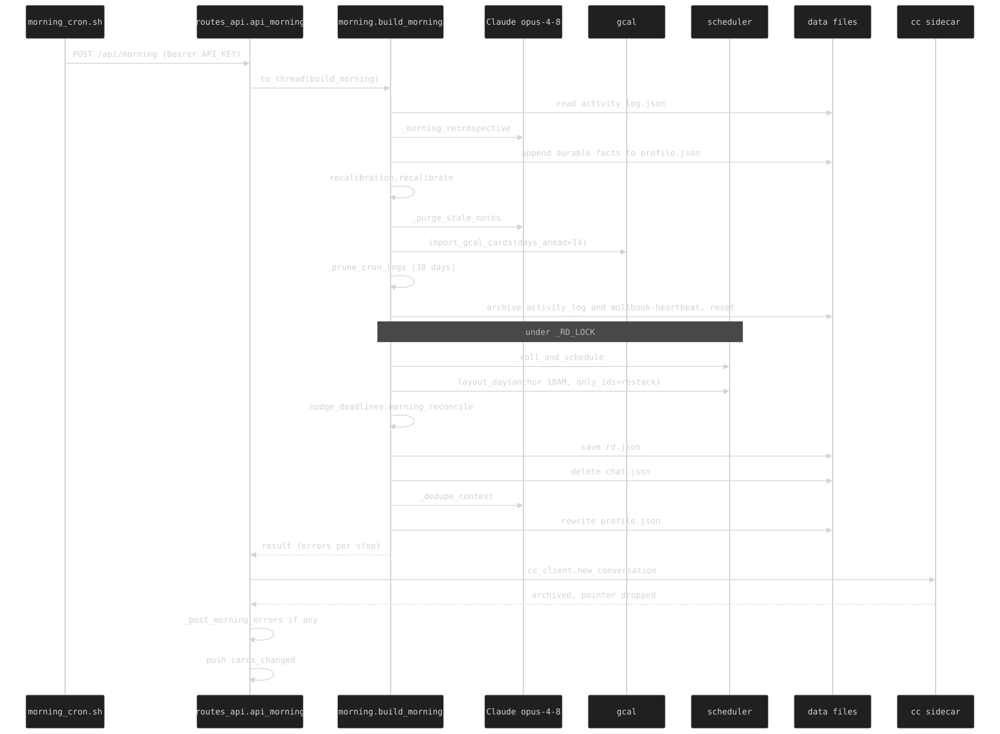

- **Each step is isolated** (`_run_step`): a failure lands in `errors[<step>]`, the rest still run. Steps: `retrospective`, `recalibrate`, `purge_stale`, `gcal_import`, `prune_cron` (drops `data/cron/*.log` older than 30 days).
- **Sidecar thread**: the panel's thread lives in the cc sidecar (§7f), not `chat.json`, so deleting `chat.json` alone left the panel on yesterday's conversation. The route calls `cc_client.new_conversation()` after `build_morning()`; the sidecar archives before dropping its pointer and refuses (500) if the archive fails, surfacing as `errors.cc_new`.
- **Errors are posted, not buried**: any entry in `errors`, or a crash of `build_morning()`, goes through `routes_morning._post_morning_errors` — a `monitor` message in the fresh `chat.json` plus a `{comment}` push (panel replays it, Discord DMs it). A clean morning posts nothing. The route also pushes `{cards_changed}`.
- **Roll/layout block** runs under `_RD_LOCK`: `_roll_and_schedule` (past `scheduled_day` on rd/hq cards -> today, except `no_rollover`; dated rd cards inside the window -> hq via `schedule_to_day`, a past-due `no_rollover` card is left alone), restack of carryover + unpositioned today cards, `layout_day` from `AUTOSTACK_ANCHOR` (10:00), then `nudge_deadlines.morning_reconcile`.

### rd.json concurrency — `helpers._RD_LOCK`

rd.json writers run on genuinely parallel OS threads: the nudge loop's scans (`asyncio.to_thread`), chat-tool dispatch (`to_thread`), sync-`def` routes on Starlette's thread pool (gcal import), and the event loop (`PATCH /api/rd`). Three guards in `helpers.py`:

- **`_RD_LOCK`** (`threading.RLock`): every read-modify-write holds it around the WHOLE load→mutate→save (`with _RD_LOCK:`). LLM/network calls are NEVER made under it — release, call the model, re-lock + reload + apply (`_fire_nudge`, `_build_graph`, `_run_triage`, `api_rd_recalc`, `_tool_decompose_task`, `import_gcal_cards`). **Any new rd.json writer follows this.**
- **`_load_rd()` returns a private deep copy** — the `_load_json` mtime cache holds one shared object.
- **`_save_rd()` is an atomic tmp+rename** and **pops rd.json out of the `_load_json` mtime cache** (1ms mtime granularity: a save in the same millisecond as the read that seeded the cache would serve the stale pre-save board).

Single-process invariant: uvicorn runs ONE worker (`--reload`), so a process-wide lock suffices; nothing outside the container writes rd.json. Read-only loads (`monitor`, `get_week_data`, scans) skip the lock — deep copy + atomic replace make that safe.

### 3b. scheduler.py — the time model

All `dir_start_min` / `scheduled_day` logic lives here. Window = `SCHED_WINDOW_DAYS = 6` (today + 6 = 7-day span).


- **`schedule_to_day`** is the one rd→hq promoter (no I/O, mutates the card). Beyond the window: stays in `rd` with `due_date` only (`scheduled_day` cleared) — unless `clamp_to_window=True` (a manual move into `hq` via `PATCH /api/rd`), which clamps to the last window day. An overdue target clamps to today. `dir_start_min` is set only when the target is today; any other day clears it.
- **Callers**: morning `_roll_and_schedule`; exec chat tools (`create_card` / `schedule_card` / reschedule → `exec_tools.run_tool` → `chat_tools._handle_tool` → `card_schedule.apply_schedule`); `POST /api/rd/{id}/schedule` (`card_schedule.drop_on_day`); `PATCH /api/rd` (`routes_api._apply_patch_schedule`: a card moved into the `hq` column, with `clamp_to_window=True`). `PATCH /api/hq` (`hq.bulk_update_scheduled_days`) does NOT call it: it sets `scheduled_day` directly, and for today takes `place_card_today`.
- **`dir_start_min`**: minutes from midnight, the card BLOCK's start (= prep start) for a card scheduled today. Block = `[dir_start_min, +estimated_time]`; the event block is its final `work` minutes. A **timed** `due_date` pins it: `dir_start_min = event_time - prep` (`timed_start_min`), so prep finishes at the event time. Timeless cards stack forward (`place_card_today`: next free slot >= now, snapped to 15 min, after the last placed card; morning `layout_day` from 10:00). An explicit `dir_start_min` argument wins.
- **Dragging the master block** (hq today column, `saveStartTime` in `web/hq-board.js`) retimes the due TIME to `block_start + prep`, keeping the due DATE; cards with no due_date just move. Between-column drags (`/api/hq`) only touch `scheduled_day`, never the due date.
- **`prep_time`**: of `estimated_time`, the decomposed **prep** minutes; `work = estimated_time - prep_time` is the atomic **event** (class, concert, appointment) — **only when `prep_time > 0`**. With `prep_time = 0` the whole time is decomposed and `ensure_event_block` (`nudge_deadlines.py`) adds no event node. Auto-filled at creation (exec `create_card`, `_card_brief`); edited as `cd-prep` + `cd-dur` in the card dialog (`fmtDuration` `35m`/`6h`, `parseDuration` also accepts `90`, `1h30m`); "recalculate" rebuilds the graph to that split. null for reminders.

History: [ARCHAEOLOGY.md §3](ARCHAEOLOGY.md#3-morning-pipeline--scheduling).
## 4. TTS (text-to-speech)

Every voice in the app — the `/hosaka` SPEAK page, the `/tarot` reader, and the Exec panel — streams through **one same-origin proxy** (`routes_tts.py`) to one of **two upstreams**: the **home GPU box** (kokoro, chatterbox + RVC; SSH reverse tunnel) or **`hosaka-piper`**, an always-on CPU container on this droplet (`glados`). The browser only talks same-origin, so the session/guest cookie carries auth on the WebSocket handshake (HTTP basic auth does not ride a WS upgrade reliably on mobile).

### 4a. Topology


- **Home upstream**: `TTS_UPSTREAM` (default `172.17.0.1:8123`), the Docker bridge gateway → host loopback → SSH tunnel to the home box. `tts-box/` (systemd user service, tunnel unit, port watchdog) lives on the home box and keeps it alive; see `tts-box/README.md`.
- **Piper upstream**: `TTS_PIPER_UPSTREAM` (default `hosaka-piper:8123`), a compose service (`docker-compose.yml`, image `hosaka-piper:latest`, no published ports, pronunciation lexicon bind-mounted read-only). `tts_routing.pick_upstream` sends an utterance with `backend == "piper"` there, everything else to the home box.
- **Voices**: `/api/hosaka/voices` queries both upstreams concurrently and merges (`merge_voices`: piper voices from piper, the rest from home; an upstream error yields `[]`).
- **Health**: `/api/hosaka/health` → `{ok, home, piper}`, 200 if EITHER answers (glados alone is still ok), else 503. Liveness (`_live`) is a real `/v1/voices` response, **never a bound port** — the tunnel listener stays bound with the home box off. `/hosaka` shows "Wai's GPU offline -- glados only" when `home` is false (`applyHealth` in `tts.js`). Probe timeouts: 3s (`_live`), 5s (voices), 4s (mode fetch), 15s (mode switch).

**Every utterance ends in a terminal frame.** Normally the upstream's own `{"type":"end"}`/`{"type":"error"}` clears `busy[url]`. If the upstream stream just ends mid-utterance (home box crash, tunnel drop, server restart), `_pump_to_client`'s `finally` synthesizes `{"type":"error","detail":"tts upstream closed mid-utterance"}` and evicts the dead connection so the next utterance reconnects. Load-bearing for `/tarot`: its typewriter paces off the audio clock and waits on a terminal frame. The guard is the pure `tts_routing.died_mid_utterance` (unit-tested), which fires **only** for the live connection on that url — a stale socket `_ws_dispatch` cut on purpose to start a new utterance must not error the one that replaced it. A failed send/connect answers `{"type":"error","detail":"tts upstream unreachable"}` for that utterance only and evicts the connection; a live glados connection survives a home-box death.

Client-side belts (a frame can also be lost browser↔droplet): `hosaka-audio.js`'s `ws.onclose` delivers a synthetic `{type:"error"}` to the in-flight utterance (guarded on the socket still being the live one), and the stall watchdog in `typewriter.js` (`twAudio`) caps `elapsed()` at the buffered duration in its progress signal so a dead stream can fire it.

### 4b. Auth — guest-or-full

`/hosaka` and `/api/hosaka/{voices,health}` are on **`guest_protected`**. `WS /ws/hosaka` and `WS /ws/hosaka/presence` are on the `public` router but close `1008` before `accept()` unless a `session` **or** `guest_session` cookie matches (this is what lets guests hear the `/tarot` reader).

| Endpoint | Router | Reachable by |
|----------|--------|--------------|
| `GET /hosaka`, `GET /api/hosaka/voices`, `/health` | `guest_protected` | full + guest |
| `WS /ws/hosaka`, `/ws/hosaka/presence` | `public` + cookie check | full + guest (else `1008`) |

### 4b-ii. GPU-mode owner control

`GET`/`POST /api/hosaka/mode` and `GET /api/hosaka/mode/stream` are on **`protected`** (owner-only; guests must never flip the GPU). They proxy the home-box `gpu-mode` service at `GPU_MODE_UPSTREAM` (default `172.17.0.1:8124`, over the same tunnel) with `Authorization: Bearer $GPU_MODE_TOKEN` (must match the home box's token; read from the environment, empty by default). GET returns `homo`/`emo`/`idle`/`gone` (`gone` = box unreachable). POST `{"action": "homo"|"emo"|"idle", "force"?: bool}` (else 400).

- **Kill-switch guard**: `emo` and `idle` stop hosaka-server and cut active listeners. `needs_user_confirm` checks `_audio_conns` (every open `/ws/hosaka` socket — incl. `/tarot` and Exec voice, not just `/hosaka`-page `_presence`) and returns `409 {detail:"active_users", count}` unless `force`. `homo` never needs confirmation.
- **Reported mode is corrected against reality**: the box's `/mode` is its *intent* and outlives the truth (hosaka-server dies, box still says `homo`). `_current_mode()` probes `/mode` and `_live(TTS_UPSTREAM)` concurrently and `gpu_mode_client.effective_mode` reports `idle` for a claimed `homo` with no live TTS. Only `homo` is second-guessed (under `emo`/`idle` a failing probe is expected; `gone` says it all). A `homo` switch sets a 90s grace (`_HOMO_GRACE_S`) assuming live, since models must load before `/v1/voices` answers.
- **Live sync**: a POST pushes instantly to `_mode_subscribers`; changes made at the home box (watchdog restart, another device) never touch that queue, so the SSE stream's keepalive tick doubles as a poll of the real mode (`_MODE_POLL_S` = 15s) and emits on change; unchanged → a `: keepalive` comment.
- **UI**: owner-only `#gpu-mode` strip on `/hosaka` (`web/gpu-mode.{css,js}`): emo / **down** / homo. The middle button is LABELLED `down` but its `data-mode` is still `idle` (the action the box accepts). `idle`/`down` (hosaka-server deliberately stopped) differs from `gone` (box unreachable). Guests get 401, strip hidden.

### 4c. Three consumers of one audio core — and one narrator above it

All share `web/hosaka-audio.js` (`HosakaAudio.createPlayer()`): `AudioContext`, the iOS unlock, the `/ws/hosaka` socket, and playback of streamed **24 kHz float32 PCM** via scheduled `AudioBufferSourceNode`s. The upstream emits only `{start}` / coarse PCM blobs / `{end}` (no per-word timestamps), so visuals sync to the *measured* audio duration.

| Surface | Script | Voice | Backend | Runs on |
|---------|--------|-------|---------|---------|
| `/hosaka` SPEAK UI | `tts.js` | `charlie` (default) + full list | chatterbox + RVC | home GPU box |
| `/tarot` reader | `tarot-voice.js` | `nicole` | kokoro | **home GPU box** |
| Exec panel + bubble | `exec-voice.js` / `exec-voice-listener.js` | `glados` | piper | **this droplet** |

**The last column is the difference that matters.** Exec keeps its voice with the home machine asleep; only `/tarot` speaks from the tunnel and can lose its voice (§14d, §14e).

- **`web/voice-narrator.js`** sits above the player for the two narrating surfaces (`/tarot`, Exec panel): player lifecycle, persisted on/off, unlock, utterance queue, and the CONTROLLER (`elapsed()`, `duration()`, `ended`, `ok`) a typewriter paces to. `exec-voice.js` / `tarot-voice.js` are thin bindings (config + what is theirs: replay glyph, home-box probe, canned opening). The control is **`web/voice-ui.js` + `voice-ui.css`**: one `.voice-mute` element, one `data-on` contract. `/tarot` overrides the star glyph's size/factor in `tarot.css` (`.voice-mute.spread-btn .voice-glyph`) because that page has no `[x]` beside it.
- **OFF means off**: nothing synthesized, no socket opens, `speak()` returns a DEAD controller, every caller reveals at its own pace now. One flag.
- Each narrating surface paces its typewriter to the audio clock and falls back to the guessed pace on any failure (§18). `exec-voice-listener.js` (nudges/monitor comments on non-planning pages) is fire-and-forget — no typewriter to pace.
- **Fourth path — pre-rendered audio**: the `/tarot` openings (§14d) are already-rendered WAVs; `player.speakBuffer({data})` schedules one through the same `scheduleBuffer` (same playhead, gain node, iOS unlock, `elapsed()`/`audioDuration()` clock). No socket; `{end}` fires on scheduling. Trap: `decodeAudioData` **detaches** its ArrayBuffer, so it decodes a copy and a replay survives.
- **No browser in the loop**: `api/tarot/voice_synth.py` speaks the upstream protocol directly (`ws://TTS_UPSTREAM/v1/audio/stream`, bypassing `/ws/hosaka` — no cookie, no client). Callers: the opening generator (`openings_gen`), the nightly voice probe (`openings_loop`, §14e), and `POST /api/tarot/warm`.
- **Mic**: `voice-input.js` is the mic engine + `bindComposer`; `exec-mic.js` / `tarot-mic.js` are thin bindings. A final result ARMS the send `SEND_DELAY_MS` (1s) out rather than sending; anything heard in the window cancels and joins the text. The mic drops everything heard while a reply streams **or** the narrator `isSpeaking()` (true through the playout tail; `exec:voice-idle` re-lights the dot) — else the page transcribes its own narration.

### 4d. One utterance

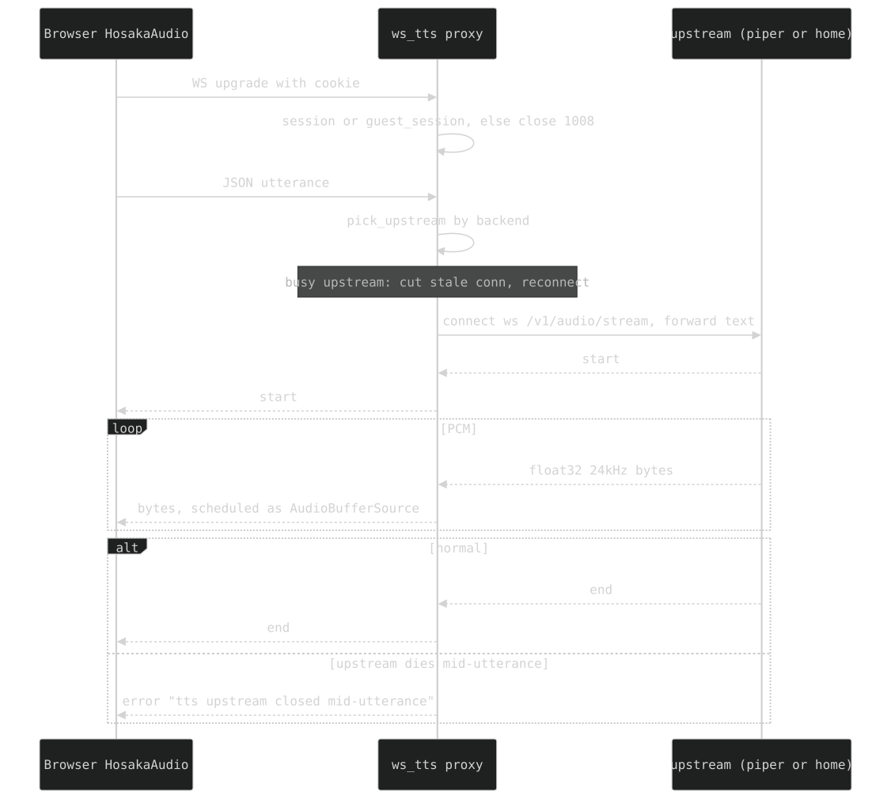

`_ws_dispatch` routes each JSON utterance by `pick_upstream`, caches one upstream WS per url (`_ws_connect`), and pumps frames both ways (`_pump_to_client`). If the previous utterance on that url is still `busy` (the client flushed playback for a new one), the stale connection is cut and reopened so trailing frames cannot interleave.

### 4e. Presence

`WS /ws/hosaka/presence` (same cookie gate): every open `/hosaka` **and `/tarot`** tab holds one socket (`web/hosaka-presence.js`); the server tracks `_presence` and broadcasts the TOTAL `{count}` on each join/leave (serialized by `_presence_lock`); each client subtracts its own socket to render `N other people speaking` (`#tts-presence`, only `/hosaka` renders it). Separate from `/ws/hosaka` (opens only on Speak) and from `_audio_conns`, which is what the GPU-mode guard counts.

History: [ARCHAEOLOGY.md §4](ARCHAEOLOGY.md).
## 5. LLM call sites + prompt caching

Every Claude call in this section goes through the `anthropic` SDK with a pay-per-token
`ANTHROPIC_API_KEY` (no subscription); the Exec panel's own agent and the rolling title run on the `/cc` sidecar's subscription login instead (§7). Where a large, byte-stable system
prefix is **reused across turns**, a `cache_control: {type: ephemeral}`
marker (5-min TTL) lets repeat requests read that prefix at ~0.1x.
Models: `claude-opus-4-8` everywhere except `card_llm.parse_date_natural` and `gcal._haiku_classify_batch` (`claude-haiku-4-5`).

### The one invariant

Render order is `tools -> system -> messages`. A marker on the **last
system block** caches `tools + system` together. Caching is a pure prefix
match: any changed byte inside the cached span (timestamp, per-request card
data) invalidates everything after it. So static text precedes volatile
text and the marker sits at the end of the static part. **Opus min cacheable
prefix = 4096 tokens** — shorter silently caches nothing
(`cache_creation_input_tokens` stays 0).

### Cached sites


| Call site | Model | Cached prefix | Tokens (measured 2026-10-14) | Reuse pattern |
|-----------|-------|---------------|-------:|---------------|
| `tarot/agent.py` `stream_chat` | opus-4-8 | `build_system(spread_type)` + `TOOLS` | 8,797 (no spread) / 13,514 (three-card) | every turn of a reading |
| `mtg/agent.py` pass 1 | opus-4-8 | `SYSTEM` + `TOOLS` | 7,223 | across research tool-loop iterations + cross-question |
| `mtg/agent.py` pass 2 | opus-4-8 | `SYSTEM` (no tools) | 6,381 | cross-question only (separate prefix from pass 1) |
| `chat_passes.run_turn` (act + reply) | opus-4-8 | `_CHAT_STATIC_PREFIX` + `_chat_tools()` | 6,494 | every exec pass; each reads what the first wrote |

Counts measured 2026-10-14 with the free `client.messages.count_tokens`
endpoint (not re-checkable from source). All four clear the 4096 floor;
**re-measure after any prompt or tool-schema edit.**

**Exec:** `_build_chat_system_prompt(stage, actions=…)` (chat.py) returns a
**two-block** system list — marked static block (identity + `EXEC_VOICE` +
global rules) and an unmarked volatile tail (`_turn_context`: TODAY, stage,
activity log, boards, 7-day schedule, context, active-nudge block, ACTIONS
YOU JUST TOOK). `TODAY` must stay in the tail. `run_turn` is used by
`routes_chat` (legacy `/api/chat`) and `discord_bot`; the Exec panel itself runs on the sidecar (§7).

**ACTIONS YOU JUST TOOK:** after a tool round the system prompt is rebuilt
with this block (`chat_actions._actions_taken_block`, from the dispatched
`{name,input,result}` list) so the model reads the refreshed board as the
result of its own action, not as a phantom duplicate. Volatile tail only —
the cached prefix stays byte-stable.

**Activity-log entries carry the card `id`** (`_log_entries_for_patch`:
created/moved/updated/deleted/revived) and the prompt renders a trailing
`[id:…]` per log line; entries sharing an id are one card (a `create_card`
with a due_date logs both `created` and `updated`). Pinned in
`tests/test_exec_tool_rounds.py`.

### Exec turn: ACT then REPLY (`api/chat_passes.py`)


History reaches the model flattened (`sanitize_history_for_api` strips past
`tool_use`, §16), so a single pass learns to SAY "Added X" without calling a tool. Hence two passes:

- **Pass 1, ACT** — tools on, `messages.create` (not streamed), **text discarded**; only `tool_use` blocks are kept. Loops until no tool calls (`_MAX_ACT_ROUNDS` 4), the action diff rebuilt each round. No action needed → no tool, no text.
- **Pass 2, REPLY** — same tools, **`tool_choice: none`**; sees every tool_result plus ACTIONS YOU JUST TOOK; the only streamed pass. If a requested action is MISSING it answers `[redo: <action>]`, which is buffered and **never shown**, attached to the closing user message as an `[auto-check, not from Wai]` block, and pass 1 re-runs. `_MAX_REDOS` 2; the last reply pass is not offered the redo and must say plainly what was not done. `strip_notes` removes auto-check blocks before `_save_chat`.
- Cost: an action turn adds one non-streamed call before any text (roughly 9s to first text vs 2.3s on a question; one-off measurements 2026-09-24). Both passes share tools + static block (each pass's rules go in the volatile tail, `chat_passes._system`), so the second reads the cache the first wrote.

`chat_store.assistant_content_blocks` converts an API message to storable text + `tool_use` dicts. Pinned by `tests/test_chat_passes.py`.

### Uncached (left alone)

Sizes below are approximate figures from when the sites were audited (no date recorded, not re-checkable from source); the call sites themselves are as listed.

| Call site | Why |
|-----------|-----|
| `monitor.py` | static slice ~1.3K (no tools) < 4096; debounced bursts = low reuse |
| `nudge_llm` `_TONE` | ~1.4K (no tools) < 4096; per-card one-shot |
| `card_llm` classify / parse-date | one-shot per card; no system / tiny volatile system |
| `morning.py`, `chat._dedupe_context` | daily one-shot; prompt lives in the user message |
| `gcal._haiku_classify_batch` | no system block; tiny instructions in the user message |
| `tarot/openings_gen.generate_texts` | `voice_preamble()` ~1.5K < 4096; one call per hour of the day (24), each producing that hour's whole batch |

**Verifying:** response `usage` reports `cache_creation_input_tokens` (~1.25x) and `cache_read_input_tokens` (~0.1x). Two identical requests with `cache_read` still 0 means a silent invalidator is back in the prefix.

### Where the marker goes

The marker always goes on a byte-stable block; the volatile part lives elsewhere.

- **Tarot** (`tarot/agent.py`) — marker on the single system block `build_system(spread_type)`; **the per-turn spread context rides in `messages`, never `system`**.
- **MTG** (`mtg/agent.py`, `_SYSTEM_CACHED`) — `SYSTEM` marked once, used at both call sites. Pass 1 (research loop, with `TOOLS`) caches within its own iterations; pass 2 (summarize, no tools) is a separate system-only prefix. Both cache cross-question; only pass 1 caches within a question.
- **Exec chat** — two-block list as above; marker on block 1 only. Every pass of `run_turn` builds the identical static block.

History — the incidents behind the rules above: [ARCHAEOLOGY.md §5](ARCHAEOLOGY.md).

## 6. Printer (ELEGOO Centauri Carbon) — two-tier reverse proxy

`/printer` serves the printer's **own** web UI (an Angular SPA with a live
MJPEG camera and SDCP websocket controls) from wai-lau.net. Same-origin
everywhere: the browser talks only to the droplet, so the full `session`
cookie rides every sub-request incl. the websocket handshake, and nothing
weaker than the owner reaches a machine that can heat a nozzle.

The page also has a **guest tier — read-only, by routing** (Turnstile guests; on the landing wheel and the guest nav). The rule is not "filter what a guest may send", it is "a guest has no route that carries their bytes to the LAN":

| Route | Owner | Guest | Why |
|-------|-------|-------|-----|
| `GET /printer` | SPA wrapper | camera + job strip | same template, `data-readonly="1"` for guests |
| `ANY /printer/{path}` | full proxy | **401 → admin login** | the SPA, file endpoints, uploads — every browser→printer HTTP path |
| `WS /ws/printer` | SDCP relay | **1008** | the only browser→printer socket; it drives the machine |
| `GET /printer/video` | MJPEG | MJPEG | one-way read off the shared hub (the vendor SPA's ``) |
| `GET /printer/frame` | ✓ | ~10fps | ONE JPEG per request — the guest pull loop (§6g) |
| `GET /api/printer/status` | ✓ | ✓ | one-way read; the printer pushes it unasked |
| `GET /api/printer/health` | ✓ | ✓ | one-way liveness GET |

Routers (`routes_printer.py`): `/printer`, health, status on `guest_protected`; `/printer/video`, `/printer/frame` on `public` with the tier checked in-handler (`_has_view_access`); `/printer/{path}` on `protected`; `/ws/printer` on `public` with a `session`-cookie `hmac.compare_digest` check (closes `1008` before `accept()`; unlike the HTTP routes it does not accept the admin bearer). "Owner" for the in-handler checks (`_is_owner`) = the `session` cookie or the admin bearer; "guest" = a valid `guest_session` cookie.

The two guest-reachable readers are **server-opened singletons**, not relays of anything a viewer said: `printer_camera.py` holds ONE upstream MJPEG stream (the printer allows ~4), and `printer_status.py` holds ONE SDCP socket that **sends no frame, ever** — the printer pushes status on its own and `public_status()` whitelists it (no `MainboardID`/`TaskId`/`Filename`).

### 6a. Topology

The printer sits on Wai's home LAN (`192.168.2.25`). Its three ports are
reverse-tunnelled from the home box to the droplet's docker bridge by
`printer-box/printer-tunnel.service` (the hosaka/emet pattern, §4a; `-R`
forwards point straight at the printer's LAN address; install in `printer-box/README.md`).


| Printer port | Bridge | Env var |
|---|---|---|
| `:80` SPA + files | `172.17.0.1:8126` | `PRINTER_UPSTREAM` |
| `:3030` SDCP websocket | `172.17.0.1:8127` | `PRINTER_WS_UPSTREAM` |
| `:3031` MJPEG camera | `172.17.0.1:8128` | `PRINTER_VIDEO_UPSTREAM` |

### 6b. Why rewrites, and which

The SPA assumes it is the origin. Pure helpers in `printer_proxy.py` (no I/O; `tests/test_printer_proxy.py` pins them against verbatim slices of firmware V1.4.49) patch it in flight:

| Upstream shape | Rewrite |
|----------------|---------|
| `<base href="/">`, root-absolute `href`/`src` (index HTML) | `rewrite_html`: → `/printer/…` (protocol-relative `//` untouched) |
| `</head>` of the index | `rewrite_html` injects `<link href="/printer-frame.css?v=3">` AFTER the re-root pass (site overrides for the proxied doc: hides `app-header`) |
| `` `ws://${…}:3030/websocket` `` (main.js) | `rewrite_js`: → `` `${location.protocol==="https:"?"wss":"ws"}://${location.host}/ws/printer` `` |
| `"http://"+(…VideoUrl)` on the camera `` | `rewrite_js`: scheme dropped (mixed content) |
| `` `http://${…hostName}:80` `` (file download href, upload POST) | `rewrite_js`: → `` `${location.origin}/printer` `` |
| quoted `"/assets/…"` literals in compiled templates (all bundles) | `rewrite_js`: → `/printer/assets/…` |
| `"VideoUrl":"<ip>:3031/video"` in the SDCP reply (cmd 386) | `rewrite_ws_text` (printer→browser text frames) → `/printer/video` |
| any `http://<lan-ip>[:80]/` in a frame (task `Thumbnail` cmd 321, `TimeLapseVideoUrl`) | `rewrite_ws_text` → `/printer/` (other ports untouched) |

Only `text/html` and JavaScript content types are rewritten (`rewrite_kind`); everything else streams untouched.

Relative URLs (hashed CSS/JS, lazy chunks, `assets/i18n/…`, fonts) resolve against the rewritten base and need nothing. **Deliberately not rewritten:** the WebRTC signalling socket (`ws://<host>:8883`, only when the printer advertises `VIDEO_WEBRTC`; the unit tested reported only FILE_TRANSFER / PRINT_CONTROL / VIDEO_STREAM) — pinned by a regression test; wiring it means a fourth tunnel port + relay.

**Headers are allowlists both ways** (`upstream_request_headers` / `client_response_headers`): the session cookie and bearer never reach the printer; `accept-encoding: identity` so bodies arrive rewritable; `content-length`/`content-encoding` dropped on the way back, a request `content-length` forwarded (the printer's HTTP server is not trusted with chunked). Every response is `Cache-Control: private, no-cache` and `CacheControlMiddleware` (main.py) skips `/printer/`. Only a root-relative `Location` survives, re-rooted; any other redirect target is dropped.

**Conditional requests are answered by the proxy**: `If-None-Match` is not forwarded; a rewritten body's ETag is the printer's tag + `-rw<REWRITE_VERSION>` (now `"5"`). **Bump `REWRITE_VERSION` whenever `rewrite_html`/`rewrite_js` change**, or browsers 304 stale rewrites.

### 6c. Runtime shape

- **`/printer/{path}`** streams non-HTML/JS bodies both directions (`StreamingResponse` over `httpx` down, `request.stream()` up, write timeout unbounded for gcode uploads); HTML/JS are read whole, rewritten, re-served. Timeouts: connect 4s, read 60s (`_HTTP_TIMEOUT`).
- **`/printer/video`** relays `multipart/x-mixed-replace` with `X-Accel-Buffering: no`; the content type is excluded from `GZipMiddleware`. `main.py` passes the exclusion list to `GZipMiddleware` explicitly (newer starlette binds the kwarg default at import time) and lists both prefix and `type/*` spellings.
- **`/ws/printer`** accepts first, then dials the printer (like `/ws/hosaka`), so a vanished browser never strands an upstream socket and a down printer (5s `open_timeout`) is a clean `1011` the SPA retries. Two pumps (`_pump_to_client` rewrites text; `_pump_to_upstream` forwards text + bytes) under `asyncio.wait(FIRST_COMPLETED)`; either side closing tears down both.
- **Liveness** (`/api/printer/health`): tunnel ports stay bound while the printer is off (accept-then-reset), so only a real HTTP answer from the SPA shell counts (the `/api/hosaka/health` rule); own timeout 2s connect / 3s total (`_HEALTH_TIMEOUT`). Upstream failures degrade to 503 or a closed socket, never 500.

### 6e. The wrapper page

**`GET /printer`** serves `templates/printer.html` via `printer_page()` — shell + nav, `full_height`: a lede and online/offline row over an **`<iframe>`** of `/printer/network-device-manager/network/control`.

- The iframe isolates the SPA's global antd CSS from chrome.css and scopes its `<base href>`.
- `web/printer.js` polls `/api/printer/health` every 15s (`POLL_MS`; + tab focus; sequence-numbered so an older answer never overwrites a fresher one) and mounts the iframe only while online. Offline: "printer offline" note, frame set to `about:blank` (kills the SPA's reconnect loop); remounts itself.
- **The iframe fades in only on `load`** (`.printer-frame` is `opacity:0` until `.ready`) — the vendor SPA paints white before its app renders.
- **Guest render is a different page, not a filtered one.** `printer_page()` sets `data-readonly="1"`; `printer.js` never mounts the SPA, showing `#printer-view`: the camera `` plus ONE job strip (`#printer-job`: state chip, percent, elapsed/remaining, layer progress) polled from `/api/printer/status` every 3s (`STATUS_MS`). No controls, no temps, no filename/thumbnail (`public_status` never sends them); `.printer-head` is hidden for guests. Idle printer = state chip alone (`.printer-job:not(:has(.pj-pct))` drops the card).
- The job strip is a centred CARD under the feed (`.doc-card` surface one step smaller), `.pj-rows` one pair per line.
- **`printer.css` keeps the CRT stack at `--z-modal` IN FRONT** for both tiers (not `z-index:-1` like `/rd`); layers are `pointer-events:none` so the SPA stays clickable.
- **The Exec link-bubble drags across the iframe**: `exec-bubble-drag.js` flags a live mouse drag `html.exec-drag`; `printer.css` drops the frame's `pointer-events` meanwhile.
- **Scrollbar**: `web/printer-frame.css` re-declares `--green-hsl`/`--radius-pill` in its own `:root` and writes the rules as `html ::-webkit-scrollbar` with `!important` on every declaration (the SPA ships its own grey bar under that selector, inline copy lands after our `<link>`). chrome.css is deliberately not injected (globals fight antd). Wrapper styles stay in `printer.css`; `printer-frame.css` is only for the proxied document.

### 6g. The camera hub

`GET /printer/video` and `/printer/frame` are on the **`public`** router with the tier checked by hand (`_has_view_access`): routers mount public → protected → guest_protected, so on `guest_protected` the owner-only `/printer/{path}` catch-all would match `/printer/video` first.

`printer_camera.py` holds **ONE** upstream stream however many watch: it demuxes into whole JPEG frames, keeps the latest, and re-muxes per viewer (boundary `--printerframe`) starting from that frame. Each viewer has a one-frame queue and drops what it cannot keep up with. Constants:

| Constant | Value | Meaning |
|---|---|---|
| `MAX_VIEWERS` | 16 | 503 past it; a pipelined guest counts once (`can_admit` divides pullers by `PULL_DEPTH`) |
| `GUEST_FRAME_INTERVAL` | 0.1s | a ceiling on the guest sample (`_promote`); owner unthrottled |
| `_SLACK` | 0.75 | a frame is accepted from 75% of the interval on |
| `PULL_WAIT_S` | 5s | `/printer/frame` long-poll; 204 = ask again |
| `PULL_DEPTH` | 2 | pulls in flight in `printer.js` |
| `_IDLE_STOP_S` | 10s | upstream dropped after the last viewer/puller (`_wanted()`) |
| `_BACKOFF_MAX` | 15s | reconnect backoff 1→15s; upstream read timeout 30s |

**The guest view PULLS.** A pushed MJPEG body is only as fresh as the slowest buffer on the path (uvicorn, nginx, kernel), which never drop — latency grows unbounded on a slow link. `GET /printer/frame?after=<seq>` returns ONE JPEG newer than `seq` (seq in `X-Frame-Seq`); `printer.js` keeps `PULL_DEPTH` pulls in flight, each asking for the frame after the previous pull's (`asked`), swaps only a decoded frame (`img.decode()`), and never goes back to an older one (`shown`). Nothing queues: a slow link gets fewer frames, never older. Guests share ONE server-side sample. The MJPEG body stays for the owner's SPA. Pinned by `tests/test_printer_camera.py`.

**The hub RECONNECTS instead of ending**: an `` never re-requests a dead MJPEG stream, so on upstream end/stall `_run` re-dials with backoff and keeps feeding the SAME open viewer responses.

History — the incidents behind the rules above: [ARCHAEOLOGY.md §6](ARCHAEOLOGY.md).

Nav label `3DP`; route, icon and internal key stay `printer`.
## 7. `/cc` — the Exec panel's agent (Claude Code, host-side sidecar)

Owner-only. The `/cc` PAGE is gone (folded into the Exec panel 2026-09-29, §7g); `/api/cc/*` and the sidecar behind them remain, and the panel on `/rd` + `/hq` is their client. This section is the **exec-fn side**: routes, transport, the panel UI. Summary + invariants: CLAUDE.md's `/cc` row. The sidecar itself (`claude-box/`, submodule `wai-lau/cc-sidecar`) has its own `ARCHITECTURE.md`, cited here as `claude-box S-N`; the agent's `cwd` is a private scratch sandbox, **not** a checkout of exec-fn.

| Old id | Now |
|---|---|
| §7a-bis (sign back in from the panel, `login.mjs`) | claude-box S-2 |
| §7b (sandbox: three mechanisms) | claude-box S-3 |
| §7b-bis (blast radius, accepted) | claude-box S-4 |
| §7b-ter (path gate; `Bash` uncovered) | claude-box S-5 (the owner-only tier bullet stays in §7b below) |
| §7c, tool allowlist / count / probe | claude-box S-6 (tool-line UI stays in §7c below) |
| §7c-bis, sidecar half (`exec-tools.mjs`, token env strip) | claude-box S-7 (container routes stay below) |
| §7d (archive tools) | claude-box S-8 |
| §7e, sidecar half (persona assembly, `cc-context.md`) | claude-box S-9 |
| §7f (the SECOND §7f: session pointer, `/new` archive) | claude-box S-10 |
| §7i, generation half (`title-gen.mjs`) | claude-box S-12 |
| §7k, sidecar half (no hangup abort, `/interrupt`) | claude-box S-11 |

### 7a. Topology (exec-fn side)

Claude Code cannot run in the app container (`python:3.12-slim`: no node, no `claude` binary, no credentials), so it runs on the droplet HOST as `cc-agent`; the container reaches it over the docker bridge at `172.17.0.1:8129` (`CC_SIDECAR_URL`, `cc_client._CC_URL`). Same idiom as hosaka/printer minus the SSH tunnel.


Container side: `cc_client.py` (transport, `x-cc-token` = `CC_SIDECAR_TOKEN`) + `routes_cc.py` + `routes_exec.py` (the reverse path, §7c-bis). Sidecar endpoints, install, limits: claude-box S-1. A logged-out sidecar answers a per-request `Not logged in` text frame; on load the panel states the sidecar's state once as a `.msg.sys.warn` line (`execAnnounceState`, `web/exec-term.js`: `sidecar offline` / `cc-agent not logged in`). Signing back in is the sidecar's job (claude-box S-2); the link arrives as markdown in an ordinary `text` frame.

**Routes** (`routes_cc.py`, all on `protected`): `GET /api/cc/health`, `/sessions`, `/title`, `/limits`, `/history`, `/exec-history`; `POST /api/cc/resume`, `/new`, `/interrupt`, `/query`. `/query` validates (400 empty prompt+images+files; 413 over 32K chars of text / 4 images / 5MB base64 each / 4 files / 6MB each / 20MB attachments), prepends `exec_context.wrap()`, and returns `cc_client.stream_query` as SSE with `X-Accel-Buffering: no`. Failures are injected as an `error` FRAME, never raised (the response has begun streaming). `/api/cc/sessions` prefers the cached rolling title over the SDK's summary, read-only (forty rows must not fire forty haiku calls).

**A busy sidecar waits instead of failing** (`cc_client.stream_query`): the sidecar runs one turn at a time; a 429 polls every `_BUSY_POLL_S` (0.5s) for up to `CC_BUSY_WAIT` (300s, `_BUSY_WAIT_S`), emitting one `{"type":"waiting"}` frame (the panel ignores it and keeps its cursor up). Only a slot held past that answers `busy`.

### 7b. The tier

`/api/cc/*` hands whoever reaches it a shell on the droplet as `cc-agent` (sandbox: claude-box S-3 to S-5), so **admin-only is the whole of the access story**: `protected` (full `session` cookie), **never `guest_protected`** — no per-caller scoping would make a guest tier safe. Pinned by `tests/test_cc_admin_only.py`, which enumerates the routes from `routes_cc.py` (never a hand-written list) and checks the tier structurally and over HTTP, anonymous and guest. The interrupt route is structural-only there (firing it would stop Wai's live run).

### 7c. Tool lines in the panel (the sidecar's tool set: claude-box S-6)

- **A tool call is ONE line, its output folds under it** (`web/exec-toolout.js`). The line clips with an ellipsis; tapping the WHOLE row (not just the marker) reveals the result and flips the gutter `+` → `-`. Open, the block is capped at `max-height: 20lh` and scrolls inside itself (`exec-term.css`). Summaries come from `execSummarize()` (`exec-term.js`): `query`/`url` FIRST, then `command`, `file_path`, `pattern`, `path`, `prompt` (WebFetch's `prompt` is the instruction, not the thing fetched).
- **Pairing is FIFO, not by id**: `tool` / `tool_result` frames carry no `tool_use_id`; results arrive in call order. A call is consumed from the queue even when its result is empty; the queue is emptied at the top of each turn; a result with no waiting call becomes a standalone open block. The cursor parks on the TOOL line while folded.
- **Every tool line expands to something**: empty result → `[ no output ]`; a call still waiting at end of turn / on interrupt → `[ no result returned ]`.
- **Text that resumes after a tool call opens its OWN bubble**: the open bubble is settled (markdown + SVG) and closed, the reveal state replaced with a fresh object (a cancelled typer never calls `onDone`, so a stale `typing` promise would hang the settle pass); the receipt hangs on the last settled body when a turn ends on a tool.
- **An Exec card tool (`mcp__exec__*`) is not a tool line**: it queues `{cardTool, input}` and renders a one-line receipt (`execCardReceipt`): `[ card added: … ]`, `[ … failed: … ]` on an `{error}` result.
- **The turn receipt** (`execAppendReceipt`, `exec-stream.js`) prints only when something happened (a wait ≥15s, `[ 32.7s ]`), hung on the END of the reply. It is STASHED at the `done` frame and rendered at settle (`done` can arrive mid-reveal, and the settle pass rebuilds `innerHTML`).
- **Closing/dropping a bubble must be idempotent** within one turn (consecutive tool frames call it repeatedly).

### 7c-bis. Exec's card tools — the container side of the relay

The agent gets Exec's card tools as `mcp__exec__*`; the sidecar relays (claude-box S-7). The tools stay in Python next to `rd.json` and `_RD_LOCK`.

- **`GET /api/exec/tools`** → `chat._chat_tools()`; **`GET /api/exec/prompt`** → Exec's static system prompt; **`POST /api/exec/tool/{name}`** → `exec_tools.run_tool`, the ONE place a tool call's side effects are decided (monitor debounce, board-changed verdict), shared with `chat_passes._dispatch`. The route pushes `{cards_changed}`; a failure returns `{error: …}`, never an exception.
- **Auth is the sidecar token, and only it.** All three routes are on `public` with an in-handler `hmac.compare_digest` of `x-cc-token` against `CC_SIDECAR_TOKEN` (`routes_exec.py`). Deliberately NOT the admin `API_KEY` (the agent has Bash). Admin and guest credentials are refused (`tests/test_routes_exec.py`).
- `scripts/cc-probe-daily.sh` (5:20 host cron `/etc/cron.d/exec-fn-ccprobe`, installed from `claude-box/exec-fn-ccprobe.cron` by the submodule's `setup.sh`) sources `/etc/cc-sidecar.env` and passes the token with `sudo --preserve-env`; mechanism: claude-box S-6.

### 7e. Persona and the board (container side)

The agent IS Exec. The sidecar assembles the system prompt (claude-box S-9: Exec's prompt + operating rules + `cc-context.md`); this side owns the container pieces:

1. **Exec's static prompt** — `chat._CHAT_STATIC_PREFIX`, served at `/api/exec/prompt`. One source for every surface. Its `LENGTH` rule: a confirmation, yes/no or single fact gets one line; one action gets one line; only an open question earns more.
2. **The board rides in the message, not the prompt**, so the system prompt stays byte-stable (cacheable). `/api/cc/query` prepends `exec_context.wrap()`: an `<exec-context>…</exec-context>` block holding `chat._turn_context("planning")` (today, activity log, selected tasks, ideas pool, 7-day schedule, known context, open nudges) plus the last `RECENT_PUSHES` = 5 nudges/monitor comments (`exec_panel.recent_pushes`; they live only in chat.json, which the agent never reads, so without it a reply to a comment answers something Exec never said). The sidecar treats the block on the LATEST message as authoritative and strips it from history/title/archive. **The tag is a contract**: `exec_context.OPEN/CLOSE` ↔ `CONTEXT_BLOCK` in `claude-box/exec-tools.mjs`, pinned by `tests/test_exec_context.py`. The block is re-sent on every user turn and stays in the stored transcript (the sidecar strips it for display).
3. **Board scope** (`api/exec_board.py`, both paths): EVERY rd + hq card, plus archives/exile cards whose latest logged move there is within 7 days and which are still in that column. Cards carry no move time, so the window is read from `activity_log.json` + the dated `activity_log_YYYYMMDD.json` rotations, matched by id (title fallback).

### 7f. The Exec panel on the sidecar

The panel on `/rd` + `/hq` (`web/exec-bubble.js`) POSTs `{prompt}` — Wai's words only — to `/api/cc/query`, which adds the `<exec-context>` block (§7e) and relays the sidecar's frames. A send while a run is in flight waits (§7a); only a slot held past `CC_BUSY_WAIT` shows a `busy` sys line.

- **Frames.** `text` blocks are whole assistant messages; a reply that resumes after a tool call is a second block of the SAME answer (joined with a blank line). `tool` → `tool_result` pairs arrive FIFO (§7c). Only `mcp__exec__*` calls leave a card receipt; web search / Bash leave a tool line. Board refresh needs nothing client-side: `/api/exec/tool/*` pushes `{cards_changed}` over the monitor SSE.
- **Replay** is `GET /api/cc/exec-history` (`api/exec_panel.py`, `merged_history`): the sidecar transcript (text, one `action` row per tool call, claude-box S-10) plus chat.json's `monitor` rows, sorted by time (`_when` normalises the sidecar's `Z` stamps and chat.json's `+00:00`). User turns get their `[dd/mm HH:MM ET]` chip from the stored ts (`execFmtTs`, `web/exec-bubble-msg.js`), so nothing time-shaped goes in the prompt. Replay keeps images and actions (`execReplayAction`).
- **The two-pass guard is NOT on this path.** The SDK transcript keeps real tool_use/tool_result pairs; `chat_passes.py` stays for Discord inbound (CLAUDE.md § Exec chat tools). `/api/chat` still exists for Discord.
- Pinned in WebKit: `tests/test_exec_panel_stream_browser.py` (receipts vs tool lines, joined blocks, prompt = words only, busy, the §7k resync paths). The fixture turns voice OFF (the audio stub's clock never advances) and mocks `/api/cc/interrupt` (unmocked, a test would stop Wai's live run).

### 7g. /cc folded into the Exec panel (2026-09-29)

`/cc` (page, template, nav `✦`, `web/cc*.{js,css}`) is gone and 404s; `/api/cc/*` stays. The NDL nav entry took `/cc`'s `seeker` icon. The page's code lives on as the panel's family, shared global scope, loaded in this order by `pages.py`: `exec-svg` · `exec-zoom` · `exec-attach` · `exec-toolout` · `exec-status` · `exec-sessions` · `exec-commands` · `exec-interrupt` · `exec-term` (renderer `execAddMsg`, history replay, send path) · `exec-resync` · `exec-stream` (the typer and the turn: a bubble per prose block, closed by any tool/thought); `exec-bubble.js` is only the shell (bubble, panel, todos, badge, composer, monitor feed). CSS: `exec-term.css`, injected by `loadStyles` (`exec-bubble-assets.js`) after `chat-msg.css` + `voice-ui.css` and before `exec-bubble.css`.

- **Dropped files** (`exec-attach`): paste OR drag-and-drop anywhere on the page (bound on `window`) opens the panel and queues it: a picture is shrunk to 1568px and sent as an image block; ANY OTHER FILE (≤4, container caps in §7a) is sent as `{name, data}` and written by the sidecar into the sandbox (claude-box S-13) with `[attached: uploads/…]` appended to the prompt. The panel parses that tail back into name chips so a sent message and its replay look alike.
- **One cursor per turn**: `execBubbles().open()` and `execSettle` drop the old cursor wherever it is.
- **Every action is its own line** (`.msg.act`: card receipts + tool lines; `margin-bottom:0`, `--lh-none`, nowrap+ellipsis).
- **Known, inherited:** a multi-call turn's `done.ctxTokens` is the SUM across its API calls (claude-box S-14), so ctx% can read 100% after a tool-using turn.

### 7g-bis. Commands (`web/exec-commands.js`, `web/exec-sessions.js`)

What a leading slash means before anything is sent (`execRunCommand`), including one typed with a picture attached.

| Command | What |
|---|---|
| `/new`, `/clear` | `POST /api/cc/new` (archive, then drop the pointer); a failed archive aborts and says so |
| `/help` | The page's own list (beats the SDK's "isn't available") |
| `/list` | The 20 most recent conversations (`EXEC_LIST_LIMIT`) |
| `/listall` | Every one |
| `/back` | The most recently touched conversation that is not the current one |
| `/context` `/cost` `/usage` `/compact` `/model` | The SDK's own, passed through (`EXEC_SDK_COMMANDS`): zero turns, never reach the model; `/model <name>` really switches it |

`/clear` is deliberately NOT passed through: the SDK honours it SILENTLY, without the archive `/new` writes first. Unknown commands print `[ unknown: /x — /help lists them ]`.

The list renders **oldest first, most recent at the BOTTOM** (the sidecar returns newest-first, the page reverses). Each row carries its age right-aligned (`<1m` / `45m` / `2h 20m` / `3d 14h 3m`). Rows are **tappable, not numbered**; the current row is not a destination. The sidecar scopes the list to the sandbox cwd and `/resume` re-checks the id (claude-box S-10). Titles prefer the cached haiku title; rows are hued from an FNV hash (`execHue`, `exec-status.js`, `--cs-hue`) — TEXT, not a band; an untitled row is not hued. **A clear ends with `/list`** (no row is `current`; the pointer was just dropped).

### 7h. The status bar (`web/exec-status.js`, `web/exec-term.css`)

Mounted at the TOP of the panel by `execStatusMount`, in the panel's own flow (slides with it). Metrics only: the conversation-title band was dropped, but `execTitleRefresh` still hits `/api/cc/title` after each `exec:reply-done`, because that request generates the cached title `/list` names rows by. The model is tracked (it decides ctx's window: 1M for a `[1m]` model else 200K) but not shown.

**Five equal columns, always all five** (`grid-template-columns: repeat(5, 1fr)`, missing values render 0 so the row never jumps): `ctx:N%` (white) · `(base:N%)` (grey) · `5h:N%` (pink) · its reset (mint, e.g. `(2h02m)`) · `7d:N%` (cyan). Each has a gauge (`.cs-bar`): ONE pill that extends on a darker full-width track (5px, `--radius-pill`) in `currentColor`; `min-width: 5px`, **no fill element at all for zero**. The reset box gauges how much of the 5h window has BURNED (`execBurned`) so all five mean "more filled = less left"; no reset time = empty.

**Every figure is REPORTED, never estimated**: model from the SDK `init` frame, context from `done.ctxTokens`, windows from `GET /api/cc/limits` (sidecar `usage.mjs`, claude-box S-14; fetched on load and each `exec:reply-done`, not polled). `base` is the smallest total input ever seen (`localStorage` `exec.ctxbase`); the whole state is cached under `exec.status` as a first paint (12h TTL; a window already past its reset is dropped). `/new` zeroes ctx (`exec:conversation-new`); base and windows survive. The reset countdown re-renders every 60s.

**`[x]` in the panel header closes the panel; it does NOT end the conversation** (`#exec-ph-close` → `closePanel`). Ending one is `/new` or `/clear`.

### 7i. The rolling title (`api/cc_title.py`, `GET /api/cc/title`)

Cached in `data/cc_titles.json` per session, regenerated every `_EVERY` = 4 messages over the latest 12 messages (400 chars each). **Generation runs in the SIDECAR on the subscription** (`cc_client.generate_title` → `POST /title-gen`, 180s timeout; claude-box S-12); a refusal (`title: null`: busy / a chat turn in flight) means "keep the cached one". The SDK's summary is the fallback; the route never raises. **The route handler is deliberately not named `cc_title`** (`cc_conversation_title`): a function with the module's name rebinds it at module scope. The Python loop is mirrored by Wai's terminal recap hook and by `title-gen.mjs` (change all three together).

### 7j. Transport and interrupt (`web/exec-interrupt.js`)

**SSE over POST** — `EventSource` is GET-only, so frames are parsed off a fetch body reader with a streaming `TextDecoder` (a chunk boundary can split a frame mid-UTF-8). The transcript only chases the tail when the reader is already at the bottom.

**Sending while a run is in flight INTERRUPTS it**: `POST /api/cc/interrupt` → the sidecar's `/interrupt` (a hangup no longer stops a run, §7k). The page also aborts its own fetch so the old handler unwinds and its partial reply stands. `execInterrupt()` waits for its own handler, then **polls `/api/cc/health` until the sidecar reports itself free** (4s cap; past that the send proceeds and a real `busy` renders); the user's line lands in the transcript BEFORE the interrupt; an abort renders `[ interrupted ]` and cancels the reveal; `_sending` guards only the interrupt window. **Voice deliberately does NOT interrupt** (§7k-bis).

### 7k. A run outlives its caller — the page side

Hanging up (minimize, close, lock the phone) never aborts a run; the sidecar half is claude-box S-11. The page picks the reply back up **from the transcript** (`web/exec-resync.js`), text only: the voice stops with the stream. `execResync()` posts a `still answering` line, waits until the sidecar is free AND no turn of the page's own is streaming, then `execLoadHistory(true)` replaces the transcript — only once the replay is in hand (a failed fetch leaves the screen alone). The wait is capped at `EXEC_RESYNC_MAX_MS` (15 min); past it the replay still runs.


Three ways in: (1) the stream errors or ends with no closing frame (`done`/`error`/`busy`) AFTER the sidecar took the turn (any frame but `waiting`); cut BEFORE that nothing runs: error line, `send again`. (2) **The watchdog**: iOS can suspend a page without the socket erroring; on `visibilitychange` → visible with a turn streaming it polls `/api/cc/health`; free twice, `EXEC_RESYNC_GRACE_MS` (3s) apart, stream still open = dead (`execRunLose`). Twice because a queued turn sees the slot free for up to `_BUSY_POLL_S` before taking it. (3) **Reopened mid-answer**: `loadHistory` in `exec-bubble.js` ends with `execFollowRun()`. Pinned by `tests/test_exec_panel_stream_browser.py`. **Not verified end to end against a live subscription run.**

### 7k-bis. Hands-free input (`web/voice-input.js`)

*(Was a second "§7k"; references to "§7k" for voice input mean this section.)* Wraps `webkitSpeechRecognition`: tap, talk, the message sends itself when you stop; the recognizer is **never stopped between turns** (`continuous = true`). **ONE engine, TWO bindings**: `voice-input.js` owns the session; `web/exec-mic.js` binds it to the Exec composer and `web/tarot-mic.js` to the reading table's. A binding supplies `fill`, `send`, `busy`, `blur`. `tests/test_voice_input_browser.py` drives both against a fake array-like recognizer. Rules:

- **A final result ARMS the send, `SEND_DELAY_MS` (1000ms) out** — a short silence is also what thinking mid-sentence sounds like. Anything heard in the window cancels the arm and joins what is there; an EMPTY result event must not cancel it; finalized text is held as `pending` (iOS ends the recognizer on silence and the rebuild resets `base`); tapping the mic off inside the window does not send.
- **The panel's `busy()`** = a reply streaming **or `execVoice.isSpeaking()`** — else the mic transcribes Exec reading its reply aloud. `exec-voice.js` fires `exec:voice-idle` when speaking clears. Closing the panel ends the session (`execMicStop`).
- **A `.mic` prompt is a `<span>`**; the first-gesture keyboard arm in `exec-bubble.js` (`preventDefault` on pointerdown for anything not `button, a, input, textarea, [contenteditable], .mic`) must keep `.mic` in that selector.
- iOS `start()` needs a user gesture and `stop()` does not, so pausing is one-way: **one tap covers the whole session**. A session ends only when tapped off — silence and recognizer errors do not (`onerror` is empty by design).
- **No `getUserMedia` track is held** (Safari gates it and speech as separate permissions). Every restart builds a **fresh recognizer**; `kill()` detaches handlers first. A refused `start()` retries quietly (300ms x10) then stops silently. A 180s watchdog stops a recognizer that never fires `end`; `visibilitychange` aborts one left open.
- Speech heard **while busy is DROPPED** (consumed via the `base` floor; prompt dims to `data-drop`). A turn you TYPED never opens the mic. **During a session the composer is never focused** (the keyboard shrinks the viewport).
- **The control IS the `$` prompt** (`#exec-prompt`; rules in `chat-msg.css`), becoming a lit `●`. It must NOT pulse: an animated element under `.cyber-blur`/`.cyber-crt` re-fires both backdrop readbacks every frame (§10a).
- Index loops, never `for...of`, over `e.results` (Safari's result list is array-LIKE; the test stubs it that way). Absent API → a plain `$`, nothing wired.

### 7l. Pictures — SVG out, screenshots in, zoom for both

**SVG out** (`web/exec-svg.js`): a fenced ` ```svg ` block is swapped for the rendered diagram with the markup in a collapsed `<details>`. **The sanitiser is load-bearing** (the markdown path uses `innerHTML`; output is steered by whatever Wai pastes in): an ALLOWLIST of elements and attributes, `href` only when it starts with `#`, no `url(`/`expression(`/`javascript:`; it returns null (code block stays visible) rather than render something it could not clean; authored `width`/`height` stripped, `viewBox` synthesised. Pinned by an in-browser attack suite. The sidecar's prompt says the canvas is a DARK terminal. **A diagram appears the moment its block CLOSES**: the typer renders at most `execClosedSvgCount(shown)` blocks; sanitised results are cached by source text.

**Images in** (`web/exec-attach.js`): a screenshot paste's FILE is taken from `clipboardData.files` and **downscaled to ~1568px** in the browser. Thumbnails stack in the composer; history replays images. Server side: claude-box S-13.

**Tap-to-zoom** (`web/exec-zoom.js`, delegated off `#exec-term`): overlay at `--z-bubble`, UNDER the `cyber-*` layers; pinch clamped `EXEC_ZOOM_MIN`/`MAX` = 0.5–8x, drag to pan, double-tap toggles 2.5x at the tap point, single tap closes only at fit. Below-fit zoom is deliberate (`overflow: visible` on the svg). Same three gesture rules as the landing wheel and the /rd calendar: `touch-action:none`, the PREFIXED `-webkit-user-select:none`, pointermove/up on WINDOW with no `setPointerCapture`.

History: [ARCHAEOLOGY.md §7](ARCHAEOLOGY.md) and `claude-box/ARCHAEOLOGY.md`.

---

## 8. `/rd` — the board and its month calendar

The board is `rd.json` in four columns (CLAUDE.md § *Terminology*). This section is the **month calendar** under the reminders/books bars — `#rd-calendar`, built by `web/rd-calendar.js` (split from rd.js for the 500-line cap; same global scope, loaded before it). Dot colour/size helpers (`dotColor`, `dotUnits`) are in `web/card-style.js`.

### 8a. The grid

Full-width Sunday-first grid of the CURRENT MONTH only, no weekday row, 4-6 rows (exactly the weeks the month spans). Out-of-month cells are blank but keep their weekend class.

- **The last column's missing right rule is keyed off a `.cal-eow` class** the builder sets from the day, never `:nth-child(7n)` (nth-child counts every child of `#rd-calendar`; a new first child shifts it).
- Grid lines are 5px at `0.12` (per-cell right+bottom). `background-clip: padding-box` on `.cal-d` keeps a cell's wash off its own rules, so **`.cal-d.cw` must set `background-image`/`background-color`, NOT the `background` shorthand** (it resets every longhand and undoes the clip).
- `.cal-d` needs **`min-width: 0`** or a busy day widens its `1fr` column.

### 8b. Dots — one per card, sized by importance

Each day is the zero-padded day number over a centred row of dots, one per card landing on that day (`scheduled_day`, else the `due_date` date part). Every dot is rendered, then `fitCalDots` decides how many fit.

- **Books and EXILED cards are excluded; archived cards count, but never after today** (a card finished EARLY would dot a day nothing happened on; a recurring card would double-book the future, since archiving clones the next occurrence).
- **Archiving PRESERVES `scheduled_day`** (`_apply_patch_schedule`, `routes_api.py`): leaving hq clears it, except into archives, where the field is the only record of the day it happened. Inert elsewhere (`get_week_data` takes `column == "hq"`, the rollover takes `("rd", "hq")`, nudges need hq).
- Colour = the card's category hue (`dotColor()`) at full opacity, except **Interfacing and Hobby**, two adjacent warms a 4px dot cannot separate: `_DOT_COLOR` gives Interfacing `--orange-hsl @1` and Hobby `--orange-glow-hsl @0.8` (split by VALUE as well as hue; both already in the palette baseline). The CARDS keep Coral.
- **A dot is as wide as the card is important**: `dotUnits()` wisp 1 · idea 2 · plan 3 · commitment 4 (unknown → idea). A **reminder is forced to wisp** (same override as `cardStyle`; also catches gcal imports with `size: null`). A multi-unit dot is a stadium via `--radius-pill` (`--radius-round`'s 50% would draw an ellipse). Dots never shrink (`flex: 0 0 auto`).
- A day with more dots than fit shows as many WHOLE dots as fit plus a trailing **hollow silver ring** (`.cal-more`, `--gray-hsl / 0.45`, one-unit diameter) — hued like nothing in the palette because it names no card. **`fitCalDots` measures the visible children's SPAN, not `scrollWidth`** (the row is `justify-content:center`, so overflow spills both sides).
- **A recurring card is projected forward two months** (`_RECUR_HORIZON_MONTHS`, `_advanceRecur` mirroring `helpers._advance_recurrence` incl. the month-end clamp). Only one occurrence is live (archiving clones the next). Archived cards are never projected.

### 8c. Three date markers, one weight

Every date sits at alpha `0.8` so only the HUE carries meaning: green weekday, **cyan weekend** (`.cal-d.we .cal-n`), **pink Québec statutory holiday** (`.cal-d.hol .cal-n`, source-ordered after the weekend rule so a holiday on a weekend wins).

The 7 days from today (`.cal-d.cw`) wash the cell green as TWO stacked `0.12` `linear-gradient`s (~0.23 composite): green's scale jumps 0.12→0.45, which was a solid block, so the stack buys a middle step with both alphas on-scale. **Today** draws a bright 1px box as a `::after` overlay (`position:absolute; inset:0`), NOT a border (a border override would replace that cell's 5px rules and shift the line).

### 8d. Holidays are computed, not tabulated

`web/qc-holidays.js` — a computus for Easter, nth-weekday for Labour Day/Thanksgiving, "Monday strictly before May 25" for the Patriotes — answers for any year. It carries the eight that bind a Québec-regulated worker (LNT s. 60 + the Fête nationale's statute) and EXCLUDES Family Day, the August Civic Holiday, Boxing Day, Remembrance Day and Sep 30 (federal only). Victoria Day's Monday IS marked (Journée nationale des patriotes). **Good Friday is the Easter entry** (the employer may choose Good Friday or Easter Monday). Pinned in `tests/test_qc_holidays.py`.

### 8e. Drag a card onto a day to schedule it

`wireCalendarDrops`: every in-month cell carries a `data-day` and is a Sortable list in the board's own `rd` group. The dropped day IS the due date (an existing clock time survives): `POST /api/rd/{card_id}/schedule {date}` → `card_schedule.drop_on_day`; inside the 7-day window the card also goes rd→hq via `schedule_to_day`; beyond it only the due date lands and the card waits in r&d (a toast says so). Reminders + books are dated but never scheduled; a card dragged out of archives/exile returns to rd first. 409 when an active nudge loop would be deferred (consequences first), 400 bad date, 404 unknown card. Pushes `{cards_changed}` so an open /hq refetches.

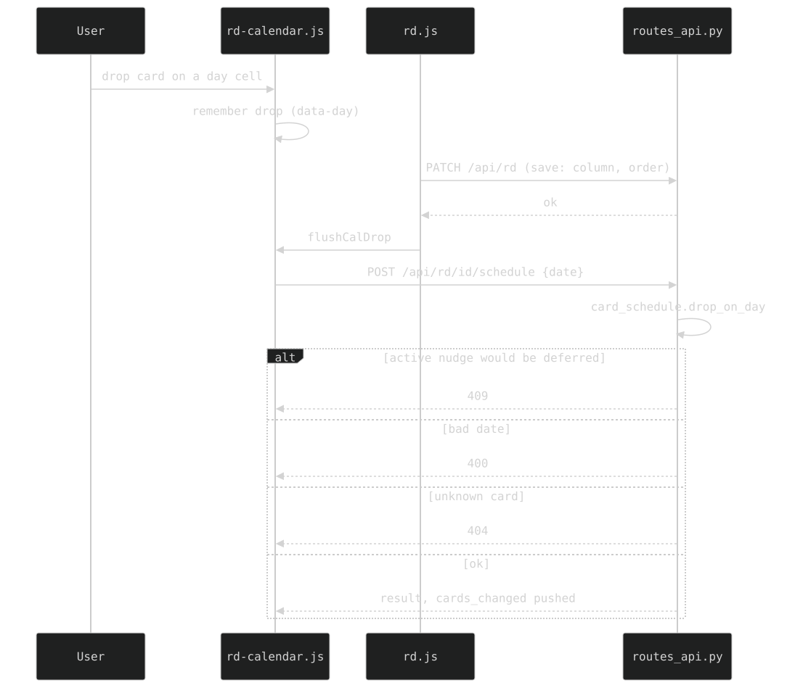

- Sortable inserts the dragged card into the hovered cell; a full card would grow the calendar mid-drag, so `#rd-calendar .cal-d > .card` is `display:none` and the cell answers with a `:has(> .card)` green `0.45` wash: **the lit cell IS the feedback**.
- The POST fires only AFTER the board's `save()` resolves (`rd.js` chains `flushCalDrop`); concurrently the save (stale `column`) could land last and undo the hq promotion.
- The reminders bar is excluded from the drop group (`put:` accepts only `#col-*`): its `onRemove` reads any exit as "no longer a reminder".

### 8f. Paging months, and the watermark

**Drag (mouse) or swipe (touch) sideways to page months** (`wireCalendarSwipe`; one month per gesture past a 45px threshold; drag right = previous). `calOffset` is never persisted, so a load ALWAYS opens on the present month. The watermark text: past month `08 >>`, future `<< 10`, present `> 09 <`. today/this-week classes key off the REAL today.

The month shows as a big glowing number behind the grid (`#cal-mark`, class `.cal-mark`: `0.12` fill + `text-shadow` glow, `filter: blur(var(--blur-xs))`, sized `min(var(--cal-h), 26vw)`). **It is a fixed SIBLING of `#rd-calendar` at `z-index:-2`, load-bearing**: `#rd-calendar` is `position:fixed` with a z-index (its own stacking context), so a negative-z child could only sink behind its own content, never behind the page's layers; as a sibling it sits under the CRT stack and above the page background. Fixed, it takes no row and cannot change `--cal-h`, so sizing it from `--cal-h` has no feedback loop.

**Gesture rules** (same as the landing wheel and `exec-zoom.js`): `user-select: none` (a drag off a text selection fires native `dragstart`, which swallows the pointer stream), `touch-action: none`, pointermove/up on **window** with NO `setPointerCapture` (stepping rebuilds the children mid-gesture). A month with a different row count changes `--cal-h`, and `.rd-board`'s top inset follows. Cells are otherwise inert.

### 8g. Bar heights are observed, not measured once

`--cal-h` rides in `.rd-board`'s top inset with `--rem-bar-h`/`--books-bar-h`; a **`ResizeObserver`** (`rd.js`) keeps all three live, because no resize event fires when the bit webfont reflows the chips (same idiom as `--nav-h`). `/rd`'s `.card.plain` opaque `color-mix` fill stays (matching `/hq`) so nothing behind the board bleeds through a card.

### 8h. The `+N` overflow needs a host, and the bar can be empty

The reminders bar shows what is within a 30-day window (plus any `pinned_reminder`); the rest is counted into a `position:absolute` `+N` button that opens the full list. **A bar's `+N` must never be parented to content that may not exist**: when nothing is visible, `buildReminders()` (like `buildBooks()`) creates an empty chip to host it. The two halves of the partition must agree: `showRemOverflow()` must keep `buildReminders()`'s `!c.pinned_reminder` term.

History: [ARCHAEOLOGY.md §8](ARCHAEOLOGY.md).

---

## 9. The landing page — a ferris wheel, not a list

`/` is public: no auth, no exec bubble. `_landing_html()` in `routes_views.py`, styles `web/landing.css`, driven by `web/landing-wheel.js`. Logged-in admins (valid `session` cookie) 302 to `/rd`; clicking a section follows the 401 redirect to the right login. An `admin` link sits bottom-right → `/login`.

Eleven sections ordered by icon hue (`_LANDING_HUE_ORDER`): recruiter · security · hosaka · aspira (`/spire`) · graph · nightfall · noodle · printer · ui · mtg · tarot. Each shows its **nav code** (`_NAV_LABELS`, same as the bottom nav, so nightfall reads `12AM` in both), its **title** (`_LANDING_BLURBS`) and one plain line (`_LANDING_DESCS`). Nav parity is pinned by `tests/test_landing_nav_parity.py`.

### 9a. One angle drives everything

A real wheel: the sections are **spokes `DTH` radians apart on a ring of radius R, seen EDGE-ON**.

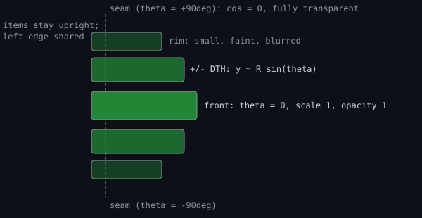

| Quantity | Formula |
|---|---|
| position | `y = R·sin θ` |
| depth | `1 − cos θ` |
| scale | `P/(P + 1 − cos θ)`, `P` = `WHEEL_PERSPECTIVE` 0.55 |
| opacity | `cos^1.6 θ` (`WHEEL_FADE_POW`) |
| blur | depth-of-field rising with `1 − cos θ`, `WHEEL_BLUR_PX` 8 at the seam |

Items stay **upright** (gondolas hang level); the arc shows in the SPACING instead.

### 9b. `DTH = (π/2)/K` is the load-bearing choice

`K` is how many slots reach the **seam** (where an item wraps from the bottom back to the top). A seam at exactly 90° means `cos θ` = 0: **an item is fully transparent at the instant it teleports**, so the ring closes with no pop for any `K`.

**`K` is solved for** (`wheelGeometry`, re-run on resize and by a `ResizeObserver` on every item): it walks `K` down from `ceil(n/2)` and takes the largest that neither collides the front pair nor pushes the outermost lit item's centre past `vh/2 · WHEEL_REACH` (1.12) — up to `2K−1` items lit. **`K` never passes `n/2`** (two offsets would name the same item). Even `n`: a spoke sits on the seam, already invisible. Odd `n`: the seam falls BETWEEN slots so `K` rounds UP — it lights every item AND narrows `DTH`, tightening the front spacing. At 11 sections the walk starts at `K`=6 (`DTH`=15°, `2K−1` = 11 lit); it only steps lower when the front pair would collide or the rim overshoots.

### 9c. Spacing

Only the FRONT pair can collide, so clearance is measured over the pairs that really sit together (taller one unshrunk) plus `WHEEL_MIN_GAP` (4px). The rim may bleed off both edges (`WHEEL_REACH`) — those items are the blurriest and faintest, so it reads as depth. `R = max(vh/2 · WHEEL_FILL, need/sin DTH)`; **`WHEEL_FILL` (0.68) is the spacing knob**, but the tallest adjacent PAIR usually sets the pitch — hence the item is `96vw` wide with a 48px icon column and a `--lh-none` title (each wrapped line saved tightens all gaps). Rim pairs may overlap by up to ~9px; only the front pair is guarded.

### 9d. The wheel genuinely turns

**Position is a float animated by `requestAnimationFrame`** (exponential settle, `WHEEL_TAU` 95ms off real elapsed time). **Nothing is CSS-transitioned** — a transition tweens in a straight line and flattens the arc — so the script writes `transform`/`opacity`/`filter`/`visibility`/`pointer-events` inline per frame. Blur is quantised to a half-pixel and dropped under 1px (a radius that changes every frame is a fresh rasterisation). Only the RESTING position is a whole slot, so a gesture always ends snapped.

| Input | Behaviour |
|---|---|
| scroll (`wheel` on window) | `WHEEL_STEP_DELTA` 60px per slot, leftover kept within a gesture and dropped after `WHEEL_GESTURE_MS` 220ms idle; a flick carries up to `WHEEL_MAX_BURST` 3 slots per event |
| drag / swipe (vertical) | turns the wheel **continuously at 1:1** (`wheelPitch` = `R·DTH`), snaps on release |
| arrow keys | step it |
| tap a lit item | turns the wheel to that slot FIRST, then follows the link |

The front item goes straight through; a press that travelled >`WHEEL_TAP_SLOP` 8px is a drag; `WHEEL_NAV_MAX_MS` (900ms) means a stalled rAF can never strand a tap. The `ResizeObserver` matters because R derives from item heights and the webfont re-wraps the blurbs with no resize event.

### 9e. Gesture details

- `body` is `touch-action: pinch-zoom` (a vertical pan would otherwise be swallowed by scroll).
- The wheel needs the **prefixed** `-webkit-user-select: none` (WebKit computes the unprefixed one to `text`; a drag off a selection fires native `dragstart` — same trap as §8f).
- pointermove/up bind to **window**, no `setPointerCapture`. The `.landing-wheel` box is `pointer-events: none` (only lit items take taps, so the `admin` link stays clickable), which is why listeners live on `window`.
- **Items scale about their LEFT edge** (`transform-origin: 0% 50%`) so the icons hold one vertical column as the wheel turns. Icons `--radius-4`; titles `--fw-bold`.

History: [ARCHAEOLOGY.md §9](ARCHAEOLOGY.md).

---

## 10. The CRT effect stack (`_CRT_FX`)

**Who gets it.** `_render_page` (unless `crt=False`: `/spire`), the landing, `/graph`, and both login screens (`/login` reads the raw static shell, `/guest` the bare one; neither picks the stack up from anywhere else). `_CRT_FX` (`pages.py`) is five divs plus `web/crt-zoom.js`. Layers are `position:fixed`, `pointer-events:none`, at `--z-modal`, so they sit over a form without taking a click. Defined in `chrome.css`.

**Paint order = DOM order, and it is load-bearing:**


| Layer | What it is |
|---|---|
| `.cyber-bg` | phosphor tint — `--cat-social` dialled TOWARDS WHITE (`calc()` on its channels: saturation −40, lightness +25; no new literal) as 4px-period stripes peaking in the gaps between the black lines @ 0.45, plus a centre glow @ 0.06. Static. |
| `.cyber-lines` | **static black scanlines** (`--bg-hsl` @ 0.45), `hard-light` — the ONE blend layer. A thin triangle ramp (0.75px shoulder, NOT a hard stop), near single-frequency so it does not alias into moiré on zoom. After bg so it re-blacks the line rows the tint lit. |
| `.cyber-blur` | **CRT glass** — `backdrop-filter: blur(var(--blur-2xs))` (0.5px) over the static composite. |
| `.cyber-crt` | **phosphor punch** — `backdrop-filter: brightness(0.85) contrast(1.5)` over the same composite, under the sweep. |
| `.cyber-scan` | sweep beam, 480px tall, same whitened hue @ 0.06, plain alpha, `cyber-sweep` 7s linear. The **ONE animated layer**, painted LAST. |

Hue and opacity are different knobs: dropping a stripe's alpha makes scanlines fainter, not less green.

### 10a. The invariant

> A `backdrop-filter` / `mix-blend-mode` layer is a full-viewport readback with **no partial invalidation**. Cheap ONLY when nothing under it animates (the compositor caches the texture); ruinous when it sits OVER an animated layer (re-fires every frame, forever).

So the glass and punch cache (their backdrop is bg+lines+static content) and the sweep stays ABOVE them. `.cyber-scan` stays plain-alpha (a blend mode on the animated layer is the same trap). Never animate anything beneath the glass. `prefers-reduced-motion` stops the animations.

### 10b. Zoom-lock

Scanline geometry is `calc(N * var(--crt-u))`, `--crt-u = 1px * var(--crt-scale)`. `web/crt-zoom.js` (loaded via `_CRT_FX`) sets `--crt-scale = baseDPR/currentDPR` on resize, holding a constant on-screen size across browser zoom (not written on load; pinch-zoom does not change DPR, so it is uncompensated).

### 10b-bis. CRT lite (measured, per machine)

**The cached-composite argument holds only on a GPU.** With software compositing both backdrop panes re-run on the CPU every frame anything moves, and the sweep moves every frame. Without the panes + sweep the landing goes from ~5fps to 60fps on a throttled software renderer; the blend layer and the wheel's blur were measured and are NOT the cost.

`web/crt-lite.js` (loaded on `/` only, via `_LANDING_SCRIPT`) times up to `SAMPLES` 30 frames or `WINDOW_MS` 1.2s, starting 500ms after `load`; a median over `SLOW_MS` 25ms adds `html.crt-lite`, and chrome.css hides `.cyber-blur`, `.cyber-crt`, `.cyber-scan` (static scanlines + tint stay). The verdict is kept in localStorage `crt.lite` (a timestamp) for 7 days. Headless WebKit/Chromium on the droplet are software-composited and go lite — clear `localStorage['crt.lite']` and pre-empt the check when the full stack is under test.

### 10c. Dimming on the dense pages

`/rd`, `/hq` and `/mtg` keep all five layers ON TOP at `--z-modal`, **dimmed to 0.75** via the shared `web/crt-dim.css` (linked from `rd.html`, `hq.html`, `mtg.html`): `.cyber-bg`/`.cyber-lines`/`.cyber-scan` at `opacity: .75`; glass `blur(calc(var(--blur-2xs) * 0.75))`; punch `brightness(0.8875) contrast(1.375)`. `/tarot` stays at full strength — its CRT is the mood.

**Dim with `opacity`, never by rewriting gradient alphas** — a scaled alpha lands off the palette snap scale and the lint rejects it. Paint order is untouched, so the backdrop panes still cache; a card DRAG is the one thing that dirties them per frame.

`.exec-nav` sits at `--z-top`, above the fx; the `/graph` nav override (`graph-overlay.css`) matches it.

History: [ARCHAEOLOGY.md §10](ARCHAEOLOGY.md).
## 11. `/graph` — serve-time transforms over a generated artifact

Guest-gated (Turnstile). A graphify codebase visualisation served from the `./graphify-out` volume, which graphify rebuilds nightly at 05:00 (host cron, §11e / CLAUDE.md § *Cron*).

**Everything below is a string transform applied at SERVE time to graphify's emitted HTML/JS — never an edit to the generated file** (a rebuild overwrites it wholesale).

`graph_page()` lives in `routes_graph.py`. The transforms split four ways:

- **`graph_scrub.py`** — privacy scrubs + node/edge drops (what survives)
- **`graph_style.py`** — communities/colours, node colour objects, tooltips, labels, unlit edges, stats header (how it LOOKS)
- **`graph_geometry.py`** — per-type shape, size by degree, occlusion percentile (how a node is FORMED)
- **`graph_layout.py`** — physics tune + baked layout (where nodes SIT, §11e)

chrome.css, the cyber-fx bg, the nav (guest nav for non-admins, full nav for admins), `web/graph-overlay.css` and the `web/graph-*.js` stack (order fixed by `_GRAPH_OVERLAY_JS`) are injected the same way. Content-hash ETag + `no-cache`.


### 11a. Applied per request, COMPUTED once per artifact


- **`_cached()`** memoises rendered bytes against `(graph.html st_mtime_ns, st_size, graph-layout.json (mtime_ns, size) or None)` — a re-bake invalidates too. One entry per `(guest, lite)`; the whole dict clears when the key changes. Warm TTFB 0.13s vs 2.5–2.9s of CPU per cold render.
- **`_render()` is pure** (same bytes in, same bytes out): the community cap breaks ties by NAME (`_ranked`) so the ETag survives a restart.
- **Cold render runs off the event loop** (`asyncio.to_thread` under `_CACHE_LOCK`) — a blocking body would stall SSE and the nudge loop.
- **`run_graph_warm_loop`** (lifespan) re-renders all four `(guest, lite)` variants whenever graph.html's `(mtime_ns, size)` changes, polling every 600s. Failure is never fatal.
- **`?relayout=1`** (the nightly bake) renders WITHOUT a baked layout, never cached.

**`_externalise_boot` lifts every inline `<body>` script into one external payload**, served by `GET /graph/boot.js?v=<md5 16>` (guest tier, `immutable`, `X-Payload-Bytes` = decoded length). `_PAYLOADS` keeps the last `_PAYLOAD_MAX` (6) digests; an unknown hash renders both lite variants once and looks again. The payload is bracketed with `__GP_PAYLOAD_START`/`__GP_PAYLOAD_MS` and carries `window.GRAPH_LAYOUT_TALL`. The shell gets `window.GRAPH_BOOT_URL` instead of a `<script src>`: **`web/graph-cover.js` fetches the payload itself** so the bar tracks real bytes (it falls back to injecting the tag; graph-overlay.js injects it if the loader never ran). `_defer_scripts` then defers every same-origin `src` script **except graph-cover.js** (the one script that must be live while the payload is on the wire); deferred scripts run in document order, so vis → payload → overlay stack keeps its old order.

**TRAP: `_externalise_boot` MUST run after every node-JSON edit** (last of the data transforms, immediately before the `</head>`/`</body>` chrome injections, so it lifts only graphify's own scripts and not ours; `_defer_scripts` is the final step). Every scrub/drop/merge is a string edit on the inline node JSON, and `graph_layout_key` hashes that same text; run first, they all no-op on a 9KB shell, the key comes back empty, and the served payload is the RAW unredacted artifact. Check the served PAYLOAD, not the page.

**Loading cover** (`_GRAPH_BOOT` markup, `gpCover`): see "Cover and loading bar" in §11f.

**Opt-in variants** (a phone gets the FULL graph by default):

- **`?lite=1`** — `_prune_for_lite` keeps the busiest `_LITE_NODES` (600) by degree plus edges among them, via `_prune_graph_nodes`. Runs AFTER `_apply_graph_layout` (survivors keep baked x/y; the layout key still hashes the full graph) and `_fix_graph_stats` re-runs. `?full=1` is not read by the server today — lite is opt-in only. The bake never renders lite.
- **`?pack=1`** (client, `graph-lattice.js`) — shelf-packs the communities as rigid tiles to the viewport aspect; the stretch is skipped while it runs. Off by default.

Client geometry (the snap, lattice, opening view, cascade, overlay): §11f.

**Shape carries TYPE, colour carries community** (`_TYPE_SHAPES`, `graph_geometry.py`): `code` → `triangle`, `rationale` → `hexagon`, `document` → `triangleDown`. No `circle`/`ellipse`/`box`/`text` in the set — vis draws those with the label inside and ignores `size`, which would discard the degree encoding. The per-node `shape` must be named in graphify's DataSet mapper (same explicit-field trap as baked x/y); the global `nodes: { shape }` is `_TYPE_SHAPES["code"]` as fallback. The overlay glyph (`web/graph-glyph.js`) mirrors vis's own triangle offset (1.15x radius, y shifted 0.275): change shapes in `_TYPE_SHAPES` alone.

**Any change to the node/edge drop code changes `graph_layout_key` and misses the bake** (the key hashes surviving ids + edge pairs; community/colour/size/label edits do not move it) → every visitor pays the ~30s browser stabilisation until `scripts/graph-layout.py` is re-run by hand (~20s). The nightly covers graphify rebuilds only.

History: [ARCHAEOLOGY.md §11](ARCHAEOLOGY.md#11-graph)

### 11b. Drops, in order

Order in `_render` (all in `graph_scrub.py`):

| Function | Drops | Why |
|---|---|---|
| `_drop_graph_redacted_nodes()` | DROP ids in `_GRAPH_REDACT_IDS` + every label over `_LABEL_MAX` (20) | a few docstring summaries leak internals (bearer-auth scheme, `EXEC_SAY_KEY` name); long labels are prose, not symbols. Was a blank-to-`[redacted]` until 2026-10-17: after the spire/noodle submodules landed it kept 1,838 of 6,082 nodes on the canvas just to say "redacted" and /graph lagged; dropping them took the served graph to 3,792 nodes / 5,802 edges |
| `_drop_graph_prefixed_nodes()` | `source_file` under `_GRAPH_DROP_PREFIXES` | table below |
| `_drop_graph_moltbook_nodes()` | substring `moltbook` in id+label+source_file | heartbeat plumbing rides inside routes_views.py |
| `_drop_graph_library_nodes()` | `file_type == code` AND (no `source_file` OR label in `_GRAPH_LIB_LABELS`) | external symbols: `BaseModel`, `Request`, `WebSocket`, `FastAPI`, `Path`, `datetime`, … |
| `_drop_graph_inferred_edges()` | edges with `dashes` (INFERRED) | keeps EXTRACTED only; **recomputes every node's `degree`** from what survives |
| `_drop_graph_orphan_nodes()` | nodes no surviving edge touches | would otherwise still be parsed, built and walked per redraw |
| `_drop_graph_small_islands()` | connected components under `min_size` 5 | pairs of files referencing only each other read as rim specks |

Every NODE drop (all but `_drop_graph_inferred_edges`, which filters `RAW_EDGES` directly) goes through `_prune_graph_nodes`, which also removes dangling `RAW_EDGES`, emptied `LEGEND` rows and any `hyperedges` referencing a removed node.

**Ordering rule:** inferred edges → orphans → islands. Dropping edges splits components and orphans nodes, so each later pass must measure the graph the previous one left. `_fix_graph_stats` (the `#stats` header) runs after all of it.

`_GRAPH_DROP_PREFIXES` (one tuple, mirrored in the repo-root `.graphifyignore` so these never count against `GRAPHIFY_VIZ_NODE_LIMIT` — keep the two in step; `.graphifyignore` also ignores `**/vendor/`, `*.min.js` etc. at extraction):

| Prefix | Why |
|---|---|
| `api/tarot/book/` | the Pollack tarot reference text; the tarot ENGINE stays |
| `web/vendor/` | vendored vis-network, one node per mangled name |
| `nightfall-incident/nightfall-src/` | the game's own React/TS source (a guest page, not exec-fn architecture; its BUILT output is what is served) |
| `api/data/` | runtime data dir (JSON key structure, not values) — not architecture. Root-only prefix |

Submodules (`apps/spire`, `apps/noodle`, `claude-box`) are NOT dropped; `_logical_key` folds each `apps/<name>/…` into one community named for it.

History (node counts, bake-key observation, what each drop removed): [ARCHAEOLOGY.md §11](ARCHAEOLOGY.md#11-graph)

### 11c. Communities are re-derived by FEATURE, then CAPPED

vis cycles a 10-colour palette, so graphify's fine-grained communities collide into colour-noise. `_merge_graph_communities()` regroups nodes by `_logical_key` (subdir module, else the filename family: `api/tarot/*` + `web/tarot-*.js` → "Tarot"), gives each its own colour from `_COMMUNITY_COLORS` (Tableau-20 + Dark2 = 28 hues, biggest = index 0), reassigns `community`/`community_name`/`color`, and rebuilds `LEGEND` biggest-first. `/graph`-page-only; `graph.json` / `GRAPH_REPORT.md` keep graphify's full set.


- A feature under `_MIN_COMMUNITY` (10) nodes folds into its top-level dir bucket (`_node_group_key`, e.g. API/Web/`(root)`).
- That fold does not bound the count (and raising the threshold plateaus ~20), so `_cap_communities()` caps at `_MAX_COMMUNITIES` (**14**): tail → top-level dir, still over → a single `(other)` bucket.

History: [ARCHAEOLOGY.md §11](ARCHAEOLOGY.md#11-graph)

### 11d. Size, labels, shape, physics, stats

- **Size** (`_size_graph_by_degree`): `min(_SIZE_MAX, _SIZE_MIN × _SIZE_GROWTH^(degree−1))` = `min(88, 12 × 1.14^(d−1))`, degree floored at 1. Reads `degree` AFTER `_drop_graph_inferred_edges` recomputed it. **Both ends scale together** — the ratio encodes degree; the ceiling must stay below the lattice step so hubs don't sit on neighbours (x1.25 was tried and reverted).
- **Occlusion** (`_unocclude_small_nodes`, after sizing): nodes at or under the `_OCCLUDE_PCTL` (0.90) size get `transparent` backgrounds (normal/highlight/hover), so only big nodes stop edges. Nearest-rank `_pctl` (never interpolated). Ships `GRAPH_OCCLUDE_MIN` and `GRAPH_WAVE_MIN` (`_WAVE_PCTL`, also 0.90 — kept separate on purpose) so the overlay gates on the same numbers; percentiles are never recomputed in JS.
- **Edges** (`_hide_graph_edges`; the name is historical): every edge `color.opacity = _EDGE_OPACITY` (= `_NODE_OPACITY`, **0.2**), `width = _EDGE_WIDTH` **3**. Written PER EDGE — graphify's per-edge `color` object outranks any global option. Colour is left alone (inherited from the from-node). The cascade's lit edges are on the overlay canvas.
- **Nodes** (`_node_color`): fill `_GRAPH_BG` `#000000` (keep equal to `--bg-hsl`), border = community colour at `_NODE_OPACITY` alpha; highlight border `#ffffff`; hover keeps the full-strength colour (read by the info-panel stripe). The unlit baseline is the BORDER alpha, never the node `opacity` option (that would make the fill translucent, killing occlusion). `_restyle_graph_nodes` also sets global `borderWidth: 2` and repoints `nb.color.background` → `nb.color.border` in `showInfo()`.
- **Labels** (`_label_graph_nodes`): site mono font (`_NODE_FONT`, size 12). Long labels are already gone (`_drop_graph_redacted_nodes`); graph-overlay.js `isRedacted` is a defensive leftover that now matches nothing.
- **Tooltips** (`_drop_graph_tooltips`): strips the unquoted `title: x.title,` from both DataSet mappers (`_TOOLTIP_FIELD_RE`); the data arrays keep their JSON-quoted `title`, and the click panel reads `label`/`_*` fields.
- **Physics** (`_tune_graph_physics`, graph_layout.py): replaces graphify's `physics:` block (matched whole, anchored on the following `interaction:` key) with one-shot `forceAtlas2Based` — `theta 0.8`, `gravitationalConstant -628`, `centralGravity 0.025`, `springLength 30`, `springConstant 0.22`, `damping 0.9`, `avoidOverlap 1`, `maxVelocity 50`, `minVelocity 4`, `stabilization { iterations 300, updateInterval 20, fit true }`. Edges become `smooth: false` (`selectionWidth: 3` kept). graph.html's `stabilizationIterationsDone` handler then turns physics off. `_render` also sets `layout: { improvedLayout: false }`. Nothing above 300 iterations shows in the picture (walked 270→370→300→325→300); raising it does NOT invalidate the bake (the key hashes ids and edges, not coordinates).
- **Stats** (`_fix_graph_stats`): rewrites the `#stats` header (graphify bakes PRE-scrub counts) after the drops and again after the lite prune.
- All array transforms use a **per-line anchored** array regex (`_array_re`): a non-greedy `[.*?]` truncates at a `];` inside a node title.

History: [ARCHAEOLOGY.md §11](ARCHAEOLOGY.md#11-graph)

### 11e. The layout is baked, not stabilised in the browser

Stabilising ~300 forceAtlas2 iterations takes seconds on a desktop and ~30s on a phone, per visit, for an identical result. So `scripts/graph-layout.py` computes it once, nightly, in a **real vis-network in headless WebKit** (Playwright) — the baked layout is exactly what vis would produce, including the client lattice snap's inputs. Output `graphify-out/graph-layout.json` = `{key, presnap, pos:{id:[x,y]}, tall:{…}}`, atomic write; `graphify-out` is gitignored (droplet disk only).


- **Key** = md5 of sorted node ids + sorted `from>to` edge pairs (`_layout_key`), read back off the rendered page (`window.GRAPH_LAYOUT_KEY`) so writer and reader can't disagree. Identical across guest/admin (they differ only by nav).
- **Hit:** `_apply_graph_layout()` writes x/y into `RAW_NODES`, adds `x: n.x, y: n.y` to graphify's DataSet mapper (it lists fields explicitly), and replaces the physics block with `physics: { enabled: false }`. The overlay is told via `window.GRAPH_LAYOUT_CACHED` (no `stabilizationIterationsDone` fires with physics off, and that event reveals the page).
- **Every failure is a no-op** (missing/unreadable file, key mismatch → `read_graph_layout` returns None) that falls back to browser stabilisation: a stale layout is worse than a slow one.
- **Two bakes**, because vis has no per-axis gravity: `_BAKES` = `pos` target aspect **1.60** @ 1440x900 (baked into `RAW_NODES`), `tall` **0.50** @ 430x932 (rides in the PAYLOAD as `GRAPH_LAYOUT_TALL`, so the 9KB no-cache shell stays small). The script injects `_SHAPE_JS`: on each `stabilizationProgress` it squeezes the cloud toward the target by `(target/current)^_SHAPE_RATE`, `_SHAPE_RATE` **0.2**, split across x and y so area is preserved. It undershoots (springs pull back); each run logs `target -> got` per bake. The client picks the nearer bake (`useBakedAspect`) and stretches the rest.
- **Reads `window.__GP_PRESNAP`** (captured before any pack/stretch/quantise) rather than `network.getPositions()`, else the client snap is baked back in. It waits for body class `gp-loaded`, fetches with `Authorization: Bearer <API_KEY from .env>`, and both bakes must return the same key.
- **Cron:** host `/etc/cron.d/exec-fn-graphify` → `0 5 * * *` `scripts/graphify-daily.sh` (as `wai-root`): graphify rebuild (600MB `RLIMIT_AS`, `GRAPHIFY_VIZ_NODE_LIMIT=8000`), a hard failure if no fresh `graph.html` was written (previous one restored from `.graph.html.prev`), then the bake. A bake failure is logged and NON-fatal. Log: `data/cron/…__graphify.log`.
- **TRAP: cron has no session bus**, so `systemd-run --user` fails with "Failed to connect to bus" unless the job exports `XDG_RUNTIME_DIR=/run/user/$(id -u)`. The `MemoryMax=700M` scope is not optional (WebKit is 200–400MB; the OOM killer picks by badness, §17).

History: [ARCHAEOLOGY.md §11](ARCHAEOLOGY.md#11-graph)
### 11f. The client-side overlay

The server decides everything it can (11b/11d); the client adds the firing animation, the audio drive, the loading cover and the viewport lattice. **No modules: 19 same-global-scope scripts, so LOAD ORDER IS THE CONTRACT** (`_GRAPH_OVERLAY_JS`, `api/routes_graph.py:75`, injected before `</body>`; every file has a `?v=` that `asset_version.py` fills at serve time).


#### File set, in load order

| File (global) | Owns |
|---|---|
| `graph-cover` (`gpCover`) | loading cover + payload loader; **not deferred** (deferred, it sits behind the payload it reports on) |
| `graph-ink` (`graphInk`) | colour arithmetic: `sat(hex)` = saturation x `SAT_BOOST` 1.75 (clamped), returns HEX; `WHITE` is the one literal on the canvas |
| `graph-surface` (`graphSurface`) | `#gp-pulse` canvas + backing store (**DPR capped at 2**), resize/woken-tab repair, the real page bg (`bg()` = computed `body` background; `setBg` is only a fallback and rejects `transparent`) |
| `graph-glyph` (`graphGlyph`) | node shapes exactly as vis draws them (`TRI_SCALE` 1.15, `TRI_SHIFT` 0.275; `triangle`/`triangleDown`/`dot`/else hexagon); `at()` takes an explicit centre so a front grows concentrically |
| `graph-pulse-draw` (`graphPulseDraw`) | the canvas paint passes and their ORDER; `HALO_OUTER` 2.6 / `HALO_INNER` 1.5 x radius, `EDGE_W` 1.6, `EDGE_SWELL` 0.6 |
| `graph-seed` (`graphSeed`) | WHERE a cascade starts: `any()` (size^`SEED_POW` 2, prefix-sum + binary search), `at(fx,fy)` (nearest `NEAR_AT` 24), `near(id, pool)` (`NEAR_POOL` 64, ceiling `NEAR_MAX` 320, falloff `NEAR_SOFT` 0.6 of the pool's own radius) |
| `graph-bands` (`graphBands`) | spectrum: bass/mid/treble, rms, spectral flux, log centroid (60-8000Hz), pan |
| `graph-norm` (`graphNorm`) | adaptive windows: `amp`, `loud`, `pitch`, `sharpness`, `hit`, `bloom`, `placeX/Y` |
| `graph-source` (`graphSource`) | capture + device selection |
| `graph-lit` (`graphLit`) | the flash envelopes (the model; its draw half is shared by several passes) |
| `graph-bias` (`graphBias`) | how audio bends the cascade: `reach`, `pool`, `node`, `length`; every read guarded, neutral with no audio |
| `graph-glow` (`graphGlow`) | the accumulated "charge" + its own two passes |
| `graph-ring` (`graphRing`) | the beat wavefront, end to end incl. its pixels |
| `graph-pulse` (`graphPulse`) | the cascade model: queue, hops, catch rolls |
| `graph-tempo` (`graphTempo`) | tempo, phase grid, `onBeat`, `hopMs`, bar accent |
| `graph-audio` (`graphAudio`) | AudioContext wiring, onset test, `fire()`, seed count |
| `graph-audio-ui` (`graphAudioUI`) | the control, source picker, readout, file-drop |
| `graph-lattice` (`gpLattice`) | viewport stretch + lattice snap; precedes the overlay because `openView` calls `snap()`/`bounds()` |
| `graph-overlay` | what's left: see below |

`graph-overlay.js`: `patchInfoPanel()` wraps graph.html's `showInfo()` (retries until it exists; redacted nodes get Type/Source blanked and neighbours removed; **opens** the panel and moves the toggle glyph; writes the label into the `<h3>` and removes the duplicate first `.field` by TEXT match, never position), `addToggle()` (the node-info collapse button), `setupZoomLimits()` (hard walls, clamps in place), `watchWake()` (on `visibilitychange` + `persisted` `pageshow`: `graphPulseDraw.resize()` + `network.redraw()`; **never reloads** — a /graph reload is a black page for the whole load), `centreBesidePanel()` (tap centres the node in the space beside the panel; next frame, no animation — animated pans are full vis redraws).

**Opening view**: `contain x FIT_MARGIN` (0.8) — the same expression `setupZoomLimits` clamps the outward wall to, so the page opens at the furthest zoom-out and the first gesture can only go inward. The cover lifts after vis's `afterDrawing`, then the pulse's first PAINTED frame (`graphPulse.init(onReady)`); `READY_CAP` 3s (from the camera move) and `DRAWN_CAP` 800ms (from `afterDrawing`) lift it unconditionally, whichever lands first. `gpCover.CAP` (`LOAD_CAP` 180s) declares failure only if `network` never appeared, else it reveals. `snapToGrid` writes `network.body.nodes[id].x/y` directly and calls `network.redraw()` ONCE (`moveNode` per node queued one vis redraw per node: 160 draws/16s).

**Trap — palette lint**: it reads source with whitespace stripped, so any colour-function name followed by `(` (code OR comment) reads as a new raw colour. That is why the helper is `hueChan` and `sat()` returns hex. Rename or reword; never baseline.

#### The firing overlay (`graph-pulse*.js`)


- **Own transparent canvas `#gp-pulse`** (`--z-raised`, `pointer-events:none`, sized to `#graph`) over vis's; **vis never redraws for it** (a warm vis redraw is ~1.5s). Cost per frame is O(lit): world positions are read once (`getPositions()`, layout is frozen), the camera transform is `(world - view) x scale + half-canvas` from `getScale()`/`getViewPosition()` each frame.
- **Split**: `graph-pulse.js` knows cascades, nothing about pixels; `graph-pulse-draw.js` the reverse. The model hands `init(pos, lit, litEdges, level, satLevel, charge maps)` once; those objects are mutated in place, never reassigned. `TERMINAL_ODDS` is passed INTO `graphSeed.index()` (one definition). `SIZE_FLOOR`/`SIZE_CEIL` (12/88) mirror `graph_geometry._SIZE_MIN/_SIZE_MAX` — move together.
- **Runs everywhere** (every size, every pointer; a tap always seeds). Under the CRT stack deliberately: 2 fps vs 18 with the stack hidden on the GPU-less droplet WebKit, our canvas ~0ms either way — the cost is compositing, not drawing. A frame with nothing lit/charged/ringing skips its draw (`graphGlow.charged()` and the ring are part of the idle check).
- **Hover does nothing to the canvas.** A tap seeds a cascade at the node (`graphPulse.seed(id)` on vis `click`) and **guarantees its first hop** (every direct neighbour + edge lights, `force`); a tap draws none of the extra burst seeds.

| Rule | Value |
|---|---|
| Ambient clock | one iteration per `ITER_MS` 1s, `ITER_LIFE` 2s; never gated on whether anything is lit, but skipped while audio capture is on (`graphAudio.driving()`); `MAX_LIVE` 8 (safety bound) |
| Burst | `SEEDS_PER_ITER` 8 (caller may ask, `MAX_SEEDS` 20); extras drawn from the first seed's `near` pool, weighted, with replacement, `SEED_TRIES` 4/seed |
| Stagger | one seed per `min(SEED_STAGGER_MS 100, SEED_WINDOW_MS 800 / want)`; a staggered seed is claimed in `seen` at once, queued `seed:true`, lights unconditionally and lights NO edge |
| One event | all seeds share the iteration's `seen` + queue |
| Spread | neighbour queued at `HOP_MS` 110 +/- `HOP_JITTER` 30% (audio locked: `hopMs()` = period/4); catch odds `P_MIN` 0.55 (size floor) .. `P_MAX` 1 (ceil), then `graphBias.reach`, x `graphBias.length`; terminal (degree 1) = `TERMINAL_ODDS` 0.15 |
| Dying | a failed roll is SPENT (nothing walks past) — the only reason cascades end; `seen` is per-iteration (each node tried once) |
| Node life | `DUR_MIN` 2500 + `DUR_PER_DEG` 290 per edge (cap `DUR_DEG_CAP` 12) x (1 +/- `DUR_JITTER` 0.4); timbre bends life (`DUR_SHARP` 0.55) and attack (`ATT_SHARP` 0.6) by treble share |
| Envelope | `ATTACK_MS` 280 rise, then `(1-t)^DECAY_POW` 0.85 (concave); multiplied by the hit's strength |
| Edges | the edge a cascade crossed lights for `EDGE_DUR` 900; an edge only ever varies in SATURATION, never hue (tinted from the from-node) |
| Saturated layer | a duplicate pass (halos, outline, edge) in the node's community colour, `SAT_MULT` 3 x as long: white flash decaying into a coloured afterglow. Colour computed ONCE per node at `index()` (`pos[id].c`); envelope is the model's own `satLevel` |
| Unlit baseline | `_NODE_OPACITY` 0.2 (`graph_style.py`) as the node BORDER's alpha and as each edge's `color.opacity`; the node `opacity` option is not used (it would thin the fill and kill occlusion); edge opacity must be written PER EDGE (a global `edges.color.opacity` is outranked) |

**A lit node is an OUTLINE and a HALO, never a fill** — the interior stays black (`A_FILL` is retired). Paint order (diagram above) is the implementation; under `'lighter'` additive layers commute, so the order only decides where the non-additive passes land: halos -> `clearNodes` (`destination-out`: erases only the overlay's own pixels, NOT a bg fill, which would hide vis's unlit layer below) -> `punchNodes` (opaque bg fill on nodes above `GRAPH_OCCLUDE_MIN` only) -> outlines (charge, white, saturated) -> wavefront (`graphRing.draw`: on a scratch layer, masked `destination-in` to the canvas's own pixels so it lands only on nodes, then blended `saturation`) -> edges (`destination-over`: paint beneath, so a big node's opaque interior occludes them and a small node's cleared interior shows them). Cost: where an edge crosses a halo it reads slightly dimmer.

**The node fill must be the real page background**: `graphSurface.bg()` reads the computed body bg; `_GRAPH_BG` (`graph_style.py:195`) must equal `--bg-hsl` (`#000000`). A wrong or `transparent` bg shows as navy shapes / duplicated rotated nodes / bright hub centres (`setBg` is the single gate).

**Occlusion** (11d): only the biggest tenth of nodes occlude — `_OCCLUDE_PCTL` 0.90, nearest-rank percentile of actual sizes, computed once server-side (`graph_geometry.py:113`) and shipped as `window.GRAPH_OCCLUDE_MIN` (three layers gate on it: unlit fill, lit punch, wavefront). The wavefront has its own cut `_WAVE_PCTL` 0.90 -> `window.GRAPH_WAVE_MIN`. `_unocclude_small_nodes` MUST run after `_size_graph_by_degree` and touches only the three `background` keys (`hover.border` keeps the full-strength colour the saturated ink reads). The client uses the WORLD size `pos[id].r`, never a drawn radius.

#### Charge (`graph-glow.js`) vs lit

Two separate mechanisms; conflating them is wrong both ways. **Lit** = the cascade flash, wall-clock timings (above). **Charge** = how OPAQUE a node has become: every hit adds `GAIN` 0.22 (never resets) and drains at a RATE set by the smoothed audio level (`graphAudio.loudness()`, follower 0.97/frame): `FADE_LOUD` 110s per full drain at peak, `FADE_SILENT` 1.6s, `FADE_AMBIENT` 2.0s with no audio. Edge charge drains at `EDGE_FADE` 0.45 of the node time. The charge draws UNDER the flash with no halos (cheap; it can cover much of the graph), `DT_CAP` 100ms. **Every `graphGlow` and `graphRing` call goes through a no-op shim** (`glow()`/`ring()` in `graph-pulse.js`; the tree is edited live, and an unguarded missing global THROWS inside the rAF and kills the whole cascade).

#### Wavefront (`graph-ring.js`)

A big node that lights ON THE BEAT throws one growing, fading triangle. **Gates**: WHERE `p.r > GRAPH_WAVE_MIN` (fallback occlusion cut, then `MIN_R_FALLBACK` 20); WHEN `graphTempo.onBeat >= ON_BEAT_MIN` 0.6 (1 with no lock). **One front per beat across the graph** (`BEAT_GAP` 0.5 of a period; `BEAT_FALLBACK_MS` 840 unlocked); life clamped to one beat so fronts never nest; `MAX_LIVE` 4 (safety). Always an UPWARD triangle (shape = type, a front isn't a type claim), random quarter-turn from `TURNS`, `GROW` 300 x radius (x `1 + BLOOM_GROW` 0.6 x `bloom()` captured ONCE at release), linear (`GROW_EASE` 1), `FADE_POW` 1.1, `A_RING` 0.55, `DUR_BASE` 1600 + `DUR_PER_R` 12 per radius. **Stroke scales strictly with the shape** (`W_AT_NODE` 1.4 must equal `nodeStroke`'s lineWidth in `graph-pulse-draw.js` — move together) so it reads as zooming in on the node's outline. Pixels: stroked on a device-pixel scratch layer, masked `destination-in` against the main canvas, blended `'saturation'` (neutral ink; a hue-bearing stroke under `source-atop` rewrote community colours), then `'lighter'` restored. **Nodes do NOT rotate** (vis's static copy can't be re-oriented without a ~100ms full redraw per beat); only the front turns. Fired from `graphLit.fire` (the one place a node hit is announced).

#### Audio drive (`graph-source`, `graph-bands`, `graph-norm`, `graph-tempo`, `graph-audio`, `graph-audio-ui`)


**Desktop only, opt-in**: the control is not rendered without `getDisplayMedia` or on a coarse pointer; nothing is captured until tapped. The UI is reached through guarded `say`/`paint`/`flash`, so analysis runs with no UI. A page cannot read the device output (no iOS system capture; Safari/Firefox put no audio on a `getDisplayMedia` stream), so sources, best first:

| Source | Prompt | Notes |
|---|---|---|
| dropped local **file** | none | the page plays it (`createMediaElementSource`); raVe `Playlist.js` |
| shared **tab** (Chrome/Edge) | share picker | real output, works with headphones; an unticked "share audio" returns video and NO audio (named, not silent) |
| **loopback** input (Monitor of..., Stereo Mix, BlackHole) | mic | offered, never assumed (`LOOPBACK` regex) |
| **microphone** | mic | hears the room |

`graphSource` resolves `{stream, el, label, audible}` and rejects with a `why` TAG (`denied`, `no-device`, `cancelled`, `no-share-audio`, `failed`), never a message. The live source is NAMED and chosen from a picker (labels are blank until a permission exists, hence `list inputs...`).

- **Bands** (`graph-bands`): 4096-point FFT, **no lowpass**, `smoothingTimeConstant` 0, dB window `MIN_DB` -90 / `MAX_DB` -10, noise `GATE` 0.02, per-band `ATTACK` 0.6 / `RELEASE` 0.08. Crossovers re-cut every `RECALC_MS` 2s at the equal-energy thirds of a ~5s average (`AVG_A` 0.003), clamped `SPLIT1` 80-400 / `SPLIT2` 1000-6000 and ordered after clamping. `bassRaw` is exported UNSMOOTHED (tempo autocorrelates it). Energy is summed over the band, never averaged across the spectrum.
- **Norm** (`graph-norm`): every value is 0..1 against its own history, neutral with nothing listening (hit 1, sharpness 0.5, pitch 0.5, loud 0). `amp` = held level vs a decaying peak (`HOLD_FALL` 0.78, `PEAK_DECAY` 0.99995, `PEAK_FLOOR` 0.02); `loud` follower `LOUD_FALL` 0.97; `pitch` centroid window (`CENT_RELAX` 0.0008, `CENT_MIN_SPAN` 0.06); `sharpness` treble share (`SHARP_RELAX` 0.0008, stepped ONCE per frame by `graphNorm.step`); `hit` = flux / running MEDIAN of `HIST_N` 45 frames, `HIT_FLOOR` 0.45 .. 1 over `HIT_SPAN` 2.6 (median, not mean; ratio taken BEFORE the frame joins the history); `bloom = amp x (1 - sharpness)`. `placeX()` is a reflecting random walk with momentum (`X_STEP` 0.09, `X_TURN` 0.45, speed `X_SLOW` 0.55..`X_FAST` 2.0, `X_HOME` 0.5; reflection flips velocity too); `placeY = 1 - pitch`. **Allocation-free in the analysis path** (typed-array ring, out-params) — allocation reads as audio jitter.
- **Onsets**: spectral FLUX over `SENS` 1.32 x the local median, `FLUX_FLOOR` 0.002, debounced `MIN_GAP_MS` 190. Tempo runs on bass energy.
- **Tempo** (`graph-tempo`): autocorrelation of the onset envelope on a fixed `ENV_HZ` 50 grid (each bucket keeps its MAX), 60-180 bpm; window `ENV_N` 600 (12s), estimating from `ENV_MIN` 300 (6s), every `TEMPO_MS` 1s; **octave correction** (the winner is offered its double, `OCT_KEEP` 0.7; `PREF_LO/MAX` 90-150); **rolling MEDIAN of the last `VOTE_N` 8** estimates (median: errors are whole octaves); a period change never resets the phase (`PERIOD_TOL` 0.03; `PLL_PULL` 0.25 drags the grid onto real onsets within `PLL_WINDOW` 0.25 beat). `LOCK_MIN` 0.22 gates `onBeat`/`hopMs`/`bpm`/`isDownbeat`/`barAccent` alike; the lock lapses after `QUIET_MS` 4000 without an onset. `onBeat` is squared (`ONBEAT_POW`) and **1 with no lock**. Every 4th fire (`BEATS_PER_BAR`) is the downbeat; `barAccent()` rescales confidence from `LOCK_MIN` and scales `DOWNBEAT_BOOST` 1.6 and `graphBias.DOWN_REACH` 0.15 (kept small: reach compounds). `stats()` reports votes + spread.
- **Fire** (`graph-audio`): a locked grid `fires()` (steady, phase-locked); with no lock a raw onset fires. `driving()` returns `on` — **nothing lights when it is quiet**; handing back to ambient during a gap would lie about what drives the page. Placement: `graphSeed.at(placeX, placeY(centroid))` -> `graphPulse.seedAt(id, n)` (full burst around the place). **Pitch decides height, X is random**: pan is measured and deliberately unused (it pinned X to a vertical column). `n = round((SEEDS_MIN 2 + amp x (SEEDS_MAX 8 - SEEDS_MIN)) x (1 + (BEAT_BOOST 2.5 - 1) x amp x onBeat) x (1 + (DOWNBEAT_BOOST - 1) x barAccent))`, capped by `MAX_SEEDS` 20: amplitude and rhythm MULTIPLY (a loud off-grid noise is a noise; a quiet on-grid tick is a tick). `at()` draws from the nearest `NEAR_AT` 24 candidates so one value doesn't light one node.
- **Bias** (`graph-bias`, all neutral with no audio): `REACH_GAIN` 0.18 on catch odds, `EXTENT_GAIN` 0.8 on the pool (64 up to `NEAR_MAX` 320); pitch biases edge length and start node by the same rule, `1 + LENGTH_BIAS 0.6 x (2 lowness - 1) x (2 longness - 1)` (low pitch favours long edges / far-reaching nodes, high favours short; `longness` is against TWICE the mean edge, the mean taken AFTER `getPositions`; a node with no edges reads 0.5, never 0). Applied in the per-cascade draws (`at`, `near`), not the ambient index-time `cum`. Lengths are already viewport-shaped (lattice stretches before `index()`), which makes the bias scale-invariant; a window RESIZE does not re-stretch.
- **Loudness/strength**: `hit()` (read at FIRE time per node) multiplies both envelopes and the charge bump — amplitude decides HOW MANY, strength HOW BRIGHT. Lit-edge width follows `loudness` (`EDGE_SWELL`); the halo and stroke do NOT breathe (the kick's pulse lives in the front's extent).
- **Readout** (`graph-audio-ui`): `srcLabel . 120 bpm . 118 / 1.4k Hz` (rounded; `crossovers()` null with nothing listening).
- Reference [raVe](https://github.com/ajm13/raVe) (maps amplitude straight onto geometry, detects no beats); our cascade is discrete so it needs onsets.

#### Cover and loading bar (`graph-cover.js`)

Static markup `_GRAPH_BOOT` at the top of `<body>`; `gpCover` names the phase (`fetching graph data` -> `building the graph` -> `drawing`), prints the split the payload measures on itself (`data Xs . build Xs`, `idx` phases), says `(slower than usual)` past `SLOW_AFTER` 20s, and on error / no payload prints `[ <reason> - reload to retry ]` and lifts the cover. `LOAD_CAP` 180s declares failure only if `network` never appeared. `#graph` is `opacity:0` until JS adds `body.gp-loaded`, so a JS failure is a black page — the cover is what says which. The payload is fetched by the cover itself (`window.GRAPH_BOOT_URL`, streamed `fetch`, handed back as a Blob `<script src>` so top-level `const`s stay global); `RESCUE_MS` 25s / `onerror` fall back to a plain `<script src>`. **The bar tracks WORK, not bytes** (WebKit returns the payload in one chunk): `FETCHED` 0.35, `BUILT` 0.6 (injected script's `onload`), `PLACED` 0.75, `DRAWN` 0.9 (vis `afterDrawing`), 1.0 at reveal; width eases 280ms between milestones; the build phase breathes (`.gp-build`, opacity — compositor-only, survives a blocked main thread); until a fraction exists the track is `.gp-indet`. `X-Payload-Bytes` is the DECODED length.

#### Lattice (`graph-lattice.js`)

The layout is snapped to a lattice in the browser, every load (the snap is NOT cached). `CELLS_PER_NODE` 2.21484375 (a density, not a count). Sequence: `__GP_PRESNAP` captured BEFORE any reshaping (the nightly baker reads it) -> `packCommunities` (opt-in `?pack=1` only) -> `useBakedAspect` (picks the wide bake `BAKE_WIDE` 1.6 or the tall bake `BAKE_TALL` 0.5 from `window.GRAPH_LAYOUT_TALL` by log distance; all-or-nothing) -> `stretchToViewport` (area-preserving, skipped under `?pack=1`; reshapes positions so `cols/rows` follows the window) -> snap with ONE `cell` on both axes (equal horizontal and vertical step) -> `nearestFree` (ring search; real distance first, ties broken toward the cloud's CENTRE so collisions fill inward). **Never bake the snapped positions** (the bake reads `__GP_PRESNAP`; baking the snap back in produced moire groups). `nodeBounds` pads by the largest node radius.

#### Traps (one-liners)

Server-side traps (drop code vs the bake key, `_externalise_boot` order, `_TYPE_SHAPES`, size range, `_GRAPH_BG`) are in 11a/11d/11e, not repeated here.

- `graph-pulse.js` and `graph-pulse-draw.js` sit near the 500-line cap — new effects go in their own file (the ring/glow precedent: an effect with its own register and passes owns its pixels; `graph-lit` stays a model because its flash feeds five passes).
- `node --check` only parses and `no-undef` is off for `web/**` (shared global scope): dead or undefined references survive lint.

History: [ARCHAEOLOGY.md §11](ARCHAEOLOGY.md#11-graph)

---

### 11g. Field notes

Everything live is in 11a-f; incident narratives are in the archaeology. What lives only here:

- Guest-gated (Turnstile) since 2026-07-03; before that public.
- Measured: lifting graphify's inline scripts out of the body (`_externalise_boot` + `_defer_scripts`) took FCP from 1304ms (`routes_graph.py` comment) to 387ms; a warm render is ~0.05-0.13s TTFB against 2.5-2.9s cold.
- `window.GRAPH_LAYOUT_CACHED` tells the overlay whether `stabilizationIterationsDone` will fire (it will not with a baked layout; that event reveals the page).

History: [ARCHAEOLOGY.md §11](ARCHAEOLOGY.md#11-graph)

## 12. The bottom nav

Fixed to the bottom of every page that carries one (`/spire` passes `show_nav=False`; `/recruiter` has none). Labels are **fixed 3-char codes** (`_NAV_LABELS` in `api/pages.py`); none is non-ASCII today, but the glyph machinery stays (§12a).

| Code | Route | Tier |
|---|---|---|
| `R&D` · `HQ` · `DBG` | `/rd` · `/hq` · `/debug` | owner |
| `BOT` | `/security` | guest-gated |
| `GPH` | `/graph` | guest-gated |
| `UIX` | `/UI` | guest-gated |
| `12AM` | `/nightfall` | guest |
| `SPR` | `/spire` | guest-gated (app submodule `apps/spire`; nav key `aspira`) |
| `MTG` · `TRT` | `/mtg` · `/tarot` | guest |
| `HSK` | `/hosaka` | guest-or-full |
| `3DP` | `/printer` | guest read-only / owner control |
| `NDL` | `/noodle` | guest (app submodule `apps/noodle`; poll pages are public by link) |
| `CV` | `/recruiter` | public |

Two lists in `pages.py`: `_NAV_LINKS` (owner, all 14) and `_GUEST_NAV_LINKS` (11: everything but `rd`/`hq`/`debug`), plus `_NAV_HREFS`, `_NAV_ICONS`, `_NAV_LABELS`. The guest nav also carries the `F5` refresh item (§12b). `tests/test_landing_nav_parity.py` scrapes the rendered landing and the rendered guest nav and asserts every landing link has a guest-nav entry (one direction: `/zombo` is unlinked on purpose, the landing's `admin` link is not a nav entry). Add a nav entry in all four tables, and the guest list if guest-reachable.

### 12f. The nav icons are traced, not drawn — and stay pixel art

The nav serves `web/icons/<name>.svg`, never the 27x27 PNG it was drawn from. They are **generated** by `scripts/trace-icons.py` (config tables in `scripts/icon_config.py`, helpers `icon_colour.py`/`icon_contours.py`/`icon_mask.py`): edit the script, never the SVGs. Rules and per-icon tables: `web/icons/README.md`.

- **Pixel art on purpose.** One source pixel = one viewBox unit (`0 0 27 27`, integer coordinates) and the root carries `shape-rendering="crispEdges"` — load-bearing: 20/27 is not whole, so without it every edge antialiases to a blur at exactly the nav's size. `image-rendering:pixelated` is the raster knob and does nothing to an SVG. No curve smoothing (4x the bytes).
- **Two modes.** Default = trace in the icon's OWN COLOURS (tile dropped = the transparency; ink takes the tile colour). `LINE_ART` (`icon_config.py`: `turbo bitman printer wizard data-file data-doctor sentinel bug`) stays on the older line-art path, where a dithered source would otherwise trace its dither.
- **Line-art path.** Outline = the DARKEST cluster (not "darker than tile": drop shadows/dither would fill solid). An interior pass inks boundaries between colour regions, only on pixels enclosed by the outline, over quantised colour (`ICON_QUANT`), merging small regions into neighbours (never dropping: that punches holes). `NO_INTERIOR` turns it off for pure-dither interiors. `GLYPH_ONLY` (`data-file`, `data-doctor`, `laser-satellite`) discards the trace and DRAWS the icon; `ICON_GLYPH` draws a named glyph over a trace; a `solid` glyph occludes earlier ones. Other by-name tables: `ICON_COLOUR`, `ICON_ACCENT`, `DROP_COLOURS`, `CENTRE_INK`, `DESPECKLE_OUTLINE`, `ICON_INK_BAND`.
- A tile within 25 lightness points of `--bg-hsl` gets its brightness inverted so it stays visible on the black site.
- A 27px source's interior detail does not resolve at the nav's 20px: the nav shows silhouette, detail reads from ~40px.

### 12a. The glyph label (machinery kept)

The pixel nav font (`04b25`, `--font-pixel`) is **ASCII only**; any other character falls back to a different face per device.

- **Detected, not listed.** `_build_nav` marks any label failing `text.isascii()` as `nav-label glyph`; `.exec-nav .nav-label.glyph` (chrome.css) re-fonts it to `--font-mono` and **must sit AFTER `.nav-label`** (source order at equal specificity).
- **Sized by `transform`, never `font-size`** — the label's box IS nav geometry; a bigger font-size grows the span, anchor and nav bar. The rule is `transform: translateY(0.3px) scale(1.48)`: `translateY` FIRST so the scale does not multiply it; the nudge rides in the transform because `.exec-nav a` is a flex column (label = flex item, `vertical-align` inert).
- Factor 1.48 was set by WIDTH (glyph ink = the M of MTG), measured by counting painted pixels at 3x DPR — **never size off canvas `measureText`** (~30% off for this glyph).
- Known residue: the glyph's 13.6px box vs the pixel labels' 13px makes one anchor 35.6px; not fixed (would need a near-duplicate font-size token).

### 12b. Standalone launch (home-screen / installed web app)


Detected in the `_build_nav` script by `navigator.standalone` or `display-mode: standalone`: adds `html.standalone` and sets `--per-row` = ceil(items / 2). The nav reflows to **two rows** with one empty icon-cell of padding each side (`html.standalone .exec-nav` in chrome.css; cell width = W/(per-row+2)).

- **`F5` refresh item** (`#nav-refresh`, `firewall.svg`, last slot): no href (the link interceptor skips it), click = `location.reload()`. Standalone appends it in JS, counted before `--per-row`; **the guest nav renders it server-side in every mode** (`_REFRESH_ITEM`), and the script checks for `#nav-refresh` first, so there is exactly one.
- `--nav-h` tracks the live nav height via `ResizeObserver` (taller in two-row mode). In standalone, same-origin link taps go through `location.href` (stops Safari kick-out).
- **Chrome-less across navigation is the manifest's job**: `/manifest.webmanifest` (`mimetypes.add_type` in main.py; linked from `_APPLE_WEBAPP_META`) declares `scope:"/"` + `display:"standalone"`. **iOS reads it at add-to-home-screen time only** — a change needs the icon deleted and re-added.

### 12c. The Exec bubble is not a nav entry

A floating draggable bubble (`#exec-bubble`, `guru-pink.png`, `exec-bubble.js` + `exec-bubble-drag.js`) injected by `_build_nav()`. No `/exec` route; guests and `/spire` (owner; it sat on the build buttons) get none.

- **`/rd`, `/hq`**: tap toggles the Exec panel; `?exec=open` opens it on load.
- **Every other non-guest page**: same bubble (exec-bubble.css, shared drag + `exec-bpos`), but a tap NAVIGATES to `/hq?exec=open` (`exec-link.js`). A `<div>`, not an `<a>`, so a drag cannot fire a click; nav via `location.href` stays in-app under standalone.
- **Under the CRT stack on every page**: `z-index: var(--z-bubble)` (8999) < the fx's `--z-modal` (9990); the fx are `pointer-events:none`, so taps land.
- Position persists in `localStorage` `exec-bpos`, clamped to the viewport; unread monitor count = badge.
- **Hidden while the panel is open** (`body:has(#exec-panel.open) #exec-bubble { display: none }`, exec-bubble.css): both sit at `--z-bubble`, DOM order puts the bubble on top, and its tap is `togglePanel()` = CLOSE. The bubble opens; the panel closes from its own `[x]`.
- `#exec-term` keeps `var(--space-2)` of BOTTOM padding as a tap guard (WebKit touch adjustment snaps a tap on nothing to the nearest control within ~10px; the composer `[x]` is a 29x19 target under the last line). Pinned by `tests/test_exec_bubble_overlap_browser.py` (WebKit 430x932): bubble never intersects the open panel; every choice button is topmost at its left/centre/right; tapping the last answer sends it and leaves the panel open.

### 12d. Exec's voice, and the panel

- Exec speaks aloud in the GLaDOS voice (`exec-voice.js`: `glados` on piper, over the shared HosakaAudio core); audible by default; `#exec-mute` toggle in the input line (localStorage `exec.voice`, global). Wai's messages and bracketed sys notes are never spoken.
- Each Exec turn's leading glyph is a clickable **replay** marker (`.msg-mark`: `>` reply, `~` monitor/nudge; built by `voice-ui.js`, bound in `exec-voice.js`). `$` and sys `#` lines get none.
- Planning pages voice replies + monitor comments + nudges. On every OTHER non-planning protected page **except `/tarot` and `/hosaka`** (`want_voice` in pages.py), `exec-voice-listener.js` voices unsolicited turns arriving over `/api/monitor/stream`. Audio unlocks on the first gesture per page.
- Panel top = server-persisted scratch **todo list** (`exec-todos.js`, `exec_todos.json`): grows to half the panel then scrolls; add-input on top; items are DELETED on checkbox (rd.json cards archive). `#exec-todo-fold` on the divider collapses it (`.folded`, localStorage `exec.todos.folded`).
- **Composer keys.** Desktop (`(hover: hover) and (pointer: fine)`): Enter sends, Shift+Enter newline. Touch: Enter is a NEWLINE; the THIRD consecutive Enter sends (counted on `beforeinput` `insertParagraph`/`insertLineBreak`; blank lines trimmed; any other edit resets the run), as does Ctrl/Cmd+Enter. No send button; the mic sends on its own. Typing pins the transcript to the bottom.
- **The composer is exactly one text line tall**: nothing in that row may have height of its own (`#exec-iline` zero padding + `align-items:flex-start`; `#exec-mute`/`#exec-ph-close` are `padding: 0 0 0 var(--space-2)` at `--lh-tight`). WebKit check: prompt, input and message bodies start at x=27 with an 18.6px line box.

### 12e. Page scroll

Non-`full_height` pages scroll inside a `.page-scroll` wrapper (`_render_page` wraps `content`; chrome.css `position:fixed; inset:0 0 var(--nav-h) 0; overflow-y:auto`). `full_height=True` callers skip it (body `overflow:hidden`, inner containers scroll): `/rd`, `/hq`, `/hosaka`, `/printer`, `/spire` (and the unlinked `/emet`).

Why: the native root scrollbar is top-layer and painted the styled pill (and its scanlines) OVER the fixed nav's right edge; ending the scroller at the nav top keeps it in the content area.

### Click-outside-to-close is decided in the CAPTURE phase

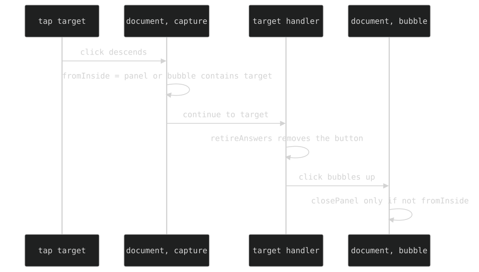

A bubble-phase `panel.contains(e.target)` test is wrong for any panel containing a control that removes itself: `document` is the last stop, so exec-choices' `retireAnswers()` has already detached the tapped button and the panel closes under the tap. `exec-bubble.js` records the origin on the way DOWN (panel OR bubble counts as inside):

```js
let fromInside = false;
function markOrigin(e) { fromInside = panel.contains(e.target) || bubble.contains(e.target); }
function closeIfOutside() { if (isOpen && !fromInside) closePanel(); }
document.addEventListener('click', markOrigin, true);   // capture: DOM still intact
document.addEventListener('click', closeIfOutside);     // bubble: act on the flag
// same pair is registered for 'touchend'
```

A property of the mechanism: any later self-detaching control is covered. Testing: the open panel spans the whole viewport (empty region passes clicks through), so there is no "outside" (x, y) — dispatch at a target the panel does not contain, and assert the old predicate reads false alongside the panel staying open. `exec-todos.js` is immune (checkbox defers `li.remove()` by 180ms).

History: [ARCHAEOLOGY.md §12](ARCHAEOLOGY.md#12-the-bottom-nav)

---

## 13. The pre-commit hook suite

Source of truth is `scripts/pre-commit`; `.git/hooks/pre-commit` symlinks to it (`bash scripts/install-hooks.sh` on a fresh clone; `bash scripts/pre-commit` to check by hand). Configs tracked: `ruff.toml`, `eslint.config.mjs`, `.stylelintrc.json`, `package.json`. Every check is **trigger-gated on what the commit stages** (`$STAGED`, read once; every gate filters it). Checks run in the order below; the first failure blocks.


| Check | Fires when | What it rejects |
|---|---|---|
| inline-script syntax | always (every `api/templates/*.html`, not just staged) | `node --check` failure in an inline `<script>` |
| ruff | staged `.py` | lint |
| stylelint | staged `web/*.css` (not `web/vendor/`), if stylelint installed | lint |
| `scripts/lint-colors.py` | any css / web-js / template staged | a new colour or alpha (§13a) |
| `scripts/lint-scale.py` | any `web/*.css` staged | a raw literal on a governed property (§13b) |
| shellcheck (`--severity=warning`) | staged `.sh` | lint |
| **mermaid render** | staged `.mmd` | `scripts/render-mermaid.py` failure; re-renders each to the `.svg` beside it and `git add`s the SVG (below) |
| ESLint | template inline scripts (every template, whenever the host has `node_modules`; skipped with a note in a tooling-only copy); staged `web/*.js` | errors; `max-lines-per-function: 100` (ratchet: only touched files) |
| `scripts/lint-swallowed.py` | staged top-level `web/*.js` | code after a mid-line `//` (swallowed code broke /spire 3x) |
| 500-line cap | staged `.py`/`.js` (not node_modules/graphify-out/web/vendor) | any file over 500 lines (no allowlist; `LINE_CAP_ALLOW` is empty) |
| no-multiline-inline-JS/CSS | staged templates | a multi-line inline `<script>`/`<style>` (one-liners ok) |
| fixture resolution (§13e) | staged `tests/*.py` or `api/*.py` | stale/renamed fixture reference |
| page smoke + admin-tier guard (§13d) | staged `api/*.py` or templates | a broken route; a `protected` route open to guest/anon |
| repo gates, by `REPO_NAME` | `spire`: staged `web/aspira-*.js`, `aspira.html` or `scripts/spire-smoke/` → `scripts/spire-smoke/smoke.mjs`. `cc-sidecar`: staged `.mjs` → `node --check` + every `*.test.mjs` | blank/throwing game; failing sidecar suite |
| tarot progression (WebKit, `run_capped`) | staged `api/tarot/`, `tarot.html`, `web/tarot*.js`, `hosaka-audio.js`, or its test | a reading that can hang |
| exec-voice (WebKit, `run_capped`) | staged `exec-voice.js`, `exec-voice-listener.js`, `voice-util.js`, `exec-bubble.js`, `hosaka-audio.js`, `api/pages.py`, or its test | Exec not speaking in its voice |
| CLAUDE.md size cap | staged `CLAUDE.md` | staged blob over 140000 chars |

Non-blocking: a reminder when `api/*.py`/templates are staged without `CLAUDE.md`/`ARCHITECTURE.md`/`ARCHAEOLOGY.md`.

- **Mermaid.** `.mmd` → `.svg` through the host's `.venv` (playwright + WebKit; mermaid 11.4.1 fetched from jsdelivr, dark theme, `htmlLabels:false` so the SVG works in an ``). Docs embed the SVG, not a fence (the Claude Code viewer prints a fence as code). A tooling-only copy skips with a note.
- **Browser suites run capped**: `run_capped` wraps pytest in `systemd-run --user --scope -p MemoryMax=700M` (bare fallback where unavailable) so a WebKit spike kills the scope, not the site.
- **Pytest scope**: `$HOST/tests/` plus every `apps/*/tests`; `PYTEST` = host `.venv`, else PATH, else empty (each pytest gate then skips cleanly). Smoke needs the live app on :8080 (`SMOKE_BASE_URL`); it skips if down.
- **Shared lint plumbing.** `scripts/lintkit.py`: file discovery via `api/app_paths.py` (`web_dirs()`/`template_dirs()` — the SAME lists the static mount, `pages._tmpl` and `/api/ui/usage` use, so lints scan what is served, apps included; `LINT_APP_ROOT` adds a committing sub repo's own tree), comment stripping, baseline I/O, `--update`.

### 13h. One hook for every repo (sub repos carry only a shim)


exec-fn owns every lint, hook and check (§1e). `HOST` = the exec-fn tree the running `scripts/pre-commit` came from (`readlink -f`); `REPO_NAME` (from `remote.origin.url`) selects the repo-specific gates. A sub repo (`apps/spire`, `apps/noodle`, `claude-box`) carries only `scripts/pre-commit` = a verbatim copy of `scripts/subrepo-pre-commit` (pinned by `tests/test_subrepo_shims.py`), wired by `core.hooksPath=scripts` (`session-context.sh` sets it for any submodule whose shim matches). As a submodule it `exec`s the superproject's hook; cloned alone it sparse-checkouts ONLY the files in `scripts/tooling-paths.txt` into a gitignored `.exec-fn/` (refresh at most hourly), runs that copy (`FULL_HOST=0`: lints only, no tests/venv). **A new lint, config or file a lint reads must be added to `tooling-paths.txt`**, or a standalone sub repo's commit fails on a missing file. nightfall keeps its own long-standing eslint hook (no shim).

### 13a. The palette lint (`scripts/lint-colors.py`)

Allowed `(color, alpha)` pairs are **DERIVED from usage** (same extraction `/api/ui/usage` feeds `/UI`) and frozen in `scripts/palette-baseline.json`. It rejects:

1. any alpha off the snap scale `0/0.06/0.12/0.25/0.45/0.6/0.8/1` (`SNAP_SCALE`);
2. any colour with more than **4 non-zero** alpha steps;
3. any `(token, alpha)` pair not in the baseline (new alpha for a colour, or a new colour token);
4. any `var(--*-hsl)` not defined in chrome.css or `LOCAL_ACCENTS` (`ember-hsl`, `seal-hsl`);
5. any raw colour literal (rgb/rgba/hex, or `hsl()`/`hsla()` not of the token form) not in `scripts/raw-color-baseline.json` (grandfathered freeze; a NEW one is rejected);
6. any CSS **named colour** in a colour property (`web/*.css` declarations, template inline `style=`) — no baseline, none exist. `transparent`/`currentcolor` allowed.

**To add a colour or alpha**: make the change, eyeball it on `/UI`, run `python3 scripts/lint-colors.py --update`, commit the baseline.

### 13b. The scale lint (`scripts/lint-scale.py`)

The same move for every other design choice. Tokens live in chrome.css's second `:root`: `--space-*`, `--radius-*`, `--font-*`, `--fs-*` (4 sizes: 2xs/sm/xl/3xl; fluid `clamp()` stays bespoke), `--fw-*` (2: normal/bold), `--lh-*`, `--tracking-*` (em), `--blur-*`, `--z-*`. Border-width, duration and easing tokens were dropped as unused.

- **Governed**: padding / margin / gap / border-radius / font-size / font-weight / line-height / letter-spacing / font-family must reference a token. Allowed raw: `0`, `calc()/min()/max()/clamp()`, `%` + viewport units, CSS keywords, **`em`** (but letter-spacing tokens ARE em, so raw em tracking is rejected), negative lengths.
- **Not governed**: border-width (in the `border` shorthand), transition/animation duration.
- **`box-shadow` and `z-index` are FREEZE-governed**: current values frozen in `scripts/scale-baseline.json`, any new value rejected; `z-index: var(--z-*)` always passes. Add one deliberately with `python3 scripts/lint-scale.py --update`.
- Scans each served web dir's top-level `*.css` (apps included); inline template styles fall under the no-inline-CSS rule.
- **Snap a page onto the scale**: `python3 scripts/scale-codemod.py [file...]` (dry-run) / `--write`; unit-aware (px↔rem snap, em stays raw).

### 13c. Cache-busting is done at serve time (`api/asset_version.py`)

Versioned static is `public, max-age=31536000, immutable`, so a stale `?v=` pins the old file in every browser that has it. The hand-bump rule and `scripts/lint-cachebust.py` are **retired** (an app submodule's template naming the parent's `/chrome.css` can't bump both in one commit).

`VersionedAssetsMiddleware` (innermost, before GZip; pure ASGI) rewrites every `/<asset>?v=<anything>` — and this site's absolute URLs (the og:image) — in each **text/html** response to `?v=<first 8 hex of the served file's sha256>`, resolving files via `app_paths.web_dirs()` (parent `web/`, then each `apps/*/web`). **The number in the source is ignored: write `?v=1` on a new reference, never bump one.** Hashes are cached per `(path, mtime_ns, size)` (a stat per asset per page).

Not covered: JS that loads other assets with its own `?v=` (e.g. `exec-bubble-assets.js` `loadStyles`; `tarot-music.js`'s `tarot-ambient.m4a?v=3`) — hand bump; `/printer/` and `/nightfall-game/` are skipped (nightfall stamps `?v=<mtime>`); a URL whose file isn't found is left as written. Pinned by `tests/test_asset_version.py`.

### 13d. The admin-tier guard (`tests/test_admin_only.py`)

Every route on `protected` must be admin-**ONLY**: refused for anonymous AND guest, still reachable with the admin cookie (a route refusing everyone would otherwise pass a "not public, not guest" check while broken).

- **The route list is enumerated from the decorators, never hand-written** (a hand list is a denylist of what someone remembered).
- `protected` is a SUFFIX of `guest_protected`, so the regex is anchored with `(?<![\w_])` (the substring trap `cmdscan.py` exists for); an included router's alias must resolve to its MODULE (nearly every module names its router `router`).
- **GET routes are fired over HTTP; mutating ones are NOT** — the suite runs against the LIVE container, and an unauthenticated POST that doesn't stop at 401 is the bug under test (it would run `POST /api/morning` on real data). They get a structural assertion.
- SSE routes (`/api/monitor/stream`, `/api/hosaka/mode/stream`) answer nothing when accepted; a timeout there is read as "not refused".
- `tests/test_cc_admin_only.py` does the same for `routes_cc.py` (shell on the host; must never reach `guest_protected`).

### 13e. The fixture-resolution check

`pytest <test dirs> --setup-plan` when any `tests/*.py` or `api/*.py` is staged. It RESOLVES every test's fixture graph across the WHOLE suite without executing bodies (no WebKit, no live app, ~0.3s), so a conftest rename can't hide in a test behind an untriggered gate. Skips cleanly without a pytest venv. The page smoke tests are HTTP over every route against the live container on :8080 (`-m "not browser"`); they skip if it's down and fail+block on a broken route.

### 13f. The Claude Code guard set (`.claude/hooks/`, registered in `.claude/settings.json`)

Separate from the git hook: these fire only when committing/editing THROUGH Claude Code. exec-fn owns every hook (§1e). **Every one fails open** (a parse error, missing file or bad payload exits 0) except `session-start.sh`, which runs `set -euo pipefail` but only in the web sandbox.


| Hook | Event / matcher | Does |
|---|---|---|
| `docs-commit-guard.sh` | PreToolUse Bash (`git commit` / `git -C <dir> commit`) | Denies a commit that stages `api/*.py` or `api/templates/*.html` without `CLAUDE.md`/`ARCHITECTURE.md`/`ARCHAEOLOGY.md`; opt-out token `[skip-docs]` in the message. Judges the index of the repo the commit RUNS in (`commit_repo.py`). |
| `git-stash-guard.sh` | PreToolUse Bash, `if: Bash(git stash*)` | Blocks `git stash` (stales bind mounts → 502); `git stash list` / `show` pass. |
| `nightfall-build-guard.py` | PreToolUse Bash | Denies a webpack build missing `NODE_ENV=production` (asset URLs 404 → silent black screen) or not run in the background. |
| `dead-file-guard.sh` | PreToolUse Edit/Write/NotebookEdit (reads `tool_input.file_path`, so in practice Edit/Write) | Denies edits to `nightfall-src/components/Netmap.tsx` (dead; only Netmap3D renders). |
| `push-after-commit.sh` | PostToolUse Bash (after a commit) | Pushes when HEAD is ahead; see below. |
| `deploy-healthcheck.sh` | PostToolUse Bash (commit, push, `docker compose up/restart`, SSH deploy, `scripts/deploy.sh`) | `curl https://wai-lau.net/` up to 5 tries; 200/301/302 = healthy. |
| `session-context.sh` | SessionStart | States droplet-vs-local from the hostname (`main` + `/exec-fn`), reinstalls the graphify post-commit hook if missing, re-attaches a detached submodule HEAD to master (only when exactly `origin/master`), sets `core.hooksPath=scripts` for shim'd submodules. |
| `session-start.sh` | SessionStart | Web sandbox only (`CLAUDE_CODE_REMOTE=true`): installs Python deps + ruff + npm devDeps. |

**`push-after-commit.sh`** pushes in the repo the commit ran in; on rejection it discards `graphify-out` drift, `pull --rebase`s and pushes again (never stash). Skips `--dry-run`; a mid-rebase tree is left alone silently; a detached HEAD or a branch with no upstream is skipped with a note (publishing a new branch stays deliberate). The parent bump is refused with a note when the recorded SHA is not an ancestor of the checkout's. For a submodule commit it then bumps the parent's gitlink in its own `chore(apps): bump <path> to <sha>` commit (commits ONLY that path; forward-only — never rolls a submodule back) and pushes the parent, submodule FIRST (`push.recurseSubmodules=check`).


**The trap they share, and why `cmdscan.py` exists**: a hook matching its trigger as a SUBSTRING fires on any command that merely *mentions* the phrase (a heredoc documenting the rule). `cmdscan.py` strips heredoc bodies (and quoted strings on request) so a guard matches an INVOCATION; every Bash-matching hook routes through it. It does NOT strip quotes by default — the docs guard reads `[skip-docs]` out of the quoted message.

### 13g. Size rules (what the cap enforces, how to split)

No inline JS/CSS in templates (extract to `web/<page>.{js,css}`; a one-line `onclick=` stays). No `.py`/`.js` over 500 lines — split on a real seam: modules, or same-global-scope files loaded in order (`web/` JS shares globals, so ESLint `no-undef`/`no-unused-vars` are off for `web/**`). Existing splits: `main.py` → `pages.py` + `routers.py` + `routes_views.py` + `routes_api.py` + `routes_graph.py`; `graph_scrub` + `graph_style`; `nudge` + `nudge_deadlines` + `nudge_llm` + `nudge_loop`; `monitor_sse`; `hq-core/drag/groups/board.js` (`hq-drag.js` = shared pointer wiring + floating-ghost drag); `graph-audio.js` → `graph-norm.js`; `tarot-view/voice/stream/chat.js` (`tarot-stream.js` = `streamResponse()` + the audio-paced typewriter).

History: [ARCHAEOLOGY.md §13](ARCHAEOLOGY.md).

---

## 14. `/tarot` — the reading surface

Guest auth. Spread (top, fixed-height) + Pollack-voiced reader chat (bottom). Per-browser state in `localStorage` (`messages`, `spread`, `significator`), **no server persistence** (the server saves a reading only for the owner, `POST /api/tarot/save`). Prompt/phase logic in `api/tarot/prompt.py`; routes in `api/tarot/routes.py` (per-IP limit 20 req / 60s on chat, history capped).


Bracketed `[event marker]` user messages drive the flow (`[opened /tarot; …; time=HH:MM <band>]`, `[chose Significator: …]`, `[drew a Three-Card spread; …]`, `[turned **Pos**: Card, upright|reversed]`). Phase 1: minimum five single-question turns (one open question ≤30 words), then the exit turn declares the card, calls `set_significator`, asks Phase 2's opening question. Phase 2: at most four querent answers, then names the heart + frame (`past_present_future` / `situation_obstacle_advice`) and calls `deal_spread`. Phase 3: face-down (the frontend prints the first flip invite). Phase 4: one card per `[turned …]`; `lookup_card_meaning` for Majors, Minors from suit + numerology in the prompt. Phase 5: two-paragraph synthesis. Server sees only revealed cards; face-down identities and `card_id`s never leave the browser. Returning querent with a Significator skips Phase 1.

### 14a. The status bar carries what the chat no longer says

A fixed **status bar under the cards** (`#tarot-status`, tarot.css; height `--status-h`, 3rem) sits between the spread and the nav; the spread, input bar and `#terminal` insets all reserve `--status-h` at the bottom. It holds two dim whole-line credit links (Pollack's *78 Degrees of Wisdom*; card back by u/vegetablebasket) under a single-line `#tarot-statusline` showing the LATEST bracketed sys note (`set_significator`/`deal_spread` results, `reader voice unavailable`, errors). `setStatus()` (tarot-view.js) writes it; **the chat carries only reader/querent prose**.

- **Hidden lines.** The deal turn's `[drew a … spread; N cards face-down]` record and the frontend flip invite stay in `messages` (model continuity) but are never rendered. `isHiddenLine()` (tarot-view.js) is the shared predicate; `tarot-chat.js`'s reload replay skips the same lines.
- **`[State: …]` never reaches the querent.** `routes._build_spread_preamble` hands the model a private per-turn Phase 1 note; `tarot/state_echo.py` guarantees it: `StateEchoFilter` swallows a leading `[State: …]` per round in `agent.stream_chat`, and `scrub_state_echo` (called in routes) strips it from stored reader turns in incoming history (an echo in localStorage teaches the reader to repeat it). Pinned by `tests/test_tarot_state_echo.py`.
- The pre-reading `begin-hint` centres in the empty terminal (`#terminal:has(.begin-hint)::before{flex:0}` neutralises chat.css's bottom-anchoring spacer).

### 14a-ii. The cards: the outline hugs the picture, and a turned card turns at once

- **Outline hugs the picture**: the card takes HEIGHT and width from the image (`width:auto` + `justify-self:center`; image `height: var(--card-h); width:auto`) because the 78 scans run 0.5545 (`strength`) to 0.5837 (`the_tower`). `card_back.jpg` is cropped to **686x1200** (median, 0.5717) so a flip doesn't resize the outline; `#sig-card` keeps a box while empty via `aspect-ratio: 686 / 1200`.
- **A turned card paints face-up on the tap, before the turn commits.** The commit still waits for the reader to narrate (a dropped request must stay retryable; `nextPosition()` must not pass an unread card), but `flipCard` awaits the whole turn and the zoom is usually dismissed mid-reading. `paintFlipped()` (tarot-view.js) sets `data-flipped`/`data-next` + the reversed rotation on that element; `card.flipped` stays false; a failed turn calls `renderSpread()`, redrawing the back. Pinned by `test_a_turned_card_shows_its_face_before_the_turn_ends` / `test_a_failed_turn_puts_the_card_back`.

### 14b. Narration paces the typewriter

`tarot-voice.js`: AUDIBLE by default (localStorage `tarot.voice`), works for `session` AND `guest_session`. The reader's turn is spoken via hosaka (voice `nicole`, kokoro, from the home GPU box). `tarot-chat.js` holds text until audio starts (blinking cursor), then reveals on a `charWeight` schedule normalised to the measured duration, self-correcting off `player.elapsed()`. Both paces live in shared `web/typewriter.js` (`twAudio` with `leadMs`, `twGuess` at the reader's 1.25; see CLAUDE.md *Typewriter*, §18).

The ♪ button in `#spread-controls` is a real **ON/OFF**: off = nothing synthesized, no socket, reveal at 1.25, and `wantsDeferredOpening()` stops holding the opening for a gesture. Audio failure or not-yet-unlocked lands in the same place.

### 14b-ii. The mic, and the reader it must not hear

The `$` prompt is the control (`tarot-mic.js` over shared `voice-input.js`, a binding like `exec-mic.js`): one tap opens a continuous session, each finished utterance sends itself. Its `busy:` list drops sound during three moments: a reader turn streaming (`tarotReplyStreaming`), **the reader's own voice playing** (`tarotVoice.isSpeaking()`), a card zoomed (`tarotCardZoomed`). The narrator core clears `speaking` for a NON-queueing surface too (else it stays true forever on `/tarot`). `tarot:voice-idle` re-lights the dot; `tarot:reply-done` (live turn AND canned opening) re-arms the session on browsers that end recognition per utterance.

**The keyboard stays down during a session**: `focusInput()`, `_focusNow()`, `sendMsg()` check `tarotMicActive()` first (focusing the composer raises the keyboard, shrinking the viewport and the spread). `#input-prompt` is a `<span>`, so it must be in the first-gesture arm's control list in tarot-chat.js or `preventDefault()` eats the first tap.

### 14c. Ambient music, and why the level is measured

`tarot-music.js`, ♫ toggle below reset. A looping track streamed lazily from `web/tarot-ambient.m4a` (gitignored, ~58MB — **the server holds the only copy**), fade-in 4s (`FADE_MS`) on first tap from a random point (desktop; iOS ignores `el.volume`). Loops via `el.loop=true` **plus** an `ended` handler that rewinds and replays (native loop can fail on a progressively-streamed m4a). No ducking.

**The bed level is baked into the file** (iOS makes `el.volume` read-only AND silences a WebAudio-routed element) and set by MEASURING dBFS, never by picking a multiplier. Shipping bake (`?v=3` in `TAROT_MUSIC_SRC`): source x 0.15 = **-31.8 dBFS mean / -16.2 dB peak**; the usable band is well under 10 dB. Re-bake from `~/tarot-ambient-0.15-orig.m4a`:

```bash
ffmpeg -i <master> -af volume=NdB -c:a aac -b:a 128k -movflags +faststart
ffmpeg -i <out> -af volumedetect -f null -   # verify
```

Then bump the `?v=` in `tarot-music.js` (hand bump; §13c doesn't reach JS-loaded assets).

### 14d. The opening turn is pre-generated


The reader's FIRST turn depends on nothing but the clock (an image of the room at this hour, a blank line, the first Phase 1 question). Generating it live cost an opus round-trip AND a (cold, ~4.6s vs 0.36s loaded) synth before the querent typed a word. So `TARGET_PER_HOUR = 10` openings per hour are generated ahead with narration already rendered; the page plays one at random for the CLIENT's hour.

| Piece | What |
|-------|------|
| `api/tarot/openings.py` | the store: `data/tarot_openings/index.json` + one `<id>.wav` per clip. Pure half (`pick_clip` / `clip_id_ok` / `shortfall`) takes the index as an argument (`tests/test_tarot_openings.py`) |
| `api/tarot/openings_gen.py` | generation + CLI (`stats` / `backfill` / `refresh` / `check`) |
| `api/tarot/voice_synth.py` | server-side synth, §4c (voice `nicole`, backend `kokoro`) |
| `GET /api/tarot/opening?hour=` | one random clip: `{clip:{id,text,dur,audio}}`, or `{clip:null}` |
| `GET /api/tarot/opening/<id>.wav` | the narration, `immutable` (id is content-unique) |
| `POST /api/tarot/warm` | load TTS models while the opening is read; 300s server cooldown (`WARM_COOLDOWN_S`), rate-limited |
| `web/tarot-opening.js` | `startOpeningTurn()`, the client half |

- **Hour is the client's** (`new Date().getHours()`). Id shape `h<HH>-<8 hex>` (`_CLIP_ID_RE`) is the whole traversal defence (it's a path component), validated before touching the filesystem.
- **Only the first turn is canned** (`!significator && !spread`); the other two openings answer state the clips don't know and stay live. **Every failure falls back to the live turn** (no clips, failed fetch, audio never lands).
- The canned turn is indistinguishable downstream: same `[opened /tarot; …]` marker, same `createTypewriter`, pushed as `{role:'assistant'}`.
- **Audio downloads during the hold**: prefetch starts when the clip JSON lands (page sits on "tap anywhere to begin"); the reveal waits at most `TAROT_CLIP_WAIT_MS` (5s), else types silently.
- **WAV, deliberately**: 16-bit mono 24 kHz (~48KB/s, 8-13s ≈ 400-600KB, cached forever). The container has no encoder (ffmpeg is HOST-only); adding one = new pinned dep + rebuild (the `httpx` outage, §1). 240 clips ≈ 150MB in a gitignored data dir.
- **Generation = ONE opus call per HOUR** (a batch converges less than ten single calls; no `temperature` — removed on opus 4.8, SDK `TypeError`/API 400). System prompt = `prompt.voice_preamble()` alone (~1.5K, under opus's 4096-token minimum cacheable prefix, so deliberately no `cache_control`). An off-shape variant (no blank line, not ending `?`, over `MAX_CHARS`=420, echoing the marker) is **dropped, not repaired**; the next top-up fills the gap.

```bash
docker compose exec api python -m tarot.openings_gen stats
docker compose exec api python -m tarot.openings_gen backfill        # idempotent
docker compose exec api python -m tarot.openings_gen refresh --n 1   # rotate the oldest
```

**When the home box is gone the page says so — after the opening has spoken.** The reader's voice is `nicole` on the home box; the droplet's piper only speaks `glados` (Exec's). `tarotVoice.probeHome()` (`GET /api/hosaka/health`, guest-safe) decides on load: skip the warm POST (a round-trip into a dead tunnel warms nothing), and once the opening finishes the status bar reads `[ reader voice offline — the reading continues in silence ]`. The note waits because a canned opening narrates from a FILE and speaks even with the box down. Wording is deliberately NOT `reader voice unavailable` (streamResponse's: a voice that tried and failed). A querent returning mid-reading has no opening, so the note goes up at once. `homeDown()` answers only after the probe returned.

### 14e. The nightly voice check

Narration fails **silently** (the page falls to the guessed-pace typewriter), so `api/tarot/openings_loop.py` checks it at 05:45 ET (`RUN_AT`; after morning 4:30, graphify 5:00, security 5:10, cc probe 5:20 — never contending on a 1967MB box). It's an **in-process asyncio loop, not cron** (polls every 300s; lifespan-started in `main.py`; no image rebuild to change) and writes `data/cron/YYYY-MM-DD__tarotvoice.log`, shown on `/debug` via `GET /api/debug/cron`. **The log is the stamp** (`_due`: past 05:45 and today's log absent), so `--reload` can't run it twice.

The probe is a real one-line synth through the querent's path (`voice_synth.probe`), judged with `gpu_mode_client.fetch_mode`:

| Reading | Meaning |
|---------|---------|
| `OK first_audio=…` | the voice answered |
| `OK SLOW …` | answered, but first audio over `SLOW_MS` (2500ms) on a box that should be warm |
| `voice down (mode=idle\|emo)` | hosaka-server deliberately stopped — expected, not a fault |
| `voice unreachable (mode=gone)` | the box didn't answer at all: asleep, off, or tunnel down |
| `FAIL (mode=homo)` | the box claims loaded models and served nothing — the one worth shouting about |

The same pass tops every hour back up to ten (`openings_gen.backfill`), skipped when there's no voice to render with.

History: [ARCHAEOLOGY.md §14](ARCHAEOLOGY.md).
## 15. The nudge loop (`nudge.py` + `nudge_deadlines.py` + `nudge_loop.py`)

ADHD activation scaffolding. Every card = decomposed **prep** steps + (when `work > 0`) one atomic **event block**. The prep back-schedules to finish at the event anchor; a nudge fires **once at the start of each step** (prep step or the event block). No reply leaves the step `awaiting_reply` in silence. The frontier moves only when Wai acts; due dates are protected behind the consequences conversation.

### 15a. Trigger and eligibility

An in-process asyncio loop (`_run_nudge_loop`, `nudge_loop.py`; lifespan-started from `main.py`; `NUDGE_POLL_SEC = 30`). **No cron, no rebuild** — state lives on the cards in `rd.json`, so `--reload` just re-arms. `POST /api/nudge/tick` is a manual tick.


- **`_eligible`** = `decomposable()` (column `hq`, not reminder/book) AND `scheduled_day == today`. No-Rollover cards are NOT excluded.
- **Anchor** (`nudge_deadlines.active_anchor`): the active node's back-scheduled `deadline` minus its own duration (`est_min` x category factor; factor is 1.0 while recalibration is gated off, §15g).
- **First nudge** = the placement. While `stage == nudging` and `last_nudge_at` is empty, `next_nudge_at` tracks the anchor each tick (`_arm_nudge`), so dragging the card moves the nudge.
- **Fire** (`_fire_nudge`): `nudge_text_sync` for the active step. (Its decompose-first branch for a graph-less card is unreachable from the tick: `_scan_due_nudges` skips cards with no graph and the plan pass builds one first.) Sets `stage=awaiting`, `awaiting_reply=true`, clears `next_nudge_at`. Delivery = `append_monitor_comment(text, card_id=)` + `push_to_monitor({comment, card_id})` + `{cards_changed}` — the monitor pipe, zero frontend.
- **Failure backoff**: an exception in any of the three passes sets a 300s per-card in-memory retry delay (`_NUDGE_FAIL_BACKOFF_SEC`); `_nudges_inflight` prevents a double run.
- **Tick order**: triage pass, plan pass, fire pass (diagram). Every `rd.json` read-modify-write holds `_RD_LOCK`, never across the LLM call (reload + re-check after it).

**`card["nudge"]` fields** (`default_nudge_state`, lazy, absent on most cards):

| Field | Meaning |
|-------|---------|
| `stage` | `idle\|nudging\|awaiting\|consequences\|resolved` (see 15d). `stalled` is read in `_ACTIVE_NUDGE_STAGES`/`chat.py` but **never assigned** — vestigial |
| `graph` | `{nodes:[{id,label,done,depth,created_at,est_min,deadline,tl_offset?,is_event_start?}], edges:[{from,to}]}`; edge = `from` precedes `to`; strict linear chain (§15b) |
| `active_node` | id of the current step |
| `first_nudge_at` / `next_nudge_at` / `last_nudge_at` / `last_user_reply_at` | naive-ET ISO (`_FMT %Y-%m-%dT%H:%M:%S`), never mixed with the UTC `ts` of the activity log / chat |
| `awaiting_reply`, `last_nudge_text` | one-nudge-per-step latch; previous nudge fed back as an anti-repeat signal |
| `consequences` | `{asked_at, answer, decision}` |
| `auto_deadline` | staggered deadline for a today card with no fixed one (`assign_auto_deadlines`; stacks by `_lead` from now, in `order`) |
| `triage_pending` | title/notes changed (`routes_api._flag_triage`, `chat_tools`) -> next tick runs `triage_sync` and rebuilds the plan only if `needs_update`; a result is dropped (flag kept) if the graph's done-state moved during the LLM call |
| `version` | `1` |
| `window_deadline`, `redecompose_count`, `redecompose_at` | **vestigial**: `window_deadline` is only ever set to `None`; the `redecompose_*` metrics are never incremented (`redecompose_count` is still read by `chat.py:125` and `nudge_llm.py:215`) |

`tl_offset` = a step's start offset in minutes from the card's `dir_start_min` (set when placed on the timeline or edited in the dialog).

### 15b. Everything in hq has a plan

Each tick, hq cards missing a graph (not reminders/books) get a **silent decompose** (`_build_graph`, no nudge sent) that builds the prep steps only; the event block is appended by `compute_deadlines` -> `ensure_event_block`.

- `prep_time = 0` -> **fully decomposed**: the whole `estimated_time` is work steps, no event block. `work = 0` (self-task) likewise: all steps, no event node.
- **Strict linear chain, never parallel.** `_linearize_chain` (called in `_normalize_graph`) topo-sorts the LLM's steps by its edges, then re-chains `step1->...->stepN`, discarding branching. Legacy parallel graphs relinearize on their next breakdown/recalc.
- **Event block** (`is_event_start:true`, `est_min = work`, label = card title) is the terminal sink every prep step points to; only when `work > 0` AND `prep > 0`. Back-scheduled so it ends at `card_deadline` and starts at the anchor.
- **`card_deadline` precedence**: placed slot (`scheduled_day`@`dir_start_min`) + total > timed `due_date` + work > `auto_deadline` > 21:00 (`_EOD_HOUR`) of the scheduled day.
- Default per-step `est_min` = `max(5, round(budget / n_prep_nodes))`, `budget = prep or total`.


### 15c. The breakdown UI

Visible and editable in the card dialog (`web/card-graph.js`, SVG chain, shown when `nudge.graph.nodes` is non-empty). Per-step label, start time (-> `tl_offset`) and estimate (`est_min`) editable; edits persist on dialog save; `active_node` is recomputed client-side with the same first-open rule.

- Single-column full-width nodes; left control stack = two `.cg-circ` buttons: `✕` delete over `+` insert (`insertStep` splices `from->to` into `from->new->to`); an entry arrow with a `+` inserts before the head. No in-graph done-toggle.
- **breakdown** (beside notes; only for a non-book, non-reminder card with NO breakdown yet) and **recalculate** both POST `/api/rd/{id}/recalc` with `{notes, prep, duration}`.
- hq today column renders the event block as a dashed `.dir-task.event` after the prep (`web/hq-groups.js renderTaskBlock`); tap-done like any step (`wireTaskDone`); dragging the spine writes `dir_start_min` (`createGroup` -> `saveStartTime`).

### 15d. One nudge per step — no stall re-peel

A step nudges **exactly once**, at its start (`_due_nudge`). No reply -> `awaiting_reply` in silence; the loop never re-fires or peels a sub-step.


- `advance_chunk` (the chat tool, `chat_tools._tool_advance_chunk`) marks the step done, clears `awaiting_reply`, sets `stage=nudging` and `next_nudge_at = now + window_for(card)`; no open step left -> `stage=resolved` (never archives — Wai archives). A **timeline tap-done** is different: it only PATCHes the card with the node's `done` flag (the client recomputes `active_node`) and logs `advanced` (§16a); it does not touch `stage`, `awaiting_reply` or `next_nudge_at`, so the next nudge waits for a chat reply or the chat tool.
- A reply **without** advance (any exec-chat turn) re-arms the *same* step one window out (`clear_awaiting_focused`, focused = most recently nudged awaiting card).
- **`window_for`** = `clamp(round(_lead * 2.6), 45, 240)` min (`NUDGE_WINDOW_MULT/MIN/MAX`); `_lead` = `estimated_time` (default 90) x category factor.
- `record_consequences` -> `stage=consequences` (from any stage); `reschedule_after_consequences` -> `stage=idle` (keeps graph); `archive_card` -> `resolved`; `exile_card` leaves `stage` alone. The 4:30 reconcile (§15f) moves any live stage to `nudging` or `idle`.

### 15e. A nudge ASKS whether the step is done; it never asserts that it isn't

(`nudge_llm._TONE` + both prompts.) **The loop has no completion data** — a fire means only that the step's slot arrived, and Wai often does a step without tapping it. So: ask whether it's done, then name the tiny first move if not. "done" -> `advance_chunk`; "not yet" -> the step; either way the loop re-arms.

- The prompt countermands `EXEC_VOICE`'s activity-log framing ("The task you scheduled for 10 AM is untouched") — that belongs to monitor comments, which read the log.
- **Asking is not softening — the question is the weapon.** Tone block = five mechanisms to rotate (mock-charitable doubt, feigned ignorance, sarcastic optimism, mock scientific rigour, false comfort); the step and reason stay in plain words — sass rides ON the question.
- `last_nudge_text` is fed in as an anti-repeat signal (each nudge is an independent LLM call).
- **Time-critical steps ask READINESS, not completion** ("are you ready to walk out?"); clock + action first.
- `chat._active_nudge_block`: a bare "yes"/"did that" IS the step done; "not yet" is an answer, not pushback — must not trigger the consequences conversation.

### 15e-bis. Answering a nudge by tapping

The nudge's final line is `[Sent it | Not yet | Doing it now]`; `web/exec-choices.js` renders buttons under the message in the exec panel. One bracketed span because that is how Exec writes a sys note and `exec-voice.js` strips every `[...]` before narrating.

- **Regex** (`RE`, exec-choices.js:56) is anchored to the LAST line and needs a `|` or a lone `card=` cell; emphasis (`**[..]**`) and trailing whitespace are tolerated; options cap at 4. Both prompts (`nudge_llm._TONE`, `chat._CHAT_STATIC_PREFIX`) say write it plain AND the parser forgives bold.
- **Every Exec reply is parsed**, not just nudges. History replay goes through `addMsg`.
- **`card=<id>` cell**: `[card=card-1750000000000 | Got it | Not yet]` -> `parse()` returns `cardId`, not an option; a pipe-less `[card=…]` is allowed. Precedence in `addMsg`: `cardId || choices.cardId`. It is the ONE place Exec may write a raw card id (stripped before render/speech). **Discord** has no buttons: `discord_bot.strip_card_cell` (in `_send_chunked`) drops the cell, keeps the answers.
- **Tapping sends the answer as Wai's own message** — the server needs no button knowledge. Built by `answerRef(text, cardId)`: `[answering: "Packed yet?" card=card-climbing] Not yet`; the quote is the LAST interrogative sentence of the message the row hangs under (whitespace collapsed, 120 chars + ellipsis).
- **EVERY open question keeps its buttons** (`clear()` is a no-op leftover). The reference replaces the old wiping, which left a tappable row under the WRONG card.
- Pieces that make the reference land: `_CHAT_STATIC_PREFIX` ANSWER REFERENCES paragraph (marker is authoritative, never echo it); `_active_nudge_block` appends **OTHER OPEN NUDGES** (`_open_nudge_cards` / `_other_nudge_lines`); `exec-bubble-msg.js` renders the marker as a dim `re: "…"` chip (`.msg-ref`), id never shown.
- **Answering retires that row's answer buttons only** (`retireAnswers`); `archive`/`exile` stay; a row left empty is removed. A **failed PATCH re-arms the button and leaves the row.**
- **Tapping must not close the panel**: `retireAnswers` detaches the tapped node synchronously, so a bubble-phase click-outside test reads it as outside. `exec-bubble.js` records the origin in the **capture** phase (`markOrigin`) and the handler consults that flag (§12). Tap-guard: `#exec-term` bottom padding `var(--space-2)` (WebKit touch adjustment snaps to the 29x19 composer `[x]`). Pinned by `tests/test_exec_bubble_overlap_browser.py`.

#### Card actions are not messages

`archive` / `exile` mean what the card dialog's buttons mean, so they **PATCH `{id, column}` directly** (no model turn). **Appended by the CLIENT** to every row that knows its card. Only `{id, column}` is sent (merge-by-id preserves the server-owned `nudge`); the server clears `scheduled_day` on exile, keeps it into archives (§8b), revives recurring cards. Leaving hq ends the loop for that card (`_eligible` requires `hq`). The panel labels the button `archive`, not `done` (it sat beside a step's `Did that` and `done` read as step-done); the dialog keeps `done`.

- Exec can also do both itself: **`archive_card`** (`chat_tools`) — on Wai's word about that card only; keeps `scheduled_day`, sets nudge `resolved`, clones recurring via `helpers.recurring_clone` (same as `PATCH /api/rd`). Pinned by `tests/test_archive_card.py`.
- **A nudge carries its card id, a monitor comment does not**: `_fire_nudge` passes `card_id` to `append_monitor_comment` and the `{comment, card_id}` SSE payload; `_save_chat` keeps monitor messages whole, `sanitize_history_for_api` drops them, `GET /api/chat` returns raw so a reload still has the id.
- `tests/test_exec_choices_browser.py` **stubs `fetch`** — the suite runs against the LIVE container and a real PATCH would archive one of Wai's cards.

### 15f. Due-date protection

`card_schedule.nudge_resched_blocked` refuses to move an active-nudge card (`_ACTIVE_NUDGE_STAGES`: nudging/awaiting/consequences, plus the never-assigned `stalled`) to a LATER day or unschedule it — for `schedule_card` and the `/rd` calendar drop alike — **until `consequences.answer` is recorded**; with an answer the guard lifts. `record_consequences` -> `reschedule_after_consequences` (hard-fails without a recorded answer) is the intended later-day path.

**Morning (4:30)** `morning_reconcile`: for every card whose stage is not `idle`/`resolved` it clears `awaiting_reply`, `last_nudge_*`, `auto_deadline`; cards `_eligible` today (hq, `scheduled_day == today`) -> `nudging` with a fresh first nudge at the re-anchored time; others -> `idle`. Also clears `window_deadline`. Never leaves a past-dated `next_nudge_at`.

### 15g. Lateness recalibration — built, GATED OFF

`recalibration.py`. Completions (`moved->archives`) are tagged with `category`; late ones (`completed_late`) also carry `minutes_late` + `estimated_time` (`routes_api._log_entries_for_patch` / `_minutes_late`). The morning pipeline folds them into a per-category EMA `factor` (`recalibrate()`, `EMA_ALPHA 0.25`, bounded `[FACTOR_MIN 1.0, FACTOR_MAX 2.0]`). `nudge._factor` biases `_lead()`, `window_for()` and `active_anchor()`; a missing/broken store = 1.0.

**`recalibration.ENABLED = False`** — `factor_for` returns 1.0. The telemetry is **dormant**: the manual "late" dialog button (sole producer of `completed_late`) was removed 2026-06-29. Flip `ENABLED` only after re-wiring a late source and accruing a sample.

History: [ARCHAEOLOGY.md §15](ARCHAEOLOGY.md#15-the-nudge-loop).

---

## 16. The Exec monitor (`monitor.py`)

Unsolicited comments after significant card activity, in Exec's GLaDOS voice (`EXEC_VOICE`, shared with chat) — backhanded observations, not encouragement. Model `claude-opus-4-8`, `max_tokens 200`.

**Exec's own changes never trigger a comment.** `exec_tools.run_tool` runs the handler through `_as_exec`, which sets the `helpers.LOG_ACTOR` contextvar (`"exec"`) INSIDE the worker thread (cannot leak across requests); `_append_rd_log_batch` copies it onto each entry as `actor: "exec"`. `_by_exec` is checked by `_is_commentable`, `_entry_is_significant` and `generate_encouragement`. The marker is `actor`, NOT `source`: the panel's archive/exile taps PATCH `/api/rd?source=Exec` and still earn a comment. Pinned by `tests/test_monitor_actor.py`.

### 16a. What counts as significant

A move to archives/exile (`to_col`), a book-card update (`updated` + `is_book`), or an `advanced` entry (completed sub-step). Reminders never. A sub-step completes two ways:
1. `advance_chunk` chat tool (`chat_tools._tool_advance_chunk` logs it; reached via `exec_tools.run_tool`) — `actor=exec`, so it does NOT comment.
2. **Timeline tap-done** in the hq today column: `persistLayout` PATCHes the card, and `routes_api._advanced_entries` (via `_log_entries_for_patch`) emits `advanced` (with `id` + `node_id`) on a node's `done` false->true — independent of the card-level diff.

`advanced` is **re-validated at fire time** (`_drop_undone_advanced` in `_recent_entries`): done-then-unmarked earns no comment.

### 16b. Timing


- `schedule_monitor()` = **trailing 60s debounce** (`_run_monitor(delay=60.0)`), called from `PATCH /api/rd` when any logged entry is significant. A new event cancels the pending task; a cancel mid-LLM pushes `{thinking:false}`.
- `POST /api/monitor/flush` (`flush_monitor`) bypasses the wait if a significant entry is newer than the watermark.
- **Watermark** `_monitor_last_comment_ts`: init = last activity-log entry's `ts` (`_init_monitor_ts`), compared strictly `>` so a `--reload` never re-comments. **Advanced only after the LLM call succeeds** (a 429/529 must not drop the batch).
- Context = profile.json + hq cards + books in progress + today's schedule (`_build_context`).
- **Recurring cards**: archiving logs a `revived` entry too; not significant alone but rides the same batch, `_entry_line` renders it as context and the system prompt tells the model to read it as normal recurrence — never resurrection/undeath/clerical error.
- Subscribers get `{thinking}` / `{comment}` on `/api/monitor/stream` SSE; the comment is written to `chat.json` as `role=monitor`. The same stream carries `{cards_changed:true}` on server-side `rd.json` rewrites (nudge fire/build/triage, `POST /api/rd/{id}/schedule`, the morning route, Discord and web exec tool rounds via `chat_passes` / `routes_exec`; NOT `PATCH /api/rd`, whose caller already has the data); `exec-bubble.js` relays it as a `window` `exec:cards-changed` event so open boards refetch.

### 16c. chat.json is ONE chronological stream

Persistence lives in **`chat_store.py`** (`get_chat`, `_save_chat`, `append_monitor_comment`, `sanitize_history_for_api`, `_msg_text_key`); `chat.py` keeps the prompt + tool builders. Every stored message carries a server `ts` (ISO-UTC) and the file is sorted by `ts`, so monitor comments and nudges interleave in time. `_save_chat` carries each conversation message's `ts` forward by index (convo only grows by append) and stamps new tail messages `now`; a keyless (structural) message inherits the preceding message's `ts` so the sort cannot split a tool turn. `append_monitor_comment` stamps and re-sorts.

### 16d. The orphaned-`tool_use` 400

Before an Anthropic call, **both** send paths (`routes_chat.api_chat`, `discord_bot.exec_reply`) run history through `chat_store.sanitize_history_for_api`: text-only, role-alternating `{role, content:<string>}`; drops `ts` (API rejects unknown keys), all monitor lines, and every prior-turn `tool_use`/`tool_result`. The fresh, correctly paired tool round is appended after. **Stripping the tool blocks is load-bearing** — an orphaned `tool_use` 400s the API (`tool_use ids … without tool_result blocks immediately after`). (The web panel no longer uses this path since phase 3; Discord and legacy `/api/chat` do.)

History: [ARCHAEOLOGY.md §16](ARCHAEOLOGY.md#16-the-exec-monitor).

---

## 17. Memory is the scarce resource on this box

1967MB RAM + **5GB swap** (`/swapfile` 1G, prio -2, draining; `/swapfile3` 4G, `pri=10`; both in `/etc/fstab`). Swap is 2x RAM because spikes are whole processes: a WebKit launch is 200-400MB, every CLI subprocess (chat turn, title call) ~300MB, against ~650MB available at rest. `vm.swappiness` is left at the default 60. Retire the 1G file with `sudo swapoff /swapfile && sudo rm /swapfile` once near 0 — a swapoff must fit every live page, so do it while the 4G file has room.

### 17a. What the pressure actually is

Not the test suite (`conftest.py` launches ONE WebKit per pytest session) and not the containers. It is the **baseline**: interactive `claude` sessions (~400MB each) and tmux dominate; the app + sidecar are small beside them. (Per-process figures drift; measure with `free -m` / `ps`.)

### 17b. The OOM killer picks by badness score, not culprit

An uncapped spike shoots `dbus-daemon` or uvicorn's python rather than the cause; a capped one just fails. So:

- **Browser suites** run under `systemd-run --user --scope -p MemoryMax=700M` — `run_capped` in `scripts/pre-commit` (falls back to a bare run if `systemd-run` is unavailable), so an over-budget browser fails the commit instead of taking out the site.
- **graphify rebuild** capped at 600MB (`GRAPHIFY_REBUILD_MEMORY_LIMIT_MB=600`, exported in `scripts/graphify-daily.sh` and `~wai-root/.zshenv`); the layout bake under `MemoryMax=700M` too.
- **Ad-hoc WebKit/playwright runs**: wrap in `systemd-run --user --scope -p MemoryMax=...`; check strays with `pgrep -f '[M]iniBrowser'`.
- **A graphify rebuild that looks expensive: check `graphify-out` ownership first** (root-owned output made every run redo full work and die at the write).
- Check pressure: `free -m` (watch **Swap used**), `sudo dmesg -T | grep -i oom`.

### 17c. Every cron job writes where both sides can see it

`data/cron/YYYY-MM-DD__<job>.log` (`morning`, `graphify`, `security`, `ccprobe`, `tarotvoice`), shown on `/debug` via `GET /api/debug/cron`. **The data volume is the only filesystem both container and host see; a log nobody can see is how a nightly fails quietly for weeks.**

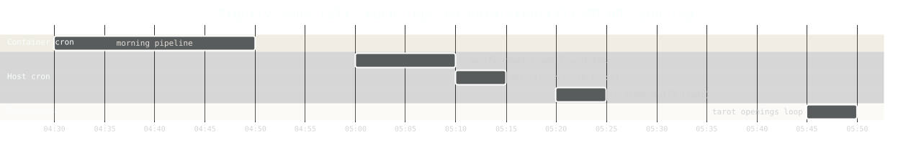

| Time (ET) | Job | Where it runs |
|-----------|-----|---------------|
| 04:30 | `morning_cron.sh` -> `POST /api/morning` | in-container, baked from `api/exec-fn.cron` into `/etc/cron.d/exec-fn` |
| 05:00 | `scripts/graphify-daily.sh` (as `wai-root`) | host `/etc/cron.d/exec-fn-graphify` |
| 05:10 | `api/scripts/security/refresh.py` (root; `flock -n /tmp/exec-fn-security.lock`; `SECURITY_OWNER_IP` in the cron file) | host `/etc/cron.d/exec-fn-security` |
| 05:20 | `scripts/cc-probe-daily.sh` (root) | host `/etc/cron.d/exec-fn-ccprobe` |
| 05:45 | `tarot/openings_loop.py` (`RUN_AT = (5, 45)`) | **not cron** — in-process loop; its `__tarotvoice.log` is the stamp |

- **One file per JOB, not per day** — the writers are different uids (container root, host root, host `wai-root`); whoever created a shared daily file would lock the others out.
- The host cron line that builds its own log path (security) `mkdir -p`s the dir and escapes the date `$(date +\%F)` — **a bare `%` is a newline to crontab**; the graphify and ccprobe scripts `mkdir` and stamp their own `LOG`.
- `morning_cron.sh` tees to that file and `/var/log/exec-fn.log` and reports **`${PIPESTATUS[0]}`, not `$?`** (through a pipe `$?` is `tee`'s status).
- `morning._prune_cron_logs` keeps 30 days (string compare on the filename).

### 17d. The nightly graphify rebuilds its own output

`scripts/graphify-daily.sh` (as `wai-root`, 05:00): rebuild (`_rebuild_code(force=True)`, 1800s alarm, RLIMIT_AS 600MB), then the **/graph layout bake** (`scripts/graph-layout.py` under `systemd-run --user --scope -p MemoryMax=700M`; cron has no session bus so the script exports `XDG_RUNTIME_DIR`; a bake failure is non-fatal). Sits between 04:30 morning and 05:10 security so they never contend. Guarded by `flock` on `/tmp/graphify-daily.lock` (graphify has its own too); logs to `data/cron/…__graphify.log`.

- **graphify-out is gitignored** (`/graphify-out/`): generated, served from disk, never committed or pushed. Before each rebuild the script copies `graph.html` to `graphify-out/.graph.html.prev`; if the rebuild writes no fresh `graph.html` the script logs FAILED, restores that copy (stale graph beats a 404), skips the bake and **exits 1**; it also logs viz headroom and warns within 10% of the ceiling.
- **graphify REFUSES to emit `graph.html` past a node ceiling (default 5000) and only logs a skip, exit 0** — so `/graph` 404s behind a "healthy" nightly. `GRAPHIFY_VIZ_NODE_LIMIT=8000` is exported in the script; **it must stay above the repo's node count**. The RLIMIT is the real guard: too big should die of `MemoryError` and log, not be skipped silently.
- **`.graphifyignore` must skip the trees `_GRAPH_DROP_PREFIXES` drops at serve time** (`api/data/`, `api/tarot/book/`, `nightfall-incident/nightfall-src/`; `web/vendor/` is covered by `**/vendor/`) — graphify does not read `.gitignore`, and runtime data (e.g. `spire-perflog/`) inflates the node count. Keep both lists in step.
- The per-commit path is off via `GRAPHIFY_SKIP_HOOK=1` in `~wai-root/.zshenv`, **not** by deleting `.git/hooks/post-commit` (untracked; `session-context.sh` reinstalls it). **Never a stash** (bind-mount outages).

History: [ARCHAEOLOGY.md §17](ARCHAEOLOGY.md#17-memory-is-the-scarce-resource-on-this-box).

### 17e. The `--reload` poller

`uvicorn --reload` silently falls back to polling `StatReload` without `watchfiles`. Two fixes, both live:

1. **`tmpfs: /app/nightfall/nightfall-src`** in `docker-compose.yml` — an empty tmpfs masking the game's source tree inside the `./nightfall-incident` bind (Docker mounts shallowest-first, so it lands on top; host copy untouched, webpack still builds against it). Under the old StatReload poller its absence cost 44% of a core; under inotify it still keeps the watched-directory count down.
2. **`watchfiles`** in `api/requirements.in` (locked `watchfiles==1.2.0`) -> inotify backend, ~0% idle; it is also what makes `entrypoint.sh`'s `--reload-exclude 'apps/*/tests/*.py'` / `'apps/*/scripts/…'` globs take effect (§1e).

Traps: a bind mount cannot be partially excluded — masking a subpath with a deeper mount is the only lever (`.dockerignore` governs the build context, not runtime binds). `fs.inotify.max_user_watches` is **15,052**; a future mount that re-inflates the tree (363 directories after masking, as measured then) would exhaust it and fail more quietly than the poller did.
## 18. The typewriter and the shared chat surfaces

Shared across `/mtg`, `/tarot` and the Exec panel (`/cc` folded into the panel): look = `chat-msg.css` (+ shell files), stream bubble + caret = `chat-dom.js` (`chatStreamDiv`, `chatCaret`), reveal = `typewriter.js`, voice = `voice-narrator.js` + `voice-ui.js` + `voice-util.js`, mic = `voice-input.js` (engine + `bindComposer`). **One copy cannot drift** — a copy is a fix you will forget to apply.


### 18a. Every chat surface reveals character by character

`web/typewriter.js`: per-character delay, punctuation is a beat (`twCharWeight`: `.`/`!`/`?` 850ms, `\n` 1100, `;` 620, `-`/`—` 480, `,`/`:` 420, ` ` 110, else `TW_BASE_MS` 65), divided by a speed multiplier.

| Surface | Speed | Why |
|---|---|---|
| `/tarot` (`tarot-stream.js`, `SPEED`) | 1.25 | a reading is paced to be listened to |
| `/mtg` (`MTG_TYPE_SPEED`), Exec panel (`EXEC_TYPE_SPEED`, `exec-stream.js`) | 5 | read for an answer; a typewriter that lags the eye is latency with a costume on (65ms char -> 13ms) |

### 18a-ii. With the voice on, the narrator sets the pace

Those speeds are the SILENT pace (`twGuess`). When narrating, **`twAudio`** keeps the per-character weights for shape but rescales the total to the measured utterance. Only the two surfaces that speak call it, `/tarot` and the Exec panel (`/mtg` has no voice and is `twGuess` only); they differ only in render target and fallback speed (`tarot-stream.js` binds it with `leadMs: 350`).

- **`leadMs`** (default 0; `/tarot` 350): reveal runs ahead of the voice by a CONSTANT offset, `(el + leadS) / dur` — not a multiplier (proportional lead finishes early). Only moves the target char, never the stall watchdogs.
- **Text buffers while a voice is coming**: `push()` on a narrating surface doesn't start a reveal; it starts when the utterance does (typing at 5 under a voice races the audio).
- **Syntax costs ZERO reveal time** (`twWeights`): jumped in one frame (18b) and `VoiceUtil.stripMarkdown` never speaks it.
- **Every failure path ends at the guessed pace** (a hung reveal freezes the page): dead controller (voice off, never unlocked, upstream gone) types immediately; `FIRST_AUDIO_MS` 12000 (first synth from a fully-off GPU box measured 10.3s, 2026-09-20); `STALL_MS` 2500 with `el` capped at what was buffered.
- A QUEUED utterance (`voice-narrator.js` queues so a monitor comment can't cut off a reply) takes the guessed pace.
- **Narration starts with the reveal, not after it**: in `execStreamResponse()` (`exec-stream.js`), `speakAndPace(text)` (calls `execVoice.speak`) sits BEFORE `await t.typer.done()` once the read loop ends. Safe because `speak()` is fire-and-forget. `addMsg()` (nudges, monitor) renders instantly and speaks immediately; a bubble closed mid-turn by a tool frame (`execBubbles.close`) is also settled and spoken at once, unpaced.

### 18b. Everything that is SYNTAX rather than prose is jumped

`twJump` order: table opening (line start only), fenced block, link tail, then block markers `#`/`>`/list/`---` (line start only), then inline: whole image `` and `***` `**` `__` `~~` `*` `_` `` ` `` `[` anywhere.

| Jump | Rule |
|---|---|
| `twLinkTail` — a link's `](url)` tail | waits for the closing paren; label is the only part read |
| `twTableHead` — a table's opening | header + separator revealed together, body rows type like prose; line start only; checked FIRST |
| `twFenceEnd` — a fenced block | jumped **whole, never typed**; while unclosed everything available is revealed at once |

### 18c. The waiting indicator is a solid blinking block

`#blinkcursor` / `#exec-bc` in chat-msg.css (the reader's `.reader-cursor` look). The old dot spans are `display: none`; the `blink` keyframes live in chat-msg.css. In the Exec panel the cursor **follows the work**: `park()` (`exec-stream.js`) re-attaches it to the last line until the turn ends.

### 18d. Reveal state contract

`tarot-stream.js` is `/tarot`'s binding of the shared engine (guessed / audio modes), not a second engine. **The state object is shared and mutable by contract** — caller appends to `buffered` and sets `serverDone`, the engine owns `displayed`. **Each surface must await the reveal before its settle pass** (markdown + SVG in the panel, rule-citation linkifying on `/mtg`) — settling mid-type prints the whole reply and types over it. Exec glue: `exec-stream.js` (`execTyper`: `push`/`speakAndPace`/`done`) and `exec-bubble-assets.js` (markdown).

### 18e. Three surfaces, one transcript look (four stacked files)


| File | Holds |
|---|---|
| `chat-msg.css` | the vocabulary: `.msg` roles + markers, markdown in a reply, blink cursor, composer, `.mic` states. **Deliberately position-free** (nothing fixed, no viewport sizing, no keyboard awareness) so it works in a sliding panel and a pinned terminal |
| `chat.css` | full-page shell only: non-scrolling body, `#terminal` pinned, `#input-bar` above the keyboard; composer MERGED into the scrollback |
| `chat-doc.css` | `/mtg`: document palette, full-width scrollback, `--kb-anchor` + `--input-h` terminal inset |
| `chat-reader.css` | `/tarot`: neon reader mood, `--lh-relaxed` over the dense default |

`chat-msg.css` is also injected on `/rd`+`/hq` by `exec-bubble-assets.js` (`chat-msg`, `voice-ui`, `exec-term`, `exec-bubble`, in that order) — **order is the cascade**.

- **One gutter**: marker (`>` reply · `$` Wai · `#` sys · `~` monitor · `+` tool) hangs in a fixed `1ch` column (`--chat-gutter`, gap `--chat-gutter-gap`). A surface building its own marker ELEMENT (the panel's replay button) is caught by `.msg:has(> .msg-mark)::before { content: none }`, which **must sit AFTER the role markers** (same specificity, source order decides; above them every reply opens `> >`). Markerless lines (tool output, thinking, probe) indent by `--chat-indent`.
- **Density**: `--lh-tight` (1.2, chrome.css), `--space-1` between messages, `--fs-2xs` sys lines at alpha **0.45**.
- **Headless WebKit won't composite the panel's `backdrop-filter`** into a screenshot — neutralise it (`backdrop-filter:none`) when verifying; a blank panel is not a regression.

### 18f. If Exec names a link, the link is tappable

Both halves required:

| Half | Rule | Where |
|---|---|---|
| Prompt | Wherever Exec can SEE a URL (card `NOTES:`, KNOWN CONTEXT) it writes a markdown link `[the EI login](https://…)`. Never a naked phrase (*the link*) and **never a bare URL** (every surface narrates; the label is spoken). No URL in hand -> name it in words, invent nothing | `chat._CHAT_STATIC_PREFIX` (byte-stable cached block), `nudge_llm._TONE` |
| Render | `mdHtml()` parses via a `marked.Renderer` whose `link` emits `target="_blank" rel="noopener"` over a `URL()`-checked href (unusable scheme keeps the label, drops the anchor). New tab because following in place tears down the board + panel mid-nudge | `web/exec-bubble-assets.js` |

- **Every `marked.parse` goes through DOMPurify** (`mdHtml` keeps `target`; `tarot-view.js renderText`, `mtg.js renderText`). ```` ```svg ```` blocks stay escaped code until `exec-svg.js` draws them through its allowlist.
- **Libs are vendored** in `web/vendor/` (marked 15.0.12, DOMPurify 3.4.17, Sortable 1.15.2, vis-network 9.1.9): bump by downloading the new pinned file, never by pointing at a CDN. Ruffle (`/zombo`) stays on the CDN, pinned by version AND SRI hash, `allowScriptAccess: false`.
- Link colour is repeated as `.msg.probe a` in exec-bubble.css (`probe` is a panel-only role; chat-msg.css colours `.msg.assistant a` alone).
- No parser change needed downstream: `twJump` jumps the `](url)` tail, `stripMarkdown` reduces links to labels, the choice-row regex needs a `|`.

History: [ARCHAEOLOGY.md §18](ARCHAEOLOGY.md).

---

## 19. `/zombo` — a secret page with one third-party dependency

The real 1999 zombo.com Flash intro: `web/zombo-flash.js` loads [Ruffle](https://ruffle.rs) from jsDelivr and points it at the `.swf` on **welcometozombo.com** ([Jonty/zombocom](https://github.com/Jonty/zombocom)). **Hotlinked, never vendored** (host sends `access-control-allow-origin: *`); the cost is a dependency on somebody else's server. If the movie can't mount the page says so; no imitation.

**Unlinked on purpose** (no `_NAV_*` entry, no landing spoke) but **unlisted is not a tier**: `guest_protected` (Turnstile), in `_GUEST_NEXT_ALLOWED`, the 401 handler's guest prefix tuple, and `tests/test_smoke.py` `GUEST_PAGES`. `api/routes_zombo.py`, bare shell (no nav, no CRT over a white Flash intro).


### Load-path traps

1. `inrozxa.swf` is a 7.9KB LOADER pulling the movie by a RELATIVE path: without Ruffle's `base` it asks wai-lau.net for `/welcomeclip.swf` (404, blank white 1360-frame movie while `load()` resolves).
2. `load()` resolves BEFORE `player.metadata` exists: hand over on the **`loadedmetadata` event**, never the promise or a timer.
3. The HEAD probe runs FIRST, on the **clip** not the loader (loader outliving the movie is trap 1), so a dead upstream costs one request, not ~1MB WASM.

### The outbound link is rewritten in the bytes

The one clickable link ("sign up for the newzletter") lives in the LOADER swf as a bare `ActionGetURL` to `http://www.zombo.com/join1.htm` with an empty target. `zbPatchLink` (zombo-flash.js) replaces it with `https://wai-lau.net/#fromzombo` **before Ruffle sees the file**: Ruffle uses `location.assign` on an empty target and every `Location` member is `[LegacyUnforgeable]`, so it can't be intercepted. **Same length (30 bytes) is the whole trick** — the file is uncompressed (`FWS`), so no tag/`DoAction`/file-length header changes. `zbFetchLoader()` GETs the loader, splices, `player.load({data, swfFileName, base})`; a data load drops Ruffle's `swfUrl`, so `base` is the ONLY thing resolving the relative pull. Any failure leaves `zbSwfData` null and Ruffle streams the original by URL. Nothing of theirs is stored.

### The page itself

- **Before the click**: white paper + `#zb-begin` (*click Anywhere to* / *Begin the.experience*, `--font-mono`, one `<span>` per char). Colour/jitter are **classes from a running index** in `zbTint()` (`.zb-h0..8`, `.zb-j0..4`), never `:nth-child` (a `<br>` is an element child, and word wrappers un-sibling the spans). Hue order = the wordmark's own (red, orange, blue, violet, cyan, blue, orange, green, blue). Each word wrapped (`.zb-w`, `nowrap`) since chars are `inline-block`.
- Ruffle `autoplay: 'off'`, `unmuteOverlay: 'hidden'`; `zbStart()` does `play()` + `unmuteAudio()` on the one gesture. A click before mount is remembered (`zbClicked`), the line goes **blank** (no status wording: downloading and missing look the same), `zbOnPlayerReady()` spends it.
- **Pre-click hide is `opacity`** (not `visibility`/`display:none`): Ruffle's overlay is in shadow DOM and sets `visibility: visible` on itself; the player measures against its real box.
- **Cross-fade, tuned together**: movie fades up over **3.5s** (`#zb-flash`), line out over **2.5s** (`.zb-begin`). The overlay must stay the shorter.
- **Sizing**: movie is 550x400, never cropped. `--zb-mh = min(100dvh, calc(100vw * 8 / 11))` (`vh` fallback under `@supports`), pinned to the TOP; the player is `min(100%, --zb-mh * 11 / 8)` wide, centred. `<ruffle-player>` needs `display: block`; sizing rule is `#zb-flash > :not(.zb-bar)` (id specificity otherwise sizes the bars as the movie).
- **Pillars** are sampled from the movie: `zbPaintBars()` stretches `ZB_SAMPLE` (6) edge columns across each bar every frame, read from Ruffle's shadow-root canvas.
- The gap inside the `.swf` between wordmark and loader is baked in.

History: [ARCHAEOLOGY.md §19](ARCHAEOLOGY.md).

---

## 20. Pages and subsystems without a section of their own

### 20a. Auth tiers (cookies, guest set)


- `session` (`POST /login`, `API_KEY`) = full. `guest_session` (`POST /guest`, Cloudflare Turnstile via `auth.verify_turnstile`, secret `TURNSTILE_SECRET`) = guest set: `/mtg`, `/tarot`, `/nightfall`, `/hosaka`, `/graph`, `/UI`, `/security`, `/printer` (read-only), `/zombo` (unlinked), `/noodle`, `/spire` (`/aspira` 301s to it). Pages only, never control routes. Open (no cookie): the landing, `/recruiter`, the login/guest pages and `/noodle/<slug>` polls.
- Guest token = `sha256("guest:"+TURNSTILE_SECRET)` (`auth.GUEST_SESSION_TOKEN`); `require_guest_auth` takes only `session`/`guest_session` cookies + the admin bearer, no guest bearer. `GET /guest` renders the widget and auto-submits on solve (`web/guest_login.js` `onGuestVerified`); `GET /guest-login` 302s to `/guest`.
- Both cookies `HttpOnly`, `SameSite=Lax`, `Secure`, **`Max-Age` 400 days** (`auth.SESSION_MAX_AGE`). Tokens are `sha256` of env values (`session:`+`API_KEY`, `guest:`+`TURNSTILE_SECRET`), so restart-stable; revocation is rotating the secret: `API_KEY` kills owner sessions only, `TURNSTILE_SECRET` kills guest sessions only.
- **Three places that must stay in sync** or a gated page bounces guests to the admin login: `_GUEST_NEXT_ALLOWED` (routes_views.py; other `next` values clamp to `/mtg`), the 401 handler's prefix tuple in `main.py` (`/mtg /tarot /hosaka /graph /UI /security /nightfall /zombo /aspira /spire`, with `/printer` and `/noodle` matched EXACTLY so owner-only sub-paths still go to `/login`), and the router tiers (`public` / `protected` / `guest_protected`, `routers.py`).
- The owner login form (`web/index.html`) carries a `username` input for password managers.
- **Security headers, every response** (`api/security_headers.py`): `Strict-Transport-Security: max-age=31536000` (no includeSubDomains/preload), `X-Frame-Options: SAMEORIGIN` (printer iframe), `X-Content-Type-Options: nosniff`; a response that sets its own value keeps it. `CacheControlMiddleware` doesn't overwrite a page's `no-store`. Pinned by `tests/test_smoke.py::test_every_response_carries_the_security_headers`.

### 20b. `/hq`

7-day planning (`scheduled_day`). Today's timeline = tall LEFT column; other 6 days = full-width **rows** (`buildBoard`/`dayRowHtml`), vertical day-label spine + horizontal list (`.hq-list-row`, card `flex-basis` 1/3 so >=3 show, `--fs-2xs`). Rows region reserves `--nav-h`.


- Three reload paths (`hq-board.js`), all gated by `hqCanReload()` = not dragging, no `saveTimer`, no `_hqSaving`: monitor SSE `{cards_changed}` -> `exec:cards-changed` -> `load(weekStart)`; SSE re-open (`exec-bubble.js` `src.onopen` after the first); wake after >30s hidden or bfcache `pageshow` -> `load(null)` (re-anchors to logical-today after the 4:30 rollover).
- **`flushUpdates()` must null `saveTimer` as its first statement** (flip `_hqSaving` around the PATCH) or every later reload is silently skipped. Drags save `{id, scheduled_day, order}` rows via `PATCH /api/hq` (`hq.bulk_update_scheduled_days`); card-edit and task-done saves go through `PATCH /api/rd` (§20h).
- Board GET is `cache: 'no-store'` (iOS serves a woken tab its stale copy).
- Today timeline: **16h view window** (`TL_VIEW_MIN`, hq-core.js) zoomed to fill, rest scrolls.
- Breakdown card = **spine view** (`createGroup`, hq-groups.js): thin spine (tap -> dialog, drag -> move group) + the CURRENT step (`currentStep`) stretched to the card's whole time (`renderTaskBlock`), DONE steps greyed (`.dir-sub.done`) above it, future steps hidden. Tapping a task toggles done (`wireTaskDone`, click-only). Spine height spans ALL steps.

### 20c. `/debug`

Profile notes + cron archive + activity log + mtg log + saved tarot readings, on the shared **document theme** (chrome.css `.doc-card` / `.doc-h2` / `.doc-chip`, raw palette tokens, no `--doc-*` layer). `/debug`, `/UI`, `/security` use it (also reused in `rd.css`/`printer.css`); `/mtg` has its own palette in `chat-doc.css`, `/tarot` the reader mood; `/rd`, `/hq` stay dense; `/recruiter` has its own `--cv-*` palette. Moltbook plumbing outside the page is deliberately kept (`morning.py` log rotation, `graph_scrub._drop_graph_moltbook_nodes`).

### 20d. `/security`

**Guest-gated.** One long page from `data/security.json` via `security.py` `render_security()` (inline-SVG charts, `_render_page("security", …, guest=…)`). Top to bottom: origin map (hero; `dotmap(zoom=1.2)`, dot size = volume, bright = SSH-login bots, dim = web scanners), scanner traffic by country | networks hosting the bots, common endpoints (top 404 probes). **No owner-identifying data** (no owner IP, attacker-IP table, usernames/bans). **No UA-based "human vs bot" split** (bots spoof UAs, the "human" bucket inverts the point). The JSON is written OUT-OF-BAND by the **host** cron `api/scripts/security/refresh.py` (root, outside the container; parses `/var/log/{auth,nginx/access,fail2ban}.log*`, geolocates via ip-api.com cached in `data/geo_cache.json`, atomic write, gitignored); `SECURITY_OWNER_IP` feeds only owner-hit accounting. Missing JSON -> "not generated yet" (the code string says the cron refreshes "hourly"; it is daily 05:10 — stale text in `security.py:104`). Chart colours: green shades only (`G`/`GDIM`/`GHI`, concrete `hsl` since SVG `fill=` can't resolve `var()`); panels FLAT (`.spanel`, the page is one `.doc-card`). Nav icon `sentinel`.

### 20e. `/UI` and `/api/ui/usage`

`/UI` — **Guest-gated**, case-sensitive, read-only palette + scale moodboard (edit tokens in chrome.css). Colour tables two per row (hue-ordered, neutrals last, 4 columns padded; card colours = wisp/idea/plan/commitment, non-card `-hsl` = used alpha steps; same-HSL tokens merge, max 4 variations; `SIZE_ALPHA` wisp .15 / idea .25 / plan .8 / commitment 1 in `web/ui.js`). Scale tokens render in the same table format by family (radius, font-family/size/weight/tracking, line-height, blur); spacing, z-layers, `--doc-*` are not shown. One `▼` usage toggle per card (`<details>`, `.clr-usedet`). Admin cookie -> full nav, else guest nav.

`GET /api/ui/usage` — **Public**. `{counts, alphas, alpha_counts, sites}`: `var(--X)` counts, used alphas per `-hsl` token, per-alpha counts, and `sites` (`{token: {α: {site-label: n}}}`, site = nearest CSS selector else filename) across templates, web assets and **all `api/*.py`** (parent and app-submodule dirs alike) (inline CSS in Python would otherwise misflag tokens unused); chrome.css `:root` excluded; bare `hsl(var(--X-hsl))` = α 1.

### 20f. `/nightfall` save slots

Guest-or-full. **Saves are scoped PER CALLER** (`gamesave_store.py`): owner at `data/gamesave_<slot>.json` (permanent, never swept); each guest under `data/gamesave_guests/`, keyed to an opaque `nf_save` cookie (HttpOnly/Secure/Lax, 400-day) minted on the PAGE response (not lazily — `wai-save-sync.js` fires three slot POSTs in parallel). Bearer-key callers count as the owner (`save_identity`). Path component is `sha256(id)[:32]`, so a hostile cookie can't traverse or hit an owner file. Guest saves untouched 90 days are swept on a write counter (`_SWEEP_EVERY` 200, `routes_nightfall.py`, `sweep_stale_guest_saves`); POST bodies cap 64KB -> 413. Pinned by `tests/test_gamesave_store.py`.

### 20g. `/recruiter`

**Public**, static résumé, built from the bare shell (`recruiter_page()` in routes_views.py, `templates/recruiter.html`, `web/recruiter.css`), no nav/fx in light mode. **Light** = plain professional résumé: `--font-doc`, ink headings via page-local `--cv-accent`, plain bullets, skills as a list, no animation; CTA -> the static `web/wai-lau-resume.pdf` download. **Dark toggle** (`#cv-theme`, `recruiter.js`, persisted in localStorage `cv-theme`) flips `html.cv-dark` (token overrides), injects the full 5-layer CRT stack in `_CRT_FX` order (bg -> lines -> blur -> crt -> scan), and starts the summary type-out (dark-only; torn down on switch back). Linked from the bottom nav (`cv`, `data-file` icon) and the landing.

### 20h. `PATCH /api/rd`

`?source=` query param (`rd` default / `Exec` / `hq`; `dirs` is a legacy label in `monitor._SRC_LABELS`). Atomic write. **Merge-by-id, NOT whole-array replace** (`helpers._merge_cards`): clients send only touched cards with only the fields they own (rd.js `{id,column,order}`; card-dialog the edited card incl. `nudge`; hq timeline the mutated card); the server shallow-merges onto disk by id, so omitted fields (esp. server-owned `card["nudge"]`) survive. A sent `nudge` replaces wholesale. Unknown id = new card. Side-effects run on the merged list: `_apply_patch_schedule` (routes_api.py: hq<->rd moves; re-pin `dir_start_min` to `event_time - prep` via `scheduler.timed_start_min` when a timed due_date or `prep_time` changes, a plain drag is left alone), recurring revival on archived `recur_type` cards, monitor debounce if significant.

### 20i. The card dialog

**The dialog NEVER scrolls itself** (`web/card-dialog.js`, loaded by rd.html + hq.html): `.cd-box` flex column `overflow:hidden`, `.cd-body` the only scroller, `.cd-actions` a pinned footer. Footer stays on screen via: overlay sized `dvh` with `vh` fallback (iOS `vh` = LARGE viewport; check **430x700** too); overlay pads by `var(--nav-h, 56px)` (nav is at `--z-top` over z-index 50); `body:has(.cd-ov.open) #exec-bubble` hidden. **Scrollbars are SILVER** (`--gray-hsl / 0.45` on `.cd-body`, notes `textarea`, card-graph `.cg-scroll`) because the dialog is tinted to the card colour; Firefox needs `.cd-box, .cd-box *` inside the same `@supports not selector(::-webkit-scrollbar)` guard chrome.css uses. CSS lives in a JS template literal — **no backticks in its comments**.

---

## 21. noodle — moved to its own repo

`wai-lau/noodle`, submodule `apps/noodle` (since 2026-10-14). Its `ARCHITECTURE.md` (§21a–m) is the design doc, with its own `ARCHAEOLOGY.md` and `CLAUDE.md`; a `§21x` reference means that file. Parent-side integration only: `routers.py` mounts its three routers and injects nav + owner detection (`noodle_pages.set_nav` / `set_owner`), the guest set (§20a), `log_masking.py` + the nginx log mask (§1d), the CSP harness in `conftest.py`. How the parent serves it: §1e.

## 22. /spire — moved to its own repo

THE SPIRE: `wai-lau/spire`, submodule `apps/spire` (since 2026-10-14). Its `ARCHITECTURE.md` is a topic-ordered game design doc; history in its `ARCHAEOLOGY.md`; own `CLAUDE.md`. How the parent serves it: §1e.
