## 1. Deployment

nginx (bare metal) terminates SSL and proxies to the `api` container (cron +
uvicorn). `hosaka-piper` (the always-on GLaDOS voice) is a second compose
service on the same network; no port is published. Persistent state is JSON files
on bind mounts.

**Port chain:** `nginx :443 (SSL) -> 127.0.0.1:8080 (compose publish) -> container:8080 (uvicorn)`.

**Image:** `python:3.12-slim`, single stage (`api/Dockerfile`). No `EXPOSE`; the port
is published in compose only. `apt`: `curl` (morning_cron's POST), `git`
(`tarot/scripts/download_cards.py`), `fonts-dejavu-core`, `cron`.

**Python deps are locked, in two files.** `api/requirements.in` holds the ~19
DIRECT dependencies and the explanatory comments; `api/requirements.txt` is a
**generated** full lock (72 packages, pinned `==`). The Dockerfile installs the
lock, never the `.in`. Regenerate with `bash scripts/lock-requirements.sh`
(fresh-resolves in a throwaway `python:3.12-slim`, refuses an empty result,
prints the rebuild command) — **a resolve verifies nothing: rebuild and hit a
route.** Rule: anything `api/` imports by name gets its own `.in` line, whoever
else pulls it in. `httpx` and `httpx2` are both in the lock on purpose.

**`rmapi-auth` is deliberately still mounted** (holds a real reMarkable device
token; a declared-but-unmounted compose volume counts as unused and
`docker volume prune` would eat it). The rmapi binary itself is gone.

**Secrets** (`.env`, among others): `API_KEY`, `ANTHROPIC_API_KEY`,
`TURNSTILE_SITE_KEY`, `TURNSTILE_SECRET` (the guest gate is a Turnstile
challenge; `GUEST_KEY` is retired). Cron cannot see the container env: `entrypoint.sh` writes only
`API_KEY` and `ANTHROPIC_API_KEY` to `/run/cron_env`.

**Cron:** `api/exec-fn.cron` is baked to `/etc/cron.d/exec-fn` — one job,
`30 4 * * *` `/app/morning_cron.sh` (`curl POST localhost:8080/api/morning`).
The other jobs are HOST crons or in-process loops (CLAUDE.md, Cron).

**uvicorn flags** (`entrypoint.sh`): `--reload`, `--timeout-graceful-shutdown 5`
(caps the SSE drain so a reload cannot hang the site), and `--reload-exclude`
file globs `apps/*/tests/*.py`, `apps/*/scripts/*.py`, `apps/*/scripts/*/*.py`
(§1e).

History: [ARCHAEOLOGY.md §1](../archaeology/01-deployment.md#1-deployment).

---

### 1d. nginx — the `--reload` 502, and the body-size 413

nginx: HTTP 80 → HTTPS redirect; HTTPS 443 → the `execfn_app` upstream
(`127.0.0.1:8080`). Live config `/etc/nginx/sites-enabled/default`; **backups go
in `/etc/nginx/backups/`, never `sites-enabled/`** (its include is an unfiltered
`*` and would load a `.bak` as a duplicate server). `bootstrap.sh` carries the
same block. The `/ws/` location is untouched.

- **Double upstream.** A `--reload` worker swap closes in-flight connections with
  no response, which nginx reports as 502. The upstream lists the server
  **TWICE** (one try per peer, so a single-server upstream can never retry),
  `max_fails=0`, and `location /` sets `proxy_next_upstream error timeout http_502`,
  `_tries 3`, `_timeout 20s`, `proxy_connect_timeout 3s`.
- **A 502/504 serves `web/errors/loading.html`** from nginx itself
  (`error_page` + an `internal` alias into `/exec-fn`); the page reloads once the
  app answers.
- **`non_idempotent` is NOT set** — a retried POST/PATCH would apply twice.
- **`http_503` is NOT retried** — the app returns a real 503 when the home box
  or printer is down; retrying only delays an honest answer.
- **`client_max_body_size 25m`** on the 443 block (default 1m 413'd pasted
  screenshots with nginx's own HTML). The app's caps are the real ones and answer
  in JSON: `routes_cc.py` allows 4 images x 5MB base64, 6MB per file, 20MB of
  attachments, inside the sidecar's 24MB body. Printer uploads share the limit.
- **Access log masks noodle links.** Both server blocks log with
  `access_log ... masked;` — a format defined in
  `/etc/nginx/conf.d/noodle-log-mask.conf` (`/noodle/<22>` and `/api/noodle/<22>`
  -> `<slug>`, any `t=` value -> `<token>`; otherwise `combined`, so
  `scripts/security/refresh.py` parses it unchanged). uvicorn's access log gets
  the same filter (`api/log_masking.py` on `uvicorn.access`), the docker log is
  capped at 3 x 10MB (`docker-compose.yml` `logging:`), `/security` collapses
  noodle paths to `<slug>`, and `bootstrap.sh` writes the same conf.d file.

History: [ARCHAEOLOGY.md §1](../archaeology/01-deployment.md#1-deployment).

---

### 1e. App submodules — `apps/<name>`

Self-contained apps are their own repos, consumed as submodules (`.gitmodules`):

| Submodule | Path | Repo |
|-----------|------|------|
| spire | `apps/spire` | `wai-lau/spire` |
| noodle | `apps/noodle` | `wai-lau/noodle` |
| nightfall | `nightfall-incident` (`ignore = dirty`) | `wai-lau/nightfall` |
| claude-box | `claude-box` | `wai-lau/cc-sidecar` |

nightfall and claude-box sit at their old paths, not under `apps/`, and are not
laid out like the parent.

**An app mirrors the parent layout** (`apps/README.md`): `api/`, `api/templates`,
`web`, `tests`, `scripts`. That one rule is why nothing else had to change —
path-filtered history, the pre-commit's `^web/` / `^api/templates/` patterns, and
every asset URL stay identical.

**How the parent finds an app's pieces** (each searches the PARENT FIRST, then
`apps/*/` in name order):
- **python** — `api/app_paths.py`, imported first by `main.py` and `routers.py`,
  APPENDS each `apps/*/api` to `sys.path`. Apps dir: `/app/apps` in the container
  (`./apps` bind), `<repo>/apps` on the host; the first NON-EMPTY wins (the
  compose bind leaves an empty `api/apps` mount point on the host — untracked,
  leave it). An uninitialised submodule is skipped.
- **static** — the one `"/"` `StaticFiles` mount in `main.py` gets the apps' `web/`
  appended to `all_directories`; asset URLs stay flat.
- **templates** — `pages._tmpl` resolves through `_tmpl_path`; `/api/ui/usage`
  scans the same dirs.

`all_directories` and the `sys.path` append are computed at IMPORT, so adding an
app needs a `--reload` swap (any `api/*.py` change in the same commit does it;
the double upstream covers it). Do that swap ON the droplet tree.

**Uniqueness is pinned.** A name clash would be decided silently by search
order, so `tests/test_app_paths.py` pins unique file names across `web/` and
`api/templates/`, unique top-level module names across `api/`, and **no
`node_modules` under `apps/`** (the reload poller walks `/app/apps` too, §17e).
**Any test that finds code by walking `api/` must also walk `apps/*/api`**
(`tests/test_admin_only.py` does).

**App tests and scripts must not reload the live worker** — `entrypoint.sh`'s
`--reload-exclude` globs (§1). They must be FILE globs (uvicorn matches a
non-directory exclude per changed file with `Path.match`, right-anchored, no
`**`); test a pattern against `uvicorn.supervisors.watchfilesreload.FileFilter`
in the container before rebuilding. `entrypoint.sh` is an image input.

**exec-fn owns every lint, hook and check.** A sub repo (spire, noodle,
cc-sidecar) holds its code, its tests and ONE tracked tooling file: the shim
`scripts/pre-commit`, a verbatim copy of `scripts/subrepo-pre-commit` (pinned by
`tests/test_subrepo_shims.py`), run via `core.hooksPath=scripts`. The shim:
- **as a submodule here** -> `exec`s this repo's `scripts/pre-commit`;
- **cloned alone** -> sparse-pulls ONLY `scripts/tooling-paths.txt` into the
  gitignored `.exec-fn/` (at most hourly, `--depth 1 --filter=blob:none`,
  `--ff-only`), clearing `GIT_DIR`/`GIT_INDEX_FILE` for its git calls. A
  tooling-only copy runs the lints; tests and eslint (needs this repo's
  `node_modules`) are skipped with a note.

`scripts/pre-commit` finds its tree from its own path, names the committing repo
from its origin URL (`REPO_NAME`), and passes the sub repo's files to the lints
via `LINT_APP_ROOT`. **Repo-specific gates are keyed by `REPO_NAME`**: spire ->
`scripts/spire-smoke/smoke.mjs` when a game file is staged; cc-sidecar ->
`node --check` on staged `.mjs` plus every `*.test.mjs` (also run in pytest via
`tests/test_cc_node_suites.py`, which FAILS, not skips, if the sandbox-gate or
sign-in suite goes missing). **nightfall is the exception**: its own TypeScript
`scripts/pre-commit`, no shim. `pytest.ini`: `testpaths = tests apps/*/tests`.

**Tooling follows the commit into the submodule:**
- `session-context.sh` sets `core.hooksPath=scripts` on every sub repo whose
  `scripts/pre-commit` is the canonical shim, and re-attaches a detached-HEAD
  submodule (only when HEAD == origin/master and local master is absent or equal).
- `lint-colors.py` / `lint-scale.py` glob `apps/*/`, so one baseline covers
  parent + apps; `eslint.config.mjs`'s script-scope override covers `apps/*/web/**`.
- Commit hooks resolve WHICH repo a commit ran in (`.claude/hooks/commit_repo.py`:
  `git -C <dir> commit`, a leading `cd <dir> &&`, the payload `cwd`).
  `docs-commit-guard.sh` judges that repo's index and docs.
  `push-after-commit.sh` pushes the submodule FIRST, then commits ONLY the
  parent's gitlink (`git commit -- <path>`) and pushes the parent. It bumps
  forward only: a recorded SHA that is not an ancestor of the checkout's HEAD is
  refused with a message, never rolled back.
- `push.recurseSubmodules=check` (repo-local on the droplet): a parent push that
  points at an unpushed submodule commit is refused.

**Submodule traps:**
- **A rebase cannot cross a folder->submodule commit** (checkout of origin/master
  sees plain files where the tree has a submodule). Fix: `mv <path> <scratch>` ->
  `git pull --rebase` -> `rmdir <path>` -> `mv <scratch> <path>` -> `git push`;
  `git fetch` right before such a swap commit.
- **A fresh mirror gets EMPTY submodule dirs** until `git submodule update --init`;
  `deploy.sh` does it, an interactive `git pull` does not. `bootstrap.sh` clones
  with `--recurse-submodules`.
- **Tests that guard by import graph** (`test_noodle_isolation.py` derives its
  forbidden-module list from `api/` + every other app) must fail on an empty list.
- **Cost:** an app change is two commits (app + pointer bump; the hook makes the
  second). Two sessions bumping one pointer conflict on the gitlink — take the
  newer SHA.

### Deploy — `scripts/deploy.sh`

Run over ssh after a push: `ssh wai-root@wai-lau.net 'bash /exec-fn/scripts/deploy.sh'`.
It picks the smallest action; most deploys restart nothing.

Rules: it **refuses over uncommitted tracked changes** (another session's work, or
a submodule commit the parent has not recorded; `--discard` overrides); the body
is one function invoked on ONE line because the reset rewrites the running
script; **no `sudo` on the git half** (only docker needs it — `sudo git reset`
makes root-owned sources); **never `git stash`** (blocked by
`.claude/hooks/git-stash-guard.sh`; it staled bind mounts and 502'd the site —
clear a rebase blocker with `git checkout -- graphify-out/`); never `git pull` on
the droplet tree. `routes_nightfall` reads its `/app/nightfall` assets lazily in
`build_nightfall_html()`, so a stale mount degrades `/nightfall` alone.

History: [ARCHAEOLOGY.md §1](../archaeology/01-deployment.md#1-deployment) (submodule migration, deploy.sh, the
sudo-git ownership mess, the httpx2 502).

---

