## 2. Module graph

Intra-project imports only (stdlib / fastapi / anthropic omitted), checked
2026-10-16 against an `ast` walk of `api/**/*.py`; rerun a walk after structural
changes. Solid arrow = top-level import; **dashed = late (in-function) import**,
the usual way a cycle is avoided (`chat`, `nudge`, `scheduler` all reach each
other this way).

- **`main.py` is the composition root.** `routers.py` builds the three auth tiers
  (`public` / `protected` / `guest_protected`) and mounts `routes_chat`,
  `routes_nightfall`, `tarot.routes`, `mtg.routes` and the noodle app's routers;
  every other `routes_*` module imports `routers` for its tier and is imported by
  `main` (except the unlinked `routes_emet`, which imports `routers` but nothing
  imports it; `main` also imports `routes_aspira` from the spire app,
  `security_headers`, `asset_version` and `log_masking`, undrawn; `routes_views`
  also imports `security`, undrawn).
- **App submodules** (`apps/spire/api`, `apps/noodle/api`) sit outside `api/`;
  `app_paths` puts them on `sys.path`. Not drawn (§1e); `noodle` imports no other
  app module.
- **Shared base, not drawn** (edges would bury the graph): `helpers.py` has 23
  inbound edges (21 top-level, late ones from `gcal` and `nudge_loop`) and imports
  no project module; `auth.py` 8 (`routers`, `routes_views`, `routes_nightfall`,
  `routes_graph`, `routes_printer`, `routes_tts`, `tarot.routes`, `mtg.routes`);
  `pages.py` 7 (`routers` late, `routes_views`, `routes_graph`, `routes_printer`,
  `routes_tts`, `routes_zombo`, the unlinked `routes_emet`); `app_paths.py` 5.
- **Collapsed subsystems:** `tarot/*` (12 modules: `routes -> agent -> tools ->
  lookup -> cards`, plus `prompt`, `spreads`, `state_echo`, `openings`,
  `openings_gen`, `openings_loop`, `voice_synth`) and `mtg/*` (5: `routes -> agent
  -> prompt/tools -> lookup`). `LEAF` = four route modules (`routes_graph`,
  `routes_printer`, `routes_tts`, `routes_zombo`) and their own leaves
  (`graph_*`, `printer_*`, `tts_routing`, `gpu_mode_client`); the four route
  modules import `routers` and are imported by `main`. `tarot/*` also imports
  `tts_routing` and `gpu_mode_client` (the `TAROT --> LEAF` edge).
- `chat` is NOT imported by `routes_chat` (it goes through `chat_passes`).
- `scheduler` is reached from `card_schedule`, `morning`, `chat`, `nudge`,
  `nudge_loop` and `routes_api` only by late import (`hq` imports it at top
  level); the runtime path is in §3.
- `morning` reaches `gcal` and `recalibration` by `__import__` inside its steps
  (dashed).

History: [ARCHAEOLOGY.md §2](../archaeology/02-module-graph.md#2-module-graph).

---

