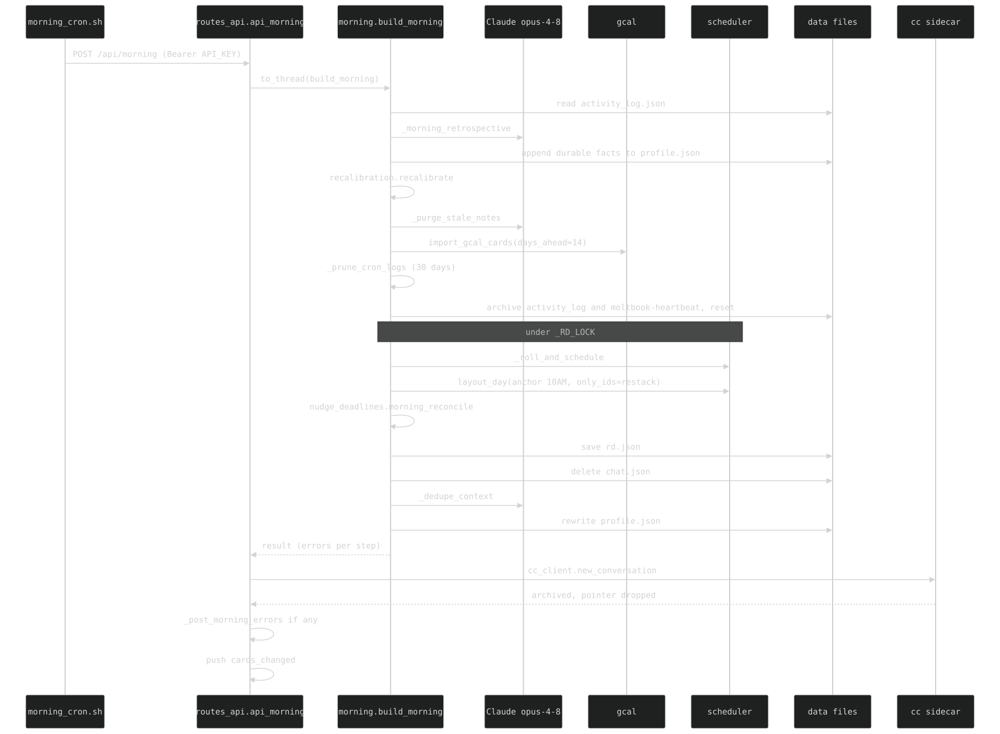

## 3. Morning pipeline + scheduling

### 3a. Morning cron sequence

`morning_cron.sh` (in-container cron, 4:30 AM ET) POSTs `/api/morning` with `Bearer API_KEY`; `routes_morning.api_morning` runs `morning.build_morning()` on a thread, then ends the Exec panel's sidecar thread.

- **Each step is isolated** (`_run_step`): a failure lands in `errors[<step>]`, the rest still run. Steps: `retrospective`, `recalibrate`, `purge_stale`, `gcal_import`, `prune_cron` (drops `data/cron/*.log` older than 30 days).
- **Sidecar thread**: the panel's thread lives in the cc sidecar (§7f), not `chat.json`, so deleting `chat.json` alone left the panel on yesterday's conversation. The route calls `cc_client.new_conversation()` after `build_morning()`; the sidecar archives before dropping its pointer and refuses (500) if the archive fails, surfacing as `errors.cc_new`.
- **Errors are posted, not buried**: any entry in `errors`, or a crash of `build_morning()`, goes through `routes_morning._post_morning_errors` — a `monitor` message in the fresh `chat.json` plus a `{comment}` push (panel replays it, Discord DMs it). A clean morning posts nothing. The route also pushes `{cards_changed}`.
- **Open pages reload** (2026-11-01): the server side reset fine, but a tab left open overnight kept yesterday's Exec transcript in its DOM. The route ends by writing `data/nightly.json` `{at}`; public `GET /api/nightly` returns it. `web/nightly-reload.js`, appended to every `_build_nav` page (owner + guest), records the stamp at load, re-asks on `visibilitychange` and every 5 min, and reloads when it moves — deferred while a field has focus. A crashed morning writes no stamp, so nothing reloads. Pages without the nav (`/spire`, `/nightfall`, landing, `/recruiter`, `/graph`) don't carry it.
- **Roll/layout block** runs under `_RD_LOCK`: first `_archive_passed_no_rollover` — every rd/hq `no_rollover` card whose day (`scheduled_day`, else the due date) is before today goes to archives ON that day, nudge resolved, recurring ones revived via `recurring_clone`; logged `source=morning` + `actor=morning`, which the monitor skips. Before 2026-11-10 such a card sat in hq outside the visible week, /hq's `consult_oracle` re-dayed it (a rollover after all) and a hand archive recorded the wrong day; `consult_oracle` now leaves a passed `no_rollover` card alone. Then `_roll_and_schedule` (past `scheduled_day` on rd/hq cards -> today, except `no_rollover`; dated rd cards inside the window -> hq via `schedule_to_day`, a past-due `no_rollover` card is left alone), restack of carryover + unpositioned today cards, `layout_day` from `AUTOSTACK_ANCHOR` (10:00), then `nudge_deadlines.morning_reconcile`.

### rd.json concurrency — `helpers._RD_LOCK`

rd.json writers run on genuinely parallel OS threads: the nudge loop's scans (`asyncio.to_thread`), chat-tool dispatch (`to_thread`), sync-`def` routes on Starlette's thread pool (gcal import), and the event loop (`PATCH /api/rd`). Three guards in `helpers.py`:

- **`_RD_LOCK`** (`threading.RLock`): every read-modify-write holds it around the WHOLE load→mutate→save (`with _RD_LOCK:`). LLM/network calls are NEVER made under it — release, call the model, re-lock + reload + apply (`_fire_nudge`, `_build_graph`, `_run_triage`, `api_rd_recalc`, `_tool_decompose_task`, `import_gcal_cards`). **Any new rd.json writer follows this.**
- **`_load_rd()` returns a private deep copy** — the `_load_json` mtime cache holds one shared object.
- **`_save_rd()` is an atomic tmp+rename** and **pops rd.json out of the `_load_json` mtime cache** (1ms mtime granularity: a save in the same millisecond as the read that seeded the cache would serve the stale pre-save board).

Single-process invariant: uvicorn runs ONE worker (`--reload`), so a process-wide lock suffices; nothing outside the container writes rd.json. Read-only loads (`monitor`, `get_week_data`, scans) skip the lock — deep copy + atomic replace make that safe.

### 3b. scheduler.py — the time model

All `dir_start_min` / `scheduled_day` logic lives here. Window = `SCHED_WINDOW_DAYS = 6` (today + 6 = 7-day span).

- **`schedule_to_day`** is the one rd→hq promoter (no I/O, mutates the card). Beyond the window: stays in `rd` with `due_date` only (`scheduled_day` cleared) — unless `clamp_to_window=True` (a manual move into `hq` via `PATCH /api/rd`), which clamps to the last window day. An overdue target clamps to today. `dir_start_min` is set only when the target is today; any other day clears it.
- **Callers**: morning `_roll_and_schedule`; exec chat tools (`create_card` / `schedule_card` / reschedule → `exec_tools.run_tool` → `chat_tools._handle_tool` → `card_schedule.apply_schedule`); `POST /api/rd/{id}/schedule` (`card_schedule.drop_on_day`); `PATCH /api/rd` (`routes_api._apply_patch_schedule`: a card moved into the `hq` column, with `clamp_to_window=True`). `PATCH /api/hq` (`hq.bulk_update_scheduled_days`) does NOT call it: it sets `scheduled_day` directly, and for today takes `place_card_today`.
- **`dir_start_min`**: minutes from midnight, the card BLOCK's start (= prep start) for a card scheduled today. Block = `[dir_start_min, +estimated_time]`; the event block is its final `work` minutes. A **timed** `due_date` pins it: `dir_start_min = event_time - prep` (`timed_start_min`), so prep finishes at the event time. Timeless cards stack forward (`place_card_today`: next free slot >= now, snapped to 15 min, after the last placed card; morning `layout_day` from 10:00). An explicit `dir_start_min` argument wins.
- **Dragging the master block** (hq today column, `saveStartTime` in `web/hq-board.js`) retimes the due TIME to `block_start + prep`, keeping the due DATE; cards with no due_date just move. Between-column drags (`/api/hq`) only touch `scheduled_day`, never the due date.
- **`prep_time`**: of `estimated_time`, the decomposed **prep** minutes; `work = estimated_time - prep_time` is the atomic **event** (class, concert, appointment) — **only when `prep_time > 0`**. With `prep_time = 0` the whole time is decomposed and `ensure_event_block` (`nudge_deadlines.py`) adds no event node. Auto-filled at creation (exec `create_card`, `_card_brief`); edited as `cd-prep` + `cd-dur` in the card dialog (`fmtDuration` `35m`/`6h`, `parseDuration` also accepts `90`, `1h30m`); "recalculate" rebuilds the graph to that split. null for reminders.

History: [ARCHAEOLOGY.md §3](../archaeology/03-morning-pipeline.md#3-morning-pipeline--scheduling).
