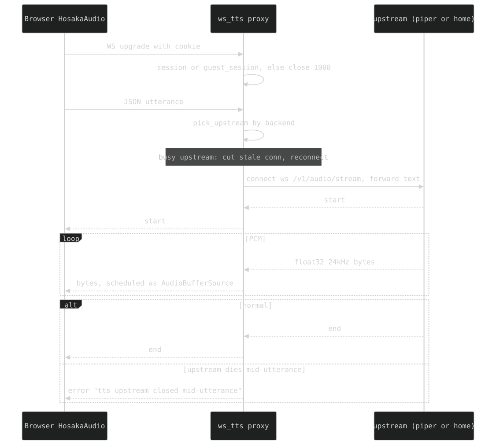

## 4. TTS (text-to-speech)

Every voice in the app — the `/hosaka` SPEAK page, the `/tarot` reader, and the Exec panel — streams through **one same-origin proxy** (`routes_tts.py`) to one of **two upstreams**: the **home GPU box** (kokoro, chatterbox + RVC; SSH reverse tunnel) or **`hosaka-piper`**, an always-on CPU container on this droplet (`glados`). The browser only talks same-origin, so the session/guest cookie carries auth on the WebSocket handshake (HTTP basic auth does not ride a WS upgrade reliably on mobile).

### 4a. Topology

- **Home upstream**: `TTS_UPSTREAM` (default `172.17.0.1:8123`), the Docker bridge gateway → host loopback → SSH tunnel to the home box. `tts-box/` (systemd user service, tunnel unit, port watchdog) lives on the home box and keeps it alive; see `tts-box/README.md`.
- **Piper upstream**: `TTS_PIPER_UPSTREAM` (default `hosaka-piper:8123`), a compose service (`docker-compose.yml`, image `hosaka-piper:latest`, no published ports, pronunciation lexicon bind-mounted read-only). `tts_routing.pick_upstream` sends an utterance with `backend == "piper"` there, everything else to the home box.
- **Voices**: `/api/hosaka/voices` queries both upstreams concurrently and merges (`merge_voices`: piper voices from piper, the rest from home; an upstream error yields `[]`).
- **Health**: `/api/hosaka/health` → `{ok, home, piper}`, 200 if EITHER answers (glados alone is still ok), else 503. Liveness (`_live`) is a real `/v1/voices` response, **never a bound port** — the tunnel listener stays bound with the home box off. `/hosaka` shows "Wai's GPU offline -- glados only" when `home` is false (`applyHealth` in `tts.js`). Probe timeouts: 3s (`_live`), 5s (voices), 4s (mode fetch), 15s (mode switch).

**Every utterance ends in a terminal frame.** Normally the upstream's own `{"type":"end"}`/`{"type":"error"}` clears `busy[url]`. If the upstream stream just ends mid-utterance (home box crash, tunnel drop, server restart), `_pump_to_client`'s `finally` synthesizes `{"type":"error","detail":"tts upstream closed mid-utterance"}` and evicts the dead connection so the next utterance reconnects. Load-bearing for `/tarot`: its typewriter paces off the audio clock and waits on a terminal frame. The guard is the pure `tts_routing.died_mid_utterance` (unit-tested), which fires **only** for the live connection on that url — a stale socket `_ws_dispatch` cut on purpose to start a new utterance must not error the one that replaced it. A failed send/connect answers `{"type":"error","detail":"tts upstream unreachable"}` for that utterance only and evicts the connection; a live glados connection survives a home-box death.

Client-side belts (a frame can also be lost browser↔droplet): `hosaka-audio.js`'s `ws.onclose` delivers a synthetic `{type:"error"}` to the in-flight utterance (guarded on the socket still being the live one), and the stall watchdog in `typewriter.js` (`twAudio`) caps `elapsed()` at the buffered duration in its progress signal so a dead stream can fire it.

### 4b. Auth — guest-or-full

`/hosaka` and `/api/hosaka/voices` are on **`protected`** (owner-only since 2026-11-10); `/api/hosaka/health` stays on **`guest_protected`** (`tarotVoice.probeHome()` needs it). `WS /ws/hosaka` and `WS /ws/hosaka/presence` are on the `public` router but close `1008` before `accept()` unless a `session` **or** `guest_session` cookie matches (this is what lets guests hear the `/tarot` reader).

| Endpoint | Router | Reachable by |
|----------|--------|--------------|
| `GET /hosaka`, `GET /api/hosaka/voices` | `protected` | full only |
| `GET /api/hosaka/health` | `guest_protected` | full + guest |
| `WS /ws/hosaka`, `/ws/hosaka/presence` | `public` + cookie check | full + guest (else `1008`) |

### 4b-ii. GPU-mode owner control

`GET`/`POST /api/hosaka/mode` and `GET /api/hosaka/mode/stream` are on **`protected`** (owner-only; guests must never flip the GPU). They proxy the home-box `gpu-mode` service at `GPU_MODE_UPSTREAM` (default `172.17.0.1:8124`, over the same tunnel) with `Authorization: Bearer $GPU_MODE_TOKEN` (must match the home box's token; read from the environment, empty by default). GET returns `homo`/`emo`/`idle`/`gone` (`gone` = box unreachable). POST `{"action": "homo"|"emo"|"idle", "force"?: bool}` (else 400).

- **Kill-switch guard**: `emo` and `idle` stop hosaka-server and cut active listeners. `needs_user_confirm` checks `_audio_conns` (every open `/ws/hosaka` socket — incl. `/tarot` and Exec voice, not just `/hosaka`-page `_presence`) and returns `409 {detail:"active_users", count}` unless `force`. `homo` never needs confirmation.
- **Reported mode is corrected against reality**: the box's `/mode` is its *intent* and outlives the truth (hosaka-server dies, box still says `homo`). `_current_mode()` probes `/mode` and `_live(TTS_UPSTREAM)` concurrently and `gpu_mode_client.effective_mode` reports `idle` for a claimed `homo` with no live TTS. Only `homo` is second-guessed (under `emo`/`idle` a failing probe is expected; `gone` says it all). A `homo` switch sets a 90s grace (`_HOMO_GRACE_S`) assuming live, since models must load before `/v1/voices` answers.
- **Live sync**: a POST pushes instantly to `_mode_subscribers`; changes made at the home box (watchdog restart, another device) never touch that queue, so the SSE stream's keepalive tick doubles as a poll of the real mode (`_MODE_POLL_S` = 15s) and emits on change; unchanged → a `: keepalive` comment.
- **UI**: owner-only `#gpu-mode` strip on `/hosaka` (`web/gpu-mode.{css,js}`): emo / **down** / homo. The middle button is LABELLED `down` but its `data-mode` is still `idle` (the action the box accepts). `idle`/`down` (hosaka-server deliberately stopped) differs from `gone` (box unreachable). Guests get 401, strip hidden.

### 4c. Three consumers of one audio core — and one narrator above it

All share `web/hosaka-audio.js` (`HosakaAudio.createPlayer()`): `AudioContext`, the iOS unlock, the `/ws/hosaka` socket, and playback of streamed **24 kHz float32 PCM** via scheduled `AudioBufferSourceNode`s. The upstream emits only `{start}` / coarse PCM blobs / `{end}` (no per-word timestamps), so visuals sync to the *measured* audio duration.

| Surface | Script | Voice | Backend | Runs on |
|---------|--------|-------|---------|---------|
| `/hosaka` SPEAK UI | `tts.js` | `charlie` (default) + full list | chatterbox + RVC | home GPU box |
| `/tarot` reader | `tarot-voice.js` | `nicole` | kokoro | **home GPU box** |
| Exec panel + bubble | `exec-voice.js` / `exec-voice-listener.js` | `glados` | piper | **this droplet** |

**The last column is the difference that matters.** Exec keeps its voice with the home machine asleep; only `/tarot` speaks from the tunnel and can lose its voice (§14d, §14e).

- **`web/voice-narrator.js`** sits above the player for the two narrating surfaces (`/tarot`, Exec panel): player lifecycle, persisted on/off, unlock, utterance queue, and the CONTROLLER (`elapsed()`, `duration()`, `ended`, `ok`) a typewriter paces to. `exec-voice.js` / `tarot-voice.js` are thin bindings (config + what is theirs: replay glyph, home-box probe, canned opening). The control is **`web/voice-ui.js` + `voice-ui.css`**: one `.voice-mute` element, one `data-on` contract. `/tarot` overrides the star glyph's size/factor in `tarot.css` (`.voice-mute.spread-btn .voice-glyph`) because that page has no `[x]` beside it.
- **OFF means off**: nothing synthesized, no socket opens, `speak()` returns a DEAD controller, every caller reveals at its own pace now. One flag.
- Each narrating surface paces its typewriter to the audio clock and falls back to the guessed pace on any failure (§18). `exec-voice-listener.js` (nudges/monitor comments on non-planning pages) is fire-and-forget — no typewriter to pace.
- **Fourth path — pre-rendered audio**: the `/tarot` openings (§14d) are already-rendered WAVs; `player.speakBuffer({data})` schedules one through the same `scheduleBuffer` (same playhead, gain node, iOS unlock, `elapsed()`/`audioDuration()` clock). No socket; `{end}` fires on scheduling. Trap: `decodeAudioData` **detaches** its ArrayBuffer, so it decodes a copy and a replay survives.
- **The audio session is HELD only while something plays** (2026-11-06). The iOS Ring/Silent-switch defeat is a looping silent `<audio>` (`silence.wav`), which puts the page in the "playback" category — the one that stops every other app's audio. `exec-voice-listener.js` unlocks the Exec player on the first tap on every nav page, so the loop used to run for the life of the tab and took Wai's music away site-wide. Now `release()` pauses the loop and suspends the `AudioContext` `RELEASE_MS` (2s) after the last buffer drains with no stream in flight (`S.streaming`, cleared by the `{end}`/`{error}` frame or `onclose`); `speak()`/`speakBuffer()` re-take it via `unlock()` (a media element that played once in a gesture replays without one). `tarot-music.js`'s own loop stops with the music.
- **Exec asks before it takes the session — `web/voice-gate.js` + `voice-gate.css`** (2026-11-07). Exec's narrator is TAP-GATED (`tapGate` in `exec-voice.js`): it never unlocks on a tap anywhere (no `armUnlock`, the panel's open no longer calls `unlock()`), and a narrator that is OFF never unlocks at all (`voice-narrator.js` `unlock()` checks `on`) — so with the voice off, chatting with Exec never touches Wai's music. With the voice on and no gesture yet, `speak()` holds the line, shows a full-screen `[ tap to hear Exec ]` overlay (+ `skip`), and returns a DEAD controller so the reveal types at its own pace; the tap unlocks inside the click and speaks every held line. The replay glyph unlocks in its own tap. The panel's capture-phase click-outside test counts `#voice-gate` as inside. If iOS later refuses the silent loop without a gesture (`NotAllowedError`), `hosaka-audio.js` clears `unlockedOnce` and the next line asks again. `/tarot` is not gated (its own first-tap flow, §14). Pinned by `tests/test_exec_voice_browser.py`.
- **No browser in the loop**: `api/tarot/voice_synth.py` speaks the upstream protocol directly (`ws://TTS_UPSTREAM/v1/audio/stream`, bypassing `/ws/hosaka` — no cookie, no client). Callers: the opening generator (`openings_gen`), the nightly voice probe (`openings_loop`, §14e), and `POST /api/tarot/warm`.
- **Mic**: `voice-input.js` is the mic engine + `bindComposer`; `exec-mic.js` / `tarot-mic.js` are thin bindings. A final result ARMS the send `SEND_DELAY_MS` (1s) out rather than sending; anything heard in the window cancels and joins the text. The mic drops everything heard while a reply streams **or** the narrator `isSpeaking()` (true through the playout tail; `exec:voice-idle` re-lights the dot) — else the page transcribes its own narration.

### 4d. One utterance

`_ws_dispatch` routes each JSON utterance by `pick_upstream`, caches one upstream WS per url (`_ws_connect`), and pumps frames both ways (`_pump_to_client`). If the previous utterance on that url is still `busy` (the client flushed playback for a new one), the stale connection is cut and reopened so trailing frames cannot interleave.

### 4e. Presence

`WS /ws/hosaka/presence` (same cookie gate): every open `/hosaka` **and `/tarot`** tab holds one socket (`web/hosaka-presence.js`); the server tracks `_presence` and broadcasts the TOTAL `{count}` on each join/leave (serialized by `_presence_lock`); each client subtracts its own socket to render `N other people speaking` (`#tts-presence`, only `/hosaka` renders it). Separate from `/ws/hosaka` (opens only on Speak) and from `_audio_conns`, which is what the GPU-mode guard counts.

History: [ARCHAEOLOGY.md §4](../archaeology/04-tts.md).
