## 5. LLM call sites + prompt caching

Every Claude call in this section goes through the `anthropic` SDK with a pay-per-token
`ANTHROPIC_API_KEY` (no subscription); the Exec panel's own agent and the rolling title run on the `/cc` sidecar's subscription login instead (§7). Where a large, byte-stable system
prefix is **reused across turns**, a `cache_control: {type: ephemeral}`
marker (5-min TTL) lets repeat requests read that prefix at ~0.1x.
Models: `claude-opus-4-8` everywhere except `card_llm.parse_date_natural` and `gcal._haiku_classify_batch` (`claude-haiku-4-5`).

### The one invariant

Render order is `tools -> system -> messages`. A marker on the **last
system block** caches `tools + system` together. Caching is a pure prefix
match: any changed byte inside the cached span (timestamp, per-request card
data) invalidates everything after it. So static text precedes volatile
text and the marker sits at the end of the static part. **Opus min cacheable
prefix = 4096 tokens** — shorter silently caches nothing
(`cache_creation_input_tokens` stays 0).

### Cached sites

| Call site | Model | Cached prefix | Tokens (measured 2026-10-14) | Reuse pattern |
|-----------|-------|---------------|-------:|---------------|
| `tarot/agent.py` `stream_chat` | opus-4-8 | `build_system(spread_type)` + `TOOLS` | 8,797 (no spread) / 13,514 (three-card) | every turn of a reading |
| `mtg/agent.py` pass 1 | opus-4-8 | `SYSTEM` + `TOOLS` | 7,223 | across research tool-loop iterations + cross-question |
| `mtg/agent.py` pass 2 | opus-4-8 | `SYSTEM` (no tools) | 6,381 | cross-question only (separate prefix from pass 1) |
| `chat_passes.run_turn` (act + reply) | opus-4-8 | `_CHAT_STATIC_PREFIX` + `_chat_tools()` | 6,494 | every exec pass; each reads what the first wrote |

Counts measured 2026-10-14 with the free `client.messages.count_tokens`
endpoint (not re-checkable from source). All four clear the 4096 floor;
**re-measure after any prompt or tool-schema edit.**

**Exec:** `_build_chat_system_prompt(stage, actions=…)` (chat.py) returns a
**two-block** system list — marked static block (identity + `EXEC_VOICE` +
global rules) and an unmarked volatile tail (`_turn_context`: TODAY, stage,
activity log, boards, 7-day schedule, context, active-nudge block, ACTIONS
YOU JUST TOOK). `TODAY` must stay in the tail. `run_turn` is used by
`routes_chat` (legacy `/api/chat`) and `discord_bot`; the Exec panel itself runs on the sidecar (§7).

**ACTIONS YOU JUST TOOK:** after a tool round the system prompt is rebuilt
with this block (`chat_actions._actions_taken_block`, from the dispatched
`{name,input,result}` list) so the model reads the refreshed board as the
result of its own action, not as a phantom duplicate. Volatile tail only —
the cached prefix stays byte-stable.

**Activity-log entries carry the card `id`** (`_log_entries_for_patch`:
created/moved/updated/deleted/revived) and the prompt renders a trailing
`[id:…]` per log line; entries sharing an id are one card (a `create_card`
with a due_date logs both `created` and `updated`). Pinned in
`tests/test_exec_tool_rounds.py`.

### Exec turn: ACT then REPLY (`api/chat_passes.py`)

History reaches the model flattened (`sanitize_history_for_api` strips past
`tool_use`, §16), so a single pass learns to SAY "Added X" without calling a tool. Hence two passes:

- **Pass 1, ACT** — tools on, `messages.create` (not streamed), **text discarded**; only `tool_use` blocks are kept. Loops until no tool calls (`_MAX_ACT_ROUNDS` 4), the action diff rebuilt each round. No action needed → no tool, no text.
- **Pass 2, REPLY** — same tools, **`tool_choice: none`**; sees every tool_result plus ACTIONS YOU JUST TOOK; the only streamed pass. If a requested action is MISSING it answers `[redo: <action>]`, which is buffered and **never shown**, attached to the closing user message as an `[auto-check, not from Wai]` block, and pass 1 re-runs. `_MAX_REDOS` 2; the last reply pass is not offered the redo and must say plainly what was not done. `strip_notes` removes auto-check blocks before `_save_chat`.
- Cost: an action turn adds one non-streamed call before any text (roughly 9s to first text vs 2.3s on a question; one-off measurements 2026-09-24). Both passes share tools + static block (each pass's rules go in the volatile tail, `chat_passes._system`), so the second reads the cache the first wrote.

`chat_store.assistant_content_blocks` converts an API message to storable text + `tool_use` dicts. Pinned by `tests/test_chat_passes.py`.

### Uncached (left alone)

Sizes below are approximate figures from when the sites were audited (no date recorded, not re-checkable from source); the call sites themselves are as listed.

| Call site | Why |
|-----------|-----|
| `monitor.py` | static slice ~1.3K (no tools) < 4096; debounced bursts = low reuse |
| `nudge_llm` `_TONE` | ~1.4K (no tools) < 4096; per-card one-shot |
| `card_llm` classify / parse-date | one-shot per card; no system / tiny volatile system |
| `morning.py`, `chat._dedupe_context` | daily one-shot; prompt lives in the user message |
| `gcal._haiku_classify_batch` | no system block; tiny instructions in the user message |
| `tarot/openings_gen.generate_texts` | `voice_preamble()` ~1.5K < 4096; one call per hour of the day (24), each producing that hour's whole batch |

**Verifying:** response `usage` reports `cache_creation_input_tokens` (~1.25x) and `cache_read_input_tokens` (~0.1x). Two identical requests with `cache_read` still 0 means a silent invalidator is back in the prefix.

### Where the marker goes

The marker always goes on a byte-stable block; the volatile part lives elsewhere.

- **Tarot** (`tarot/agent.py`) — marker on the single system block `build_system(spread_type)`; **the per-turn spread context rides in `messages`, never `system`**.
- **MTG** (`mtg/agent.py`, `_SYSTEM_CACHED`) — `SYSTEM` marked once, used at both call sites. Pass 1 (research loop, with `TOOLS`) caches within its own iterations; pass 2 (summarize, no tools) is a separate system-only prefix. Both cache cross-question; only pass 1 caches within a question.
- **Exec chat** — two-block list as above; marker on block 1 only. Every pass of `run_turn` builds the identical static block.

History — the incidents behind the rules above: [ARCHAEOLOGY.md §5](../archaeology/05-llm-calls.md).

