## 6. Printer (ELEGOO Centauri Carbon) — two-tier reverse proxy

`/printer` serves the printer's **own** web UI (an Angular SPA with a live
MJPEG camera and SDCP websocket controls) from wai-lau.net. Same-origin
everywhere: the browser talks only to the droplet, so the full `session`
cookie rides every sub-request incl. the websocket handshake, and nothing
weaker than the owner reaches a machine that can heat a nozzle.

The page also has a **guest tier — read-only, by routing** (Turnstile guests; on the landing wheel and the guest nav). The rule is not "filter what a guest may send", it is "a guest has no route that carries their bytes to the LAN":

| Route | Owner | Guest | Why |
|-------|-------|-------|-----|
| `GET /printer` | SPA wrapper | camera + job strip | same template, `data-readonly="1"` for guests |
| `ANY /printer/{path}` | full proxy | **401 → admin login** | the SPA, file endpoints, uploads — every browser→printer HTTP path |
| `WS /ws/printer` | SDCP relay | **1008** | the only browser→printer socket; it drives the machine |
| `GET /printer/video` | MJPEG | MJPEG | one-way read off the shared hub (the vendor SPA's ``) |
| `GET /printer/frame` | ✓ | ~10fps | ONE JPEG per request — the guest pull loop (§6g) |
| `GET /api/printer/status` | ✓ | ✓ | one-way read; the printer pushes it unasked |
| `GET /api/printer/health` | ✓ | ✓ | one-way liveness GET |

Routers (`routes_printer.py`): `/printer`, health, status on `guest_protected`; `/printer/video`, `/printer/frame` on `public` with the tier checked in-handler (`_has_view_access`); `/printer/{path}` on `protected`; `/ws/printer` on `public` with a `session`-cookie `hmac.compare_digest` check (closes `1008` before `accept()`; unlike the HTTP routes it does not accept the admin bearer). "Owner" for the in-handler checks (`_is_owner`) = the `session` cookie or the admin bearer; "guest" = a valid `guest_session` cookie.

The two guest-reachable readers are **server-opened singletons**, not relays of anything a viewer said: `printer_camera.py` holds ONE upstream MJPEG stream (the printer allows ~4), and `printer_status.py` holds ONE SDCP socket that **sends no frame, ever** — the printer pushes status on its own and `public_status()` whitelists it (no `MainboardID`/`TaskId`/`Filename`).

### 6a. Topology

The printer sits on Wai's home LAN (`192.168.2.25`). Its three ports are
reverse-tunnelled from the home box to the droplet's docker bridge by
`printer-box/printer-tunnel.service` (the hosaka/emet pattern, §4a; `-R`
forwards point straight at the printer's LAN address; install in `printer-box/README.md`).

| Printer port | Bridge | Env var |
|---|---|---|
| `:80` SPA + files | `172.17.0.1:8126` | `PRINTER_UPSTREAM` |
| `:3030` SDCP websocket | `172.17.0.1:8127` | `PRINTER_WS_UPSTREAM` |
| `:3031` MJPEG camera | `172.17.0.1:8128` | `PRINTER_VIDEO_UPSTREAM` |

### 6b. Why rewrites, and which

The SPA assumes it is the origin. Pure helpers in `printer_proxy.py` (no I/O; `tests/test_printer_proxy.py` pins them against verbatim slices of firmware V1.4.49) patch it in flight:

| Upstream shape | Rewrite |
|----------------|---------|
| `<base href="/">`, root-absolute `href`/`src` (index HTML) | `rewrite_html`: → `/printer/…` (protocol-relative `//` untouched) |
| `</head>` of the index | `rewrite_html` injects `<link href="/printer-frame.css?v=3">` AFTER the re-root pass (site overrides for the proxied doc: hides `app-header`) |
| `` `ws://${…}:3030/websocket` `` (main.js) | `rewrite_js`: → `` `${location.protocol==="https:"?"wss":"ws"}://${location.host}/ws/printer` `` |
| `"http://"+(…VideoUrl)` on the camera `` | `rewrite_js`: scheme dropped (mixed content) |
| `` `http://${…hostName}:80` `` (file download href, upload POST) | `rewrite_js`: → `` `${location.origin}/printer` `` |
| quoted `"/assets/…"` literals in compiled templates (all bundles) | `rewrite_js`: → `/printer/assets/…` |
| `"VideoUrl":"<ip>:3031/video"` in the SDCP reply (cmd 386) | `rewrite_ws_text` (printer→browser text frames) → `/printer/video` |
| any `http://<lan-ip>[:80]/` in a frame (task `Thumbnail` cmd 321, `TimeLapseVideoUrl`) | `rewrite_ws_text` → `/printer/` (other ports untouched) |

Only `text/html` and JavaScript content types are rewritten (`rewrite_kind`); everything else streams untouched.

Relative URLs (hashed CSS/JS, lazy chunks, `assets/i18n/…`, fonts) resolve against the rewritten base and need nothing. **Deliberately not rewritten:** the WebRTC signalling socket (`ws://<host>:8883`, only when the printer advertises `VIDEO_WEBRTC`; the unit tested reported only FILE_TRANSFER / PRINT_CONTROL / VIDEO_STREAM) — pinned by a regression test; wiring it means a fourth tunnel port + relay.

**Headers are allowlists both ways** (`upstream_request_headers` / `client_response_headers`): the session cookie and bearer never reach the printer; `accept-encoding: identity` so bodies arrive rewritable; `content-length`/`content-encoding` dropped on the way back, a request `content-length` forwarded (the printer's HTTP server is not trusted with chunked). Every response is `Cache-Control: private, no-cache` and `CacheControlMiddleware` (main.py) skips `/printer/`. Only a root-relative `Location` survives, re-rooted; any other redirect target is dropped.

**Conditional requests are answered by the proxy**: `If-None-Match` is not forwarded; a rewritten body's ETag is the printer's tag + `-rw<REWRITE_VERSION>` (now `"5"`). **Bump `REWRITE_VERSION` whenever `rewrite_html`/`rewrite_js` change**, or browsers 304 stale rewrites.

### 6c. Runtime shape

- **`/printer/{path}`** streams non-HTML/JS bodies both directions (`StreamingResponse` over `httpx` down, `request.stream()` up, write timeout unbounded for gcode uploads); HTML/JS are read whole, rewritten, re-served. Timeouts: connect 4s, read 60s (`_HTTP_TIMEOUT`).
- **`/printer/video`** relays `multipart/x-mixed-replace` with `X-Accel-Buffering: no`; the content type is excluded from `GZipMiddleware`. `main.py` passes the exclusion list to `GZipMiddleware` explicitly (newer starlette binds the kwarg default at import time) and lists both prefix and `type/*` spellings.
- **`/ws/printer`** accepts first, then dials the printer (like `/ws/hosaka`), so a vanished browser never strands an upstream socket and a down printer (5s `open_timeout`) is a clean `1011` the SPA retries. Two pumps (`_pump_to_client` rewrites text; `_pump_to_upstream` forwards text + bytes) under `asyncio.wait(FIRST_COMPLETED)`; either side closing tears down both.
- **Liveness** (`/api/printer/health`): tunnel ports stay bound while the printer is off (accept-then-reset), so only a real HTTP answer from the SPA shell counts (the `/api/hosaka/health` rule); own timeout 2s connect / 3s total (`_HEALTH_TIMEOUT`). Upstream failures degrade to 503 or a closed socket, never 500.

### 6e. The wrapper page

**`GET /printer`** serves `templates/printer.html` via `printer_page()` — shell + nav, `full_height`: a lede and online/offline row over an **`<iframe>`** of `/printer/network-device-manager/network/control`.

- The iframe isolates the SPA's global antd CSS from chrome.css and scopes its `<base href>`.
- `web/printer.js` polls `/api/printer/health` every 15s (`POLL_MS`; + tab focus; sequence-numbered so an older answer never overwrites a fresher one) and mounts the iframe only while online. Offline: "printer offline" note, frame set to `about:blank` (kills the SPA's reconnect loop); remounts itself.
- **The iframe fades in only on `load`** (`.printer-frame` is `opacity:0` until `.ready`) — the vendor SPA paints white before its app renders.
- **Guest render is a different page, not a filtered one.** `printer_page()` sets `data-readonly="1"`; `printer.js` never mounts the SPA, showing `#printer-view`: the camera `` plus ONE job strip (`#printer-job`: state chip, percent, elapsed/remaining, layer progress) polled from `/api/printer/status` every 3s (`STATUS_MS`). No controls, no temps, no filename/thumbnail (`public_status` never sends them); `.printer-head` is hidden for guests. Idle printer = state chip alone (`.printer-job:not(:has(.pj-pct))` drops the card).
- The job strip is a centred CARD under the feed (`.doc-card` surface one step smaller), `.pj-rows` one pair per line.
- **`printer.css` keeps the CRT stack at `--z-modal` IN FRONT** for both tiers (not `z-index:-1` like `/rd`); layers are `pointer-events:none` so the SPA stays clickable.
- **The Exec link-bubble drags across the iframe**: `exec-bubble-drag.js` flags a live mouse drag `html.exec-drag`; `printer.css` drops the frame's `pointer-events` meanwhile.
- **Scrollbar**: `web/printer-frame.css` re-declares `--green-hsl`/`--radius-pill` in its own `:root` and writes the rules as `html ::-webkit-scrollbar` with `!important` on every declaration (the SPA ships its own grey bar under that selector, inline copy lands after our `<link>`). chrome.css is deliberately not injected (globals fight antd). Wrapper styles stay in `printer.css`; `printer-frame.css` is only for the proxied document.

### 6g. The camera hub

`GET /printer/video` and `/printer/frame` are on the **`public`** router with the tier checked by hand (`_has_view_access`): routers mount public → protected → guest_protected, so on `guest_protected` the owner-only `/printer/{path}` catch-all would match `/printer/video` first.

`printer_camera.py` holds **ONE** upstream stream however many watch: it demuxes into whole JPEG frames, keeps the latest, and re-muxes per viewer (boundary `--printerframe`) starting from that frame. Each viewer has a one-frame queue and drops what it cannot keep up with. Constants:

| Constant | Value | Meaning |
|---|---|---|
| `MAX_VIEWERS` | 16 | 503 past it; a pipelined guest counts once (`can_admit` divides pullers by `PULL_DEPTH`) |
| `GUEST_FRAME_INTERVAL` | 0.1s | a ceiling on the guest sample (`_promote`); owner unthrottled |
| `_SLACK` | 0.75 | a frame is accepted from 75% of the interval on |
| `PULL_WAIT_S` | 5s | `/printer/frame` long-poll; 204 = ask again |
| `PULL_DEPTH` | 2 | pulls in flight in `printer.js` |
| `_IDLE_STOP_S` | 10s | upstream dropped after the last viewer/puller (`_wanted()`) |
| `_BACKOFF_MAX` | 15s | reconnect backoff 1→15s; upstream read timeout 30s |

**The guest view PULLS.** A pushed MJPEG body is only as fresh as the slowest buffer on the path (uvicorn, nginx, kernel), which never drop — latency grows unbounded on a slow link. `GET /printer/frame?after=<seq>` returns ONE JPEG newer than `seq` (seq in `X-Frame-Seq`); `printer.js` keeps `PULL_DEPTH` pulls in flight, each asking for the frame after the previous pull's (`asked`), swaps only a decoded frame (`img.decode()`), and never goes back to an older one (`shown`). Nothing queues: a slow link gets fewer frames, never older. Guests share ONE server-side sample. The MJPEG body stays for the owner's SPA. Pinned by `tests/test_printer_camera.py`.

**The hub RECONNECTS instead of ending**: an `` never re-requests a dead MJPEG stream, so on upstream end/stall `_run` re-dials with backoff and keeps feeding the SAME open viewer responses.

History — the incidents behind the rules above: [ARCHAEOLOGY.md §6](../archaeology/06-printer.md).

Nav label `3DP`; route, icon and internal key stay `printer`.
