## 7. `/cc` — the Exec panel's agent (Claude Code, host-side sidecar)

Owner-only. The `/cc` PAGE is gone (folded into the Exec panel 2026-09-29, §7g); `/api/cc/*` and the sidecar behind them remain, and the panel on `/rd` + `/hq` is their client. This section is the **exec-fn side**: routes, transport, the panel UI. Summary + invariants: CLAUDE.md's `/cc` row. The sidecar itself (`claude-box/`, submodule `wai-lau/cc-sidecar`) has its own `ARCHITECTURE.md`, cited here as `claude-box S-N`; the agent's `cwd` is a private scratch sandbox, **not** a checkout of exec-fn.

| Old id | Now |
|---|---|
| §7a-bis (sign back in from the panel, `login.mjs`) | claude-box S-2 |
| §7b (sandbox: three mechanisms) | claude-box S-3 |
| §7b-bis (blast radius, accepted) | claude-box S-4 |
| §7b-ter (path gate; `Bash` uncovered) | claude-box S-5 (the owner-only tier bullet stays in §7b below) |
| §7c, tool allowlist / count / probe | claude-box S-6 (tool-line UI stays in §7c below) |
| §7c-bis, sidecar half (`exec-tools.mjs`, token env strip) | claude-box S-7 (container routes stay below) |
| §7d (archive tools) | claude-box S-8 |
| §7e, sidecar half (persona assembly, `cc-context.md`) | claude-box S-9 |
| §7f (the SECOND §7f: session pointer, `/new` archive) | claude-box S-10 |
| §7i, generation half (`title-gen.mjs`) | claude-box S-12 |
| §7k, sidecar half (no hangup abort, `/interrupt`) | claude-box S-11 |

### 7a. Topology (exec-fn side)

Claude Code cannot run in the app container (`python:3.12-slim`: no node, no `claude` binary, no credentials), so it runs on the droplet HOST as `cc-agent`; the container reaches it over the docker bridge at `172.17.0.1:8129` (`CC_SIDECAR_URL`, `cc_client._CC_URL`). Same idiom as hosaka/printer minus the SSH tunnel.



Container side: `cc_client.py` (transport, `x-cc-token` = `CC_SIDECAR_TOKEN`) + `routes_cc.py` + `routes_exec.py` (the reverse path, §7c-bis). Sidecar endpoints, install, limits: claude-box S-1. A logged-out sidecar answers a per-request `Not logged in` text frame; on load the panel states the sidecar's state once as a `.msg.sys.warn` line (`execAnnounceState`, `web/exec-term.js`: `sidecar offline` / `cc-agent not logged in`). Signing back in is the sidecar's job (claude-box S-2); the link arrives as markdown in an ordinary `text` frame.

**Routes** (`routes_cc.py`, all on `protected`): `GET /api/cc/health`, `/sessions`, `/title`, `/limits`, `/history`, `/exec-history`; `POST /api/cc/resume`, `/new`, `/interrupt`, `/query`. `/query` validates (400 empty prompt+images+files; 413 over 32K chars of text / 4 images / 5MB base64 each / 4 files / 6MB each / 20MB attachments), prepends `exec_context.wrap()`, and returns `cc_client.stream_query` as SSE with `X-Accel-Buffering: no`. Failures are injected as an `error` FRAME, never raised (the response has begun streaming). `/api/cc/sessions` prefers the cached rolling title over the SDK's summary, read-only (forty rows must not fire forty haiku calls).

**A busy sidecar waits instead of failing** (`cc_client.stream_query`): the sidecar runs one turn at a time; a 429 polls every `_BUSY_POLL_S` (0.5s) for up to `CC_BUSY_WAIT` (300s, `_BUSY_WAIT_S`), emitting one `{"type":"waiting"}` frame (the panel ignores it and keeps its cursor up). Only a slot held past that answers `busy`.

### 7b. The tier

`/api/cc/*` hands whoever reaches it a shell on the droplet as `cc-agent` (sandbox: claude-box S-3 to S-5), so **admin-only is the whole of the access story**: `protected` (full `session` cookie), **never `guest_protected`** — no per-caller scoping would make a guest tier safe. Pinned by `tests/test_cc_admin_only.py`, which enumerates the routes from `routes_cc.py` (never a hand-written list) and checks the tier structurally and over HTTP, anonymous and guest. The interrupt route is structural-only there (firing it would stop Wai's live run).

### 7c. Tool lines in the panel (the sidecar's tool set: claude-box S-6)

- **A tool call is ONE line, its output folds under it** (`web/exec-toolout.js`). The line clips with an ellipsis; tapping the WHOLE row (not just the marker) reveals the result and flips the gutter `+` → `-`. Open, the block is capped at `max-height: 20lh` and scrolls inside itself (`exec-term.css`). Summaries come from `execSummarize()` (`exec-term.js`): `query`/`url` FIRST, then `command`, `file_path`, `pattern`, `path`, `prompt` (WebFetch's `prompt` is the instruction, not the thing fetched).
- **Pairing is FIFO, not by id**: `tool` / `tool_result` frames carry no `tool_use_id`; results arrive in call order. A call is consumed from the queue even when its result is empty; the queue is emptied at the top of each turn; a result with no waiting call becomes a standalone open block. The cursor parks on the TOOL line while folded.
- **Every tool line expands to something**: empty result → `[ no output ]`; a call still waiting at end of turn / on interrupt → `[ no result returned ]`.
- **Text that resumes after a tool call opens its OWN bubble**: the open bubble is settled (markdown + SVG) and closed, the reveal state replaced with a fresh object (a cancelled typer never calls `onDone`, so a stale `typing` promise would hang the settle pass); the receipt hangs on the last settled body when a turn ends on a tool.
- **An Exec card tool (`mcp__exec__*`) is not a tool line**: it queues `{cardTool, input}` and renders a one-line receipt (`execCardReceipt`): `[ card added: … ]`, `[ … failed: … ]` on an `{error}` result.
- **The turn receipt** (`execAppendReceipt`, `exec-stream.js`) prints only when something happened (a wait ≥15s, `[ 32.7s ]`), hung on the END of the reply. It is STASHED at the `done` frame and rendered at settle (`done` can arrive mid-reveal, and the settle pass rebuilds `innerHTML`).
- **Closing/dropping a bubble must be idempotent** within one turn (consecutive tool frames call it repeatedly).

### 7c-bis. Exec's card tools — the container side of the relay

The agent gets Exec's card tools as `mcp__exec__*`; the sidecar relays (claude-box S-7). The tools stay in Python next to `rd.json` and `_RD_LOCK`.

- **`GET /api/exec/tools`** → `chat._chat_tools()`; **`GET /api/exec/prompt`** → Exec's static system prompt; **`POST /api/exec/tool/{name}`** → `exec_tools.run_tool`, the ONE place a tool call's side effects are decided (monitor debounce, board-changed verdict), shared with `chat_passes._dispatch`. The route pushes `{cards_changed}`; a failure returns `{error: …}`, never an exception.
- **Auth is the sidecar token, and only it.** All three routes are on `public` with an in-handler `hmac.compare_digest` of `x-cc-token` against `CC_SIDECAR_TOKEN` (`routes_exec.py`). Deliberately NOT the admin `API_KEY` (the agent has Bash). Admin and guest credentials are refused (`tests/test_routes_exec.py`).
- `scripts/cc-probe-daily.sh` (5:20 host cron `/etc/cron.d/exec-fn-ccprobe`, installed from `claude-box/exec-fn-ccprobe.cron` by the submodule's `setup.sh`) sources `/etc/cc-sidecar.env` and passes the token with `sudo --preserve-env`; mechanism: claude-box S-6.

### 7e. Persona and the board (container side)

The agent IS Exec. The sidecar assembles the system prompt (claude-box S-9: Exec's prompt + operating rules + `cc-context.md`); this side owns the container pieces:

1. **Exec's static prompt** — `chat._CHAT_STATIC_PREFIX`, served at `/api/exec/prompt`. One source for every surface. Its `LENGTH` rule: a confirmation, yes/no or single fact gets one line; one action gets one line; only an open question earns more.
2. **The board rides in the message, not the prompt**, so the system prompt stays byte-stable (cacheable). `/api/cc/query` prepends `exec_context.wrap()`: an `<exec-context>…</exec-context>` block holding `chat._turn_context("planning")` (today, activity log, selected tasks, ideas pool, 7-day schedule, known context, open nudges) plus the last `RECENT_PUSHES` = 5 nudges/monitor comments (`exec_panel.recent_pushes`; they live only in chat.json, which the agent never reads, so without it a reply to a comment answers something Exec never said). The sidecar treats the block on the LATEST message as authoritative and strips it from history/title/archive. **The tag is a contract**: `exec_context.OPEN/CLOSE` ↔ `CONTEXT_BLOCK` in `claude-box/exec-tools.mjs`, pinned by `tests/test_exec_context.py`. The block is re-sent on every user turn and stays in the stored transcript (the sidecar strips it for display).
3. **Board scope** (`api/exec_board.py`, both paths): EVERY rd + hq card, plus archives/exile cards whose latest logged move there is within 7 days and which are still in that column. Cards carry no move time, so the window is read from `activity_log.json` + the dated `activity_log_YYYYMMDD.json` rotations, matched by id (title fallback).

### 7f. The Exec panel on the sidecar

The panel on `/rd` + `/hq` (`web/exec-bubble.js`) POSTs `{prompt}` — Wai's words only — to `/api/cc/query`, which adds the `<exec-context>` block (§7e) and relays the sidecar's frames. A send while a run is in flight waits (§7a); only a slot held past `CC_BUSY_WAIT` shows a `busy` sys line.

- **Frames.** `text` blocks are whole assistant messages; a reply that resumes after a tool call is a second block of the SAME answer (joined with a blank line). `tool` → `tool_result` pairs arrive FIFO (§7c). Only `mcp__exec__*` calls leave a card receipt; web search / Bash leave a tool line. Board refresh needs nothing client-side: `/api/exec/tool/*` pushes `{cards_changed}` over the monitor SSE.
- **Replay** is `GET /api/cc/exec-history` (`api/exec_panel.py`, `merged_history`): the sidecar transcript (text, one `action` row per tool call, claude-box S-10) plus chat.json's `monitor` rows, sorted by time (`_when` normalises the sidecar's `Z` stamps and chat.json's `+00:00`). User turns get their `[dd/mm HH:MM ET]` chip from the stored ts (`execFmtTs`, `web/exec-bubble-msg.js`), so nothing time-shaped goes in the prompt. Replay keeps images and actions (`execReplayAction`).
- **The two-pass guard is NOT on this path.** The SDK transcript keeps real tool_use/tool_result pairs; `chat_passes.py` stays for Discord inbound (CLAUDE.md § Exec chat tools). `/api/chat` still exists for Discord.
- Pinned in WebKit: `tests/test_exec_panel_stream_browser.py` (receipts vs tool lines, joined blocks, prompt = words only, busy, the §7k resync paths). The fixture turns voice OFF (the audio stub's clock never advances) and mocks `/api/cc/interrupt` (unmocked, a test would stop Wai's live run).

### 7g. /cc folded into the Exec panel (2026-09-29)

`/cc` (page, template, nav `✦`, `web/cc*.{js,css}`) is gone and 404s; `/api/cc/*` stays. The NDL nav entry took `/cc`'s `seeker` icon. The page's code lives on as the panel's family, shared global scope, loaded in this order by `pages.py`: `exec-svg` · `exec-zoom` · `exec-attach` · `exec-toolout` · `exec-status` · `exec-sessions` · `exec-commands` · `exec-interrupt` · `exec-term` (renderer `execAddMsg`, history replay, send path) · `exec-resync` · `exec-stream` (the typer and the turn: a bubble per prose block, closed by any tool/thought); `exec-bubble.js` is only the shell (bubble, panel, todos, badge, composer, monitor feed). CSS: `exec-term.css`, injected by `loadStyles` (`exec-bubble-assets.js`) after `chat-msg.css` + `voice-ui.css` and before `exec-bubble.css`.

- **Dropped files** (`exec-attach`): paste OR drag-and-drop anywhere on the page (bound on `window`) opens the panel and queues it: a picture is shrunk to 1568px and sent as an image block; ANY OTHER FILE (≤4, container caps in §7a) is sent as `{name, data}` and written by the sidecar into the sandbox (claude-box S-13) with `[attached: uploads/…]` appended to the prompt. The panel parses that tail back into name chips so a sent message and its replay look alike.
- **One cursor per turn**: `execBubbles().open()` and `execSettle` drop the old cursor wherever it is.
- **Every action is its own line** (`.msg.act`: card receipts + tool lines; `margin-bottom:0`, `--lh-none`, nowrap+ellipsis).
- **Known, inherited:** a multi-call turn's `done.ctxTokens` is the SUM across its API calls (claude-box S-14), so ctx% can read 100% after a tool-using turn.

### 7g-bis. Commands (`web/exec-commands.js`, `web/exec-sessions.js`)

What a leading slash means before anything is sent (`execRunCommand`), including one typed with a picture attached.

| Command | What |
|---|---|
| `/new`, `/clear` | `POST /api/cc/new` (archive, then drop the pointer); a failed archive aborts and says so |
| `/help` | The page's own list (beats the SDK's "isn't available") |
| `/list` | The 20 most recent conversations (`EXEC_LIST_LIMIT`) |
| `/listall` | Every one |
| `/back` | The most recently touched conversation that is not the current one |
| `/context` `/cost` `/usage` `/compact` `/model` | The SDK's own, passed through (`EXEC_SDK_COMMANDS`): zero turns, never reach the model; `/model <name>` really switches it |

`/clear` is deliberately NOT passed through: the SDK honours it SILENTLY, without the archive `/new` writes first. Unknown commands print `[ unknown: /x — /help lists them ]`.

The list renders **oldest first, most recent at the BOTTOM** (the sidecar returns newest-first, the page reverses). Each row carries its age right-aligned (`<1m` / `45m` / `2h 20m` / `3d 14h 3m`). Rows are **tappable, not numbered**; the current row is not a destination. The sidecar scopes the list to the sandbox cwd and `/resume` re-checks the id (claude-box S-10). Titles prefer the cached haiku title; rows are hued from an FNV hash (`execHue`, `exec-status.js`, `--cs-hue`) — TEXT, not a band; an untitled row is not hued. **A clear ends with `/list`** (no row is `current`; the pointer was just dropped).

### 7h. The status bar (`web/exec-status.js`, `web/exec-term.css`)

Mounted at the TOP of the panel by `execStatusMount`, in the panel's own flow (slides with it). Metrics only: the conversation-title band was dropped, but `execTitleRefresh` still hits `/api/cc/title` after each `exec:reply-done`, because that request generates the cached title `/list` names rows by. The model is tracked (it decides ctx's window: 1M for a `[1m]` model else 200K) but not shown.

**Five equal columns, always all five** (`grid-template-columns: repeat(5, 1fr)`, missing values render 0 so the row never jumps): `ctx:N%` (white) · `(base:N%)` (grey) · `5h:N%` (pink) · its reset (mint, e.g. `(2h02m)`) · `7d:N%` (cyan). Each has a gauge (`.cs-bar`): ONE pill that extends on a darker full-width track (5px, `--radius-pill`) in `currentColor`; `min-width: 5px`, **no fill element at all for zero**. The reset box gauges how much of the 5h window has BURNED (`execBurned`) so all five mean "more filled = less left"; no reset time = empty.

**Every figure is REPORTED, never estimated**: model from the SDK `init` frame, context from `done.ctxTokens`, windows from `GET /api/cc/limits` (sidecar `usage.mjs`, claude-box S-14; fetched on load and each `exec:reply-done`, not polled). `base` is the smallest total input ever seen (`localStorage` `exec.ctxbase`); the whole state is cached under `exec.status` as a first paint (12h TTL; a window already past its reset is dropped). `/new` zeroes ctx (`exec:conversation-new`); base and windows survive. The reset countdown re-renders every 60s.

**`[x]` in the panel header closes the panel; it does NOT end the conversation** (`#exec-ph-close` → `closePanel`). Ending one is `/new` or `/clear`.

### 7i. The rolling title (`api/cc_title.py`, `GET /api/cc/title`)

Cached in `data/cc_titles.json` per session, regenerated every `_EVERY` = 4 messages over the latest 12 messages (400 chars each). **Generation runs in the SIDECAR on the subscription** (`cc_client.generate_title` → `POST /title-gen`, 180s timeout; claude-box S-12); a refusal (`title: null`: busy / a chat turn in flight) means "keep the cached one". The SDK's summary is the fallback; the route never raises. **The route handler is deliberately not named `cc_title`** (`cc_conversation_title`): a function with the module's name rebinds it at module scope. The Python loop is mirrored by Wai's terminal recap hook and by `title-gen.mjs` (change all three together).

### 7j. Transport and interrupt (`web/exec-interrupt.js`)

**SSE over POST** — `EventSource` is GET-only, so frames are parsed off a fetch body reader with a streaming `TextDecoder` (a chunk boundary can split a frame mid-UTF-8). The transcript only chases the tail when the reader is already at the bottom.

**Sending while a run is in flight INTERRUPTS it**: `POST /api/cc/interrupt` → the sidecar's `/interrupt` (a hangup no longer stops a run, §7k). The page also aborts its own fetch so the old handler unwinds and its partial reply stands. `execInterrupt()` waits for its own handler, then **polls `/api/cc/health` until the sidecar reports itself free** (4s cap; past that the send proceeds and a real `busy` renders); the user's line lands in the transcript BEFORE the interrupt; an abort renders `[ interrupted ]` and cancels the reveal; `_sending` guards only the interrupt window. **Voice deliberately does NOT interrupt** (§7k-bis).

### 7k. A run outlives its caller — the page side

Hanging up (minimize, close, lock the phone) never aborts a run; the sidecar half is claude-box S-11. The page picks the reply back up **from the transcript** (`web/exec-resync.js`), text only: the voice stops with the stream. `execResync()` posts a `still answering` line, waits until the sidecar is free AND no turn of the page's own is streaming, then `execLoadHistory(true)` replaces the transcript — only once the replay is in hand (a failed fetch leaves the screen alone). The wait is capped at `EXEC_RESYNC_MAX_MS` (15 min); past it the replay still runs.



Three ways in: (1) the stream errors or ends with no closing frame (`done`/`error`/`busy`) AFTER the sidecar took the turn (any frame but `waiting`); cut BEFORE that nothing runs: error line, `send again`. (2) **The watchdog**: iOS can suspend a page without the socket erroring; on `visibilitychange` → visible with a turn streaming it polls `/api/cc/health`; free twice, `EXEC_RESYNC_GRACE_MS` (3s) apart, stream still open = dead (`execRunLose`). Twice because a queued turn sees the slot free for up to `_BUSY_POLL_S` before taking it. (3) **Reopened mid-answer**: `loadHistory` in `exec-bubble.js` ends with `execFollowRun()`. Pinned by `tests/test_exec_panel_stream_browser.py`. **Not verified end to end against a live subscription run.**

### 7k-bis. Hands-free input (`web/voice-input.js`)

*(Was a second "§7k"; references to "§7k" for voice input mean this section.)* Wraps `webkitSpeechRecognition`: tap, talk, the message sends itself when you stop; the recognizer is **never stopped between turns** (`continuous = true`). **ONE engine, TWO bindings**: `voice-input.js` owns the session; `web/exec-mic.js` binds it to the Exec composer and `web/tarot-mic.js` to the reading table's. A binding supplies `fill`, `send`, `busy`, `blur`. `tests/test_voice_input_browser.py` drives both against a fake array-like recognizer. Rules:

- **A final result ARMS the send, `SEND_DELAY_MS` (1000ms) out** — a short silence is also what thinking mid-sentence sounds like. Anything heard in the window cancels the arm and joins what is there; an EMPTY result event must not cancel it; finalized text is held as `pending` (iOS ends the recognizer on silence and the rebuild resets `base`); tapping the mic off inside the window does not send.
- **The panel's `busy()`** = a reply streaming **or `execVoice.isSpeaking()`** — else the mic transcribes Exec reading its reply aloud. `exec-voice.js` fires `exec:voice-idle` when speaking clears. Closing the panel ends the session (`execMicStop`).
- **A `.mic` prompt is a `<span>`**; the first-gesture keyboard arm in `exec-bubble.js` (`preventDefault` on pointerdown for anything not `button, a, input, textarea, [contenteditable], .mic`) must keep `.mic` in that selector.
- iOS `start()` needs a user gesture and `stop()` does not, so pausing is one-way: **one tap covers the whole session**. A session ends only when tapped off — silence and recognizer errors do not (`onerror` is empty by design).
- **No `getUserMedia` track is held** (Safari gates it and speech as separate permissions). Every restart builds a **fresh recognizer**; `kill()` detaches handlers first. A refused `start()` retries quietly (300ms x10) then stops silently. A 180s watchdog stops a recognizer that never fires `end`; `visibilitychange` aborts one left open.
- Speech heard **while busy is DROPPED** (consumed via the `base` floor; prompt dims to `data-drop`). A turn you TYPED never opens the mic. **During a session the composer is never focused** (the keyboard shrinks the viewport).
- **The control IS the `$` prompt** (`#exec-prompt`; rules in `chat-msg.css`), becoming a lit `●`. It must NOT pulse: an animated element under `.cyber-blur`/`.cyber-crt` re-fires both backdrop readbacks every frame (§10a).
- Index loops, never `for...of`, over `e.results` (Safari's result list is array-LIKE; the test stubs it that way). Absent API → a plain `$`, nothing wired.

### 7l. Pictures — SVG out, screenshots in, zoom for both

**SVG out** (`web/exec-svg.js`): a fenced ` ```svg ` block is swapped for the rendered diagram with the markup in a collapsed `<details>`. **The sanitiser is load-bearing** (the markdown path uses `innerHTML`; output is steered by whatever Wai pastes in): an ALLOWLIST of elements and attributes, `href` only when it starts with `#`, no `url(`/`expression(`/`javascript:`; it returns null (code block stays visible) rather than render something it could not clean; authored `width`/`height` stripped, `viewBox` synthesised. Pinned by an in-browser attack suite. The sidecar's prompt says the canvas is a DARK terminal. **A diagram appears the moment its block CLOSES**: the typer renders at most `execClosedSvgCount(shown)` blocks; sanitised results are cached by source text.

**Images in** (`web/exec-attach.js`): a screenshot paste's FILE is taken from `clipboardData.files` and **downscaled to ~1568px** in the browser. Thumbnails stack in the composer; history replays images. Server side: claude-box S-13.

**Tap-to-zoom** (`web/exec-zoom.js`, delegated off `#exec-term`): overlay at `--z-bubble`, UNDER the `cyber-*` layers; pinch clamped `EXEC_ZOOM_MIN`/`MAX` = 0.5–8x, drag to pan, double-tap toggles 2.5x at the tap point, single tap closes only at fit. Below-fit zoom is deliberate (`overflow: visible` on the svg). Same three gesture rules as the landing wheel and the /rd calendar: `touch-action:none`, the PREFIXED `-webkit-user-select:none`, pointermove/up on WINDOW with no `setPointerCapture`.

History: [ARCHAEOLOGY.md §7](../archaeology/07-cc-exec-agent.md) and `claude-box/ARCHAEOLOGY.md`.

---

