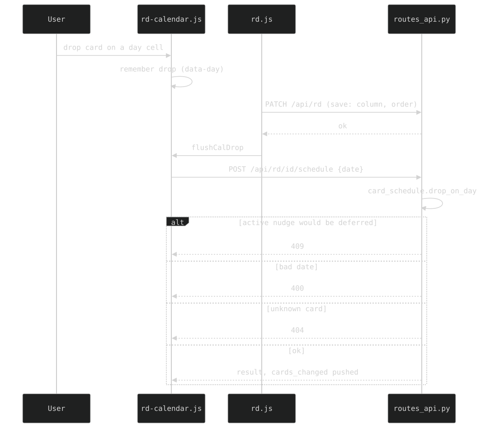

## 8. `/rd` — the board and its month calendar

The board is `rd.json` in four columns (CLAUDE.md § *Terminology*). This section is the **month calendar** under the reminders/books bars — `#rd-calendar`, built by `web/rd-calendar.js` (split from rd.js for the 500-line cap; same global scope, loaded before it). Dot colour/size helpers (`dotColor`, `dotUnits`) are in `web/card-style.js`.

### 8a. The grid

Full-width Sunday-first grid of the CURRENT MONTH only, no weekday row, 4-6 rows (exactly the weeks the month spans). Out-of-month cells are blank but keep their weekend class.

- **The last column's missing right rule is keyed off a `.cal-eow` class** the builder sets from the day, never `:nth-child(7n)` (nth-child counts every child of `#rd-calendar`; a new first child shifts it).
- Grid lines are 5px at `0.12` (per-cell right+bottom). `background-clip: padding-box` on `.cal-d` keeps a cell's wash off its own rules, so **`.cal-d.cw` must set `background-image`/`background-color`, NOT the `background` shorthand** (it resets every longhand and undoes the clip).
- `.cal-d` needs **`min-width: 0`** or a busy day widens its `1fr` column.

### 8b. Dots — one per card, sized by importance

Each day is the zero-padded day number over a centred row of dots, one per card landing on that day (`scheduled_day`, else the `due_date` date part). Every dot is rendered, then `fitCalDots` decides how many fit.

- **Books and EXILED cards are excluded; archived cards count, but never after today** (a card finished EARLY would dot a day nothing happened on; a recurring card would double-book the future, since archiving clones the next occurrence).
- **Archiving PRESERVES `scheduled_day`** (`_apply_patch_schedule`, `routes_api.py`): leaving hq clears it, except into archives, where the field is the only record of the day it happened. Inert elsewhere (`get_week_data` takes `column == "hq"`, the rollover takes `("rd", "hq")`, nudges need hq).
- Colour = the card's category hue (`dotColor()`) at full opacity, except **Interfacing and Hobby**, two adjacent warms a 4px dot cannot separate: `_DOT_COLOR` gives Interfacing `--orange-hsl @1` and Hobby `--orange-glow-hsl @0.8` (split by VALUE as well as hue; both already in the palette baseline). The CARDS keep Coral.
- **A dot is as wide as the card is important**: `dotUnits()` wisp 1 · idea 2 · plan 3 · commitment 4 (unknown → idea). A **reminder is forced to wisp** (same override as `cardStyle`; also catches gcal imports with `size: null`). A multi-unit dot is a stadium via `--radius-pill` (`--radius-round`'s 50% would draw an ellipse). Dots never shrink (`flex: 0 0 auto`).
- A day with more dots than fit shows as many WHOLE dots as fit plus a trailing **hollow silver ring** (`.cal-more`, `--gray-hsl / 0.45`, one-unit diameter) — hued like nothing in the palette because it names no card. **`fitCalDots` measures the visible children's SPAN, not `scrollWidth`** (the row is `justify-content:center`, so overflow spills both sides).
- **A recurring card is projected forward two months** (`_RECUR_HORIZON_MONTHS`, `_advanceRecur` mirroring `helpers._advance_recurrence` incl. the month-end clamp). Only one occurrence is live (archiving clones the next). Archived cards are never projected.

### 8c. Three date markers, one weight

Every date sits at alpha `0.8` so only the HUE carries meaning: green weekday, **cyan weekend** (`.cal-d.we .cal-n`), **pink Québec statutory holiday** (`.cal-d.hol .cal-n`, source-ordered after the weekend rule so a holiday on a weekend wins).

The 7 days from today (`.cal-d.cw`) wash the cell green as TWO stacked `0.12` `linear-gradient`s (~0.23 composite): green's scale jumps 0.12→0.45, which was a solid block, so the stack buys a middle step with both alphas on-scale. **Today** draws a bright 1px box as a `::after` overlay (`position:absolute; inset:0`), NOT a border (a border override would replace that cell's 5px rules and shift the line).

### 8d. Holidays are computed, not tabulated

`web/qc-holidays.js` — a computus for Easter, nth-weekday for Labour Day/Thanksgiving, "Monday strictly before May 25" for the Patriotes — answers for any year. It carries the eight that bind a Québec-regulated worker (LNT s. 60 + the Fête nationale's statute) and EXCLUDES Family Day, the August Civic Holiday, Boxing Day, Remembrance Day and Sep 30 (federal only). Victoria Day's Monday IS marked (Journée nationale des patriotes). **Good Friday is the Easter entry** (the employer may choose Good Friday or Easter Monday). Pinned in `tests/test_qc_holidays.py`.

### 8e. Drag a card onto a day to schedule it

`wireCalendarDrops`: every in-month cell carries a `data-day` and is a Sortable list in the board's own `rd` group. The dropped day IS the due date (an existing clock time survives): `POST /api/rd/{card_id}/schedule {date}` → `card_schedule.drop_on_day`; inside the 7-day window the card also goes rd→hq via `schedule_to_day`; beyond it only the due date lands and the card waits in r&d (a toast says so). Reminders + books are dated but never scheduled; a card dragged out of archives/exile returns to rd first. 409 when an active nudge loop would be deferred (consequences first), 400 bad date, 404 unknown card. Pushes `{cards_changed}` so an open /hq refetches.

- Sortable inserts the dragged card into the hovered cell; a full card would grow the calendar mid-drag, so `#rd-calendar .cal-d > .card` is `display:none` and the cell answers with a `:has(> .card)` green `0.45` wash: **the lit cell IS the feedback**.
- The POST fires only AFTER the board's `save()` resolves (`rd.js` chains `flushCalDrop`); concurrently the save (stale `column`) could land last and undo the hq promotion.
- The reminders bar is excluded from the drop group (`put:` accepts only `#col-*`): its `onRemove` reads any exit as "no longer a reminder".

### 8f. Paging months, and the watermark

**Drag (mouse) or swipe (touch) sideways to page months** (`wireCalendarSwipe`; one month per gesture past a 45px threshold; drag right = previous). `calOffset` is never persisted, so a load ALWAYS opens on the present month. The watermark text: past month `08 >>`, future `<< 10`, present `> 09 <`. today/this-week classes key off the REAL today.

The month shows as a big glowing number behind the grid (`#cal-mark`, class `.cal-mark`: `0.12` fill + `text-shadow` glow, `filter: blur(var(--blur-xs))`, sized `min(var(--cal-h), 26vw)`). **It is a fixed SIBLING of `#rd-calendar` at `z-index:-2`, load-bearing**: `#rd-calendar` is `position:fixed` with a z-index (its own stacking context), so a negative-z child could only sink behind its own content, never behind the page's layers; as a sibling it sits under the CRT stack and above the page background. Fixed, it takes no row and cannot change `--cal-h`, so sizing it from `--cal-h` has no feedback loop.

**Gesture rules** (same as the landing wheel and `exec-zoom.js`): `user-select: none` (a drag off a text selection fires native `dragstart`, which swallows the pointer stream), `touch-action: none`, pointermove/up on **window** with NO `setPointerCapture` (stepping rebuilds the children mid-gesture). A month with a different row count changes `--cal-h`, and `.rd-board`'s top inset follows. Cells are otherwise inert.

### 8g. Bar heights are observed, not measured once

`--cal-h` rides in `.rd-board`'s top inset with `--rem-bar-h`/`--books-bar-h`; a **`ResizeObserver`** (`rd.js`) keeps all three live, because no resize event fires when the bit webfont reflows the chips (same idiom as `--nav-h`). `/rd`'s `.card.plain` opaque `color-mix` fill stays (matching `/hq`) so nothing behind the board bleeds through a card.

### 8h. The `+N` overflow needs a host, and the bar can be empty

The reminders bar shows what is within a 30-day window (plus any `pinned_reminder`); the rest is counted into a `position:absolute` `+N` button that opens the full list. **A bar's `+N` must never be parented to content that may not exist**: when nothing is visible, `buildReminders()` (like `buildBooks()`) creates an empty chip to host it. The two halves of the partition must agree: `showRemOverflow()` must keep `buildReminders()`'s `!c.pinned_reminder` term.

History: [ARCHAEOLOGY.md §8](../archaeology/08-rd-board.md).

---

