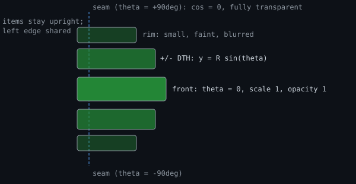

## 9. The landing page — a ferris wheel, not a list

`/` is public: no auth, no exec bubble. `_landing_html()` in `routes_views.py`, styles `web/landing.css`, driven by `web/landing-wheel.js`. Logged-in admins (valid `session` cookie) 302 to `/rd`; clicking a section follows the 401 redirect to the right login. An `admin` link sits bottom-right → `/login`.

Eleven sections ordered by icon hue (`_LANDING_HUE_ORDER`): recruiter · security · hosaka · aspira (`/spire`) · graph · nightfall · noodle · printer · ui · mtg · tarot. Each shows its **nav code** (`_NAV_LABELS`, same as the bottom nav, so nightfall reads `12AM` in both), its **title** (`_LANDING_BLURBS`) and one plain line (`_LANDING_DESCS`). Nav parity is pinned by `tests/test_landing_nav_parity.py`.

### 9a. One angle drives everything

A real wheel: the sections are **spokes `DTH` radians apart on a ring of radius R, seen EDGE-ON**.

| Quantity | Formula |
|---|---|
| position | `y = R·sin θ` |
| depth | `1 − cos θ` |
| scale | `P/(P + 1 − cos θ)`, `P` = `WHEEL_PERSPECTIVE` 0.55 |
| opacity | `cos^1.6 θ` (`WHEEL_FADE_POW`) |
| blur | depth-of-field rising with `1 − cos θ`, `WHEEL_BLUR_PX` 8 at the seam |

Items stay **upright** (gondolas hang level); the arc shows in the SPACING instead.

### 9b. `DTH = (π/2)/K` is the load-bearing choice

`K` is how many slots reach the **seam** (where an item wraps from the bottom back to the top). A seam at exactly 90° means `cos θ` = 0: **an item is fully transparent at the instant it teleports**, so the ring closes with no pop for any `K`.

**`K` is solved for** (`wheelGeometry`, re-run on resize and by a `ResizeObserver` on every item): it walks `K` down from `ceil(n/2)` and takes the largest that neither collides the front pair nor pushes the outermost lit item's centre past `vh/2 · WHEEL_REACH` (1.12) — up to `2K−1` items lit. **`K` never passes `n/2`** (two offsets would name the same item). Even `n`: a spoke sits on the seam, already invisible. Odd `n`: the seam falls BETWEEN slots so `K` rounds UP — it lights every item AND narrows `DTH`, tightening the front spacing. At 11 sections the walk starts at `K`=6 (`DTH`=15°, `2K−1` = 11 lit); it only steps lower when the front pair would collide or the rim overshoots.

### 9c. Spacing

Only the FRONT pair can collide, so clearance is measured over the pairs that really sit together (taller one unshrunk) plus `WHEEL_MIN_GAP` (4px). The rim may bleed off both edges (`WHEEL_REACH`) — those items are the blurriest and faintest, so it reads as depth. `R = max(vh/2 · WHEEL_FILL, need/sin DTH)`; **`WHEEL_FILL` (0.68) is the spacing knob**, but the tallest adjacent PAIR usually sets the pitch — hence the item is `96vw` wide with a 48px icon column and a `--lh-none` title (each wrapped line saved tightens all gaps). Rim pairs may overlap by up to ~9px; only the front pair is guarded.

### 9d. The wheel genuinely turns

**Position is a float animated by `requestAnimationFrame`** (exponential settle, `WHEEL_TAU` 95ms off real elapsed time). **Nothing is CSS-transitioned** — a transition tweens in a straight line and flattens the arc — so the script writes `transform`/`opacity`/`filter`/`visibility`/`pointer-events` inline per frame. Blur is quantised to a half-pixel and dropped under 1px (a radius that changes every frame is a fresh rasterisation). Only the RESTING position is a whole slot, so a gesture always ends snapped.

| Input | Behaviour |
|---|---|
| scroll (`wheel` on window) | `WHEEL_STEP_DELTA` 60px per slot, leftover kept within a gesture and dropped after `WHEEL_GESTURE_MS` 220ms idle; a flick carries up to `WHEEL_MAX_BURST` 3 slots per event |
| drag / swipe (vertical) | turns the wheel **continuously at 1:1** (`wheelPitch` = `R·DTH`), snaps on release |
| arrow keys | step it |
| tap a lit item | turns the wheel to that slot FIRST, then follows the link |

The front item goes straight through; a press that travelled >`WHEEL_TAP_SLOP` 8px is a drag; `WHEEL_NAV_MAX_MS` (900ms) means a stalled rAF can never strand a tap. The `ResizeObserver` matters because R derives from item heights and the webfont re-wraps the blurbs with no resize event.

### 9e. Gesture details

- `body` is `touch-action: pinch-zoom` (a vertical pan would otherwise be swallowed by scroll).
- The wheel needs the **prefixed** `-webkit-user-select: none` (WebKit computes the unprefixed one to `text`; a drag off a selection fires native `dragstart` — same trap as §8f).
- pointermove/up bind to **window**, no `setPointerCapture`. The `.landing-wheel` box is `pointer-events: none` (only lit items take taps, so the `admin` link stays clickable), which is why listeners live on `window`.
- **Items scale about their LEFT edge** (`transform-origin: 0% 50%`) so the icons hold one vertical column as the wheel turns. Icons `--radius-4`; titles `--fw-bold`.

History: [ARCHAEOLOGY.md §9](../archaeology/09-landing-page.md).

---

