## 10. The CRT effect stack (`_CRT_FX`)

**Who gets it.** `_render_page` (unless `crt=False`: `/spire`), the landing, `/graph`, and both login screens (`/login` reads the raw static shell, `/guest` the bare one; neither picks the stack up from anywhere else). `_CRT_FX` (`pages.py`) is five divs plus `web/crt-zoom.js`. Layers are `position:fixed`, `pointer-events:none`, at `--z-modal`, so they sit over a form without taking a click. Defined in `web/crt.css` (split out of `chrome.css` 2026-11-10; `_CHROME_LINK` links both, chrome first).

**Paint order = DOM order, and it is load-bearing:**

| Layer | What it is |
|---|---|
| `.cyber-bg` | phosphor tint — `--cat-social` dialled TOWARDS WHITE (`calc()` on its channels: saturation −40, lightness +25; no new literal) as 4px-period stripes peaking in the gaps between the black lines @ 0.45, plus a centre glow @ 0.06. Static. |
| `.cyber-lines` | **static black scanlines** (`--bg-hsl` @ 0.45), `hard-light` — the ONE blend layer. A thin triangle ramp (0.75px shoulder, NOT a hard stop), near single-frequency so it does not alias into moiré on zoom. After bg so it re-blacks the line rows the tint lit. |
| `.cyber-blur` | **CRT glass** — `backdrop-filter: blur(var(--blur-2xs))` (0.5px) over the static composite. |
| `.cyber-crt` | **phosphor punch** — `backdrop-filter: brightness(0.85) contrast(1.5)` over the same composite, under the sweep. |
| `.cyber-scan` | sweep beam, 480px tall, same whitened hue @ 0.06, plain alpha, `cyber-sweep` 7s linear. The **ONE animated layer**, painted LAST. |

Hue and opacity are different knobs: dropping a stripe's alpha makes scanlines fainter, not less green.

### 10a. The invariant

> A `backdrop-filter` / `mix-blend-mode` layer is a full-viewport readback with **no partial invalidation**. Cheap ONLY when nothing under it animates (the compositor caches the texture); ruinous when it sits OVER an animated layer (re-fires every frame, forever).

So the glass and punch cache (their backdrop is bg+lines+static content) and the sweep stays ABOVE them. `.cyber-scan` stays plain-alpha (a blend mode on the animated layer is the same trap). Never animate anything beneath the glass. `prefers-reduced-motion` stops the animations.

### 10b. Zoom-lock

Scanline geometry is `calc(N * var(--crt-u))`, `--crt-u = 1px * var(--crt-scale)`. `web/crt-zoom.js` (loaded via `_CRT_FX`) sets `--crt-scale = baseDPR/currentDPR` on resize, holding a constant on-screen size across browser zoom (not written on load; pinch-zoom does not change DPR, so it is uncompensated).

### 10b-bis. CRT lite (measured, per machine)

**The cached-composite argument holds only on a GPU.** With software compositing both backdrop panes re-run on the CPU every frame anything moves, and the sweep moves every frame. Without the panes + sweep the landing goes from ~5fps to 60fps on a throttled software renderer; the blend layer and the wheel's blur were measured and are NOT the cost.

`web/crt-lite.js` (loaded on `/` only, via `_LANDING_SCRIPT`) times up to `SAMPLES` 30 frames or `WINDOW_MS` 1.2s, starting 500ms after `load`; a median over `SLOW_MS` 25ms adds `html.crt-lite`, and crt.css hides `.cyber-blur`, `.cyber-crt`, `.cyber-scan` (static scanlines + tint stay). The verdict is kept in localStorage `crt.lite` (a timestamp) for 7 days. Headless WebKit/Chromium on the droplet are software-composited and go lite — clear `localStorage['crt.lite']` and pre-empt the check when the full stack is under test.

### 10c. Dimming on the dense pages

`/rd`, `/hq` and `/mtg` keep all five layers ON TOP at `--z-modal`, **dimmed to 0.75** via the shared `web/crt-dim.css` (linked from `rd.html`, `hq.html`, `mtg.html`): `.cyber-bg`/`.cyber-lines`/`.cyber-scan` at `opacity: .75`; glass `blur(calc(var(--blur-2xs) * 0.75))`; punch `brightness(0.8875) contrast(1.375)`. `/tarot` stays at full strength — its CRT is the mood.

**Dim with `opacity`, never by rewriting gradient alphas** — a scaled alpha lands off the palette snap scale and the lint rejects it. Paint order is untouched, so the backdrop panes still cache; a card DRAG is the one thing that dirties them per frame.

`.exec-nav` sits at `--z-top`, above the fx; the `/graph` nav override (`graph-overlay.css`) matches it.

History: [ARCHAEOLOGY.md §10](../archaeology/10-crt-effects.md).
