## 11. `/graph` — serve-time transforms over a generated artifact

Guest-gated (Turnstile). A graphify codebase visualisation served from the `./graphify-out` volume, which graphify rebuilds nightly at 05:00 (host cron, §11e / CLAUDE.md § *Cron*).

**Everything below is a string transform applied at SERVE time to graphify's emitted HTML/JS — never an edit to the generated file** (a rebuild overwrites it wholesale).

`graph_page()` lives in `routes_graph.py`. The transforms split four ways:

- **`graph_scrub.py`** — privacy scrubs + node/edge drops (what survives)
- **`graph_style.py`** — communities/colours, node colour objects, tooltips, labels, unlit edges, stats header (how it LOOKS)
- **`graph_geometry.py`** — per-type shape, size by degree, occlusion percentile (how a node is FORMED)
- **`graph_layout.py`** — physics tune + baked layout (where nodes SIT, §11e)

chrome.css, the cyber-fx bg, the nav (guest nav for non-admins, full nav for admins), `web/graph-overlay.css` and the `web/graph-*.js` stack (order fixed by `_GRAPH_OVERLAY_JS`) are injected the same way. Content-hash ETag + `no-cache`.

### 11a. Applied per request, COMPUTED once per artifact

- **`_cached()`** memoises rendered bytes against `(graph.html st_mtime_ns, st_size, graph-layout.json (mtime_ns, size) or None)` — a re-bake invalidates too. One entry per `(guest, lite)`; the whole dict clears when the key changes. Warm TTFB 0.13s vs 2.5–2.9s of CPU per cold render.
- **`_render()` is pure** (same bytes in, same bytes out): the community cap breaks ties by NAME (`_ranked`) so the ETag survives a restart.
- **Cold render runs off the event loop** (`asyncio.to_thread` under `_CACHE_LOCK`) — a blocking body would stall SSE and the nudge loop.
- **`run_graph_warm_loop`** (lifespan) re-renders all four `(guest, lite)` variants whenever graph.html's `(mtime_ns, size)` changes, polling every 600s. Failure is never fatal.
- **`?relayout=1`** (the nightly bake) renders WITHOUT a baked layout, never cached.

**`_externalise_boot` lifts every inline `<body>` script into one external payload**, served by `GET /graph/boot.js?v=<md5 16>` (guest tier, `immutable`, `X-Payload-Bytes` = decoded length). `_PAYLOADS` keeps the last `_PAYLOAD_MAX` (6) digests; an unknown hash renders both lite variants once and looks again. The payload is bracketed with `__GP_PAYLOAD_START`/`__GP_PAYLOAD_MS` and carries `window.GRAPH_LAYOUT_TALL`. The shell gets `window.GRAPH_BOOT_URL` instead of a `<script src>`: **`web/graph-cover.js` fetches the payload itself** so the bar tracks real bytes (it falls back to injecting the tag; graph-overlay.js injects it if the loader never ran). `_defer_scripts` then defers every same-origin `src` script **except graph-cover.js** (the one script that must be live while the payload is on the wire); deferred scripts run in document order, so vis → payload → overlay stack keeps its old order.

**TRAP: `_externalise_boot` MUST run after every node-JSON edit** (last of the data transforms, immediately before the `</head>`/`</body>` chrome injections, so it lifts only graphify's own scripts and not ours; `_defer_scripts` is the final step). Every scrub/drop/merge is a string edit on the inline node JSON, and `graph_layout_key` hashes that same text; run first, they all no-op on a 9KB shell, the key comes back empty, and the served payload is the RAW unredacted artifact. Check the served PAYLOAD, not the page.

**Loading cover** (`_GRAPH_BOOT` markup, `gpCover`): see "Cover and loading bar" in §11f.

**Opt-in variants** (a phone gets the FULL graph by default):

- **`?lite=1`** — `_prune_for_lite` keeps the busiest `_LITE_NODES` (600) by degree plus edges among them, via `_prune_graph_nodes`. Runs AFTER `_apply_graph_layout` (survivors keep baked x/y; the layout key still hashes the full graph) and `_fix_graph_stats` re-runs. `?full=1` is not read by the server today — lite is opt-in only. The bake never renders lite.
- **`?pack=1`** (client, `graph-lattice.js`) — shelf-packs the communities as rigid tiles to the viewport aspect; the stretch is skipped while it runs. Off by default.

Client geometry (the snap, lattice, opening view, cascade, overlay): §11f.

**Shape carries TYPE, colour carries community** (`_TYPE_SHAPES`, `graph_geometry.py`): `code` → `triangle`, `rationale` → `hexagon`, `document` → `triangleDown`. No `circle`/`ellipse`/`box`/`text` in the set — vis draws those with the label inside and ignores `size`, which would discard the degree encoding. The per-node `shape` must be named in graphify's DataSet mapper (same explicit-field trap as baked x/y); the global `nodes: { shape }` is `_TYPE_SHAPES["code"]` as fallback. The overlay glyph (`web/graph-glyph.js`) mirrors vis's own triangle offset (1.15x radius, y shifted 0.275): change shapes in `_TYPE_SHAPES` alone.

**Any change to the node/edge drop code changes `graph_layout_key` and misses the bake** (the key hashes surviving ids + edge pairs; community/colour/size/label edits do not move it) → every visitor pays the ~30s browser stabilisation until `scripts/graph-layout.py` is re-run by hand (~20s). The nightly covers graphify rebuilds only.

History: [ARCHAEOLOGY.md §11](../archaeology/11-graph.md#11-graph)

### 11b. Drops, in order

Order in `_render` (all in `graph_scrub.py`):

| Function | Drops | Why |
|---|---|---|
| `_drop_graph_redacted_nodes()` | DROP ids in `_GRAPH_REDACT_IDS` + every label over `_LABEL_MAX` (20) | a few docstring summaries leak internals (bearer-auth scheme, `EXEC_SAY_KEY` name); long labels are prose, not symbols. Was a blank-to-`[redacted]` until 2026-10-17: after the spire/noodle submodules landed it kept 1,838 of 6,082 nodes on the canvas just to say "redacted" and /graph lagged; dropping them took the served graph to 3,792 nodes / 5,802 edges |
| `_drop_graph_noise_nodes()` | DROP nodes from tests, `scripts/` (spire's balance sim ~400), `static/`, `.claude/`, `nightfall-incident/` (built bundle + saves), any `.json`/`.md`, `test_*`/`*.test.js` | /graph is visual candy, not docs: 3,792 → 2,685 nodes / 4,286 edges (2026-10-17). Serve-time only, NOT in `.graphifyignore` |
| `_drop_graph_prefixed_nodes()` | `source_file` under `_GRAPH_DROP_PREFIXES` | table below |
| `_drop_graph_moltbook_nodes()` | substring `moltbook` in id+label+source_file | heartbeat plumbing rides inside routes_views.py |
| `_drop_graph_library_nodes()` | `file_type == code` AND (no `source_file` OR label in `_GRAPH_LIB_LABELS`) | external symbols: `BaseModel`, `Request`, `WebSocket`, `FastAPI`, `Path`, `datetime`, … |
| `_drop_graph_inferred_edges()` | edges with `dashes` (INFERRED) | keeps EXTRACTED only; **recomputes every node's `degree`** from what survives |
| `_drop_graph_orphan_nodes()` | nodes no surviving edge touches | would otherwise still be parsed, built and walked per redraw |
| `_drop_graph_small_islands()` | connected components under `min_size` 5 | pairs of files referencing only each other read as rim specks |

Every NODE drop (all but `_drop_graph_inferred_edges`, which filters `RAW_EDGES` directly) goes through `_prune_graph_nodes`, which also removes dangling `RAW_EDGES`, emptied `LEGEND` rows and any `hyperedges` referencing a removed node.

**Ordering rule:** inferred edges → orphans → islands. Dropping edges splits components and orphans nodes, so each later pass must measure the graph the previous one left. `_fix_graph_stats` (the `#stats` header) runs after all of it.

`_GRAPH_DROP_PREFIXES` (one tuple, mirrored in the repo-root `.graphifyignore` so these never count against `GRAPHIFY_VIZ_NODE_LIMIT` — keep the two in step; `.graphifyignore` also ignores `**/vendor/`, `*.min.js` etc. at extraction):

| Prefix | Why |
|---|---|
| `api/tarot/book/` | the Pollack tarot reference text; the tarot ENGINE stays |
| `web/vendor/` | vendored vis-network, one node per mangled name |
| `nightfall-incident/nightfall-src/` | the game's own React/TS source (a guest page, not exec-fn architecture; its BUILT output is what is served) |
| `api/data/` | runtime data dir (JSON key structure, not values) — not architecture. Root-only prefix |

Submodules (`apps/spire`, `apps/noodle`, `claude-box`) are NOT dropped; `_logical_key` folds each `apps/<name>/…` into one community named for it.

History (node counts, bake-key observation, what each drop removed): [ARCHAEOLOGY.md §11](../archaeology/11-graph.md#11-graph)

### 11c. Communities are re-derived by FEATURE, then CAPPED

vis cycles a 10-colour palette, so graphify's fine-grained communities collide into colour-noise. `_merge_graph_communities()` regroups nodes by `_logical_key` (subdir module, else the filename family: `api/tarot/*` + `web/tarot-*.js` → "Tarot"), gives each its own colour from `_COMMUNITY_COLORS` (Tableau-20 + Dark2 = 28 hues, biggest = index 0), reassigns `community`/`community_name`/`color`, and rebuilds `LEGEND` biggest-first. `/graph`-page-only; `graph.json` / `GRAPH_REPORT.md` keep graphify's full set.

- A feature under `_MIN_COMMUNITY` (10) nodes folds into its top-level dir bucket (`_node_group_key`, e.g. API/Web/`(root)`).
- That fold does not bound the count (and raising the threshold plateaus ~20), so `_cap_communities()` caps at `_MAX_COMMUNITIES` (**14**): tail → top-level dir, still over → a single `(other)` bucket.

History: [ARCHAEOLOGY.md §11](../archaeology/11-graph.md#11-graph)

### 11d. Size, labels, shape, physics, stats

- **Size** (`_size_graph_by_degree`): `min(_SIZE_MAX, _SIZE_MIN × _SIZE_GROWTH^(degree−1))` = `min(88, 12 × 1.14^(d−1))`, degree floored at 1. Reads `degree` AFTER `_drop_graph_inferred_edges` recomputed it. **Both ends scale together** — the ratio encodes degree; the ceiling must stay below the lattice step so hubs don't sit on neighbours (x1.25 was tried and reverted).
- **Occlusion** (`_unocclude_small_nodes`, after sizing): nodes at or under the `_OCCLUDE_PCTL` (0.90) size get `transparent` backgrounds (normal/highlight/hover), so only big nodes stop edges. Nearest-rank `_pctl` (never interpolated). Ships `GRAPH_OCCLUDE_MIN` and `GRAPH_WAVE_MIN` (`_WAVE_PCTL`, also 0.90 — kept separate on purpose) so the overlay gates on the same numbers; percentiles are never recomputed in JS.
- **Edges** (`_hide_graph_edges`; the name is historical): every edge `color.opacity = _EDGE_OPACITY` (= `_NODE_OPACITY`, **0.2**), `width = _EDGE_WIDTH` **3**. Written PER EDGE — graphify's per-edge `color` object outranks any global option. Colour is left alone (inherited from the from-node). The cascade's lit edges are on the overlay canvas.
- **Nodes** (`_node_color`): fill `_GRAPH_BG` `#000000` (keep equal to `--bg-hsl`), border = community colour at `_NODE_OPACITY` alpha; highlight border `#ffffff`; hover keeps the full-strength colour (read by the info-panel stripe). The unlit baseline is the BORDER alpha, never the node `opacity` option (that would make the fill translucent, killing occlusion). `_restyle_graph_nodes` also sets global `borderWidth: 2` and repoints `nb.color.background` → `nb.color.border` in `showInfo()`.
- **Labels** (`_label_graph_nodes`): site mono font (`_NODE_FONT`, size 12). Long labels are already gone (`_drop_graph_redacted_nodes`); graph-overlay.js `isRedacted` is a defensive leftover that now matches nothing.
- **Tooltips** (`_drop_graph_tooltips`): strips the unquoted `title: x.title,` from both DataSet mappers (`_TOOLTIP_FIELD_RE`); the data arrays keep their JSON-quoted `title`, and the click panel reads `label`/`_*` fields.
- **Physics** (`_tune_graph_physics`, graph_layout.py): replaces graphify's `physics:` block (matched whole, anchored on the following `interaction:` key) with one-shot `forceAtlas2Based` — `theta 0.8`, `gravitationalConstant -628`, `centralGravity 0.025`, `springLength 30`, `springConstant 0.22`, `damping 0.9`, `avoidOverlap 1`, `maxVelocity 50`, `minVelocity 4`, `stabilization { iterations 300, updateInterval 20, fit true }`. Edges become `smooth: false` (`selectionWidth: 3` kept). graph.html's `stabilizationIterationsDone` handler then turns physics off. `_render` also sets `layout: { improvedLayout: false }`. Nothing above 300 iterations shows in the picture (walked 270→370→300→325→300); raising it does NOT invalidate the bake (the key hashes ids and edges, not coordinates).
- **Stats** (`_fix_graph_stats`): rewrites the `#stats` header (graphify bakes PRE-scrub counts) after the drops and again after the lite prune.
- All array transforms use a **per-line anchored** array regex (`_array_re`): a non-greedy `[.*?]` truncates at a `];` inside a node title.

History: [ARCHAEOLOGY.md §11](../archaeology/11-graph.md#11-graph)

### 11e. The layout is baked, not stabilised in the browser

Stabilising ~300 forceAtlas2 iterations takes seconds on a desktop and ~30s on a phone, per visit, for an identical result. So `scripts/graph-layout.py` computes it once, nightly, in a **real vis-network in headless WebKit** (Playwright) — the baked layout is exactly what vis would produce, including the client lattice snap's inputs. Output `graphify-out/graph-layout.json` = `{key, presnap, pos:{id:[x,y]}, tall:{…}}`, atomic write; `graphify-out` is gitignored (droplet disk only).

- **Key** = md5 of sorted node ids + sorted `from>to` edge pairs (`_layout_key`), read back off the rendered page (`window.GRAPH_LAYOUT_KEY`) so writer and reader can't disagree. Identical across guest/admin (they differ only by nav).
- **Hit:** `_apply_graph_layout()` writes x/y into `RAW_NODES`, adds `x: n.x, y: n.y` to graphify's DataSet mapper (it lists fields explicitly), and replaces the physics block with `physics: { enabled: false }`. The overlay is told via `window.GRAPH_LAYOUT_CACHED` (no `stabilizationIterationsDone` fires with physics off, and that event reveals the page).
- **Every failure is a no-op** (missing/unreadable file, key mismatch → `read_graph_layout` returns None) that falls back to browser stabilisation: a stale layout is worse than a slow one.
- **Two bakes**, because vis has no per-axis gravity: `_BAKES` = `pos` target aspect **1.60** @ 1440x900 (baked into `RAW_NODES`), `tall` **0.50** @ 430x932 (rides in the PAYLOAD as `GRAPH_LAYOUT_TALL`, so the 9KB no-cache shell stays small). The script injects `_SHAPE_JS`: on each `stabilizationProgress` it squeezes the cloud toward the target by `(target/current)^_SHAPE_RATE`, `_SHAPE_RATE` **0.2**, split across x and y so area is preserved. It undershoots (springs pull back); each run logs `target -> got` per bake. The client picks the nearer bake (`useBakedAspect`) and stretches the rest.
- **Reads `window.__GP_PRESNAP`** (captured before any pack/stretch/quantise) rather than `network.getPositions()`, else the client snap is baked back in. It waits for body class `gp-loaded`, fetches with `Authorization: Bearer <API_KEY from .env>`, and both bakes must return the same key.
- **Cron:** host `/etc/cron.d/exec-fn-graphify` → `0 5 * * *` `scripts/graphify-daily.sh` (as `wai-root`): graphify rebuild (600MB `RLIMIT_AS`, `GRAPHIFY_VIZ_NODE_LIMIT=8000`), a hard failure if no fresh `graph.html` was written (previous one restored from `.graph.html.prev`), then the bake. A bake failure is logged and NON-fatal. Log: `data/cron/…__graphify.log`.
- **TRAP: cron has no session bus**, so `systemd-run --user` fails with "Failed to connect to bus" unless the job exports `XDG_RUNTIME_DIR=/run/user/$(id -u)`. The `MemoryMax=700M` scope is not optional (WebKit is 200–400MB; the OOM killer picks by badness, §17).

History: [ARCHAEOLOGY.md §11](../archaeology/11-graph.md#11-graph)
### 11f. The client-side overlay

The server decides everything it can (11b/11d); the client adds the firing animation, the audio drive, the loading cover and the viewport lattice. **No modules: 19 same-global-scope scripts, so LOAD ORDER IS THE CONTRACT** (`_GRAPH_OVERLAY_JS`, `api/routes_graph.py:75`, injected before `</body>`; every file has a `?v=` that `asset_version.py` fills at serve time).

#### File set, in load order

| File (global) | Owns |
|---|---|
| `graph-cover` (`gpCover`) | loading cover + payload loader; **not deferred** (deferred, it sits behind the payload it reports on) |
| `graph-ink` (`graphInk`) | colour arithmetic: `sat(hex)` = saturation x `SAT_BOOST` 1.75 (clamped), returns HEX; `WHITE` is the one literal on the canvas |
| `graph-surface` (`graphSurface`) | `#gp-pulse` canvas + backing store (**DPR capped at 2**), resize/woken-tab repair, the real page bg (`bg()` = computed `body` background; `setBg` is only a fallback and rejects `transparent`) |
| `graph-glyph` (`graphGlyph`) | node shapes exactly as vis draws them (`TRI_SCALE` 1.15, `TRI_SHIFT` 0.275; `triangle`/`triangleDown`/`dot`/else hexagon); `at()` takes an explicit centre so a front grows concentrically |
| `graph-pulse-draw` (`graphPulseDraw`) | the canvas paint passes and their ORDER; `HALO_OUTER` 2.6 / `HALO_INNER` 1.5 x radius, `EDGE_W` 1.6, `EDGE_SWELL` 0.6 |
| `graph-seed` (`graphSeed`) | WHERE a cascade starts: `any()` (size^`SEED_POW` 2, prefix-sum + binary search), `at(fx,fy)` (nearest `NEAR_AT` 24), `near(id, pool)` (`NEAR_POOL` 64, ceiling `NEAR_MAX` 320, falloff `NEAR_SOFT` 0.6 of the pool's own radius) |
| `graph-bands` (`graphBands`) | spectrum: bass/mid/treble, rms, spectral flux, log centroid (60-8000Hz), pan |
| `graph-norm` (`graphNorm`) | adaptive windows: `amp`, `loud`, `pitch`, `sharpness`, `hit`, `bloom`, `placeX/Y` |
| `graph-source` (`graphSource`) | capture + device selection |
| `graph-lit` (`graphLit`) | the flash envelopes (the model; its draw half is shared by several passes) |
| `graph-bias` (`graphBias`) | how audio bends the cascade: `reach`, `pool`, `node`, `length`; every read guarded, neutral with no audio |
| `graph-glow` (`graphGlow`) | the accumulated "charge" + its own two passes |
| `graph-ring` (`graphRing`) | the beat wavefront, end to end incl. its pixels |
| `graph-pulse` (`graphPulse`) | the cascade model: queue, hops, catch rolls |
| `graph-tempo` (`graphTempo`) | tempo, phase grid, `onBeat`, `hopMs`, bar accent |
| `graph-audio` (`graphAudio`) | AudioContext wiring, onset test, `fire()`, seed count |
| `graph-audio-ui` (`graphAudioUI`) | the control, source picker, readout, file-drop |
| `graph-lattice` (`gpLattice`) | viewport stretch + lattice snap; precedes the overlay because `openView` calls `snap()`/`bounds()` |
| `graph-overlay` | what's left: see below |

`graph-overlay.js`: `patchInfoPanel()` wraps graph.html's `showInfo()` (retries until it exists; redacted nodes get Type/Source blanked and neighbours removed; **opens** the panel and moves the toggle glyph; writes the label into the `<h3>` and removes the duplicate first `.field` by TEXT match, never position), `addToggle()` (the node-info collapse button), `setupZoomLimits()` (hard walls, clamps in place), `watchWake()` (on `visibilitychange` + `persisted` `pageshow`: `graphPulseDraw.resize()` + `network.redraw()`; **never reloads** — a /graph reload is a black page for the whole load), `centreBesidePanel()` (tap centres the node in the space beside the panel; next frame, no animation — animated pans are full vis redraws).

**Opening view**: `contain x FIT_MARGIN` (0.8) — the same expression `setupZoomLimits` clamps the outward wall to, so the page opens at the furthest zoom-out and the first gesture can only go inward. The cover lifts after vis's `afterDrawing`, then the pulse's first PAINTED frame (`graphPulse.init(onReady)`); `READY_CAP` 3s (from the camera move) and `DRAWN_CAP` 800ms (from `afterDrawing`) lift it unconditionally, whichever lands first. `gpCover.CAP` (`LOAD_CAP` 180s) declares failure only if `network` never appeared, else it reveals. `snapToGrid` writes `network.body.nodes[id].x/y` directly and calls `network.redraw()` ONCE (`moveNode` per node queued one vis redraw per node: 160 draws/16s).

**Trap — palette lint**: it reads source with whitespace stripped, so any colour-function name followed by `(` (code OR comment) reads as a new raw colour. That is why the helper is `hueChan` and `sat()` returns hex. Rename or reword; never baseline.

#### The firing overlay (`graph-pulse*.js`)

- **Own transparent canvas `#gp-pulse`** (`--z-raised`, `pointer-events:none`, sized to `#graph`) over vis's; **vis never redraws for it** (a warm vis redraw is ~1.5s). Cost per frame is O(lit): world positions are read once (`getPositions()`, layout is frozen), the camera transform is `(world - view) x scale + half-canvas` from `getScale()`/`getViewPosition()` each frame.
- **Split**: `graph-pulse.js` knows cascades, nothing about pixels; `graph-pulse-draw.js` the reverse. The model hands `init(pos, lit, litEdges, level, satLevel, charge maps)` once; those objects are mutated in place, never reassigned. `TERMINAL_ODDS` is passed INTO `graphSeed.index()` (one definition). `SIZE_FLOOR`/`SIZE_CEIL` (12/88) mirror `graph_geometry._SIZE_MIN/_SIZE_MAX` — move together.
- **Runs everywhere** (every size, every pointer; a tap always seeds). Under the CRT stack deliberately: 2 fps vs 18 with the stack hidden on the GPU-less droplet WebKit, our canvas ~0ms either way — the cost is compositing, not drawing. A frame with nothing lit/charged/ringing skips its draw (`graphGlow.charged()` and the ring are part of the idle check).
- **Hover does nothing to the canvas.** A tap seeds a cascade at the node (`graphPulse.seed(id)` on vis `click`) and **guarantees its first hop** (every direct neighbour + edge lights, `force`); a tap draws none of the extra burst seeds.

| Rule | Value |
|---|---|
| Ambient clock | one iteration per `ITER_MS` 1s, `ITER_LIFE` 2s; never gated on whether anything is lit, but skipped while audio capture is on (`graphAudio.driving()`); `MAX_LIVE` 8 (safety bound) |
| Burst | `SEEDS_PER_ITER` 8 (caller may ask, `MAX_SEEDS` 20); extras drawn from the first seed's `near` pool, weighted, with replacement, `SEED_TRIES` 4/seed |
| Stagger | one seed per `min(SEED_STAGGER_MS 100, SEED_WINDOW_MS 800 / want)`; a staggered seed is claimed in `seen` at once, queued `seed:true`, lights unconditionally and lights NO edge |
| One event | all seeds share the iteration's `seen` + queue |
| Spread | neighbour queued at `HOP_MS` 110 +/- `HOP_JITTER` 30% (audio locked: `hopMs()` = period/4); catch odds `P_MIN` 0.55 (size floor) .. `P_MAX` 1 (ceil), then `graphBias.reach`, x `graphBias.length`; terminal (degree 1) = `TERMINAL_ODDS` 0.15 |
| Dying | a failed roll is SPENT (nothing walks past) — the only reason cascades end; `seen` is per-iteration (each node tried once) |
| Node life | `DUR_MIN` 2500 + `DUR_PER_DEG` 290 per edge (cap `DUR_DEG_CAP` 12) x (1 +/- `DUR_JITTER` 0.4); timbre bends life (`DUR_SHARP` 0.55) and attack (`ATT_SHARP` 0.6) by treble share |
| Envelope | `ATTACK_MS` 280 rise, then `(1-t)^DECAY_POW` 0.85 (concave); multiplied by the hit's strength |
| Edges | the edge a cascade crossed lights for `EDGE_DUR` 900; an edge only ever varies in SATURATION, never hue (tinted from the from-node) |
| Saturated layer | a duplicate pass (halos, outline, edge) in the node's community colour, `SAT_MULT` 3 x as long: white flash decaying into a coloured afterglow. Colour computed ONCE per node at `index()` (`pos[id].c`); envelope is the model's own `satLevel` |
| Unlit baseline | `_NODE_OPACITY` 0.2 (`graph_style.py`) as the node BORDER's alpha and as each edge's `color.opacity`; the node `opacity` option is not used (it would thin the fill and kill occlusion); edge opacity must be written PER EDGE (a global `edges.color.opacity` is outranked) |

**A lit node is an OUTLINE and a HALO, never a fill** — the interior stays black (`A_FILL` is retired). Paint order (diagram above) is the implementation; under `'lighter'` additive layers commute, so the order only decides where the non-additive passes land: halos -> `clearNodes` (`destination-out`: erases only the overlay's own pixels, NOT a bg fill, which would hide vis's unlit layer below) -> `punchNodes` (opaque bg fill on nodes above `GRAPH_OCCLUDE_MIN` only) -> outlines (charge, white, saturated) -> wavefront (`graphRing.draw`: on a scratch layer, masked `destination-in` to the canvas's own pixels so it lands only on nodes, then blended `saturation`) -> edges (`destination-over`: paint beneath, so a big node's opaque interior occludes them and a small node's cleared interior shows them). Cost: where an edge crosses a halo it reads slightly dimmer.

**The node fill must be the real page background**: `graphSurface.bg()` reads the computed body bg; `_GRAPH_BG` (`graph_style.py:195`) must equal `--bg-hsl` (`#000000`). A wrong or `transparent` bg shows as navy shapes / duplicated rotated nodes / bright hub centres (`setBg` is the single gate).

**Occlusion** (11d): only the biggest tenth of nodes occlude — `_OCCLUDE_PCTL` 0.90, nearest-rank percentile of actual sizes, computed once server-side (`graph_geometry.py:113`) and shipped as `window.GRAPH_OCCLUDE_MIN` (three layers gate on it: unlit fill, lit punch, wavefront). The wavefront has its own cut `_WAVE_PCTL` 0.90 -> `window.GRAPH_WAVE_MIN`. `_unocclude_small_nodes` MUST run after `_size_graph_by_degree` and touches only the three `background` keys (`hover.border` keeps the full-strength colour the saturated ink reads). The client uses the WORLD size `pos[id].r`, never a drawn radius.

#### Charge (`graph-glow.js`) vs lit

Two separate mechanisms; conflating them is wrong both ways. **Lit** = the cascade flash, wall-clock timings (above). **Charge** = how OPAQUE a node has become: every hit adds `GAIN` 0.22 (never resets) and drains at a RATE set by the smoothed audio level (`graphAudio.loudness()`, follower 0.97/frame): `FADE_LOUD` 110s per full drain at peak, `FADE_SILENT` 1.6s, `FADE_AMBIENT` 2.0s with no audio. Edge charge drains at `EDGE_FADE` 0.45 of the node time. The charge draws UNDER the flash with no halos (cheap; it can cover much of the graph), `DT_CAP` 100ms. **Every `graphGlow` and `graphRing` call goes through a no-op shim** (`glow()`/`ring()` in `graph-pulse.js`; the tree is edited live, and an unguarded missing global THROWS inside the rAF and kills the whole cascade).

#### Wavefront (`graph-ring.js`)

A big node that lights ON THE BEAT throws one growing, fading triangle. **Gates**: WHERE `p.r > GRAPH_WAVE_MIN` (fallback occlusion cut, then `MIN_R_FALLBACK` 20); WHEN `graphTempo.onBeat >= ON_BEAT_MIN` 0.6 (1 with no lock). **One front per beat across the graph** (`BEAT_GAP` 0.5 of a period; `BEAT_FALLBACK_MS` 840 unlocked); life clamped to one beat so fronts never nest; `MAX_LIVE` 4 (safety). Always an UPWARD triangle (shape = type, a front isn't a type claim), random quarter-turn from `TURNS`, `GROW` 300 x radius (x `1 + BLOOM_GROW` 0.6 x `bloom()` captured ONCE at release), linear (`GROW_EASE` 1), `FADE_POW` 1.1, `A_RING` 0.55, `DUR_BASE` 1600 + `DUR_PER_R` 12 per radius. **Stroke scales strictly with the shape** (`W_AT_NODE` 1.4 must equal `nodeStroke`'s lineWidth in `graph-pulse-draw.js` — move together) so it reads as zooming in on the node's outline. Pixels: stroked on a device-pixel scratch layer, masked `destination-in` against the main canvas, blended `'saturation'` (neutral ink; a hue-bearing stroke under `source-atop` rewrote community colours), then `'lighter'` restored. **Nodes do NOT rotate** (vis's static copy can't be re-oriented without a ~100ms full redraw per beat); only the front turns. Fired from `graphLit.fire` (the one place a node hit is announced).

#### Audio drive (`graph-source`, `graph-bands`, `graph-norm`, `graph-tempo`, `graph-audio`, `graph-audio-ui`)

**Desktop only, opt-in**: the control is not rendered without `getDisplayMedia` or on a coarse pointer; nothing is captured until tapped. The UI is reached through guarded `say`/`paint`/`flash`, so analysis runs with no UI. A page cannot read the device output (no iOS system capture; Safari/Firefox put no audio on a `getDisplayMedia` stream), so sources, best first:

| Source | Prompt | Notes |
|---|---|---|
| dropped local **file** | none | the page plays it (`createMediaElementSource`); raVe `Playlist.js` |
| shared **tab** (Chrome/Edge) | share picker | real output, works with headphones; an unticked "share audio" returns video and NO audio (named, not silent) |
| **loopback** input (Monitor of..., Stereo Mix, BlackHole) | mic | offered, never assumed (`LOOPBACK` regex) |
| **microphone** | mic | hears the room |

`graphSource` resolves `{stream, el, label, audible}` and rejects with a `why` TAG (`denied`, `no-device`, `cancelled`, `no-share-audio`, `failed`), never a message. The live source is NAMED and chosen from a picker (labels are blank until a permission exists, hence `list inputs...`).

- **Bands** (`graph-bands`): 4096-point FFT, **no lowpass**, `smoothingTimeConstant` 0, dB window `MIN_DB` -90 / `MAX_DB` -10, noise `GATE` 0.02, per-band `ATTACK` 0.6 / `RELEASE` 0.08. Crossovers re-cut every `RECALC_MS` 2s at the equal-energy thirds of a ~5s average (`AVG_A` 0.003), clamped `SPLIT1` 80-400 / `SPLIT2` 1000-6000 and ordered after clamping. `bassRaw` is exported UNSMOOTHED (tempo autocorrelates it). Energy is summed over the band, never averaged across the spectrum.
- **Norm** (`graph-norm`): every value is 0..1 against its own history, neutral with nothing listening (hit 1, sharpness 0.5, pitch 0.5, loud 0). `amp` = held level vs a decaying peak (`HOLD_FALL` 0.78, `PEAK_DECAY` 0.99995, `PEAK_FLOOR` 0.02); `loud` follower `LOUD_FALL` 0.97; `pitch` centroid window (`CENT_RELAX` 0.0008, `CENT_MIN_SPAN` 0.06); `sharpness` treble share (`SHARP_RELAX` 0.0008, stepped ONCE per frame by `graphNorm.step`); `hit` = flux / running MEDIAN of `HIST_N` 45 frames, `HIT_FLOOR` 0.45 .. 1 over `HIT_SPAN` 2.6 (median, not mean; ratio taken BEFORE the frame joins the history); `bloom = amp x (1 - sharpness)`. `placeX()` is a reflecting random walk with momentum (`X_STEP` 0.09, `X_TURN` 0.45, speed `X_SLOW` 0.55..`X_FAST` 2.0, `X_HOME` 0.5; reflection flips velocity too); `placeY = 1 - pitch`. **Allocation-free in the analysis path** (typed-array ring, out-params) — allocation reads as audio jitter.
- **Onsets**: spectral FLUX over `SENS` 1.32 x the local median, `FLUX_FLOOR` 0.002, debounced `MIN_GAP_MS` 190. Tempo runs on bass energy.
- **Tempo** (`graph-tempo`): autocorrelation of the onset envelope on a fixed `ENV_HZ` 50 grid (each bucket keeps its MAX), 60-180 bpm; window `ENV_N` 600 (12s), estimating from `ENV_MIN` 300 (6s), every `TEMPO_MS` 1s; **octave correction** (the winner is offered its double, `OCT_KEEP` 0.7; `PREF_LO/MAX` 90-150); **rolling MEDIAN of the last `VOTE_N` 8** estimates (median: errors are whole octaves); a period change never resets the phase (`PERIOD_TOL` 0.03; `PLL_PULL` 0.25 drags the grid onto real onsets within `PLL_WINDOW` 0.25 beat). `LOCK_MIN` 0.22 gates `onBeat`/`hopMs`/`bpm`/`isDownbeat`/`barAccent` alike; the lock lapses after `QUIET_MS` 4000 without an onset. `onBeat` is squared (`ONBEAT_POW`) and **1 with no lock**. Every 4th fire (`BEATS_PER_BAR`) is the downbeat; `barAccent()` rescales confidence from `LOCK_MIN` and scales `DOWNBEAT_BOOST` 1.6 and `graphBias.DOWN_REACH` 0.15 (kept small: reach compounds). `stats()` reports votes + spread.
- **Fire** (`graph-audio`): a locked grid `fires()` (steady, phase-locked); with no lock a raw onset fires. `driving()` returns `on` — **nothing lights when it is quiet**; handing back to ambient during a gap would lie about what drives the page. Placement: `graphSeed.at(placeX, placeY(centroid))` -> `graphPulse.seedAt(id, n)` (full burst around the place). **Pitch decides height, X is random**: pan is measured and deliberately unused (it pinned X to a vertical column). `n = round((SEEDS_MIN 2 + amp x (SEEDS_MAX 8 - SEEDS_MIN)) x (1 + (BEAT_BOOST 2.5 - 1) x amp x onBeat) x (1 + (DOWNBEAT_BOOST - 1) x barAccent))`, capped by `MAX_SEEDS` 20: amplitude and rhythm MULTIPLY (a loud off-grid noise is a noise; a quiet on-grid tick is a tick). `at()` draws from the nearest `NEAR_AT` 24 candidates so one value doesn't light one node.
- **Bias** (`graph-bias`, all neutral with no audio): `REACH_GAIN` 0.18 on catch odds, `EXTENT_GAIN` 0.8 on the pool (64 up to `NEAR_MAX` 320); pitch biases edge length and start node by the same rule, `1 + LENGTH_BIAS 0.6 x (2 lowness - 1) x (2 longness - 1)` (low pitch favours long edges / far-reaching nodes, high favours short; `longness` is against TWICE the mean edge, the mean taken AFTER `getPositions`; a node with no edges reads 0.5, never 0). Applied in the per-cascade draws (`at`, `near`), not the ambient index-time `cum`. Lengths are already viewport-shaped (lattice stretches before `index()`), which makes the bias scale-invariant; a window RESIZE does not re-stretch.
- **Loudness/strength**: `hit()` (read at FIRE time per node) multiplies both envelopes and the charge bump — amplitude decides HOW MANY, strength HOW BRIGHT. Lit-edge width follows `loudness` (`EDGE_SWELL`); the halo and stroke do NOT breathe (the kick's pulse lives in the front's extent).
- **Readout** (`graph-audio-ui`): `srcLabel . 120 bpm . 118 / 1.4k Hz` (rounded; `crossovers()` null with nothing listening).
- Reference [raVe](https://github.com/ajm13/raVe) (maps amplitude straight onto geometry, detects no beats); our cascade is discrete so it needs onsets.

#### Cover and loading bar (`graph-cover.js`)

Static markup `_GRAPH_BOOT` at the top of `<body>`; `gpCover` names the phase (`fetching graph data` -> `building the graph` -> `drawing`), prints the split the payload measures on itself (`data Xs . build Xs`, `idx` phases), says `(slower than usual)` past `SLOW_AFTER` 20s, and on error / no payload prints `[ <reason> - reload to retry ]` and lifts the cover. `LOAD_CAP` 180s declares failure only if `network` never appeared. `#graph` is `opacity:0` until JS adds `body.gp-loaded`, so a JS failure is a black page — the cover is what says which. The payload is fetched by the cover itself (`window.GRAPH_BOOT_URL`, streamed `fetch`, handed back as a Blob `<script src>` so top-level `const`s stay global); `RESCUE_MS` 25s / `onerror` fall back to a plain `<script src>`. **The bar tracks WORK, not bytes** (WebKit returns the payload in one chunk): `FETCHED` 0.35, `BUILT` 0.6 (injected script's `onload`), `PLACED` 0.75, `DRAWN` 0.9 (vis `afterDrawing`), 1.0 at reveal; width eases 280ms between milestones; the build phase breathes (`.gp-build`, opacity — compositor-only, survives a blocked main thread); until a fraction exists the track is `.gp-indet`. `X-Payload-Bytes` is the DECODED length.

#### Lattice (`graph-lattice.js`)

The layout is snapped to a lattice in the browser, every load (the snap is NOT cached). `CELLS_PER_NODE` 2.21484375 (a density, not a count). Sequence: `__GP_PRESNAP` captured BEFORE any reshaping (the nightly baker reads it) -> `packCommunities` (opt-in `?pack=1` only) -> `useBakedAspect` (picks the wide bake `BAKE_WIDE` 1.6 or the tall bake `BAKE_TALL` 0.5 from `window.GRAPH_LAYOUT_TALL` by log distance; all-or-nothing) -> `stretchToViewport` (area-preserving, skipped under `?pack=1`; reshapes positions so `cols/rows` follows the window) -> snap with ONE `cell` on both axes (equal horizontal and vertical step) -> `nearestFree` (ring search; real distance first, ties broken toward the cloud's CENTRE so collisions fill inward). **Never bake the snapped positions** (the bake reads `__GP_PRESNAP`; baking the snap back in produced moire groups). `nodeBounds` pads by the largest node radius.

#### Traps (one-liners)

Server-side traps (drop code vs the bake key, `_externalise_boot` order, `_TYPE_SHAPES`, size range, `_GRAPH_BG`) are in 11a/11d/11e, not repeated here.

- `graph-pulse.js` and `graph-pulse-draw.js` sit near the 500-line cap — new effects go in their own file (the ring/glow precedent: an effect with its own register and passes owns its pixels; `graph-lit` stays a model because its flash feeds five passes).
- `node --check` only parses and `no-undef` is off for `web/**` (shared global scope): dead or undefined references survive lint.

History: [ARCHAEOLOGY.md §11](../archaeology/11-graph.md#11-graph)

---

### 11g. Field notes

Everything live is in 11a-f; incident narratives are in the archaeology. What lives only here:

- Guest-gated (Turnstile) since 2026-07-03; before that public.
- Measured: lifting graphify's inline scripts out of the body (`_externalise_boot` + `_defer_scripts`) took FCP from 1304ms (`routes_graph.py` comment) to 387ms; a warm render is ~0.05-0.13s TTFB against 2.5-2.9s cold.
- `window.GRAPH_LAYOUT_CACHED` tells the overlay whether `stabilizationIterationsDone` will fire (it will not with a baked layout; that event reveals the page).

History: [ARCHAEOLOGY.md §11](../archaeology/11-graph.md#11-graph)

