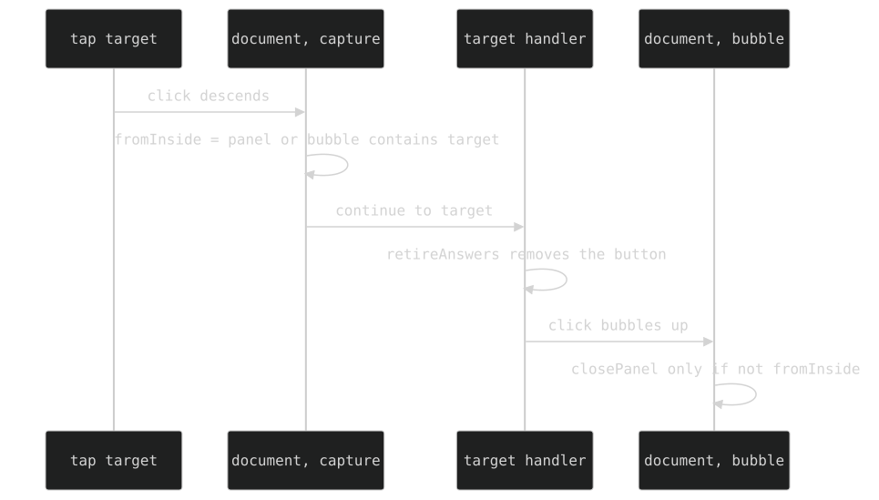

## 12. The bottom nav

Fixed to the bottom of every page that carries one (`/spire` passes `show_nav=False`; `/recruiter` has none). Labels are **fixed 3-char codes** (`_NAV_LABELS` in `api/pages.py`); none is non-ASCII today, but the glyph machinery stays (§12a).

| Code | Route | Tier |
|---|---|---|
| `R&D` · `HQ` · `DBG` | `/rd` · `/hq` · `/debug` | owner |
| `BOT` | `/security` | guest-gated |
| `GPH` | `/graph` | guest-gated |
| `UIX` | `/UI` | guest-gated |
| `12AM` | `/nightfall` | guest |
| `SPR` | `/spire` | guest-gated (app submodule `apps/spire`; nav key `aspira`) |
| `MTG` · `TRT` | `/mtg` · `/tarot` | guest |
| `HSK` | `/hosaka` | owner |
| `3DP` | `/printer` | guest read-only / owner control |
| `NDL` | `/noodle` | guest (app submodule `apps/noodle`; poll pages are public by link) |
| `CV` | `/recruiter` | public |

Two lists in `pages.py`: `_NAV_LINKS` (owner, all 14) and `_GUEST_NAV_LINKS` (11: everything but `rd`/`hq`/`debug`), plus `_NAV_HREFS`, `_NAV_ICONS`, `_NAV_LABELS`. The guest nav also carries the `F5` refresh item (§12b). `tests/test_landing_nav_parity.py` scrapes the rendered landing and the rendered guest nav and asserts every landing link has a guest-nav entry (one direction: `/zombo` is unlinked on purpose, the landing's `admin` link is not a nav entry). Add a nav entry in all four tables, and the guest list if guest-reachable.

### 12f. The nav icons are traced, not drawn — and stay pixel art

The nav serves `web/icons/<name>.svg`, never the 27x27 PNG it was drawn from. They are **generated** by `scripts/trace-icons.py` (config tables in `scripts/icon_config.py`, helpers `icon_colour.py`/`icon_contours.py`/`icon_mask.py`): edit the script, never the SVGs. Rules and per-icon tables: `web/icons/README.md`.

- **Pixel art on purpose.** One source pixel = one viewBox unit (`0 0 27 27`, integer coordinates) and the root carries `shape-rendering="crispEdges"` — load-bearing: 20/27 is not whole, so without it every edge antialiases to a blur at exactly the nav's size. `image-rendering:pixelated` is the raster knob and does nothing to an SVG. No curve smoothing (4x the bytes).
- **Two modes.** Default = trace in the icon's OWN COLOURS (tile dropped = the transparency; ink takes the tile colour). `LINE_ART` (`icon_config.py`: `turbo bitman printer wizard data-file data-doctor sentinel bug`) stays on the older line-art path, where a dithered source would otherwise trace its dither.
- **Line-art path.** Outline = the DARKEST cluster (not "darker than tile": drop shadows/dither would fill solid). An interior pass inks boundaries between colour regions, only on pixels enclosed by the outline, over quantised colour (`ICON_QUANT`), merging small regions into neighbours (never dropping: that punches holes). `NO_INTERIOR` turns it off for pure-dither interiors. `GLYPH_ONLY` (`data-file`, `data-doctor`, `laser-satellite`) discards the trace and DRAWS the icon; `ICON_GLYPH` draws a named glyph over a trace; a `solid` glyph occludes earlier ones. Other by-name tables: `ICON_COLOUR`, `ICON_ACCENT`, `DROP_COLOURS`, `CENTRE_INK`, `DESPECKLE_OUTLINE`, `ICON_INK_BAND`.
- A tile within 25 lightness points of `--bg-hsl` gets its brightness inverted so it stays visible on the black site.
- A 27px source's interior detail does not resolve at the nav's 20px: the nav shows silhouette, detail reads from ~40px.

### 12a. The glyph label (machinery kept)

The pixel nav font (`04b25`, `--font-pixel`) is **ASCII only**; any other character falls back to a different face per device.

- **Detected, not listed.** `_build_nav` marks any label failing `text.isascii()` as `nav-label glyph`; `.exec-nav .nav-label.glyph` (chrome.css) re-fonts it to `--font-mono` and **must sit AFTER `.nav-label`** (source order at equal specificity).
- **Sized by `transform`, never `font-size`** — the label's box IS nav geometry; a bigger font-size grows the span, anchor and nav bar. The rule is `transform: translateY(0.3px) scale(1.48)`: `translateY` FIRST so the scale does not multiply it; the nudge rides in the transform because `.exec-nav a` is a flex column (label = flex item, `vertical-align` inert).
- Factor 1.48 was set by WIDTH (glyph ink = the M of MTG), measured by counting painted pixels at 3x DPR — **never size off canvas `measureText`** (~30% off for this glyph).
- Known residue: the glyph's 13.6px box vs the pixel labels' 13px makes one anchor 35.6px; not fixed (would need a near-duplicate font-size token).

### 12b. Standalone launch (home-screen / installed web app)



Detected in the `_build_nav` script by `navigator.standalone` or `display-mode: standalone`: adds `html.standalone` and sets `--per-row` = ceil(items / 2). The nav reflows to **two rows** with one empty icon-cell of padding each side (`html.standalone .exec-nav` in chrome.css; cell width = W/(per-row+2)).

- **`F5` refresh item** (`#nav-refresh`, `firewall.svg`, last slot): no href (the link interceptor skips it), click = `location.reload()`. Standalone appends it in JS, counted before `--per-row`; **the guest nav renders it server-side in every mode** (`_REFRESH_ITEM`), and the script checks for `#nav-refresh` first, so there is exactly one.
- `--nav-h` tracks the live nav height via `ResizeObserver` (taller in two-row mode). In standalone, same-origin link taps go through `location.href` (stops Safari kick-out).
- **Chrome-less across navigation is the manifest's job**: `/manifest.webmanifest` (`mimetypes.add_type` in main.py; linked from `_APPLE_WEBAPP_META`) declares `scope:"/"` + `display:"standalone"`. **iOS reads it at add-to-home-screen time only** — a change needs the icon deleted and re-added.

### 12c. The Exec bubble is not a nav entry

A floating draggable bubble (`#exec-bubble`, `guru-pink.png`, `exec-bubble.js` + `exec-bubble-drag.js`) injected by `_build_nav()`. No `/exec` route; guests and `/spire` (owner; it sat on the build buttons) get none.

- **`/rd`, `/hq`**: tap toggles the Exec panel; `?exec=open` opens it on load.
- **Every other non-guest page**: same bubble (exec-bubble.css, shared drag + `exec-bpos`), but a tap NAVIGATES to `/hq?exec=open` (`exec-link.js`). A `<div>`, not an `<a>`, so a drag cannot fire a click; nav via `location.href` stays in-app under standalone.
- **Under the CRT stack on every page**: `z-index: var(--z-bubble)` (8999) < the fx's `--z-modal` (9990); the fx are `pointer-events:none`, so taps land.
- Position persists in `localStorage` `exec-bpos`, clamped to the viewport; unread monitor count = badge.
- **Hidden while the panel is open** (`body:has(#exec-panel.open) #exec-bubble { display: none }`, exec-bubble.css): both sit at `--z-bubble`, DOM order puts the bubble on top, and its tap is `togglePanel()` = CLOSE. The bubble opens; the panel closes from its own `[x]`.
- `#exec-term` keeps `var(--space-2)` of BOTTOM padding as a tap guard (WebKit touch adjustment snaps a tap on nothing to the nearest control within ~10px; the composer `[x]` is a 29x19 target under the last line). Pinned by `tests/test_exec_bubble_overlap_browser.py` (WebKit 430x932): bubble never intersects the open panel; every choice button is topmost at its left/centre/right; tapping the last answer sends it and leaves the panel open.

### 12d. Exec's voice, and the panel

- Exec speaks aloud in the GLaDOS voice (`exec-voice.js`: `glados` on piper, over the shared HosakaAudio core); audible by default; `#exec-mute` toggle in the input line (localStorage `exec.voice`, global). Wai's messages and bracketed sys notes are never spoken.
- Each Exec turn's leading glyph is a clickable **replay** marker (`.msg-mark`: `>` reply, `~` monitor/nudge; built by `voice-ui.js`, bound in `exec-voice.js`). `$` and sys `#` lines get none.
- Planning pages voice replies + monitor comments + nudges. On every OTHER non-planning protected page **except `/tarot` and `/hosaka`** (`want_voice` in pages.py), `exec-voice-listener.js` voices unsolicited turns arriving over `/api/monitor/stream`. Audio unlocks on the first gesture per page.
- Panel top = server-persisted scratch **todo list** (`exec-todos.js`, `exec_todos.json`): grows to half the panel then scrolls; add-input on top; items are DELETED on checkbox (rd.json cards archive). `#exec-todo-fold` on the divider collapses it (`.folded`, localStorage `exec.todos.folded`).
- **Composer keys.** Desktop (`(hover: hover) and (pointer: fine)`): Enter sends, Shift+Enter newline. Touch: Enter is a NEWLINE; the THIRD consecutive Enter sends (counted on `beforeinput` `insertParagraph`/`insertLineBreak`; blank lines trimmed; any other edit resets the run), as does Ctrl/Cmd+Enter. No send button; the mic sends on its own. Typing pins the transcript to the bottom.
- **The composer is exactly one text line tall**: nothing in that row may have height of its own (`#exec-iline` zero padding + `align-items:flex-start`; `#exec-mute`/`#exec-ph-close` are `padding: 0 0 0 var(--space-2)` at `--lh-tight`). WebKit check: prompt, input and message bodies start at x=27 with an 18.6px line box.

### 12e. Page scroll

Non-`full_height` pages scroll inside a `.page-scroll` wrapper (`_render_page` wraps `content`; chrome.css `position:fixed; inset:0 0 var(--nav-h) 0; overflow-y:auto`). `full_height=True` callers skip it (body `overflow:hidden`, inner containers scroll): `/rd`, `/hq`, `/hosaka`, `/printer`, `/spire` (and the unlinked `/emet`).

Why: the native root scrollbar is top-layer and painted the styled pill (and its scanlines) OVER the fixed nav's right edge; ending the scroller at the nav top keeps it in the content area.

### Click-outside-to-close is decided in the CAPTURE phase



A bubble-phase `panel.contains(e.target)` test is wrong for any panel containing a control that removes itself: `document` is the last stop, so exec-choices' `retireAnswers()` has already detached the tapped button and the panel closes under the tap. `exec-bubble.js` records the origin on the way DOWN (panel OR bubble counts as inside):

```js
let fromInside = false;
function markOrigin(e) { fromInside = panel.contains(e.target) || bubble.contains(e.target); }
function closeIfOutside() { if (isOpen && !fromInside) closePanel(); }
document.addEventListener('click', markOrigin, true);   // capture: DOM still intact
document.addEventListener('click', closeIfOutside);     // bubble: act on the flag
// same pair is registered for 'touchend'
```

A property of the mechanism: any later self-detaching control is covered. Testing: the open panel spans the whole viewport (empty region passes clicks through), so there is no "outside" (x, y) — dispatch at a target the panel does not contain, and assert the old predicate reads false alongside the panel staying open. `exec-todos.js` is immune (checkbox defers `li.remove()` by 180ms).

History: [ARCHAEOLOGY.md §12](../archaeology/12-bottom-nav.md#12-the-bottom-nav)

---

