## 13. The pre-commit hook suite

Source of truth is `scripts/pre-commit`; `.git/hooks/pre-commit` symlinks to it (`bash scripts/install-hooks.sh` on a fresh clone; `bash scripts/pre-commit` to check by hand). Configs tracked: `ruff.toml`, `eslint.config.mjs`, `.stylelintrc.json`, `package.json`. Every check is **trigger-gated on what the commit stages** (`$STAGED`, read once; every gate filters it). Checks run in the order below; the first failure blocks.

| Check | Fires when | What it rejects |
|---|---|---|
| inline-script syntax | always (every `api/templates/*.html`, not just staged) | `node --check` failure in an inline `<script>` |
| ruff | staged `.py` | lint |
| stylelint | staged `web/*.css` (not `web/vendor/`), if stylelint installed | lint |
| `scripts/lint-colors.py` | any css / web-js / template staged | a new colour or alpha (§13a) |
| `scripts/lint-scale.py` | any `web/*.css` staged | a raw literal on a governed property (§13b) |
| shellcheck (`--severity=warning`) | staged `.sh` | lint |
| **mermaid render** | staged `.mmd` | `scripts/render-mermaid.py` failure; re-renders each to the `.svg` beside it and `git add`s the SVG (below) |
| ESLint | template inline scripts (every template, whenever the host has `node_modules`; skipped with a note in a tooling-only copy); staged `web/*.js` | errors; `max-lines-per-function: 100` (ratchet: only touched files) |
| `scripts/lint-swallowed.py` | staged top-level `web/*.js` | code after a mid-line `//` (swallowed code broke /spire 3x) |
| 500-line cap | in a repo listed in `LINE_CAP_ALL_REPOS` (exec-fn): EVERY staged text file, docs included (binaries + submodule gitlinks skipped); elsewhere staged `.py`/`.js`. Never node_modules/graphify-out/web/vendor | any file over 500 lines, bar `LINE_CAP_ALLOW` (spire's `web/aspira-changelog.js`, vendored `mtg/data/mtg_rules.txt`) |
| no-multiline-inline-JS/CSS | staged templates | a multi-line inline `<script>`/`<style>` (one-liners ok) |
| fixture resolution (§13e) | staged `tests/*.py` or `api/*.py` | stale/renamed fixture reference |
| page smoke + admin-tier guard (§13d) | staged `api/*.py` or templates | a broken route; a `protected` route open to guest/anon |
| repo gates, by `REPO_NAME` | `spire`: staged `web/aspira-*.js`, `aspira.html` or `scripts/spire-smoke/` → `scripts/spire-smoke/smoke.mjs`. `cc-sidecar`: staged `.mjs` → `node --check` + every `*.test.mjs` | blank/throwing game; failing sidecar suite |
| tarot progression (WebKit, `run_capped`) | staged `api/tarot/`, `tarot.html`, `web/tarot*.js`, `hosaka-audio.js`, or its test | a reading that can hang |
| exec-voice (WebKit, `run_capped`) | staged `exec-voice.js`, `exec-voice-listener.js`, `voice-util.js`, `exec-bubble.js`, `hosaka-audio.js`, `api/pages.py`, or its test | Exec not speaking in its voice |
| CLAUDE.md size cap | staged `CLAUDE.md` | staged blob over 140000 chars |

Non-blocking: a reminder when `api/*.py`/templates are staged without `CLAUDE.md`/`ARCHITECTURE.md`/`ARCHAEOLOGY.md`.

- **Mermaid.** `.mmd` → `.svg` through the host's `.venv` (playwright + WebKit; mermaid 11.4.1 fetched from jsdelivr, dark theme, `htmlLabels:false` so the SVG works in an ``). Docs embed the SVG, not a fence (the Claude Code viewer prints a fence as code). A tooling-only copy skips with a note.
- **Browser suites run capped**: `run_capped` wraps pytest in `systemd-run --user --scope -p MemoryMax=700M` (bare fallback where unavailable) so a WebKit spike kills the scope, not the site.
- **Pytest scope**: `$HOST/tests/` plus every `apps/*/tests`; `PYTEST` = host `.venv`, else PATH, else empty (each pytest gate then skips cleanly). Smoke needs the live app on :8080 (`SMOKE_BASE_URL`); it skips if down.
- **Shared lint plumbing.** `scripts/lintkit.py`: file discovery via `api/app_paths.py` (`web_dirs()`/`template_dirs()` — the SAME lists the static mount, `pages._tmpl` and `/api/ui/usage` use, so lints scan what is served, apps included; `LINT_APP_ROOT` adds a committing sub repo's own tree), comment stripping, baseline I/O, `--update`.

### 13h. One hook for every repo (sub repos carry only a shim)

exec-fn owns every lint, hook and check (§1e). `HOST` = the exec-fn tree the running `scripts/pre-commit` came from (`readlink -f`); `REPO_NAME` (from `remote.origin.url`) selects the repo-specific gates. A sub repo (`apps/spire`, `apps/noodle`, `claude-box`) carries only `scripts/pre-commit` = a verbatim copy of `scripts/subrepo-pre-commit` (pinned by `tests/test_subrepo_shims.py`), wired by `core.hooksPath=scripts` (`session-context.sh` sets it for any submodule whose shim matches). As a submodule it `exec`s the superproject's hook; cloned alone it sparse-checkouts ONLY the files in `scripts/tooling-paths.txt` into a gitignored `.exec-fn/` (refresh at most hourly), runs that copy (`FULL_HOST=0`: lints only, no tests/venv). **A new lint, config or file a lint reads must be added to `tooling-paths.txt`**, or a standalone sub repo's commit fails on a missing file. nightfall keeps its own long-standing eslint hook (no shim).

### 13a. The palette lint (`scripts/lint-colors.py`)

Allowed `(color, alpha)` pairs are **DERIVED from usage** (same extraction `/api/ui/usage` feeds `/UI`) and frozen in `scripts/palette-baseline.json`. It rejects:

1. any alpha off the snap scale `0/0.06/0.12/0.25/0.45/0.6/0.8/1` (`SNAP_SCALE`);
2. any colour with more than **4 non-zero** alpha steps;
3. any `(token, alpha)` pair not in the baseline (new alpha for a colour, or a new colour token);
4. any `var(--*-hsl)` not defined in chrome.css or `LOCAL_ACCENTS` (`ember-hsl`, `seal-hsl`);
5. any raw colour literal (rgb/rgba/hex, or `hsl()`/`hsla()` not of the token form) not in `scripts/raw-color-baseline.json` (grandfathered freeze; a NEW one is rejected);
6. any CSS **named colour** in a colour property (`web/*.css` declarations, template inline `style=`) — no baseline, none exist. `transparent`/`currentcolor` allowed.

**To add a colour or alpha**: make the change, eyeball it on `/UI`, run `python3 scripts/lint-colors.py --update`, commit the baseline.

**Not a usage — an ALIAS** (`_ALIAS`, 2026-11-10): a custom property whose whole value is one bare token (`--tc-gray: var(--gray-hsl);`) draws nothing; the colour is used wherever the alias is read, at that read's alpha. Counting it as an alpha-1 use blocked noodle's palette sheets (owner: "exempt this from the color linter if needed"). This is the lint's second deliberate divergence from `/api/ui/usage` (the first: comments stripped). Only the bare form is exempt — `var(--x-hsl) / 0.5` or anything around it still counts.

### 13b. The scale lint (`scripts/lint-scale.py`)

The same move for every other design choice. Tokens live in chrome.css's second `:root`: `--space-*`, `--radius-*`, `--font-*`, `--fs-*` (4 sizes: 2xs/sm/xl/3xl; fluid `clamp()` stays bespoke), `--fw-*` (2: normal/bold), `--lh-*`, `--tracking-*` (em), `--blur-*`, `--z-*`. Border-width, duration and easing tokens were dropped as unused.

- **Governed**: padding / margin / gap / border-radius / font-size / font-weight / line-height / letter-spacing / font-family must reference a token. Allowed raw: `0`, `calc()/min()/max()/clamp()`, `%` + viewport units, CSS keywords, **`em`** (but letter-spacing tokens ARE em, so raw em tracking is rejected), negative lengths.
- **Not governed**: border-width (in the `border` shorthand), transition/animation duration.
- **`box-shadow` and `z-index` are FREEZE-governed**: current values frozen in `scripts/scale-baseline.json`, any new value rejected; `z-index: var(--z-*)` always passes. Add one deliberately with `python3 scripts/lint-scale.py --update`.
- Scans each served web dir's top-level `*.css` (apps included); inline template styles fall under the no-inline-CSS rule.
- **Snap a page onto the scale**: `python3 scripts/scale-codemod.py [file...]` (dry-run) / `--write`; unit-aware (px↔rem snap, em stays raw).

### 13c. Cache-busting is done at serve time (`api/asset_version.py`)

Versioned static is `public, max-age=31536000, immutable`, so a stale `?v=` pins the old file in every browser that has it. The hand-bump rule and `scripts/lint-cachebust.py` are **retired** (an app submodule's template naming the parent's `/chrome.css` can't bump both in one commit).

`VersionedAssetsMiddleware` (innermost, before GZip; pure ASGI) rewrites every `/<asset>?v=<anything>` — and this site's absolute URLs (the og:image) — in each **text/html** response to `?v=<first 8 hex of the served file's sha256>`, resolving files via `app_paths.web_dirs()` (parent `web/`, then each `apps/*/web`). **The number in the source is ignored: write `?v=1` on a new reference, never bump one.** Hashes are cached per `(path, mtime_ns, size)` (a stat per asset per page).

Not covered: JS that loads other assets with its own `?v=` (e.g. `exec-bubble-assets.js` `loadStyles`; `tarot-music.js`'s `tarot-ambient.m4a?v=3`) — hand bump; `/printer/` and `/nightfall-game/` are skipped (nightfall stamps `?v=<mtime>`); a URL whose file isn't found is left as written. Pinned by `tests/test_asset_version.py`.

### 13d. The admin-tier guard (`tests/test_admin_only.py`)

Every route on `protected` must be admin-**ONLY**: refused for anonymous AND guest, still reachable with the admin cookie (a route refusing everyone would otherwise pass a "not public, not guest" check while broken).

- **The route list is enumerated from the decorators, never hand-written** (a hand list is a denylist of what someone remembered).
- `protected` is a SUFFIX of `guest_protected`, so the regex is anchored with `(?<![\w_])` (the substring trap `cmdscan.py` exists for); an included router's alias must resolve to its MODULE (nearly every module names its router `router`).
- **GET routes are fired over HTTP; mutating ones are NOT** — the suite runs against the LIVE container, and an unauthenticated POST that doesn't stop at 401 is the bug under test (it would run `POST /api/morning` on real data). They get a structural assertion.
- SSE routes (`/api/monitor/stream`, `/api/hosaka/mode/stream`) answer nothing when accepted; a timeout there is read as "not refused".
- `tests/test_cc_admin_only.py` does the same for `routes_cc.py` (shell on the host; must never reach `guest_protected`).

### 13e. The fixture-resolution check

`pytest <test dirs> --setup-plan` when any `tests/*.py` or `api/*.py` is staged. It RESOLVES every test's fixture graph across the WHOLE suite without executing bodies (no WebKit, no live app, ~0.3s), so a conftest rename can't hide in a test behind an untriggered gate. Skips cleanly without a pytest venv. The page smoke tests are HTTP over every route against the live container on :8080 (`-m "not browser"`); they skip if it's down and fail+block on a broken route.

### 13f. The Claude Code guard set (`.claude/hooks/`, registered in `.claude/settings.json`)

Separate from the git hook: these fire only when committing/editing THROUGH Claude Code. exec-fn owns every hook (§1e). **Every one fails open** (a parse error, missing file or bad payload exits 0) except `session-start.sh`, which runs `set -euo pipefail` but only in the web sandbox.

| Hook | Event / matcher | Does |
|---|---|---|
| `docs-commit-guard.sh` | PreToolUse Bash (`git commit` / `git -C <dir> commit`) | Denies a commit that stages `api/*.py` or `api/templates/*.html` without `CLAUDE.md`/`ARCHITECTURE.md`/`ARCHAEOLOGY.md`; opt-out token `[skip-docs]` in the message. Judges the index of the repo the commit RUNS in (`commit_repo.py`). |
| `git-stash-guard.sh` | PreToolUse Bash, `if: Bash(git stash*)` | Blocks `git stash` (stales bind mounts → 502); `git stash list` / `show` pass. |
| `nightfall-build-guard.py` | PreToolUse Bash | Denies a webpack build missing `NODE_ENV=production` (asset URLs 404 → silent black screen) or not run in the background. |
| `dead-file-guard.sh` | PreToolUse Edit/Write/NotebookEdit (reads `tool_input.file_path`, so in practice Edit/Write) | Denies edits to `nightfall-src/components/Netmap.tsx` (dead; only Netmap3D renders). |
| `push-after-commit.sh` | PostToolUse Bash (after a commit) | Pushes when HEAD is ahead; see below. |
| `deploy-healthcheck.sh` | PostToolUse Bash (commit, push, `docker compose up/restart`, SSH deploy, `scripts/deploy.sh`) | `curl https://wai-lau.net/` up to 5 tries; 200/301/302 = healthy. |
| `session-context.sh` | SessionStart | States droplet-vs-local from the hostname (`main` + `/exec-fn`), reinstalls the graphify post-commit hook if missing, re-attaches a detached submodule HEAD to master (only when exactly `origin/master`), sets `core.hooksPath=scripts` for shim'd submodules. |
| `session-start.sh` | SessionStart | Web sandbox only (`CLAUDE_CODE_REMOTE=true`): installs Python deps + ruff + npm devDeps. |

**`push-after-commit.sh`** pushes in the repo the commit ran in; on rejection it discards `graphify-out` drift, `pull --rebase`s and pushes again (never stash). Skips `--dry-run`; a mid-rebase tree is left alone silently; a detached HEAD or a branch with no upstream is skipped with a note (publishing a new branch stays deliberate). The parent bump is refused with a note when the recorded SHA is not an ancestor of the checkout's. For a submodule commit it then bumps the parent's gitlink in its own `chore(apps): bump <path> to <sha>` commit (commits ONLY that path; forward-only — never rolls a submodule back) and pushes the parent, submodule FIRST (`push.recurseSubmodules=check`).

**The trap they share, and why `cmdscan.py` exists**: a hook matching its trigger as a SUBSTRING fires on any command that merely *mentions* the phrase (a heredoc documenting the rule). `cmdscan.py` strips heredoc bodies (and quoted strings on request) so a guard matches an INVOCATION; every Bash-matching hook routes through it. It does NOT strip quotes by default — the docs guard reads `[skip-docs]` out of the quoted message.

### 13g. Size rules (what the cap enforces, how to split)

No inline JS/CSS in templates (extract to `web/<page>.{js,css}`; a one-line `onclick=` stays). No `.py`/`.js` over 500 lines — split on a real seam: modules, or same-global-scope files loaded in order (`web/` JS shares globals, so ESLint `no-undef`/`no-unused-vars` are off for `web/**`). Existing splits: `main.py` → `pages.py` + `routers.py` + `routes_views.py` + `routes_api.py` + `routes_graph.py`; `graph_scrub` + `graph_style`; `nudge` + `nudge_deadlines` + `nudge_llm` + `nudge_loop`; `monitor_sse`; `hq-core/drag/groups/board.js` (`hq-drag.js` = shared pointer wiring + floating-ghost drag); `graph-audio.js` → `graph-norm.js`; `tarot-view/voice/stream/chat.js` (`tarot-stream.js` = `streamResponse()` + the audio-paced typewriter).

Since 2026-11-10 (owner: "add a 500 line limit to every file, including docs") exec-fn caps every text file, not just code: `ARCHITECTURE.md` / `ARCHAEOLOGY.md` are indexes over `docs/architecture/` + `docs/archaeology/` (one file per `## N.` section), and `web/chrome.css` → `chrome.css` + `crt.css`.

History: [ARCHAEOLOGY.md §13](../archaeology/13-pre-commit-hooks.md).

---

