## 14. `/tarot` — the reading surface

Guest auth. Spread (top, fixed-height) + Pollack-voiced reader chat (bottom). Per-browser state in `localStorage` (`messages`, `spread`, `significator`), **no server persistence** (the server saves a reading only for the owner, `POST /api/tarot/save`). Prompt/phase logic in `api/tarot/prompt.py`; routes in `api/tarot/routes.py` (per-IP limit 20 req / 60s on chat, history capped).



Bracketed `[event marker]` user messages drive the flow (`[opened /tarot; …; time=HH:MM <band>]`, `[chose Significator: …]`, `[drew a Three-Card spread; …]`, `[turned **Pos**: Card, upright|reversed]`). Phase 1: minimum five single-question turns (one open question ≤30 words), then the exit turn declares the card, calls `set_significator`, asks Phase 2's opening question. Phase 2: at most four querent answers, then names the heart + frame (`past_present_future` / `situation_obstacle_advice`) and calls `deal_spread`. Phase 3: face-down (the frontend prints the first flip invite). Phase 4: one card per `[turned …]`; `lookup_card_meaning` for Majors, Minors from suit + numerology in the prompt. Phase 5: two-paragraph synthesis. Server sees only revealed cards; face-down identities and `card_id`s never leave the browser. Returning querent with a Significator skips Phase 1.

### 14a. The status bar carries what the chat no longer says

A fixed **status bar under the cards** (`#tarot-status`, tarot.css; height `--status-h`, 3rem) sits between the spread and the nav; the spread, input bar and `#terminal` insets all reserve `--status-h` at the bottom. It holds two dim whole-line credit links (Pollack's *78 Degrees of Wisdom*; card back by u/vegetablebasket) under a single-line `#tarot-statusline` showing the LATEST bracketed sys note (`set_significator`/`deal_spread` results, `reader voice unavailable`, errors). `setStatus()` (tarot-view.js) writes it; **the chat carries only reader/querent prose**.

- **Hidden lines.** The deal turn's `[drew a … spread; N cards face-down]` record and the frontend flip invite stay in `messages` (model continuity) but are never rendered. `isHiddenLine()` (tarot-view.js) is the shared predicate; `tarot-chat.js`'s reload replay skips the same lines.
- **`[State: …]` never reaches the querent.** `routes._build_spread_preamble` hands the model a private per-turn Phase 1 note; `tarot/state_echo.py` guarantees it: `StateEchoFilter` swallows a leading `[State: …]` per round in `agent.stream_chat`, and `scrub_state_echo` (called in routes) strips it from stored reader turns in incoming history (an echo in localStorage teaches the reader to repeat it). Pinned by `tests/test_tarot_state_echo.py`.
- The pre-reading `begin-hint` centres in the empty terminal (`#terminal:has(.begin-hint)::before{flex:0}` neutralises chat.css's bottom-anchoring spacer).

### 14a-ii. The cards: the outline hugs the picture, and a turned card turns at once

- **Outline hugs the picture**: the card takes HEIGHT and width from the image (`width:auto` + `justify-self:center`; image `height: var(--card-h); width:auto`) because the 78 scans run 0.5545 (`strength`) to 0.5837 (`the_tower`). `card_back.jpg` is cropped to **686x1200** (median, 0.5717) so a flip doesn't resize the outline; `#sig-card` keeps a box while empty via `aspect-ratio: 686 / 1200`.
- **A turned card paints face-up on the tap, before the turn commits.** The commit still waits for the reader to narrate (a dropped request must stay retryable; `nextPosition()` must not pass an unread card), but `flipCard` awaits the whole turn and the zoom is usually dismissed mid-reading. `paintFlipped()` (tarot-view.js) sets `data-flipped`/`data-next` + the reversed rotation on that element; `card.flipped` stays false; a failed turn calls `renderSpread()`, redrawing the back. Pinned by `test_a_turned_card_shows_its_face_before_the_turn_ends` / `test_a_failed_turn_puts_the_card_back`.

### 14b. Narration paces the typewriter

`tarot-voice.js`: AUDIBLE by default (localStorage `tarot.voice`), works for `session` AND `guest_session`. The reader's turn is spoken via hosaka (voice `nicole`, kokoro, from the home GPU box). `tarot-chat.js` holds text until audio starts (blinking cursor), then reveals on a `charWeight` schedule normalised to the measured duration, self-correcting off `player.elapsed()`. Both paces live in shared `web/typewriter.js` (`twAudio` with `leadMs`, `twGuess` at the reader's 1.25; see CLAUDE.md *Typewriter*, §18).

The ♪ button in `#spread-controls` is a real **ON/OFF**: off = nothing synthesized, no socket, reveal at 1.25, and `wantsDeferredOpening()` stops holding the opening for a gesture. Audio failure or not-yet-unlocked lands in the same place.

### 14b-ii. The mic, and the reader it must not hear

The `$` prompt is the control (`tarot-mic.js` over shared `voice-input.js`, a binding like `exec-mic.js`): one tap opens a continuous session, each finished utterance sends itself. Its `busy:` list drops sound during three moments: a reader turn streaming (`tarotReplyStreaming`), **the reader's own voice playing** (`tarotVoice.isSpeaking()`), a card zoomed (`tarotCardZoomed`). The narrator core clears `speaking` for a NON-queueing surface too (else it stays true forever on `/tarot`). `tarot:voice-idle` re-lights the dot; `tarot:reply-done` (live turn AND canned opening) re-arms the session on browsers that end recognition per utterance.

**The keyboard stays down during a session**: `focusInput()`, `_focusNow()`, `sendMsg()` check `tarotMicActive()` first (focusing the composer raises the keyboard, shrinking the viewport and the spread). `#input-prompt` is a `<span>`, so it must be in the first-gesture arm's control list in tarot-chat.js or `preventDefault()` eats the first tap.

### 14c. Ambient music, and why the level is measured

`tarot-music.js`, ♫ toggle below reset. A looping track streamed lazily from `web/tarot-ambient.m4a` (gitignored, ~58MB — **the server holds the only copy**), fade-in 4s (`FADE_MS`) on first tap from a random point (desktop; iOS ignores `el.volume`). Loops via `el.loop=true` **plus** an `ended` handler that rewinds and replays (native loop can fail on a progressively-streamed m4a). No ducking.

**The bed level is baked into the file** (iOS makes `el.volume` read-only AND silences a WebAudio-routed element) and set by MEASURING dBFS, never by picking a multiplier. Shipping bake (`?v=3` in `TAROT_MUSIC_SRC`): source x 0.15 = **-31.8 dBFS mean / -16.2 dB peak**; the usable band is well under 10 dB. Re-bake from `~/tarot-ambient-0.15-orig.m4a`:

```bash
ffmpeg -i <master> -af volume=NdB -c:a aac -b:a 128k -movflags +faststart
ffmpeg -i <out> -af volumedetect -f null -   # verify
```

Then bump the `?v=` in `tarot-music.js` (hand bump; §13c doesn't reach JS-loaded assets).

### 14d. The opening turn is pre-generated



The reader's FIRST turn depends on nothing but the clock (an image of the room at this hour, a blank line, the first Phase 1 question). Generating it live cost an opus round-trip AND a (cold, ~4.6s vs 0.36s loaded) synth before the querent typed a word. So `TARGET_PER_HOUR = 10` openings per hour are generated ahead with narration already rendered; the page plays one at random for the CLIENT's hour.

| Piece | What |
|-------|------|
| `api/tarot/openings.py` | the store: `data/tarot_openings/index.json` + one `<id>.wav` per clip. Pure half (`pick_clip` / `clip_id_ok` / `shortfall`) takes the index as an argument (`tests/test_tarot_openings.py`) |
| `api/tarot/openings_gen.py` | generation + CLI (`stats` / `backfill` / `refresh` / `check`) |
| `api/tarot/voice_synth.py` | server-side synth, §4c (voice `nicole`, backend `kokoro`) |
| `GET /api/tarot/opening?hour=` | one random clip: `{clip:{id,text,dur,audio}}`, or `{clip:null}` |
| `GET /api/tarot/opening/<id>.wav` | the narration, `immutable` (id is content-unique) |
| `POST /api/tarot/warm` | load TTS models while the opening is read; 300s server cooldown (`WARM_COOLDOWN_S`), rate-limited |
| `web/tarot-opening.js` | `startOpeningTurn()`, the client half |

- **Hour is the client's** (`new Date().getHours()`). Id shape `h<HH>-<8 hex>` (`_CLIP_ID_RE`) is the whole traversal defence (it's a path component), validated before touching the filesystem.
- **Only the first turn is canned** (`!significator && !spread`); the other two openings answer state the clips don't know and stay live. **Every failure falls back to the live turn** (no clips, failed fetch, audio never lands).
- The canned turn is indistinguishable downstream: same `[opened /tarot; …]` marker, same `createTypewriter`, pushed as `{role:'assistant'}`.
- **Audio downloads during the hold**: prefetch starts when the clip JSON lands (page sits on "tap anywhere to begin"); the reveal waits at most `TAROT_CLIP_WAIT_MS` (5s), else types silently.
- **WAV, deliberately**: 16-bit mono 24 kHz (~48KB/s, 8-13s ≈ 400-600KB, cached forever). The container has no encoder (ffmpeg is HOST-only); adding one = new pinned dep + rebuild (the `httpx` outage, §1). 240 clips ≈ 150MB in a gitignored data dir.
- **Generation = ONE opus call per HOUR** (a batch converges less than ten single calls; no `temperature` — removed on opus 4.8, SDK `TypeError`/API 400). System prompt = `prompt.voice_preamble()` alone (~1.5K, under opus's 4096-token minimum cacheable prefix, so deliberately no `cache_control`). An off-shape variant (no blank line, not ending `?`, over `MAX_CHARS`=420, echoing the marker) is **dropped, not repaired**; the next top-up fills the gap.

```bash
docker compose exec api python -m tarot.openings_gen stats
docker compose exec api python -m tarot.openings_gen backfill        # idempotent
docker compose exec api python -m tarot.openings_gen refresh --n 1   # rotate the oldest
```

**When the home box is gone the page says so — after the opening has spoken.** The reader's voice is `nicole` on the home box; the droplet's piper only speaks `glados` (Exec's). `tarotVoice.probeHome()` (`GET /api/hosaka/health`, guest-safe) decides on load: skip the warm POST (a round-trip into a dead tunnel warms nothing), and once the opening finishes the status bar reads `[ reader voice offline — the reading continues in silence ]`. The note waits because a canned opening narrates from a FILE and speaks even with the box down. Wording is deliberately NOT `reader voice unavailable` (streamResponse's: a voice that tried and failed). A querent returning mid-reading has no opening, so the note goes up at once. `homeDown()` answers only after the probe returned.

### 14e. The nightly voice check

Narration fails **silently** (the page falls to the guessed-pace typewriter), so `api/tarot/openings_loop.py` checks it at 05:45 ET (`RUN_AT`; after morning 4:30, graphify 5:00, security 5:10, cc probe 5:20 — never contending on a 1967MB box). It's an **in-process asyncio loop, not cron** (polls every 300s; lifespan-started in `main.py`; no image rebuild to change) and writes `data/cron/YYYY-MM-DD__tarotvoice.log`, shown on `/debug` via `GET /api/debug/cron`. **The log is the stamp** (`_due`: past 05:45 and today's log absent), so `--reload` can't run it twice.

The probe is a real one-line synth through the querent's path (`voice_synth.probe`), judged with `gpu_mode_client.fetch_mode`:

| Reading | Meaning |
|---------|---------|
| `OK first_audio=…` | the voice answered |
| `OK SLOW …` | answered, but first audio over `SLOW_MS` (2500ms) on a box that should be warm |
| `voice down (mode=idle\|emo)` | hosaka-server deliberately stopped — expected, not a fault |
| `voice unreachable (mode=gone)` | the box didn't answer at all: asleep, off, or tunnel down |
| `FAIL (mode=homo)` | the box claims loaded models and served nothing — the one worth shouting about |

The same pass tops every hour back up to ten (`openings_gen.backfill`), skipped when there's no voice to render with.

History: [ARCHAEOLOGY.md §14](../archaeology/14-tarot.md).
