## 15. The nudge loop (`nudge.py` + `nudge_deadlines.py` + `nudge_loop.py`)

ADHD activation scaffolding. Every card = decomposed **prep** steps + (when `work > 0`) one atomic **event block**. The prep back-schedules to finish at the event anchor; a nudge fires **once at the start of each step** (prep step or the event block). No reply leaves the step `awaiting_reply` in silence. The frontier moves only when Wai acts; due dates are protected behind the consequences conversation.

### 15a. Trigger and eligibility

An in-process asyncio loop (`_run_nudge_loop`, `nudge_loop.py`; lifespan-started from `main.py`; `NUDGE_POLL_SEC = 30`). **No cron, no rebuild** — state lives on the cards in `rd.json`, so `--reload` just re-arms. `POST /api/nudge/tick` is a manual tick.

- **`_eligible`** = `decomposable()` (column `hq`, not reminder/book) AND `scheduled_day == today`. No-Rollover cards are NOT excluded.
- **Anchor** (`nudge_deadlines.active_anchor`): the active node's back-scheduled `deadline` minus its own duration (`est_min` x category factor; factor is 1.0 while recalibration is gated off, §15g).
- **First nudge** = the placement. While `stage == nudging` and `last_nudge_at` is empty, `next_nudge_at` tracks the anchor each tick (`_arm_nudge`), so dragging the card moves the nudge.
- **Fire** (`_fire_nudge`): `nudge_text_sync` for the active step. (Its decompose-first branch for a graph-less card is unreachable from the tick: `_scan_due_nudges` skips cards with no graph and the plan pass builds one first.) Sets `stage=awaiting`, `awaiting_reply=true`, clears `next_nudge_at`. Delivery = `append_monitor_comment(text, card_id=)` + `push_to_monitor({comment, card_id})` + `{cards_changed}` — the monitor pipe, zero frontend.
- **Failure backoff**: an exception in any of the three passes sets a 300s per-card in-memory retry delay (`_NUDGE_FAIL_BACKOFF_SEC`); `_nudges_inflight` prevents a double run.
- **Tick order**: triage pass, plan pass, fire pass (diagram). Every `rd.json` read-modify-write holds `_RD_LOCK`, never across the LLM call (reload + re-check after it).

**`card["nudge"]` fields** (`default_nudge_state`, lazy, absent on most cards):

| Field | Meaning |
|-------|---------|
| `stage` | `idle\|nudging\|awaiting\|consequences\|resolved` (see 15d). `stalled` is read in `_ACTIVE_NUDGE_STAGES`/`chat.py` but **never assigned** — vestigial |
| `graph` | `{nodes:[{id,label,done,depth,created_at,est_min,deadline,tl_offset?,is_event_start?}], edges:[{from,to}]}`; edge = `from` precedes `to`; strict linear chain (§15b) |
| `active_node` | id of the current step |
| `first_nudge_at` / `next_nudge_at` / `last_nudge_at` / `last_user_reply_at` | naive-ET ISO (`_FMT %Y-%m-%dT%H:%M:%S`), never mixed with the UTC `ts` of the activity log / chat |
| `awaiting_reply`, `last_nudge_text` | one-nudge-per-step latch; previous nudge fed back as an anti-repeat signal |
| `consequences` | `{asked_at, answer, decision}` |
| `auto_deadline` | staggered deadline for a today card with no fixed one (`assign_auto_deadlines`; stacks by `_lead` from now, in `order`) |
| `triage_pending` | title/notes changed (`routes_api._flag_triage`, `chat_tools`) -> next tick runs `triage_sync` and rebuilds the plan only if `needs_update`; a result is dropped (flag kept) if the graph's done-state moved during the LLM call |
| `version` | `1` |
| `window_deadline`, `redecompose_count`, `redecompose_at` | **vestigial**: `window_deadline` is only ever set to `None`; the `redecompose_*` metrics are never incremented (`redecompose_count` is still read by `chat.py:125` and `nudge_llm.py:215`) |

`tl_offset` = a step's start offset in minutes from the card's `dir_start_min` (set when placed on the timeline or edited in the dialog).

### 15b. Everything in hq has a plan

Each tick, hq cards missing a graph (not reminders/books) get a **silent decompose** (`_build_graph`, no nudge sent) that builds the prep steps only; the event block is appended by `compute_deadlines` -> `ensure_event_block`.

- `prep_time = 0` -> **fully decomposed**: the whole `estimated_time` is work steps, no event block. `work = 0` (self-task) likewise: all steps, no event node.
- **Strict linear chain, never parallel.** `_linearize_chain` (called in `_normalize_graph`) topo-sorts the LLM's steps by its edges, then re-chains `step1->...->stepN`, discarding branching. Legacy parallel graphs relinearize on their next breakdown/recalc.
- **Event block** (`is_event_start:true`, `est_min = work`, label = card title) is the terminal sink every prep step points to; only when `work > 0` AND `prep > 0`. Back-scheduled so it ends at `card_deadline` and starts at the anchor.
- **`card_deadline` precedence**: placed slot (`scheduled_day`@`dir_start_min`) + total > timed `due_date` + work > `auto_deadline` > 21:00 (`_EOD_HOUR`) of the scheduled day.
- Default per-step `est_min` = `max(5, round(budget / n_prep_nodes))`, `budget = prep or total`.

### 15c. The breakdown UI

Visible and editable in the card dialog (`web/card-graph.js`, SVG chain, shown when `nudge.graph.nodes` is non-empty). Per-step label, start time (-> `tl_offset`) and estimate (`est_min`) editable; edits persist on dialog save; `active_node` is recomputed client-side with the same first-open rule.

- Single-column full-width nodes; left control stack = two `.cg-circ` buttons: `✕` delete over `+` insert (`insertStep` splices `from->to` into `from->new->to`); an entry arrow with a `+` inserts before the head. No in-graph done-toggle.
- **breakdown** (beside notes; only for a non-book, non-reminder card with NO breakdown yet) and **recalculate** both POST `/api/rd/{id}/recalc` with `{notes, prep, duration}`.
- hq today column renders the event block as a dashed `.dir-task.event` after the prep (`web/hq-groups.js renderTaskBlock`); tap-done like any step (`wireTaskDone`); dragging the spine writes `dir_start_min` (`createGroup` -> `saveStartTime`).

### 15d. One nudge per step — no stall re-peel

A step nudges **exactly once**, at its start (`_due_nudge`). No reply -> `awaiting_reply` in silence; the loop never re-fires or peels a sub-step.

- `advance_chunk` (the chat tool, `chat_tools._tool_advance_chunk`) marks the step done, clears `awaiting_reply`, sets `stage=nudging` and `next_nudge_at = now + window_for(card)`; no open step left -> `stage=resolved` (never archives — Wai archives). A **timeline tap-done** is different: it only PATCHes the card with the node's `done` flag (the client recomputes `active_node`) and logs `advanced` (§16a); it does not touch `stage`, `awaiting_reply` or `next_nudge_at`, so the next nudge waits for a chat reply or the chat tool.
- A reply **without** advance (any exec-chat turn) re-arms the *same* step one window out (`clear_awaiting_focused`, focused = most recently nudged awaiting card).
- **`window_for`** = `clamp(round(_lead * 2.6), 45, 240)` min (`NUDGE_WINDOW_MULT/MIN/MAX`); `_lead` = `estimated_time` (default 90) x category factor.
- `record_consequences` -> `stage=consequences` (from any stage); `reschedule_after_consequences` -> `stage=idle` (keeps graph); `archive_card` -> `resolved`; `exile_card` leaves `stage` alone. The 4:30 reconcile (§15f) moves any live stage to `nudging` or `idle`.

### 15e. A nudge ASKS whether the step is done; it never asserts that it isn't

(`nudge_llm._TONE` + both prompts.) **The loop has no completion data** — a fire means only that the step's slot arrived, and Wai often does a step without tapping it. So: ask whether it's done, then name the tiny first move if not. "done" -> `advance_chunk`; "not yet" -> the step; either way the loop re-arms.

- The prompt countermands `EXEC_VOICE`'s activity-log framing ("The task you scheduled for 10 AM is untouched") — that belongs to monitor comments, which read the log.
- **Asking is not softening — the question is the weapon.** Tone block = five mechanisms to rotate (mock-charitable doubt, feigned ignorance, sarcastic optimism, mock scientific rigour, false comfort); the step and reason stay in plain words — sass rides ON the question.
- `last_nudge_text` is fed in as an anti-repeat signal (each nudge is an independent LLM call).
- **Time-critical steps ask READINESS, not completion** ("are you ready to walk out?"); clock + action first.
- `chat._active_nudge_block`: a bare "yes"/"did that" IS the step done; "not yet" is an answer, not pushback — must not trigger the consequences conversation.

### 15e-bis. Answering a nudge by tapping

The nudge's final line is `[Sent it | Not yet | Doing it now]`; `web/exec-choices.js` renders buttons under the message in the exec panel. One bracketed span because that is how Exec writes a sys note and `exec-voice.js` strips every `[...]` before narrating.

- **Regex** (`RE`, exec-choices.js:56) is anchored to the LAST line and needs a `|` or a lone `card=` cell; emphasis (`**[..]**`) and trailing whitespace are tolerated; options cap at 4. Both prompts (`nudge_llm._TONE`, `chat._CHAT_STATIC_PREFIX`) say write it plain AND the parser forgives bold.
- **Every Exec reply is parsed**, not just nudges. History replay goes through `addMsg`.
- **`card=<id>` cell**: `[card=card-1750000000000 | Got it | Not yet]` -> `parse()` returns `cardId`, not an option; a pipe-less `[card=…]` is allowed. Precedence in `addMsg`: `cardId || choices.cardId`. It is the ONE place Exec may write a raw card id (stripped before render/speech). **Discord** has no buttons: `discord_bot.strip_card_cell` (in `_send_chunked`) drops the cell, keeps the answers.
- **Tapping sends the answer as Wai's own message** — the server needs no button knowledge. Built by `answerRef(text, cardId)`: `[answering: "Packed yet?" card=card-climbing] Not yet`; the quote is the LAST interrogative sentence of the message the row hangs under (whitespace collapsed, 120 chars + ellipsis).
- **EVERY open question keeps its buttons** (`clear()` is a no-op leftover). The reference replaces the old wiping, which left a tappable row under the WRONG card.
- Pieces that make the reference land: `_CHAT_STATIC_PREFIX` ANSWER REFERENCES paragraph (marker is authoritative, never echo it); `_active_nudge_block` appends **OTHER OPEN NUDGES** (`_open_nudge_cards` / `_other_nudge_lines`); `exec-bubble-msg.js` renders the marker as a dim `re: "…"` chip (`.msg-ref`), id never shown.
- **Answering retires that row's answer buttons only** (`retireAnswers`); `archive`/`exile` stay; a row left empty is removed. A **failed PATCH re-arms the button and leaves the row.**
- **Tapping must not close the panel**: `retireAnswers` detaches the tapped node synchronously, so a bubble-phase click-outside test reads it as outside. `exec-bubble.js` records the origin in the **capture** phase (`markOrigin`) and the handler consults that flag (§12). Tap-guard: `#exec-term` bottom padding `var(--space-2)` (WebKit touch adjustment snaps to the 29x19 composer `[x]`). Pinned by `tests/test_exec_bubble_overlap_browser.py`.

#### Card actions are not messages

`archive` / `exile` mean what the card dialog's buttons mean, so they **PATCH `{id, column}` directly** (no model turn). **Appended by the CLIENT** to every row that knows its card. Only `{id, column}` is sent (merge-by-id preserves the server-owned `nudge`); the server clears `scheduled_day` on exile, keeps it into archives (§8b), revives recurring cards. Leaving hq ends the loop for that card (`_eligible` requires `hq`). The panel labels the button `archive`, not `done` (it sat beside a step's `Did that` and `done` read as step-done); the dialog keeps `done`. Order is shared: the panel row ends `exile`, `archive`; the dialog footer is `exile` · `chat` `done` `save` (done marked, save in the corner).

- Exec can also do both itself: **`archive_card`** (`chat_tools`) — on Wai's word about that card only; keeps `scheduled_day`, sets nudge `resolved`, clones recurring via `helpers.recurring_clone` (same as `PATCH /api/rd`). Pinned by `tests/test_archive_card.py`.
- **A nudge carries its card id, a monitor comment does not**: `_fire_nudge` passes `card_id` to `append_monitor_comment` and the `{comment, card_id}` SSE payload; `_save_chat` keeps monitor messages whole, `sanitize_history_for_api` drops them, `GET /api/chat` returns raw so a reload still has the id.
- `tests/test_exec_choices_browser.py` **stubs `fetch`** — the suite runs against the LIVE container and a real PATCH would archive one of Wai's cards.

### 15f. Due-date protection

`card_schedule.nudge_resched_blocked` refuses to move an active-nudge card (`_ACTIVE_NUDGE_STAGES`: nudging/awaiting/consequences, plus the never-assigned `stalled`) to a LATER day or unschedule it — for `schedule_card` and the `/rd` calendar drop alike — **until `consequences.answer` is recorded**; with an answer the guard lifts. `record_consequences` -> `reschedule_after_consequences` (hard-fails without a recorded answer) is the intended later-day path.

**Morning (4:30)** `morning_reconcile`: for every card whose stage is not `idle`/`resolved` it clears `awaiting_reply`, `last_nudge_*`, `auto_deadline`; cards `_eligible` today (hq, `scheduled_day == today`) -> `nudging` with a fresh first nudge at the re-anchored time; others -> `idle`. Also clears `window_deadline`. Never leaves a past-dated `next_nudge_at`.

### 15g. Lateness recalibration — built, GATED OFF

`recalibration.py`. Completions (`moved->archives`) are tagged with `category`; late ones (`completed_late`) also carry `minutes_late` + `estimated_time` (`routes_api._log_entries_for_patch` / `_minutes_late`). The morning pipeline folds them into a per-category EMA `factor` (`recalibrate()`, `EMA_ALPHA 0.25`, bounded `[FACTOR_MIN 1.0, FACTOR_MAX 2.0]`). `nudge._factor` biases `_lead()`, `window_for()` and `active_anchor()`; a missing/broken store = 1.0.

**`recalibration.ENABLED = False`** — `factor_for` returns 1.0. The telemetry is **dormant**: the manual "late" dialog button (sole producer of `completed_late`) was removed 2026-06-29. Flip `ENABLED` only after re-wiring a late source and accruing a sample.

History: [ARCHAEOLOGY.md §15](../archaeology/15-nudge-loop.md#15-the-nudge-loop).

---

