## 16. The Exec monitor (`monitor.py`)

Unsolicited comments after significant card activity, in Exec's GLaDOS voice (`EXEC_VOICE`, shared with chat) — backhanded observations, not encouragement. Model `claude-opus-4-8`, `max_tokens 200`.

**Exec's own changes never trigger a comment.** `exec_tools.run_tool` runs the handler through `_as_exec`, which sets the `helpers.LOG_ACTOR` contextvar (`"exec"`) INSIDE the worker thread (cannot leak across requests); `_append_rd_log_batch` copies it onto each entry as `actor: "exec"`. `_by_exec` is checked by `_is_commentable`, `_entry_is_significant` and `generate_encouragement`. The marker is `actor`, NOT `source`: the panel's archive/exile taps PATCH `/api/rd?source=Exec` and still earn a comment. Pinned by `tests/test_monitor_actor.py`.

### 16a. What counts as significant

A move to archives/exile (`to_col`), a book-card update (`updated` + `is_book`), or an `advanced` entry (completed sub-step). Reminders never. A sub-step completes two ways:
1. `advance_chunk` chat tool (`chat_tools._tool_advance_chunk` logs it; reached via `exec_tools.run_tool`) — `actor=exec`, so it does NOT comment.
2. **Timeline tap-done** in the hq today column: `persistLayout` PATCHes the card, and `routes_api._advanced_entries` (via `_log_entries_for_patch`) emits `advanced` (with `id` + `node_id`) on a node's `done` false->true — independent of the card-level diff.

`advanced` is **re-validated at fire time** (`_drop_undone_advanced` in `_recent_entries`): done-then-unmarked earns no comment.

### 16b. Timing

- `schedule_monitor()` = **trailing 60s debounce** (`_run_monitor(delay=60.0)`), called from `PATCH /api/rd` when any logged entry is significant. A new event cancels the pending task; a cancel mid-LLM pushes `{thinking:false}`.
- `POST /api/monitor/flush` (`flush_monitor`) bypasses the wait if a significant entry is newer than the watermark.
- **Watermark** `_monitor_last_comment_ts`: init = last activity-log entry's `ts` (`_init_monitor_ts`), compared strictly `>` so a `--reload` never re-comments. **Advanced only after the LLM call succeeds** (a 429/529 must not drop the batch).
- Context = profile.json + hq cards + books in progress + today's schedule (`_build_context`).
- **Recurring cards**: archiving logs a `revived` entry too; not significant alone but rides the same batch, `_entry_line` renders it as context and the system prompt tells the model to read it as normal recurrence — never resurrection/undeath/clerical error.
- Subscribers get `{thinking}` / `{comment}` on `/api/monitor/stream` SSE; the comment is written to `chat.json` as `role=monitor`. The same stream carries `{cards_changed:true}` on server-side `rd.json` rewrites (nudge fire/build/triage, `POST /api/rd/{id}/schedule`, the morning route, Discord and web exec tool rounds via `chat_passes` / `routes_exec`; NOT `PATCH /api/rd`, whose caller already has the data); `exec-bubble.js` relays it as a `window` `exec:cards-changed` event so open boards refetch.

### 16c. chat.json is ONE chronological stream

Persistence lives in **`chat_store.py`** (`get_chat`, `_save_chat`, `append_monitor_comment`, `sanitize_history_for_api`, `_msg_text_key`); `chat.py` keeps the prompt + tool builders. Every stored message carries a server `ts` (ISO-UTC) and the file is sorted by `ts`, so monitor comments and nudges interleave in time. `_save_chat` carries each conversation message's `ts` forward by index (convo only grows by append) and stamps new tail messages `now`; a keyless (structural) message inherits the preceding message's `ts` so the sort cannot split a tool turn. `append_monitor_comment` stamps and re-sorts.

### 16d. The orphaned-`tool_use` 400

Before an Anthropic call, **both** send paths (`routes_chat.api_chat`, `discord_bot.exec_reply`) run history through `chat_store.sanitize_history_for_api`: text-only, role-alternating `{role, content:<string>}`; drops `ts` (API rejects unknown keys), all monitor lines, and every prior-turn `tool_use`/`tool_result`. The fresh, correctly paired tool round is appended after. **Stripping the tool blocks is load-bearing** — an orphaned `tool_use` 400s the API (`tool_use ids … without tool_result blocks immediately after`). (The web panel no longer uses this path since phase 3; Discord and legacy `/api/chat` do.)

History: [ARCHAEOLOGY.md §16](../archaeology/16-exec-monitor.md#16-the-exec-monitor).

---

