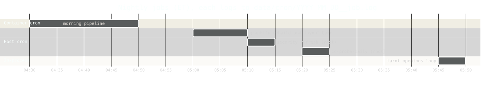

## 17. Memory is the scarce resource on this box

1967MB RAM + **5GB swap** (`/swapfile` 1G, prio -2, draining; `/swapfile3` 4G, `pri=10`; both in `/etc/fstab`). Swap is 2x RAM because spikes are whole processes: a WebKit launch is 200-400MB, every CLI subprocess (chat turn, title call) ~300MB, against ~650MB available at rest. `vm.swappiness` is left at the default 60. Retire the 1G file with `sudo swapoff /swapfile && sudo rm /swapfile` once near 0 — a swapoff must fit every live page, so do it while the 4G file has room.

### 17a. What the pressure actually is

Not the test suite (`conftest.py` launches ONE WebKit per pytest session) and not the containers. It is the **baseline**: interactive `claude` sessions (~400MB each) and tmux dominate; the app + sidecar are small beside them. (Per-process figures drift; measure with `free -m` / `ps`.)

### 17b. The OOM killer picks by badness score, not culprit

An uncapped spike shoots `dbus-daemon` or uvicorn's python rather than the cause; a capped one just fails. So:

- **Browser suites** run under `systemd-run --user --scope -p MemoryMax=700M` — `run_capped` in `scripts/pre-commit` (falls back to a bare run if `systemd-run` is unavailable), so an over-budget browser fails the commit instead of taking out the site.
- **graphify rebuild** capped at 600MB (`GRAPHIFY_REBUILD_MEMORY_LIMIT_MB=600`, exported in `scripts/graphify-daily.sh` and `~wai-root/.zshenv`); the layout bake under `MemoryMax=700M` too.
- **Ad-hoc WebKit/playwright runs**: wrap in `systemd-run --user --scope -p MemoryMax=...`; check strays with `pgrep -f '[M]iniBrowser'`.
- **A graphify rebuild that looks expensive: check `graphify-out` ownership first** (root-owned output made every run redo full work and die at the write).
- Check pressure: `free -m` (watch **Swap used**), `sudo dmesg -T | grep -i oom`.

### 17c. Every cron job writes where both sides can see it

`data/cron/YYYY-MM-DD__<job>.log` (`morning`, `graphify`, `security`, `ccprobe`, `tarotvoice`), shown on `/debug` via `GET /api/debug/cron`. **The data volume is the only filesystem both container and host see; a log nobody can see is how a nightly fails quietly for weeks.**

| Time (ET) | Job | Where it runs |
|-----------|-----|---------------|
| 04:30 | `morning_cron.sh` -> `POST /api/morning` | in-container, baked from `api/exec-fn.cron` into `/etc/cron.d/exec-fn` |
| 05:00 | `scripts/graphify-daily.sh` (as `wai-root`) | host `/etc/cron.d/exec-fn-graphify` |
| 05:10 | `api/scripts/security/refresh.py` (root; `flock -n /tmp/exec-fn-security.lock`; `SECURITY_OWNER_IP` in the cron file) | host `/etc/cron.d/exec-fn-security` |
| 05:20 | `scripts/cc-probe-daily.sh` (root) | host `/etc/cron.d/exec-fn-ccprobe` |
| 05:45 | `tarot/openings_loop.py` (`RUN_AT = (5, 45)`) | **not cron** — in-process loop; its `__tarotvoice.log` is the stamp |

- **One file per JOB, not per day** — the writers are different uids (container root, host root, host `wai-root`); whoever created a shared daily file would lock the others out.
- The host cron line that builds its own log path (security) `mkdir -p`s the dir and escapes the date `$(date +\%F)` — **a bare `%` is a newline to crontab**; the graphify and ccprobe scripts `mkdir` and stamp their own `LOG`.
- `morning_cron.sh` tees to that file and `/var/log/exec-fn.log` and reports **`${PIPESTATUS[0]}`, not `$?`** (through a pipe `$?` is `tee`'s status).
- `morning._prune_cron_logs` keeps 30 days (string compare on the filename).

### 17d. The nightly graphify rebuilds its own output

`scripts/graphify-daily.sh` (as `wai-root`, 05:00): rebuild (`_rebuild_code(force=True)`, 1800s alarm, RLIMIT_AS 600MB), then the **/graph layout bake** (`scripts/graph-layout.py` under `systemd-run --user --scope -p MemoryMax=700M`; cron has no session bus so the script exports `XDG_RUNTIME_DIR`; a bake failure is non-fatal). Sits between 04:30 morning and 05:10 security so they never contend. Guarded by `flock` on `/tmp/graphify-daily.lock` (graphify has its own too); logs to `data/cron/…__graphify.log`.

- **graphify-out is gitignored** (`/graphify-out/`): generated, served from disk, never committed or pushed. Before each rebuild the script copies `graph.html` to `graphify-out/.graph.html.prev`; if the rebuild writes no fresh `graph.html` the script logs FAILED, restores that copy (stale graph beats a 404), skips the bake and **exits 1**; it also logs viz headroom and warns within 10% of the ceiling.
- **graphify REFUSES to emit `graph.html` past a node ceiling (default 5000) and only logs a skip, exit 0** — so `/graph` 404s behind a "healthy" nightly. `GRAPHIFY_VIZ_NODE_LIMIT=8000` is exported in the script; **it must stay above the repo's node count**. The RLIMIT is the real guard: too big should die of `MemoryError` and log, not be skipped silently.
- **`.graphifyignore` must skip the trees `_GRAPH_DROP_PREFIXES` drops at serve time** (`api/data/`, `api/tarot/book/`, `nightfall-incident/nightfall-src/`; `web/vendor/` is covered by `**/vendor/`) — graphify does not read `.gitignore`, and runtime data (e.g. `spire-perflog/`) inflates the node count. Keep both lists in step.
- The per-commit path is off via `GRAPHIFY_SKIP_HOOK=1` in `~wai-root/.zshenv`, **not** by deleting `.git/hooks/post-commit` (untracked; `session-context.sh` reinstalls it). **Never a stash** (bind-mount outages).

History: [ARCHAEOLOGY.md §17](../archaeology/17-memory.md#17-memory-is-the-scarce-resource-on-this-box).

### 17e. The `--reload` poller

`uvicorn --reload` silently falls back to polling `StatReload` without `watchfiles`. Two fixes, both live:

1. **`tmpfs: /app/nightfall/nightfall-src`** in `docker-compose.yml` — an empty tmpfs masking the game's source tree inside the `./nightfall-incident` bind (Docker mounts shallowest-first, so it lands on top; host copy untouched, webpack still builds against it). Under the old StatReload poller its absence cost 44% of a core; under inotify it still keeps the watched-directory count down.
2. **`watchfiles`** in `api/requirements.in` (locked `watchfiles==1.2.0`) -> inotify backend, ~0% idle; it is also what makes `entrypoint.sh`'s `--reload-exclude 'apps/*/tests/*.py'` / `'apps/*/scripts/…'` globs take effect (§1e).

Traps: a bind mount cannot be partially excluded — masking a subpath with a deeper mount is the only lever (`.dockerignore` governs the build context, not runtime binds). `fs.inotify.max_user_watches` is **15,052**; a future mount that re-inflates the tree (363 directories after masking, as measured then) would exhaust it and fail more quietly than the poller did.
