## 18. The typewriter and the shared chat surfaces

Shared across `/mtg`, `/tarot` and the Exec panel (`/cc` folded into the panel): look = `chat-msg.css` (+ shell files), stream bubble + caret = `chat-dom.js` (`chatStreamDiv`, `chatCaret`), reveal = `typewriter.js`, voice = `voice-narrator.js` + `voice-ui.js` + `voice-util.js`, mic = `voice-input.js` (engine + `bindComposer`). **One copy cannot drift** — a copy is a fix you will forget to apply.



### 18a. Every chat surface reveals character by character

`web/typewriter.js`: per-character delay, punctuation is a beat (`twCharWeight`: `.`/`!`/`?` 850ms, `\n` 1100, `;` 620, `-`/`—` 480, `,`/`:` 420, ` ` 110, else `TW_BASE_MS` 65), divided by a speed multiplier.

| Surface | Speed | Why |
|---|---|---|
| `/tarot` (`tarot-stream.js`, `SPEED`) | 1.25 | a reading is paced to be listened to |
| `/mtg` (`MTG_TYPE_SPEED`), Exec panel (`EXEC_TYPE_SPEED`, `exec-stream.js`) | 5 | read for an answer; a typewriter that lags the eye is latency with a costume on (65ms char -> 13ms) |

### 18a-ii. With the voice on, the narrator sets the pace

Those speeds are the SILENT pace (`twGuess`). When narrating, **`twAudio`** keeps the per-character weights for shape but rescales the total to the measured utterance. Only the two surfaces that speak call it, `/tarot` and the Exec panel (`/mtg` has no voice and is `twGuess` only); they differ only in render target and fallback speed (`tarot-stream.js` binds it with `leadMs: 350`).

- **`leadMs`** (default 0; `/tarot` 350): reveal runs ahead of the voice by a CONSTANT offset, `(el + leadS) / dur` — not a multiplier (proportional lead finishes early). Only moves the target char, never the stall watchdogs.
- **Text buffers while a voice is coming**: `push()` on a narrating surface doesn't start a reveal; it starts when the utterance does (typing at 5 under a voice races the audio).
- **Syntax costs ZERO reveal time** (`twWeights`): jumped in one frame (18b) and `VoiceUtil.stripMarkdown` never speaks it.
- **Every failure path ends at the guessed pace** (a hung reveal freezes the page): dead controller (voice off, never unlocked, upstream gone) types immediately; `FIRST_AUDIO_MS` 12000 (first synth from a fully-off GPU box measured 10.3s, 2026-09-20); `STALL_MS` 2500 with `el` capped at what was buffered.
- A QUEUED utterance (`voice-narrator.js` queues so a monitor comment can't cut off a reply) takes the guessed pace.
- **Narration starts with the reveal, not after it**: in `execStreamResponse()` (`exec-stream.js`), `speakAndPace(text)` (calls `execVoice.speak`) sits BEFORE `await t.typer.done()` once the read loop ends. Safe because `speak()` is fire-and-forget. `addMsg()` (nudges, monitor) renders instantly and speaks immediately; a bubble closed mid-turn by a tool frame (`execBubbles.close`) is also settled and spoken at once, unpaced.

### 18b. Everything that is SYNTAX rather than prose is jumped

`twJump` order: table opening (line start only), fenced block, link tail, then block markers `#`/`>`/list/`---` (line start only), then inline: whole image `` and `***` `**` `__` `~~` `*` `_` `` ` `` `[` anywhere.

| Jump | Rule |
|---|---|
| `twLinkTail` — a link's `](url)` tail | waits for the closing paren; label is the only part read |
| `twTableHead` — a table's opening | header + separator revealed together, body rows type like prose; line start only; checked FIRST |
| `twFenceEnd` — a fenced block | jumped **whole, never typed**; while unclosed everything available is revealed at once |

### 18c. The waiting indicator is a solid blinking block

`#blinkcursor` / `#exec-bc` in chat-msg.css (the reader's `.reader-cursor` look). The old dot spans are `display: none`; the `blink` keyframes live in chat-msg.css. In the Exec panel the cursor **follows the work**: `park()` (`exec-stream.js`) re-attaches it to the last line until the turn ends.

### 18d. Reveal state contract

`tarot-stream.js` is `/tarot`'s binding of the shared engine (guessed / audio modes), not a second engine. **The state object is shared and mutable by contract** — caller appends to `buffered` and sets `serverDone`, the engine owns `displayed`. **Each surface must await the reveal before its settle pass** (markdown + SVG in the panel, rule-citation linkifying on `/mtg`) — settling mid-type prints the whole reply and types over it. Exec glue: `exec-stream.js` (`execTyper`: `push`/`speakAndPace`/`done`) and `exec-bubble-assets.js` (markdown).

### 18e. Three surfaces, one transcript look (four stacked files)



| File | Holds |
|---|---|
| `chat-msg.css` | the vocabulary: `.msg` roles + markers, markdown in a reply, blink cursor, composer, `.mic` states. **Deliberately position-free** (nothing fixed, no viewport sizing, no keyboard awareness) so it works in a sliding panel and a pinned terminal |
| `chat.css` | full-page shell only: non-scrolling body, `#terminal` pinned, `#input-bar` above the keyboard; composer MERGED into the scrollback |
| `chat-doc.css` | `/mtg`: document palette, full-width scrollback, `--kb-anchor` + `--input-h` terminal inset |
| `chat-reader.css` | `/tarot`: neon reader mood, `--lh-relaxed` over the dense default |

`chat-msg.css` is also injected on `/rd`+`/hq` by `exec-bubble-assets.js` (`chat-msg`, `voice-ui`, `exec-term`, `exec-bubble`, in that order) — **order is the cascade**.

- **One gutter**: marker (`>` reply · `$` Wai · `#` sys · `~` monitor · `+` tool) hangs in a fixed `1ch` column (`--chat-gutter`, gap `--chat-gutter-gap`). A surface building its own marker ELEMENT (the panel's replay button) is caught by `.msg:has(> .msg-mark)::before { content: none }`, which **must sit AFTER the role markers** (same specificity, source order decides; above them every reply opens `> >`). Markerless lines (tool output, thinking, probe) indent by `--chat-indent`.
- **Density**: `--lh-tight` (1.2, chrome.css), `--space-1` between messages, `--fs-2xs` sys lines at alpha **0.45**.
- **Headless WebKit won't composite the panel's `backdrop-filter`** into a screenshot — neutralise it (`backdrop-filter:none`) when verifying; a blank panel is not a regression.

### 18f. If Exec names a link, the link is tappable

Both halves required:

| Half | Rule | Where |
|---|---|---|
| Prompt | Wherever Exec can SEE a URL (card `NOTES:`, KNOWN CONTEXT) it writes a markdown link `[the EI login](https://…)`. Never a naked phrase (*the link*) and **never a bare URL** (every surface narrates; the label is spoken). No URL in hand -> name it in words, invent nothing | `chat._CHAT_STATIC_PREFIX` (byte-stable cached block), `nudge_llm._TONE` |
| Render | `mdHtml()` parses via a `marked.Renderer` whose `link` emits `target="_blank" rel="noopener"` over a `URL()`-checked href (unusable scheme keeps the label, drops the anchor). New tab because following in place tears down the board + panel mid-nudge | `web/exec-bubble-assets.js` |

- **Every `marked.parse` goes through DOMPurify** (`mdHtml` keeps `target`; `tarot-view.js renderText`, `mtg.js renderText`). ```` ```svg ```` blocks stay escaped code until `exec-svg.js` draws them through its allowlist.
- **Libs are vendored** in `web/vendor/` (marked 15.0.12, DOMPurify 3.4.17, Sortable 1.15.2, vis-network 9.1.9): bump by downloading the new pinned file, never by pointing at a CDN. Ruffle (`/zombo`) stays on the CDN, pinned by version AND SRI hash, `allowScriptAccess: false`.
- Link colour is repeated as `.msg.probe a` in exec-bubble.css (`probe` is a panel-only role; chat-msg.css colours `.msg.assistant a` alone).
- No parser change needed downstream: `twJump` jumps the `](url)` tail, `stripMarkdown` reduces links to labels, the choice-row regex needs a `|`.

History: [ARCHAEOLOGY.md §18](../archaeology/18-typewriter-chat.md).

---

