## 19. `/zombo` — a secret page with one third-party dependency

The real 1999 zombo.com Flash intro: `web/zombo-flash.js` loads [Ruffle](https://ruffle.rs) from jsDelivr and points it at the `.swf` on **welcometozombo.com** ([Jonty/zombocom](https://github.com/Jonty/zombocom)). **Hotlinked, never vendored** (host sends `access-control-allow-origin: *`); the cost is a dependency on somebody else's server. If the movie can't mount the page says so; no imitation.

**Unlinked on purpose** (no `_NAV_*` entry, no landing spoke) but **unlisted is not a tier**: `guest_protected` (Turnstile), in `_GUEST_NEXT_ALLOWED`, the 401 handler's guest prefix tuple, and `tests/test_smoke.py` `GUEST_PAGES`. `api/routes_zombo.py`, bare shell (no nav, no CRT over a white Flash intro).

### Load-path traps

1. `inrozxa.swf` is a 7.9KB LOADER pulling the movie by a RELATIVE path: without Ruffle's `base` it asks wai-lau.net for `/welcomeclip.swf` (404, blank white 1360-frame movie while `load()` resolves).
2. `load()` resolves BEFORE `player.metadata` exists: hand over on the **`loadedmetadata` event**, never the promise or a timer.
3. The HEAD probe runs FIRST, on the **clip** not the loader (loader outliving the movie is trap 1), so a dead upstream costs one request, not ~1MB WASM.

### The outbound link is rewritten in the bytes

The one clickable link ("sign up for the newzletter") lives in the LOADER swf as a bare `ActionGetURL` to `http://www.zombo.com/join1.htm` with an empty target. `zbPatchLink` (zombo-flash.js) replaces it with `https://wai-lau.net/#fromzombo` **before Ruffle sees the file**: Ruffle uses `location.assign` on an empty target and every `Location` member is `[LegacyUnforgeable]`, so it can't be intercepted. **Same length (30 bytes) is the whole trick** — the file is uncompressed (`FWS`), so no tag/`DoAction`/file-length header changes. `zbFetchLoader()` GETs the loader, splices, `player.load({data, swfFileName, base})`; a data load drops Ruffle's `swfUrl`, so `base` is the ONLY thing resolving the relative pull. Any failure leaves `zbSwfData` null and Ruffle streams the original by URL. Nothing of theirs is stored.

### The page itself

- **Before the click**: white paper + `#zb-begin` (*click Anywhere to* / *Begin the.experience*, `--font-mono`, one `` per char). Colour/jitter are **classes from a running index** in `zbTint()` (`.zb-h0..8`, `.zb-j0..4`), never `:nth-child` (a ` ` is an element child, and word wrappers un-sibling the spans). Hue order = the wordmark's own (red, orange, blue, violet, cyan, blue, orange, green, blue). Each word wrapped (`.zb-w`, `nowrap`) since chars are `inline-block`.
- Ruffle `autoplay: 'off'`, `unmuteOverlay: 'hidden'`; `zbStart()` does `play()` + `unmuteAudio()` on the one gesture. A click before mount is remembered (`zbClicked`), the line goes **blank** (no status wording: downloading and missing look the same), `zbOnPlayerReady()` spends it.
- **Pre-click hide is `opacity`** (not `visibility`/`display:none`): Ruffle's overlay is in shadow DOM and sets `visibility: visible` on itself; the player measures against its real box.
- **Cross-fade, tuned together**: movie fades up over **3.5s** (`#zb-flash`), line out over **2.5s** (`.zb-begin`). The overlay must stay the shorter.
- **Sizing**: movie is 550x400, never cropped. `--zb-mh = min(100dvh, calc(100vw * 8 / 11))` (`vh` fallback under `@supports`), pinned to the TOP; the player is `min(100%, --zb-mh * 11 / 8)` wide, centred. `<ruffle-player>` needs `display: block`; sizing rule is `#zb-flash > :not(.zb-bar)` (id specificity otherwise sizes the bars as the movie).
- **Pillars** are sampled from the movie: `zbPaintBars()` stretches `ZB_SAMPLE` (6) edge columns across each bar every frame, read from Ruffle's shadow-root canvas.
- The gap inside the `.swf` between wordmark and loader is baked in.

History: [ARCHAEOLOGY.md §19](../archaeology/19-zombo.md).

---

