## 20. Pages and subsystems without a section of their own

### 20a. Auth tiers (cookies, guest set)

- `session` (`POST /login`, `API_KEY`) = full. `guest_session` (`POST /guest`, Cloudflare Turnstile via `auth.verify_turnstile`, secret `TURNSTILE_SECRET`) = guest set: `/mtg`, `/tarot`, `/nightfall`, `/graph`, `/UI`, `/security`, `/printer` (read-only), `/zombo` (unlinked), `/noodle`, `/spire` (`/aspira` 301s to it). Pages only, never control routes. Open (no cookie): the landing, `/recruiter`, the login/guest pages and `/noodle/<slug>` polls.
- Guest token = `sha256("guest:"+TURNSTILE_SECRET)` (`auth.GUEST_SESSION_TOKEN`); `require_guest_auth` takes only `session`/`guest_session` cookies + the admin bearer, no guest bearer. `GET /guest` renders the widget and auto-submits on solve (`web/guest_login.js` `onGuestVerified`); `GET /guest-login` 302s to `/guest`.
- Both cookies `HttpOnly`, `SameSite=Lax`, `Secure`, **`Max-Age` 400 days** (`auth.SESSION_MAX_AGE`). Tokens are `sha256` of env values (`session:`+`API_KEY`, `guest:`+`TURNSTILE_SECRET`), so restart-stable; revocation is rotating the secret: `API_KEY` kills owner sessions only, `TURNSTILE_SECRET` kills guest sessions only.
- **Three places that must stay in sync** or a gated page bounces guests to the admin login: `_GUEST_NEXT_ALLOWED` (routes_views.py; other `next` values clamp to `/mtg`), the 401 handler's prefix tuple in `main.py` (`/mtg /tarot /hosaka /graph /UI /security /nightfall /zombo /aspira /spire`, with `/printer` and `/noodle` matched EXACTLY so owner-only sub-paths still go to `/login`), and the router tiers (`public` / `protected` / `guest_protected`, `routers.py`).
- The owner login form (`web/index.html`) carries a `username` input for password managers.
- **Security headers, every response** (`api/security_headers.py`): `Strict-Transport-Security: max-age=31536000` (no includeSubDomains/preload), `X-Frame-Options: SAMEORIGIN` (printer iframe), `X-Content-Type-Options: nosniff`; a response that sets its own value keeps it. `CacheControlMiddleware` doesn't overwrite a page's `no-store`. Pinned by `tests/test_smoke.py::test_every_response_carries_the_security_headers`.

### 20b. `/hq`

7-day planning (`scheduled_day`). Today's timeline = tall LEFT column; other 6 days = full-width **rows** (`buildBoard`/`dayRowHtml`), vertical day-label spine + horizontal list (`.hq-list-row`, card `flex-basis` 1/3 so >=3 show, `--fs-2xs`). Rows region reserves `--nav-h`.

- Three reload paths (`hq-board.js`), all gated by `hqCanReload()` = not dragging, no `saveTimer`, no `_hqSaving`: monitor SSE `{cards_changed}` -> `exec:cards-changed` -> `load(weekStart)`; SSE re-open (`exec-bubble.js` `src.onopen` after the first); wake after >30s hidden or bfcache `pageshow` -> `load(null)` (re-anchors to logical-today after the 4:30 rollover).
- **`flushUpdates()` must null `saveTimer` as its first statement** (flip `_hqSaving` around the PATCH) or every later reload is silently skipped. Drags save `{id, scheduled_day, order}` rows via `PATCH /api/hq` (`hq.bulk_update_scheduled_days`); card-edit and task-done saves go through `PATCH /api/rd` (§20h).
- Board GET is `cache: 'no-store'` (iOS serves a woken tab its stale copy).
- Today timeline: **16h view window** (`TL_VIEW_MIN`, hq-core.js) zoomed to fill, rest scrolls.
- Breakdown card = **spine view** (`createGroup`, hq-groups.js): thin spine (tap -> dialog, drag -> move group) + the CURRENT step (`currentStep`) stretched to the card's whole time (`renderTaskBlock`), DONE steps greyed (`.dir-sub.done`) above it, future steps hidden. Tapping a task toggles done (`wireTaskDone`, click-only). Spine height spans ALL steps.

### 20c. `/debug`

Profile notes + cron archive + activity log + mtg log + saved tarot readings, on the shared **document theme** (chrome.css `.doc-card` / `.doc-h2` / `.doc-chip`, raw palette tokens, no `--doc-*` layer). `/debug`, `/UI`, `/security` use it (also reused in `rd.css`/`printer.css`); `/mtg` has its own palette in `chat-doc.css`, `/tarot` the reader mood; `/rd`, `/hq` stay dense; `/recruiter` has its own `--cv-*` palette. Moltbook plumbing outside the page is deliberately kept (`morning.py` log rotation, `graph_scrub._drop_graph_moltbook_nodes`).

### 20d. `/security`

**Guest-gated.** One long page from `data/security.json` via `security.py` `render_security()` (inline-SVG charts, `_render_page("security", …, guest=…)`). Top to bottom: origin map (hero; `dotmap(zoom=1.2)`, dot size = volume, bright = SSH-login bots, dim = web scanners), scanner traffic by country | networks hosting the bots, common endpoints (top 404 probes). **No owner-identifying data** (no owner IP, attacker-IP table, usernames/bans). **No UA-based "human vs bot" split** (bots spoof UAs, the "human" bucket inverts the point). The JSON is written OUT-OF-BAND by the **host** cron `api/scripts/security/refresh.py` (root, outside the container; parses `/var/log/{auth,nginx/access,fail2ban}.log*`, geolocates via ip-api.com cached in `data/geo_cache.json`, atomic write, gitignored); `SECURITY_OWNER_IP` feeds only owner-hit accounting. Missing JSON -> "not generated yet" (the code string says the cron refreshes "hourly"; it is daily 05:10 — stale text in `security.py:104`). Chart colours: green shades only (`G`/`GDIM`/`GHI`, concrete `hsl` since SVG `fill=` can't resolve `var()`); panels FLAT (`.spanel`, the page is one `.doc-card`). Nav icon `sentinel`.

### 20e. `/UI` and `/api/ui/usage`

`/UI` — **Guest-gated**, case-sensitive, read-only palette + scale moodboard (edit tokens in chrome.css). Colour tables two per row (hue-ordered, neutrals last, 4 columns padded; card colours = wisp/idea/plan/commitment, non-card `-hsl` = used alpha steps; same-HSL tokens merge, max 4 variations; `SIZE_ALPHA` wisp .15 / idea .25 / plan .8 / commitment 1 in `web/ui.js`). Scale tokens render in the same table format by family (radius, font-family/size/weight/tracking, line-height, blur); spacing, z-layers, `--doc-*` are not shown. One `▼` usage toggle per card (`
`, `.clr-usedet`). Admin cookie -> full nav, else guest nav.

`GET /api/ui/usage` — **Public**. `{counts, alphas, alpha_counts, sites}`: `var(--X)` counts, used alphas per `-hsl` token, per-alpha counts, and `sites` (`{token: {α: {site-label: n}}}`, site = nearest CSS selector else filename) across templates, web assets and **all `api/*.py`** (parent and app-submodule dirs alike) (inline CSS in Python would otherwise misflag tokens unused); chrome.css `:root` excluded; bare `hsl(var(--X-hsl))` = α 1.

### 20f. `/nightfall` save slots

Guest-or-full. **Saves are scoped PER CALLER** (`gamesave_store.py`): owner at `data/gamesave_<slot>.json` (permanent, never swept); each guest under `data/gamesave_guests/`, keyed to an opaque `nf_save` cookie (HttpOnly/Secure/Lax, 400-day) minted on the PAGE response (not lazily — `wai-save-sync.js` fires three slot POSTs in parallel). Bearer-key callers count as the owner (`save_identity`). Path component is `sha256(id)[:32]`, so a hostile cookie can't traverse or hit an owner file. Guest saves untouched 90 days are swept on a write counter (`_SWEEP_EVERY` 200, `routes_nightfall.py`, `sweep_stale_guest_saves`); POST bodies cap 64KB -> 413. Pinned by `tests/test_gamesave_store.py`.

### 20g. `/recruiter`

**Public**, static résumé, built from the bare shell (`recruiter_page()` in routes_views.py, `templates/recruiter.html`, `web/recruiter.css`), no nav/fx in light mode. **Light** = plain professional résumé: `--font-doc`, ink headings via page-local `--cv-accent`, plain bullets, skills as a list, no animation; CTA -> the static `web/wai-lau-resume.pdf` download. **Dark toggle** (`#cv-theme`, `recruiter.js`, persisted in localStorage `cv-theme`) flips `html.cv-dark` (token overrides), injects the full 5-layer CRT stack in `_CRT_FX` order (bg -> lines -> blur -> crt -> scan), and starts the summary type-out (dark-only; torn down on switch back). Linked from the bottom nav (`cv`, `data-file` icon) and the landing.

### 20h. `PATCH /api/rd`

`?source=` query param (`rd` default / `Exec` / `hq`; `dirs` is a legacy label in `monitor._SRC_LABELS`). Atomic write. **Merge-by-id, NOT whole-array replace** (`helpers._merge_cards`): clients send only touched cards with only the fields they own (rd.js `{id,column,order}`; card-dialog the edited card incl. `nudge`; hq timeline the mutated card); the server shallow-merges onto disk by id, so omitted fields (esp. server-owned `card["nudge"]`) survive. A sent `nudge` replaces wholesale. Unknown id = new card. Side-effects run on the merged list: `_apply_patch_schedule` (routes_api.py: hq<->rd moves; re-pin `dir_start_min` to `event_time - prep` via `scheduler.timed_start_min` when a timed due_date or `prep_time` changes, a plain drag is left alone), recurring revival on archived `recur_type` cards, monitor debounce if significant.

### 20i. The card dialog

**The dialog NEVER scrolls itself** (`web/card-dialog.js`, loaded by rd.html + hq.html): `.cd-box` flex column `overflow:hidden`, `.cd-body` the only scroller, `.cd-actions` a pinned footer. Footer stays on screen via: overlay sized `dvh` with `vh` fallback (iOS `vh` = LARGE viewport; check **430x700** too); overlay pads by `var(--nav-h, 56px)` (nav is at `--z-top` over z-index 50); `body:has(.cd-ov.open) #exec-bubble` hidden. **Scrollbars are SILVER** (`--gray-hsl / 0.45` on `.cd-body`, notes `textarea`, card-graph `.cg-scroll`) because the dialog is tinted to the card colour; Firefox needs `.cd-box, .cd-box *` inside the same `@supports not selector(::-webkit-scrollbar)` guard chrome.css uses. CSS lives in a JS template literal — **no backticks in its comments**.

---

